# 9個觀音＆新屋景點推薦・全台唯一的客庄海洋聚落，跟著海客漁夫體驗石滬的一日漫遊

- 編號：D-002（urls.csv：page_004）
- 原始網址：https://romantichakka.com/hakkatours/TourExpert?a=1202&fromlist=1&id=1624
- 最終網址（轉址後）：https://romantichakka.hakka.gov.tw/hakkatours/TourExpert?a=1202&fromlist=1&id=1624
- 網站：romantichakka.hakka.gov.tw（旅遊／飲食媒體（客委會「客庄小旅行」））
- 作者：旅行圖中許傑（發布單位：客家委員會）
- 發表日期：2023-10-23
- 取得時間：2026-11-05T13:01:14+08:00
- 擷取方式：site_rule[romantichakka.hakka.gov.tw]: article.page-article
- 資料性質：**媒體／部落格內容，尚未經官方資料查核**（查核結果見 analysis/fact_check_D.md）

---

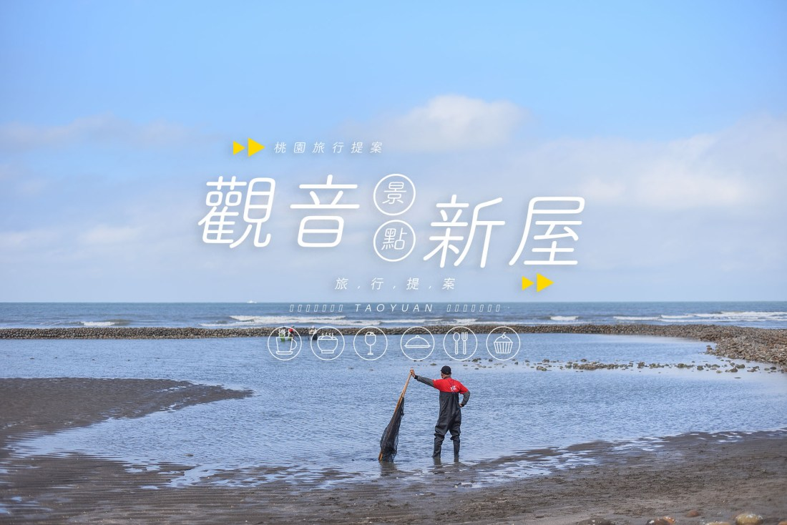

*圖說：桃園新屋、觀音｜圖片來源：未標示（文章未註明圖片來源）*

桃園新屋、觀音等沿海鄉鎮區有著不少客家聚落，聚落濱海而居、農漁兼作，發展出與台灣其他鄉鎮客庄有所不同的生活樣貌，像有「牽罟」、「石滬」及「吹海螺」等百年捕魚文化，是台灣相當少見的「海洋客家文化」。這次旅行就讓我們從桃園海岸線展開，走進觀音與新屋沿海風景，探索防風林、體驗百年石滬捕魚、品嚐手作鹹醢飯，再去乘坐大王蓮、草漯沙丘看夕陽，展開一段深度體驗的桃園海客漁夫一日漁事生活。

#### 新屋深圳石滬群：新屋海客漁夫體驗

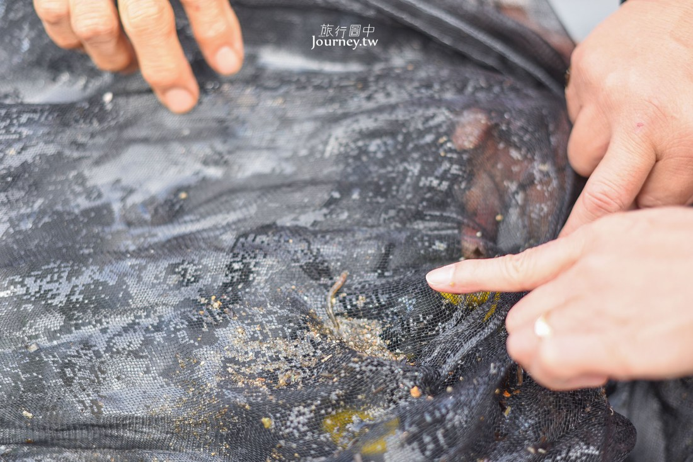

*圖說：漁夫體驗｜圖片來源：未標示（文章未註明圖片來源）*

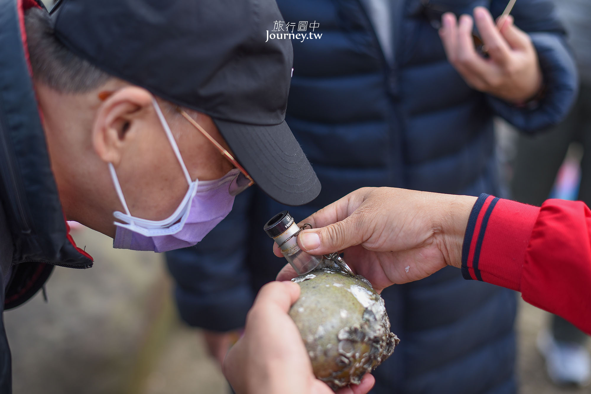

*圖說：漁夫體驗｜圖片來源：未標示（文章未註明圖片來源）*

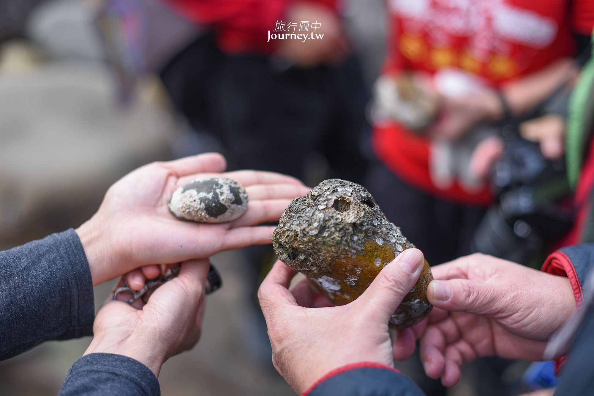

*圖說：漁夫體驗｜圖片來源：未標示（文章未註明圖片來源）*

在過去捕魚技術尚未像現在如此多元且發達時，祖先運用智慧，利用地形及潮汐發展出了獨特的石滬捕魚文化。運用天然地形，再以卵石堆砌成一條海上長城，魚群會隨著漲潮游入石滬中，待潮水退去後，小魚會從石縫中游出，體型較大的魚種就會自然被困在石滬中。因石滬捕魚漁獲量無法固定，加上需要長時間等待潮汐變換、石滬又會因風浪而損毀需要經常修補，現在已經鮮少有人會使用石滬捕魚了。

「新屋深圳石滬群」在當地新屋區愛鄉協會與地方人士的維護修繕下，成為台灣本島目前石滬保存最完好的一區，也是旅客體驗石滬捕魚的主要場地。由於石滬捕撈漁獲需要看潮汐，在岸上換上青蛙裝後，在老師的講解中展開「海客漁夫職前訓練」，包含如何使用圍網、兩人如何同心協力在大海中抓魚等等，看似簡單的動作，實際做起來真的很不容易！

#### 新屋石滬故事館：警察哨所躍升變成石滬故事的舞台

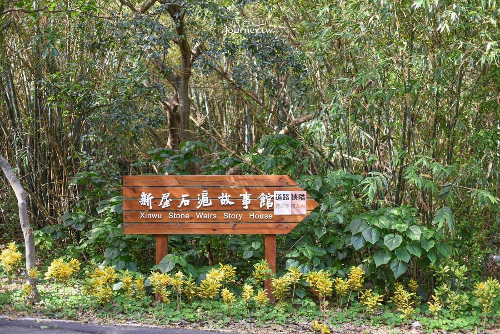

*圖說：新屋石滬故事館｜圖片來源：未標示（文章未註明圖片來源）*

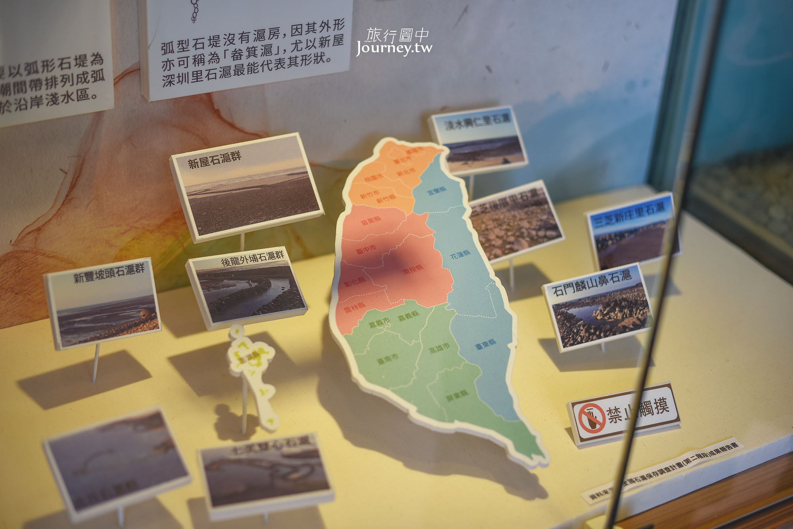

*圖說：新屋石滬故事館 陳列｜圖片來源：未標示（文章未註明圖片來源）*

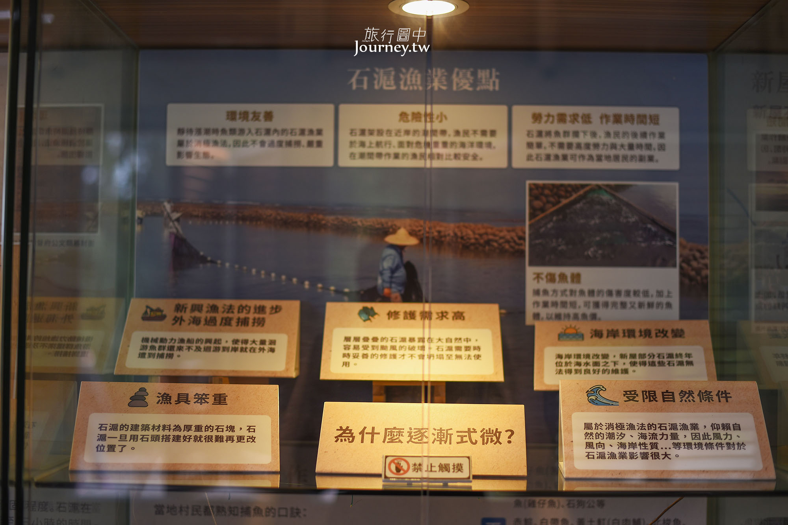

*圖說：新屋石滬故事館 資料｜圖片來源：未標示（文章未註明圖片來源）*

在臺灣沿海地區也有著不少石滬，只是時間無情更迭，在老一輩離世後缺乏年輕人繼承，缺乏效益又無人傳承下而逐漸消失。新屋石滬故事館是早期的警察哨所，現在經過重新整修後，委託「新屋愛鄉協會」經營管理，館內除了推廣海岸環境教育及新屋生態環境外，也作為旅客騎單車沿著新屋綠色隧道來此的休憩中點站，提供新屋石滬靜態展覽及教室使用。

#### 景點資訊

#### 桃園、新屋景點｜新屋石滬故事館

- 地址｜桃園市新屋區觀海路一段2180巷70號

- 開放時間｜09：00－17：00（每周二、三公休）免費參觀

- 官方網站｜點此前往

#### 海洋客家休閒農業區遊客服務中心：體驗千人牽罟，築石塭、編織漁網

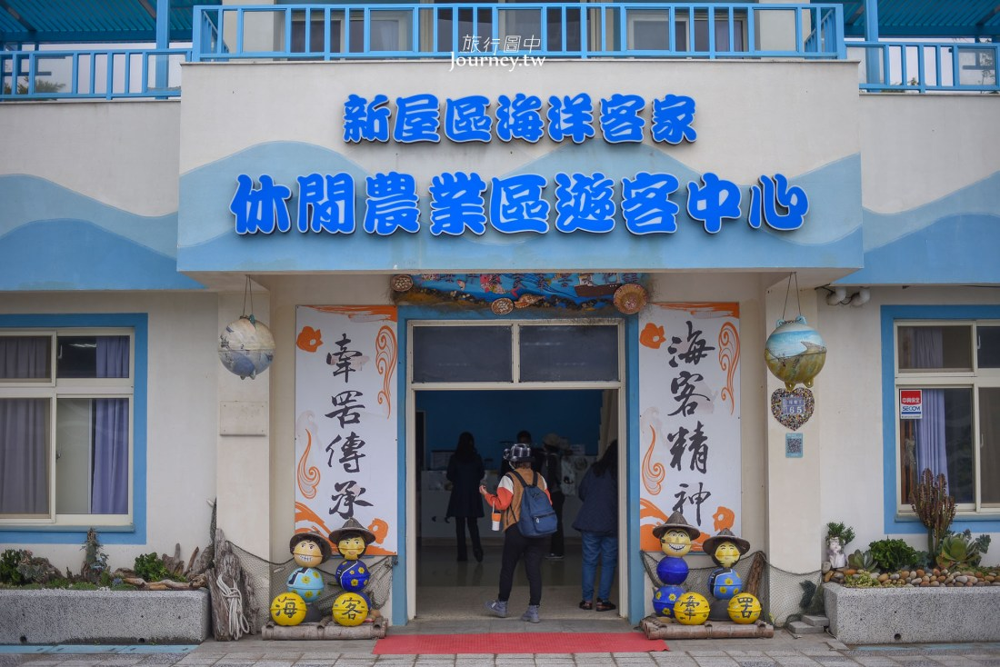

*圖說：海洋客家休閒農業區遊客服務中心｜圖片來源：未標示（文章未註明圖片來源）*

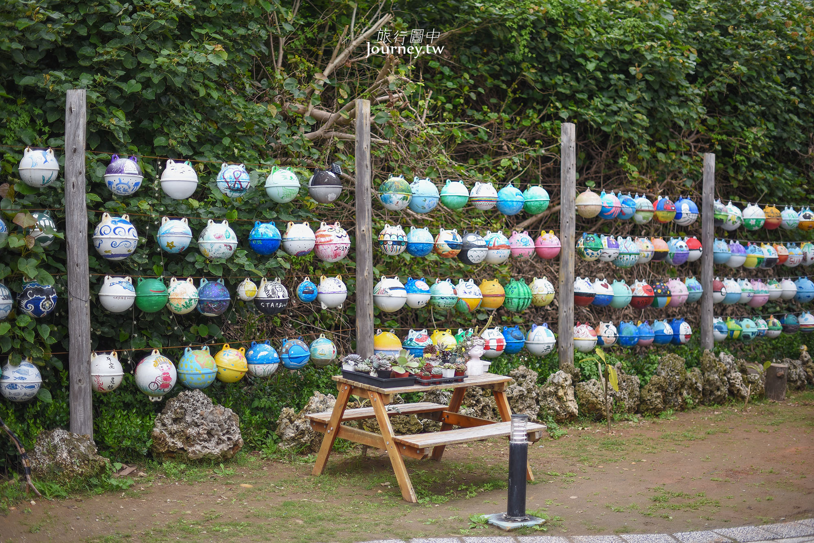

*圖說：海洋客家休閒農業區遊客服務中心 裝置藝術｜圖片來源：未標示（文章未註明圖片來源）*

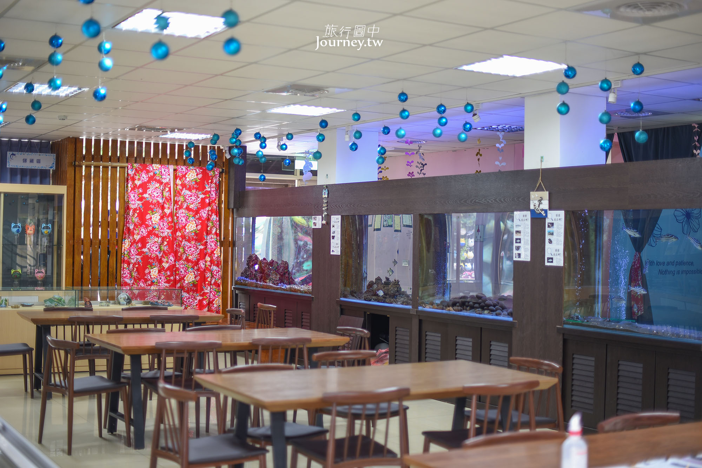

*圖說：海洋客家休閒農業區遊客服務中心 內部｜圖片來源：未標示（文章未註明圖片來源）*

「海洋客家休閒農業區遊客服務中心」是台灣首座海洋客家「牽罟文化館」，場館原是軍方的海防基地，軍方逐漸撤離後，閒置的場域在市政府爭取下，改造轉型為提供旅客到新屋綠色隧道旅遊時的單車休息站。除了有咖啡、輕食提供旅客休憩的餐飲空間外，也展示牽罟歷史照片、捕魚器具及相關農漁珍貴文物，致力將海客文化的技藝透過文字、圖片等方式傳承及保存下來，每年也會配合活動不定期舉辦千人牽罟、築石塭、編織漁網等活動。而牽罟文化館旁的防風林步道別有洞天，防風林不只是用來固沙擋風用，也間接孕育了一片自然生態，跟著導覽員走進防風林步道認識各種濱海植物，也從植物中了解環境保育的重要性。

#### 景點資訊

#### 桃園、新屋景點｜海洋客家牽罟文化館（好客莊園）

- 地址｜桃園市新屋區觀海路二段278號

- 開放時間｜6~9月 週三~週一09：00－17：30 \ 10~5月 週三~週一10：00－17：00

- 週二公休(依照月份而有不同時段時間開放，請依官方公告為主。)

- 官方網站｜點此前往

#### 永安海螺文化體驗園區・桃園四大新場館！白海螺建築線條微美蔓延

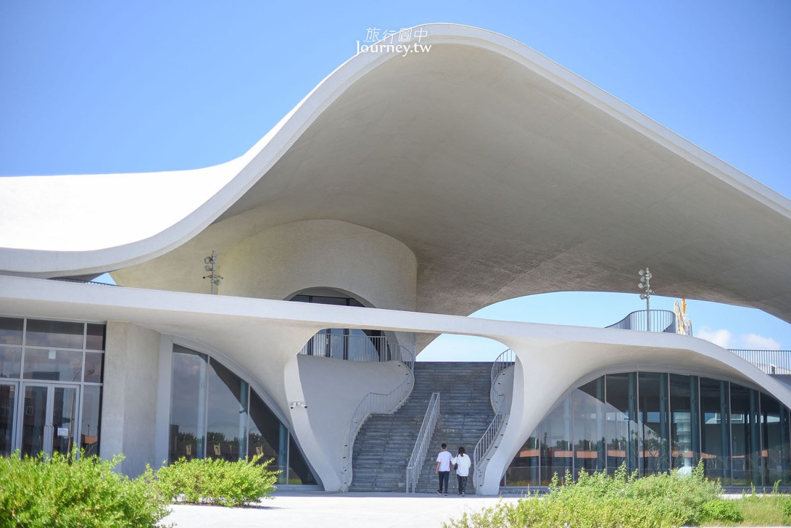

*圖說：永安海螺文化體驗園區｜圖片來源：未標示（文章未註明圖片來源）*

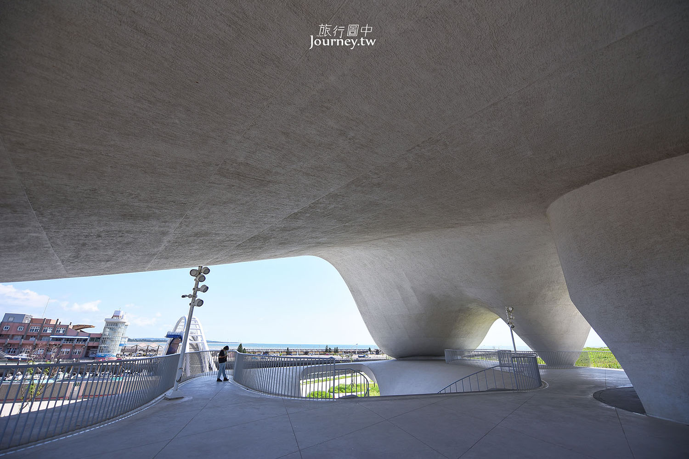

*圖說：永安海螺文化體驗園區 不同角度｜圖片來源：未標示（文章未註明圖片來源）*

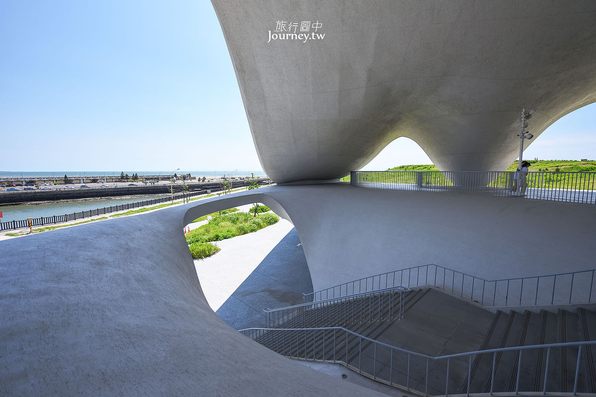

*圖說：永安海螺文化體驗園區 內部｜圖片來源：未標示（文章未註明圖片來源）*

「永安海螺文化體驗園區」是台灣行政院前瞻計畫補助桃園的四大重點場館之一，另三座場館分別是、1895乙未保台紀念公園、桃園北區客家會館及台灣客家茶文化館。在永安海螺文化體驗園區啟用後，將成為桃園海岸線的樞紐，從永安漁港往南北延伸，串連竹圍漁港、許厝港濕地、草漯沙丘、白沙岬燈塔、新屋石滬、觀新藻礁、綠色走廊及新屋農博環境教育園區等桃園濱海觀光景點。旅客來到永安海螺文化體驗園區，透過館中的介紹可以認識桃園濱海生態、環境及新屋的「海客文化（海洋客家文化）」，更全方位且深度認識桃園。

#### 景點資訊

#### 桃園、新屋景點｜永安海螺文化體驗園區

- 地址｜桃園市新屋區新港路85號

- 開放時間｜09：00－17：00（每周一公休）

- 官方網站｜點此前往

#### 向陽農場：北台灣最大的向日葵主題農場

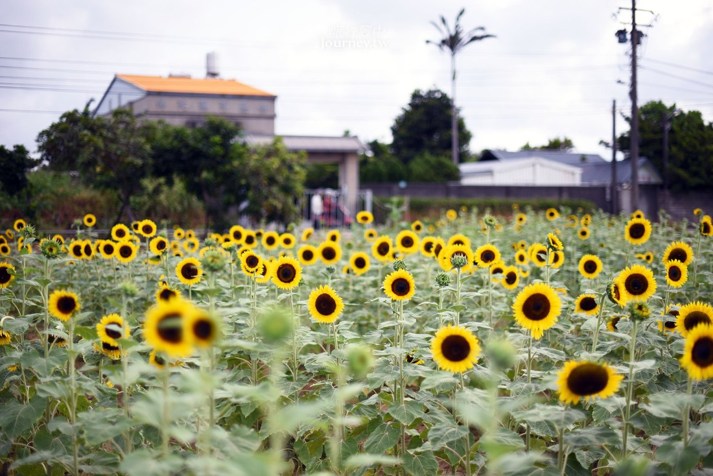

*圖說：向陽農場｜圖片來源：未標示（文章未註明圖片來源）*

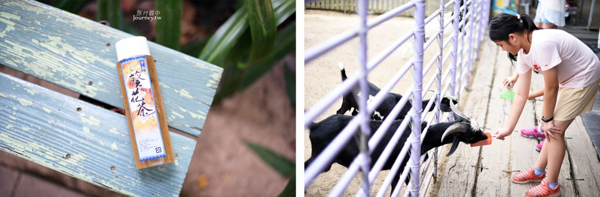

*圖說：向陽農場 不同角度｜圖片來源：未標示（文章未註明圖片來源）*

向陽農場過去曾吸引許多偶像劇來此地拍攝，成為桃園著名的花海農場，不僅是北台灣最大的向日葵主題農場，更是桃園老字號的農場。還記得高中時期假日最喜歡和朋友從中壢車站搭公車到向陽農場烤肉和拍照，因園區中廣泛種植大面積的向日葵花海，還會因季節更換花卉，有百日菊、百合花及薰衣草，不管什麼季節來，都讓人有美麗的花海可以拍攝。數年過去，與家人再訪向陽農場，沒想到農場的規模更龐大了，不僅設有野餐區和烤肉區、婚宴會廳，還有户外及室内的活動專區，假日吸引了許多家長帶著小朋友前來踏青遊樂，更可以吃到許多以向日葵、觀音蓮花製成的美食，有葵瓜子、布丁、蓮子酥、蓮花脆餅等等。不過園區的向日葵品種雖然還是很多，但整體花海的規模也不如以往了。

#### 景點資訊

#### 桃園、觀音景點｜向陽農場

- 地址｜桃園市觀音區藍埔里11鄰52號

- 開放時間｜09：00－18：00（每週一休園）

- 門票資訊｜入園清潔費$100，消費可抵

- 官方網站｜點此前往

#### 白沙岬燈塔：原來桃園也有一座百年燈塔

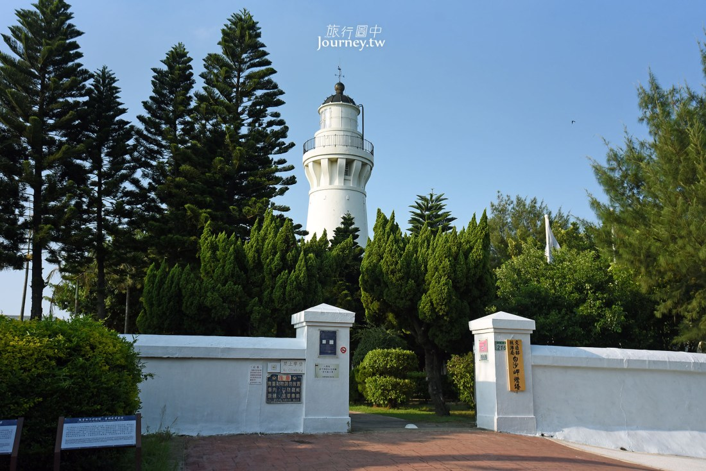

*圖說：白沙岬燈塔｜圖片來源：未標示（文章未註明圖片來源）*

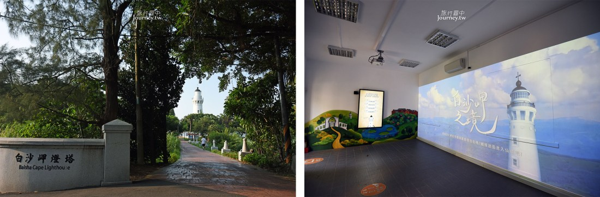

*圖說：白沙岬燈塔 不同角度｜圖片來源：未標示（文章未註明圖片來源）*

落成於西元1901年的白沙岬燈塔守護著桃園外海，已有百年時光，圓形燈塔高約37公尺，是台灣唯一使用紅磚與石頭建造而成，燈塔園區中設有一間導覽室，結合步道及公園，免費開放讓遊客就近參觀，雖然不比台灣其他燈塔來的知名，卻是桃園少有的燈塔，可以結合周邊的觀音濱海遊憩區順遊。

#### 景點資訊

#### 桃園、觀音景點｜白沙岬燈塔

- 地址｜桃園市觀音區光明路216號

- 開放時間｜09：00－17：00（每週一休園）

#### 蓮荷園休閒農場：坐上大王蓮的奇幻漂浮

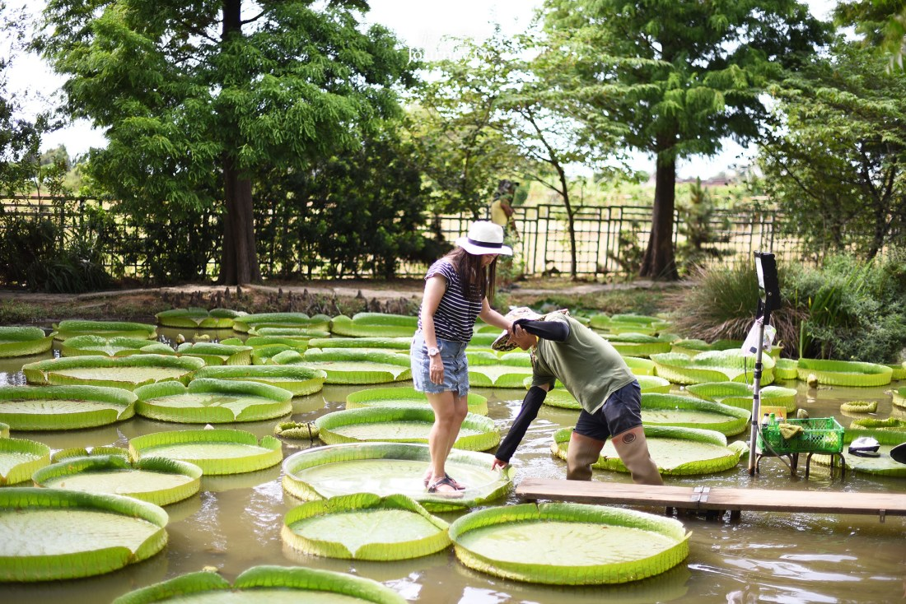

*圖說：蓮荷園休閒農場｜圖片來源：未標示（文章未註明圖片來源）*

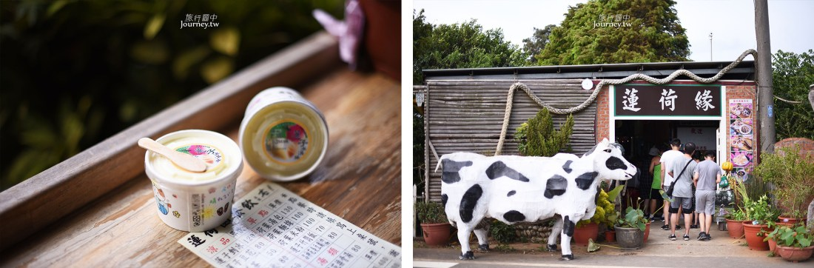

*圖說：蓮荷園休閒農場 不同角度｜圖片來源：未標示（文章未註明圖片來源）*

蓮荷園休閒農場以種植大王蓮而聞名，除了有著名的大王蓮可以乘坐拍照之外，園區內也廣泛種植各種蓮花與荷花品種，許多品種非常罕見，對於喜歡蓮花、荷花的朋友來說，宛如走進了「蓮荷百科全書」般，大開眼界。在蓮荷開花的時節，更讓人快門按個不同。除賞花之外，園區興建許多網美裝置藝術設施供人拍照打卡，也有以蓮花、蓮子、蓮藕為主題的特色餐點，有清涼的蓮子豆花、蓮子霜淇淋、冰淇淋、剉冰，還有荷葉麵線、荷葉飯等等，最特別的莫過於炸的外酥內軟的「洛神花臭豆腐」，料理種類非常的豐富。

#### 景點資訊

#### 桃園、觀音景點｜蓮荷園休閒農場

- 地址｜桃園市觀音區金華路690號

開放時間｜

- 5月開始 08：30－17：30，週二公休

- 6月-9月花季期08：30－18：00，週二公休

- 12月-隔年4月只開放團體預約(依照月份而有不同時段時間開放，請依官方公告為主。)

- 門票資訊｜入園需要收取門票（不可抵消費）

- 官方網站｜點此前往

#### 水之丘主題公園：這溜滑梯太猛！體驗從三樓高滑落的極限快感

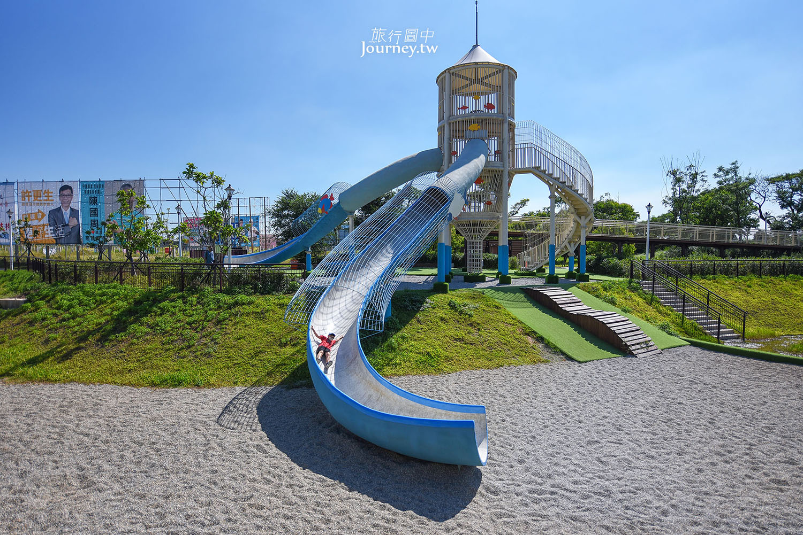

*圖說：水之丘主題公園｜圖片來源：未標示（文章未註明圖片來源）*

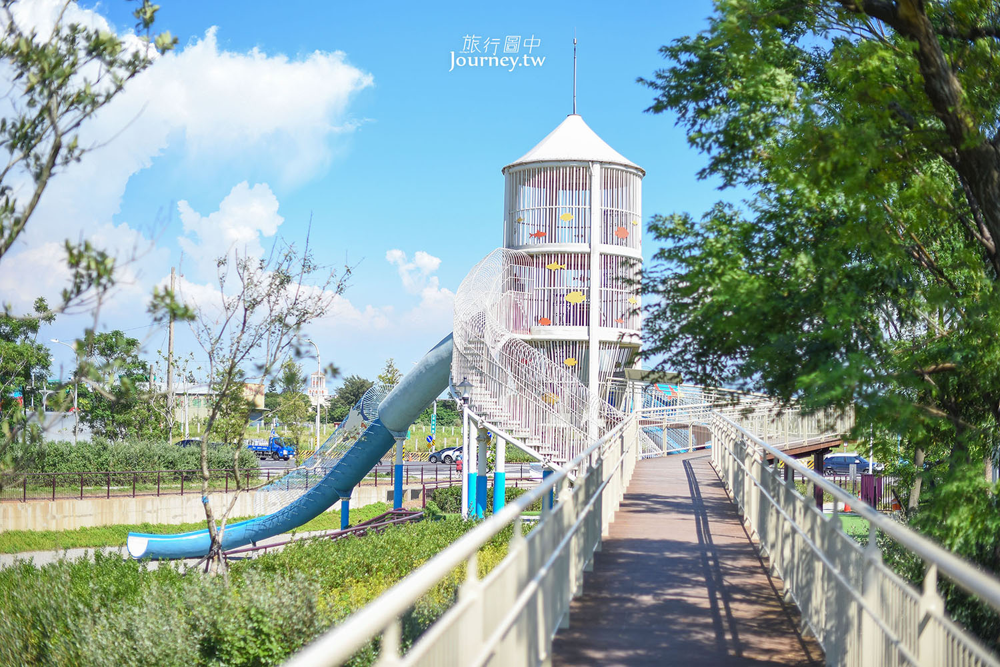

*圖說：水之丘主題公園 不同角度｜圖片來源：未標示（文章未註明圖片來源）*

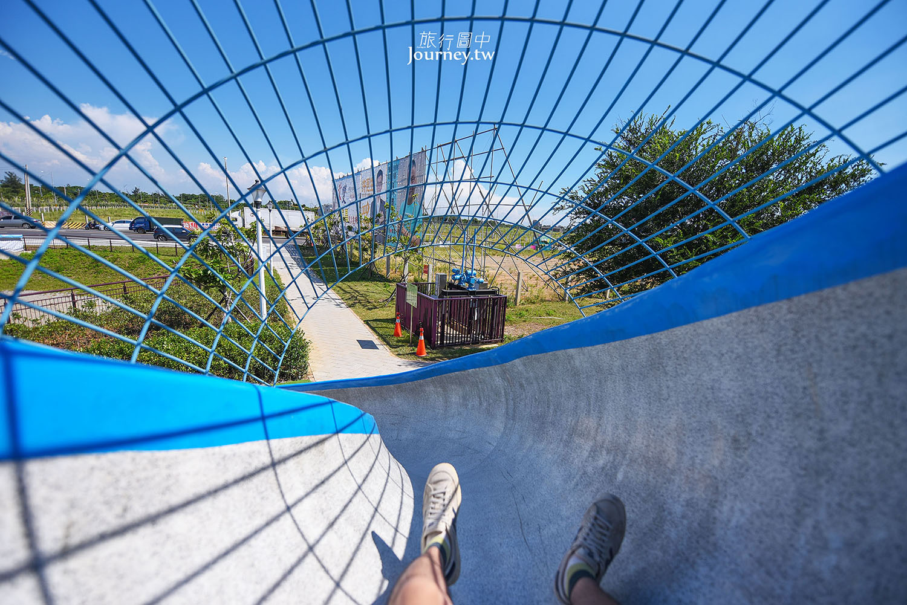

*圖說：水之丘主題公園 設施｜圖片來源：未標示（文章未註明圖片來源）*

草漯重劃區過去是一片農地，在政府推動之下，重劃整片土地，採共同管溝、LED智慧路燈、防災設計，並保留當地原有生態、文化特色，結合埤塘、河川生態打造出新市鎮，同時也在新市鎮中闢建打造了「水之丘」、「風之谷」兩座主題公園。於2021年11月啟用的「水之丘主題公園」是新的桃園親子景點，本身除了是一座公園，更兼具滯洪、防災功用，但最具話題的莫過於公園中有一座以埤塘特有的「飼料桶」為改念打造的「溜滑梯」。溜滑梯設有三種不同高度讓小朋友做選擇，其中最高的一段達三層樓、也是速度最快、刺激度最高的一段。

#### 景點資訊

#### 桃園、觀音景點｜水之丘主題公園

- 地址｜桃園市觀音區台15線402號

- 開放時間｜公園全天候對外開放

#### 草漯沙丘：宛如沙漠風情的桃園首座地質公園

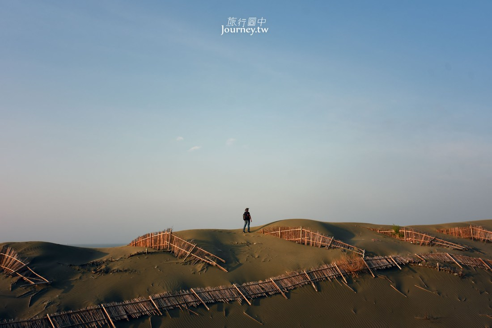

*圖說：草漯沙丘｜圖片來源：未標示（文章未註明圖片來源）*

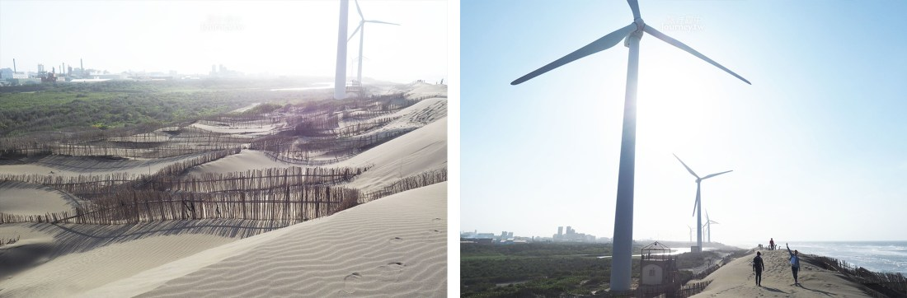

*圖說：草漯沙丘 不同角度｜圖片來源：未標示（文章未註明圖片來源）*

日本鳥取砂丘吸引許多旅客前往，台灣其實也有一片小巧而精美的沙丘地貌，就在桃園觀音區的「草漯沙丘（漯ㄊㄚˋ）」。草漯沙丘為非官方景點，過去在很多桃園介紹中也少有見到它的蹤影，隨著網路社群發展興盛的年代，一張張攝影師及網美們拍出宛如走在沙漠場景的美照，慢慢堆疊出草漯沙丘的名氣，現在已經從桃園秘境躍升為網美打卡景點。

2020更將此區規劃，成立了「草漯沙丘地質公園」，是桃園首座地質公園。走上沙丘，綿延無際的黃沙堆疊起一座座可愛的小山丘，後方是一片蔚藍大海與整排轉動的風車，未來將興建完整的步道及設施，整合周邊的許厝港濕地、草漯沙丘、觀新藻礁及新屋石滬，讓旅客可以重新了解桃園沿線海域及生態，而不是克難的在沙丘上拍照而已。

#### 景點資訊

#### 桃園、觀音景點｜草漯沙丘

- 景點位置｜桃園市大園區老街溪口南岸至觀音區大堀溪出海口間之沿海地帶

- 草漯沙丘地質公園位置｜桃園市觀音區中興路469號

有句俗話說：靠海吃海、靠山吃山，依賴在什麼地方，就要運用當地的客觀條件去討生活。我們活在非常便利的現代，想吃什麼、想買什麼只要透過網路就會有人送上門來，真的很難想像過去的祖先是如何生活的。這次實際走進大海的舞台，體驗海洋客家的日常，真的唯有實際體驗才能了解在過去每一樣食材都是得來不易，不僅要看天吃飯，人生也要多一點運氣才行。

## 圖片清單

| 檔案 | 圖說 | 圖片來源標示 | 對應段落 | 原始網址 |
| --- | --- | --- | --- | --- |
| images/D-002_image_01.jpg | 桃園新屋、觀音 | 未標示（文章未註明圖片來源） | 9個觀音＆新屋景點推薦・全台唯一的客庄海洋聚落，跟著海客漁夫體驗石滬的一日漫遊： | https://romantichakka.hakka.gov.tw/UserFiles/expertTravel/17/1.jpg |
| images/D-002_image_02.jpg | 漁夫體驗 | 未標示（文章未註明圖片來源） | 新屋深圳石滬群：新屋海客漁夫體驗：桃園新屋、觀音等沿海鄉鎮區有著不少客家聚落，聚落濱海而居、農漁兼作，發展出與台灣 | https://romantichakka.hakka.gov.tw/UserFiles/expertTravel/17/2.jpg |
| images/D-002_image_03.jpg | 漁夫體驗 | 未標示（文章未註明圖片來源） | 新屋深圳石滬群：新屋海客漁夫體驗：桃園新屋、觀音等沿海鄉鎮區有著不少客家聚落，聚落濱海而居、農漁兼作，發展出與台灣 | https://romantichakka.hakka.gov.tw/UserFiles/expertTravel/17/3.jpg |
| images/D-002_image_04.jpg | 漁夫體驗 | 未標示（文章未註明圖片來源） | 新屋深圳石滬群：新屋海客漁夫體驗：桃園新屋、觀音等沿海鄉鎮區有著不少客家聚落，聚落濱海而居、農漁兼作，發展出與台灣 | https://romantichakka.hakka.gov.tw/UserFiles/expertTravel/17/4.jpg |
| images/D-002_image_05.jpg | 新屋石滬故事館 | 未標示（文章未註明圖片來源） | 新屋石滬故事館：警察哨所躍升變成石滬故事的舞台：「新屋深圳石滬群」在當地新屋區愛鄉協會與地方人士的維護修繕下，成為台灣本島目前石 | https://romantichakka.hakka.gov.tw/UserFiles/expertTravel/17/5.jpg |
| images/D-002_image_06.jpg | 新屋石滬故事館 陳列 | 未標示（文章未註明圖片來源） | 新屋石滬故事館：警察哨所躍升變成石滬故事的舞台：「新屋深圳石滬群」在當地新屋區愛鄉協會與地方人士的維護修繕下，成為台灣本島目前石 | https://romantichakka.hakka.gov.tw/UserFiles/expertTravel/17/6.jpg |
| images/D-002_image_07.jpg | 新屋石滬故事館 資料 | 未標示（文章未註明圖片來源） | 新屋石滬故事館：警察哨所躍升變成石滬故事的舞台：「新屋深圳石滬群」在當地新屋區愛鄉協會與地方人士的維護修繕下，成為台灣本島目前石 | https://romantichakka.hakka.gov.tw/UserFiles/expertTravel/17/7.jpg |
| images/D-002_image_08.jpg | 海洋客家休閒農業區遊客服務中心 | 未標示（文章未註明圖片來源） | 海洋客家休閒農業區遊客服務中心：體驗千人牽罟，築石塭、編織漁網：開放時間｜09：00－17：00（每周二、三公休）免費參觀 | https://romantichakka.hakka.gov.tw/UserFiles/expertTravel/17/8.jpg |
| images/D-002_image_09.jpg | 海洋客家休閒農業區遊客服務中心 裝置藝術 | 未標示（文章未註明圖片來源） | 海洋客家休閒農業區遊客服務中心：體驗千人牽罟，築石塭、編織漁網：開放時間｜09：00－17：00（每周二、三公休）免費參觀 | https://romantichakka.hakka.gov.tw/UserFiles/expertTravel/17/9.jpg |
| images/D-002_image_10.jpg | 海洋客家休閒農業區遊客服務中心 內部 | 未標示（文章未註明圖片來源） | 海洋客家休閒農業區遊客服務中心：體驗千人牽罟，築石塭、編織漁網：開放時間｜09：00－17：00（每周二、三公休）免費參觀 | https://romantichakka.hakka.gov.tw/UserFiles/expertTravel/17/10.jpg |
| images/D-002_image_11.jpg | 永安海螺文化體驗園區 | 未標示（文章未註明圖片來源） | 永安海螺文化體驗園區・桃園四大新場館！白海螺建築線條微美蔓延：週二公休(依照月份而有不同時段時間開放，請依官方公告為主。) | https://romantichakka.hakka.gov.tw/UserFiles/expertTravel/17/11.jpg |
| images/D-002_image_12.jpg | 永安海螺文化體驗園區 不同角度 | 未標示（文章未註明圖片來源） | 永安海螺文化體驗園區・桃園四大新場館！白海螺建築線條微美蔓延：週二公休(依照月份而有不同時段時間開放，請依官方公告為主。) | https://romantichakka.hakka.gov.tw/UserFiles/expertTravel/17/12.jpg |
| images/D-002_image_13.jpg | 永安海螺文化體驗園區 內部 | 未標示（文章未註明圖片來源） | 永安海螺文化體驗園區・桃園四大新場館！白海螺建築線條微美蔓延：週二公休(依照月份而有不同時段時間開放，請依官方公告為主。) | https://romantichakka.hakka.gov.tw/UserFiles/expertTravel/17/13.jpg |
| images/D-002_image_14.jpg | 向陽農場 | 未標示（文章未註明圖片來源） | 向陽農場：北台灣最大的向日葵主題農場：開放時間｜09：00－17：00（每周一公休） | https://romantichakka.hakka.gov.tw/UserFiles/expertTravel/17/14.jpg |
| images/D-002_image_15.jpg | 向陽農場 不同角度 | 未標示（文章未註明圖片來源） | 向陽農場：北台灣最大的向日葵主題農場：開放時間｜09：00－17：00（每周一公休） | https://romantichakka.hakka.gov.tw/UserFiles/expertTravel/17/15.jpg |
| images/D-002_image_16.jpg | 白沙岬燈塔 | 未標示（文章未註明圖片來源） | 白沙岬燈塔：原來桃園也有一座百年燈塔：門票資訊｜入園清潔費$100，消費可抵 | https://romantichakka.hakka.gov.tw/UserFiles/expertTravel/17/16.jpg |
| images/D-002_image_17.jpg | 白沙岬燈塔 不同角度 | 未標示（文章未註明圖片來源） | 白沙岬燈塔：原來桃園也有一座百年燈塔：門票資訊｜入園清潔費$100，消費可抵 | https://romantichakka.hakka.gov.tw/UserFiles/expertTravel/17/17.jpg |
| images/D-002_image_18.jpg | 蓮荷園休閒農場 | 未標示（文章未註明圖片來源） | 蓮荷園休閒農場：坐上大王蓮的奇幻漂浮：開放時間｜09：00－17：00（每週一休園） | https://romantichakka.hakka.gov.tw/UserFiles/expertTravel/17/18.jpg |
| images/D-002_image_19.jpg | 蓮荷園休閒農場 不同角度 | 未標示（文章未註明圖片來源） | 蓮荷園休閒農場：坐上大王蓮的奇幻漂浮：開放時間｜09：00－17：00（每週一休園） | https://romantichakka.hakka.gov.tw/UserFiles/expertTravel/17/19.jpg |
| images/D-002_image_20.jpg | 水之丘主題公園 | 未標示（文章未註明圖片來源） | 水之丘主題公園：這溜滑梯太猛！體驗從三樓高滑落的極限快感：門票資訊｜入園需要收取門票（不可抵消費） | https://romantichakka.hakka.gov.tw/UserFiles/expertTravel/17/20.jpg |
| images/D-002_image_21.jpg | 水之丘主題公園 不同角度 | 未標示（文章未註明圖片來源） | 水之丘主題公園：這溜滑梯太猛！體驗從三樓高滑落的極限快感：門票資訊｜入園需要收取門票（不可抵消費） | https://romantichakka.hakka.gov.tw/UserFiles/expertTravel/17/21.jpg |
| images/D-002_image_22.jpg | 水之丘主題公園 設施 | 未標示（文章未註明圖片來源） | 水之丘主題公園：這溜滑梯太猛！體驗從三樓高滑落的極限快感：門票資訊｜入園需要收取門票（不可抵消費） | https://romantichakka.hakka.gov.tw/UserFiles/expertTravel/17/22.jpg |
| images/D-002_image_23.jpg | 草漯沙丘 | 未標示（文章未註明圖片來源） | 草漯沙丘：宛如沙漠風情的桃園首座地質公園：地址｜桃園市觀音區台15線402號 | https://romantichakka.hakka.gov.tw/UserFiles/expertTravel/17/23.jpg |
| images/D-002_image_24.jpg | 草漯沙丘 不同角度 | 未標示（文章未註明圖片來源） | 草漯沙丘：宛如沙漠風情的桃園首座地質公園：地址｜桃園市觀音區台15線402號 | https://romantichakka.hakka.gov.tw/UserFiles/expertTravel/17/24.jpg |

## 正文內連結

- [點此前往](https://www.oceanhakka.com.tw/)
- [點此前往](https://www.hakka.tycg.gov.tw/cp.aspx?n=15952)
