# 【桃園石觀音甘泉寺一日遊】清乾隆古剎 × 甘泉傳奇 × 三教合一的石觀音聖地

- 編號：D-003（urls.csv：page_009）
- 原始網址：https://vocus.cc/article/695b08a8fd897800017a25c9
- 網站：vocus（部落格（方格子 vocus））
- 作者：峰（發布單位：vocus）
- 發表日期：2026-02-18
- 取得時間：2026-11-05T13:01:25+08:00
- 擷取方式：site_rule[vocus.cc]: article.editor-content-block
- 資料性質：**媒體／部落格內容，尚未經官方資料查核**（查核結果見 analysis/fact_check_D.md）

---

位於桃園市龍潭、楊梅交界山區的 桃園石觀音甘泉寺，是一處結合自然奇景、宗教信仰與歷史文化的靜謐聖地。寺內最著名的「石觀音」與「甘泉水」流傳兩百多年，相傳可祈福、解厄、療癒身心，更被視為儒、釋、道三教合一的宗教建築典範。

### 一、甘泉寺歷史沿革與由來典故

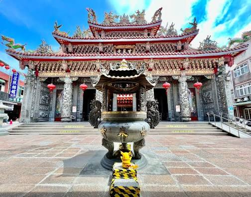

*圖說：龍潭甘泉寺（圖片截圖於網路）｜圖片來源：作者標示「截圖於網路」，原始出處不明*

- 清乾隆年間（約西元1780年） 創建

- 前身為「福龍寺」，因山中岩壁湧出甘甜泉水而聲名遠播

- 後因「甘泉」與「石觀音」信仰興盛，更名為「甘泉寺」

& 石觀音與甘泉傳說

- 山壁天然岩石形似觀音菩薩側影，信眾稱為「石觀音」

- 岩下湧泉終年不竭，被稱為「甘泉水」

- 相傳甘泉水曾治癒疾病、解除瘟疫，吸引各地信眾前來取水祈福

### 二、主祀神明與信仰特色

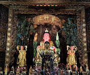

*圖說：觀音菩薩殿（圖片截圖於網路）｜圖片來源：作者標示「截圖於網路」，原始出處不明*

¥ 主祀神明

- 觀音菩薩（石觀音）

¥ 宗教特色

- 佛教：以觀音信仰為核心

- 道教：融合修行、祈福與地方信仰

- 儒家：重倫理、孝道與修身 ¥ 形成罕見的「三教合一」信仰空間

### 三、主要保佑事項（適合拜什麼？）

- 🙏 身體健康、疾病康復

- 🙏 心靈平靜、消災解厄

- 🙏 家庭和諧、子女平安

- 🙏 事業順利、考試祈福

- 🙏 行車出入、登山平安

### 四、參拜流程（樓層與動線說明）

¥ 建議參拜順序

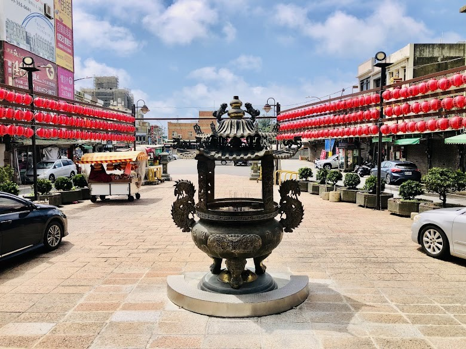

*圖說：天公爐（圖片截圖於網路）｜圖片來源：作者標示「截圖於網路」，原始出處不明*

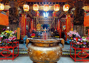

*圖說：正殿 觀菩薩（圖片截圖於網路）｜圖片來源：作者標示「截圖於網路」，原始出處不明*

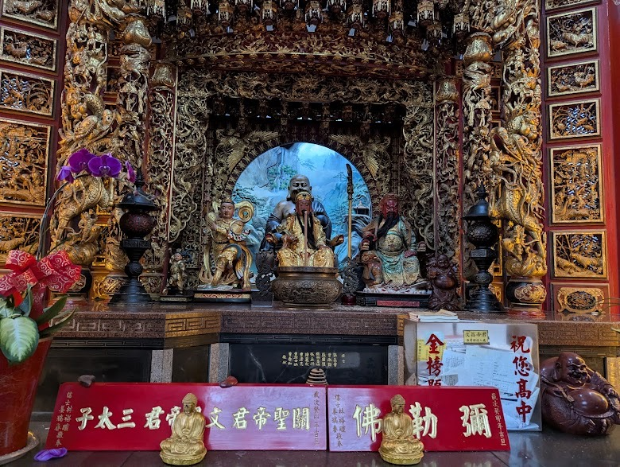

*圖說：陪祀神佛（圖片截圖於網路）｜圖片來源：作者標示「截圖於網路」，原始出處不明*

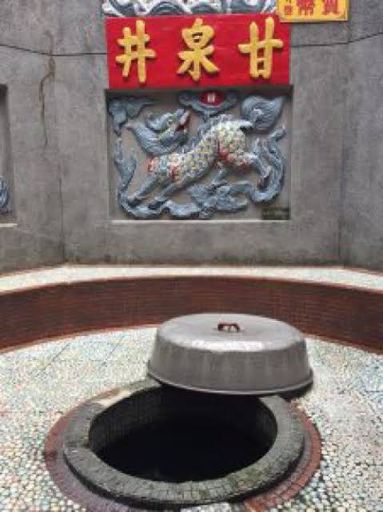

*圖說：甘泉井（圖片截圖於網路）｜圖片來源：作者標示「截圖於網路」，原始出處不明*

- 山門入口 → 整理衣冠、靜心片刻

- → 合掌參拜、默念祈願

- 甘泉取水處 → 以容器取少量，象徵祝福（勿浪費）

- 主殿觀音菩薩 → 上香、稟報姓名、生辰、住址、願望

- 配祀神明區 → 依序參拜，感謝庇佑

- 迴向感恩 → 參拜結束，心存感謝

### 五、周邊造景與園區亮點

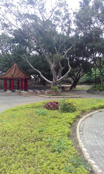

*圖說：園區造景（圖片截圖於網路）｜圖片來源：作者標示「截圖於網路」，原始出處不明*

- 山林步道環繞，清幽寧靜

- 天然岩壁石觀音景觀

- 甘泉湧泉池（禁止戲水）

- 林蔭休憩平台，適合靜坐沉澱

- 多處自然取景點，適合攝影與慢遊

### 六、注意要項（參拜與旅遊禮儀）

- 穿著端莊，避免過於暴露

- 取甘泉水「少量即可」，勿商業販售

- 保持安靜，勿喧嘩奔跑

- 山區濕滑，穿防滑鞋

- 禁止破壞自然岩壁與刻字

### 七、重大慶典與熱鬧時節

- 觀音菩薩誕辰（農曆二月十九）

- 觀音成道日（農曆六月十九）

- 觀音出家日（農曆九月十九）

¥ 以上日期香客眾多，建議提早到訪

### 八、建築風格特色

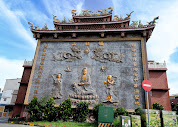

*圖說：地標造景（圖片截圖於網路）｜圖片來源：作者標示「截圖於網路」，原始出處不明*

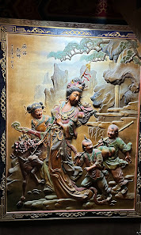

*圖說：彩繪浮雕工藝精華（圖片截圖於網路）｜圖片來源：作者標示「截圖於網路」，原始出處不明*

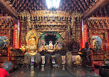

*圖說：大殿 莊嚴隆重（圖片截圖於網路）｜圖片來源：作者標示「截圖於網路」，原始出處不明*

- 傳統閩南式寺廟結構

- 自然岩壁融入建築，渾然天成

- 無過度雕琢，保留原始山林氣息

- 展現「依山而建、與自然共存」的宗教美學

### 九、交通指南

^ 自行開車

- 國道三號 → 龍潭交流道 → 指標前往石觀音甘泉寺

- 寺外設有簡易停車空間（假日較滿）

^ 大眾運輸

- 桃園／中壢火車站 → 轉乘往龍潭公車 → 再轉計程車或步行登山路段

### 十、在地美食推薦

- 龍潭客家粄條

- 客家菜包、草仔粿

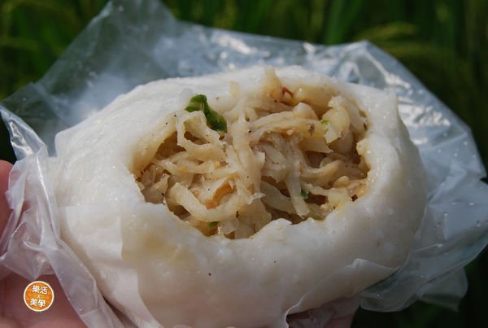

*圖說：客家菜包（圖片截圖於網路）｜圖片來源：作者標示「截圖於網路」，原始出處不明*

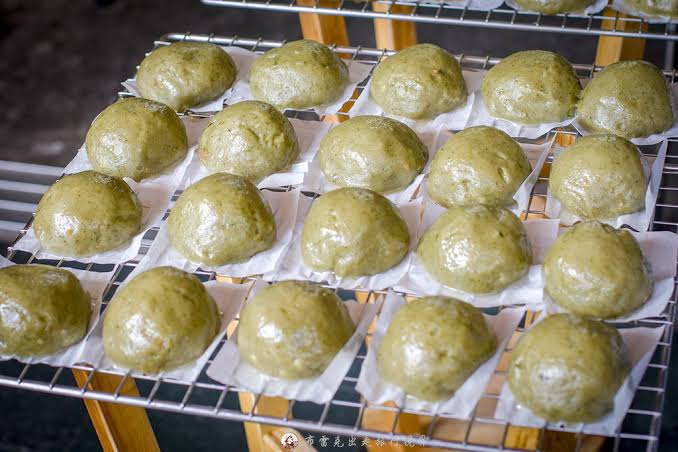

*圖說：美味的草仔粿（圖片截圖於網路）｜圖片來源：作者標示「截圖於網路」，原始出處不明*

- 擂茶、仙草茶

- 地瓜、花生等在地小吃

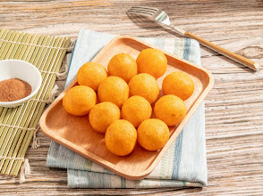

*圖說：好吃的地瓜球（圖片截圖於網路）｜圖片來源：作者標示「截圖於網路」，原始出處不明*

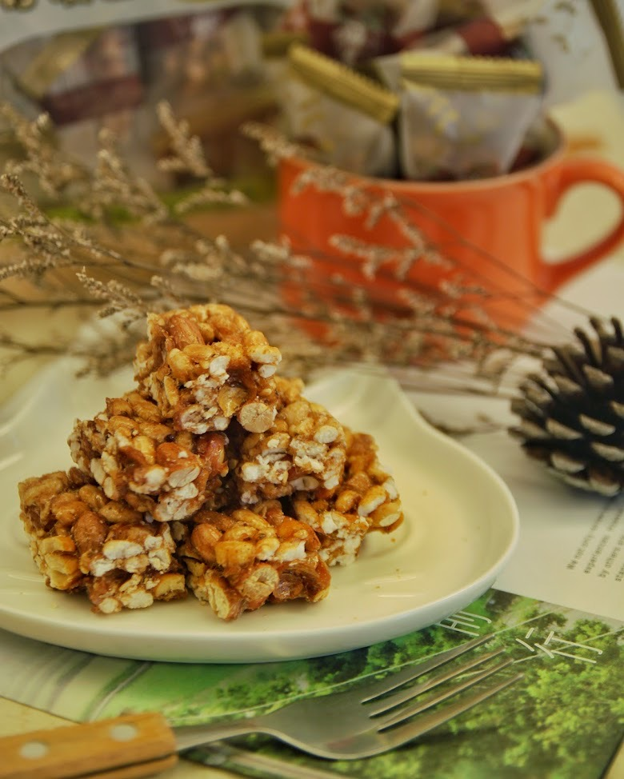

*圖說：古早味花生糖（圖片截圖於網路）｜圖片來源：作者標示「截圖於網路」，原始出處不明*

### 十一、周邊景點順遊建議

- 龍潭大池風景區

- 三坑老街

- 石門水庫

- 小人國主題樂園（親子行程）

### 「 FAQ 常見問題 」

Q：甘泉水真的可以喝嗎？

A：多數信眾取回象徵性飲用，建議少量、心誠即可。

Q：需要門票嗎？

A：不需要，屬開放式參拜空間。

Q：適合親子或長輩嗎？

A：可以，但部分步道較陡，需注意安全。

作者｜悠遊時光

石觀音甘泉寺不僅是一座廟，更像一段被山林守護的信仰記憶。當你站在岩壁前，聽泉水潺潺、合掌靜心的那一刻，會發現這裡真正療癒的，不只是甘泉，而是內心。

## 圖片清單

| 檔案 | 圖說 | 圖片來源標示 | 對應段落 | 原始網址 |
| --- | --- | --- | --- | --- |
| images/D-003_image_01.jpg | 龍潭甘泉寺（圖片截圖於網路） | 作者標示「截圖於網路」，原始出處不明 | 一、甘泉寺歷史沿革與由來典故：位於桃園市龍潭、楊梅交界山區的 桃園石觀音甘泉寺，是一處結合自然奇景、宗教信仰與 | https://images.vocus.cc/4c7f1f2a-ed21-490b-bdb7-1ae8b969758e.jpg |
| images/D-003_image_02.jpg | 觀音菩薩殿（圖片截圖於網路） | 作者標示「截圖於網路」，原始出處不明 | 二、主祀神明與信仰特色：相傳甘泉水曾治癒疾病、解除瘟疫，吸引各地信眾前來取水祈福 | https://images.vocus.cc/8e521fc3-a944-4d23-bc5e-585633344550.jpg |
| images/D-003_image_03.jpg | 天公爐（圖片截圖於網路） | 作者標示「截圖於網路」，原始出處不明 | 四、參拜流程（樓層與動線說明）：儒家：重倫理、孝道與修身 ¥ 形成罕見的「三教合一」信仰空間 | https://images.vocus.cc/8749cb49-ce2b-4d89-b8d6-901c6c1f7aac.jpg |
| images/D-003_image_04.jpg | 正殿 觀菩薩（圖片截圖於網路） | 作者標示「截圖於網路」，原始出處不明 | 四、參拜流程（樓層與動線說明）：儒家：重倫理、孝道與修身 ¥ 形成罕見的「三教合一」信仰空間 | https://images.vocus.cc/9cba03e1-9af7-4a91-9f80-3787fc67c4e7.jpg |
| images/D-003_image_05.jpg | 陪祀神佛（圖片截圖於網路） | 作者標示「截圖於網路」，原始出處不明 | 四、參拜流程（樓層與動線說明）：正殿 觀菩薩（圖片截圖於網路） | https://images.vocus.cc/638a50e9-9409-4a28-95f6-ba928b3a09df.jpg |
| images/D-003_image_06.jpg | 甘泉井（圖片截圖於網路） | 作者標示「截圖於網路」，原始出處不明 | 四、參拜流程（樓層與動線說明）：正殿 觀菩薩（圖片截圖於網路） | https://images.vocus.cc/7ca5c11f-df44-4068-9219-67762df60f54.jpg |
| images/D-003_image_07.jpg | 園區造景（圖片截圖於網路） | 作者標示「截圖於網路」，原始出處不明 | 五、周邊造景與園區亮點：迴向感恩 → 參拜結束，心存感謝 | https://images.vocus.cc/7452330c-4517-46b7-942a-0e6175540feb.jpg |
| images/D-003_image_08.jpg | 地標造景（圖片截圖於網路） | 作者標示「截圖於網路」，原始出處不明 | 八、建築風格特色：¥ 以上日期香客眾多，建議提早到訪 | https://images.vocus.cc/74cd0ad9-f967-4e72-9762-f75e09cda1c1.jpg |
| images/D-003_image_09.jpg | 彩繪浮雕工藝精華（圖片截圖於網路） | 作者標示「截圖於網路」，原始出處不明 | 八、建築風格特色：¥ 以上日期香客眾多，建議提早到訪 | https://images.vocus.cc/4b7544f2-2a93-488a-afff-71c534b3a03c.jpg |
| images/D-003_image_10.jpg | 大殿 莊嚴隆重（圖片截圖於網路） | 作者標示「截圖於網路」，原始出處不明 | 八、建築風格特色：彩繪浮雕工藝精華（圖片截圖於網路） | https://images.vocus.cc/f2f3ec6e-482f-4525-bbea-9085b2a83a08.jpg |
| images/D-003_image_11.jpg | 客家菜包（圖片截圖於網路） | 作者標示「截圖於網路」，原始出處不明 | 十、在地美食推薦：桃園／中壢火車站 → 轉乘往龍潭公車 → 再轉計程車或步行登山路段 | https://images.vocus.cc/16d9e199-17b4-4d51-9ab1-37ba56c91797.jpg |
| images/D-003_image_12.jpg | 美味的草仔粿（圖片截圖於網路） | 作者標示「截圖於網路」，原始出處不明 | 十、在地美食推薦：桃園／中壢火車站 → 轉乘往龍潭公車 → 再轉計程車或步行登山路段 | https://images.vocus.cc/0caf5db3-9a5f-480e-824c-82e9dd38ca4c.jpg |
| images/D-003_image_13.jpg | 好吃的地瓜球（圖片截圖於網路） | 作者標示「截圖於網路」，原始出處不明 | 十、在地美食推薦：美味的草仔粿（圖片截圖於網路） | https://images.vocus.cc/8e53bbc5-bd74-4010-a4ab-266b032b9091.jpg |
| images/D-003_image_14.jpg | 古早味花生糖（圖片截圖於網路） | 作者標示「截圖於網路」，原始出處不明 | 十、在地美食推薦：好吃的地瓜球（圖片截圖於網路） | https://images.vocus.cc/88d1e5f6-f3f4-4656-a12d-232b71c1ac60.jpg |

## 正文內連結

- （無）
