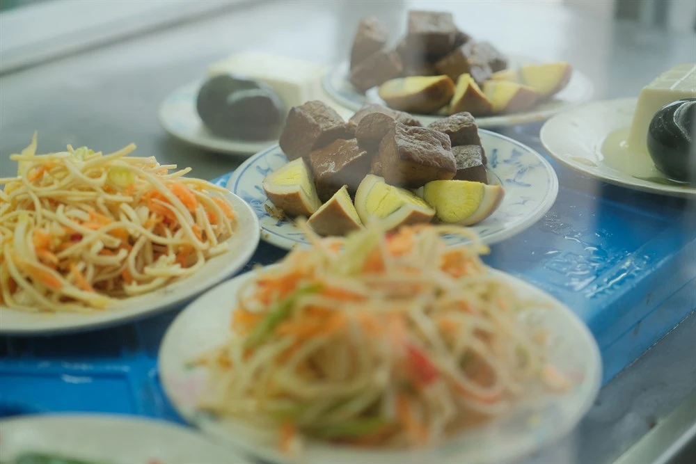

# 來來牛家莊

- 編號：D-005（urls.csv：page_017）
- 原始網址：https://romantichakka.com/explore/HaFood?a=1955&id=3209
- 最終網址（轉址後）：https://romantichakka.hakka.gov.tw/explore/HaFood?a=1955&id=3209
- 網站：romantichakka.hakka.gov.tw（旅遊／飲食媒體（客委會「客庄小旅行」））
- 作者：未標示（發布單位：客家委員會）
- 發表日期：2024-11-13
- 取得時間：2026-11-05T13:01:55+08:00
- 擷取方式：site_rule[romantichakka.hakka.gov.tw]: dl.description-list, article.page-article
- 資料性質：**媒體／部落格內容，尚未經官方資料查核**（查核結果見 analysis/fact_check_D.md）

---

*圖說：來來牛家莊｜圖片來源：未標示（文章未註明圖片來源）*

- 店家電話：+886-3-4731412

- 店家地址：桃園市 觀音區 廣興里成功路二段1538號

- 營業時間：星期一: 11:00 – 18:30；星期二: 11:00 – 18:30；星期三: 11:00 – 18:30；星期四: 11:00 – 18:30；星期五: 11:00 – 18:30；星期六: 11:00 – 18:30；星期日: 休息

### 店家介紹

已有30年歷史的來來牛家莊位於觀音工業區附近，是不少上班族午晚餐的首選。店內主打清燉牛肉麵，湯頭清澈爽口，牛肋條軟嫩適中，入口不見腥羶味，深受顧客喜愛。除牛肉麵外，也供應牛肉湯、油蔥乾麵與幾款滷味小菜，簡單卻道地。寬版麵條帶勁不軟爛，與湯頭相得益彰。用餐時段總是人潮絡繹，樸實環境與實在價格成為在地人推薦的原因。若想吃一碗實在的牛肉麵，來來牛家莊是值得一試的地方。

## 圖片清單

| 檔案 | 圖說 | 圖片來源標示 | 對應段落 | 原始網址 |
| --- | --- | --- | --- | --- |
| images/D-005_image_01.jpg | 來來牛家莊 | 未標示（文章未註明圖片來源） | 來來牛家莊： | https://romantichakka.hakka.gov.tw/fapi/ArtPic?id=9287&w=1000 |

## 正文內連結

- （無）
