# 【桃園觀音白千層綠韻大道】IG熱門打卡文青風秘境 ★ 筆直的綠蔭大道

- 編號：D-007（urls.csv：page_022）
- 原始網址：https://wonderfood.pixnet.net/blog/posts/8229181678
- 網站：美食人生（部落格（痞客邦 PIXNET））
- 作者：美食人生（發布單位：美食人生）
- 發表日期：2020-04-06
- 取得時間：2026-11-05T13:02:04+08:00
- 擷取方式：site_rule[pixnet.net]: .article-body
- 資料性質：**媒體／部落格內容，尚未經官方資料查核**（查核結果見 analysis/fact_check_D.md）

---

桃園觀音的白千層綠韻大道是一個熱門的小秘境

特色就在於兩旁夾道的白千層

濃密的綠蔭覆蓋與白色斑薄的樹幹極有特色

怎麼拍都美!

桃園觀音白千層綠韻大道參觀資訊

參觀日期:2019.10.31

地點: 桃園市觀音區福山路二段

簡介: 全長2.8公里的白千層藝術大道，種植近700棵白千層樹

開放時間: 24小時(無門票)

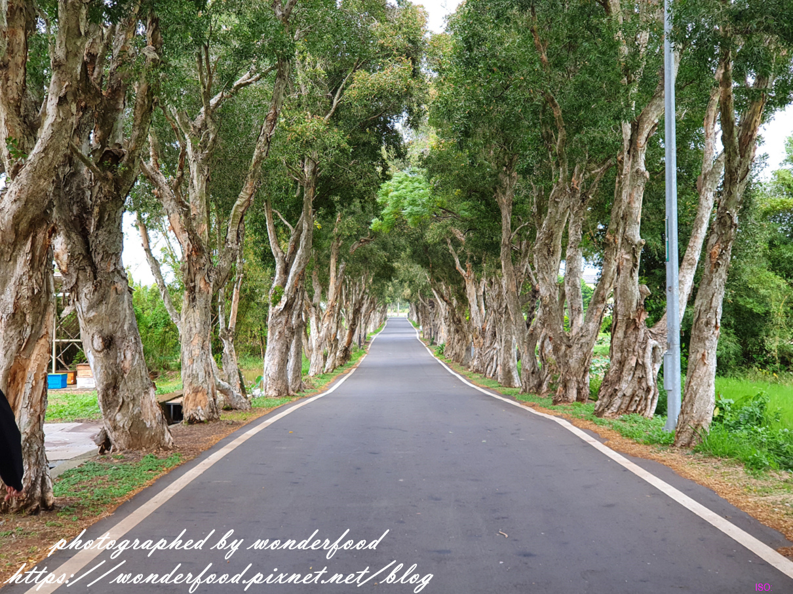

*圖說：PhotoCap_122.jpg｜圖片來源：未標示（文章未註明圖片來源）*

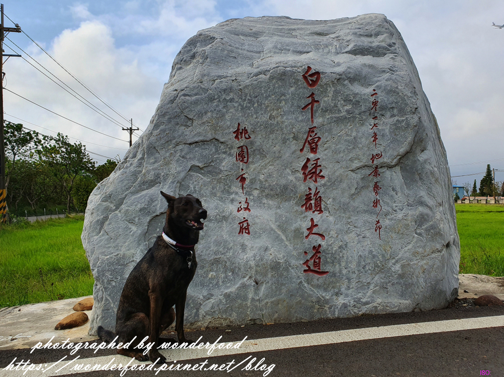

*圖說：PhotoCap_114.jpg｜圖片來源：未標示（文章未註明圖片來源）*

這天我們來桃園吃中餐和晚餐

獸大正在尋找適合下午時分走走逛逛，散步拍照的小景點

結果位在觀音鄉廣福村的這條綠道秘境雀屏中選

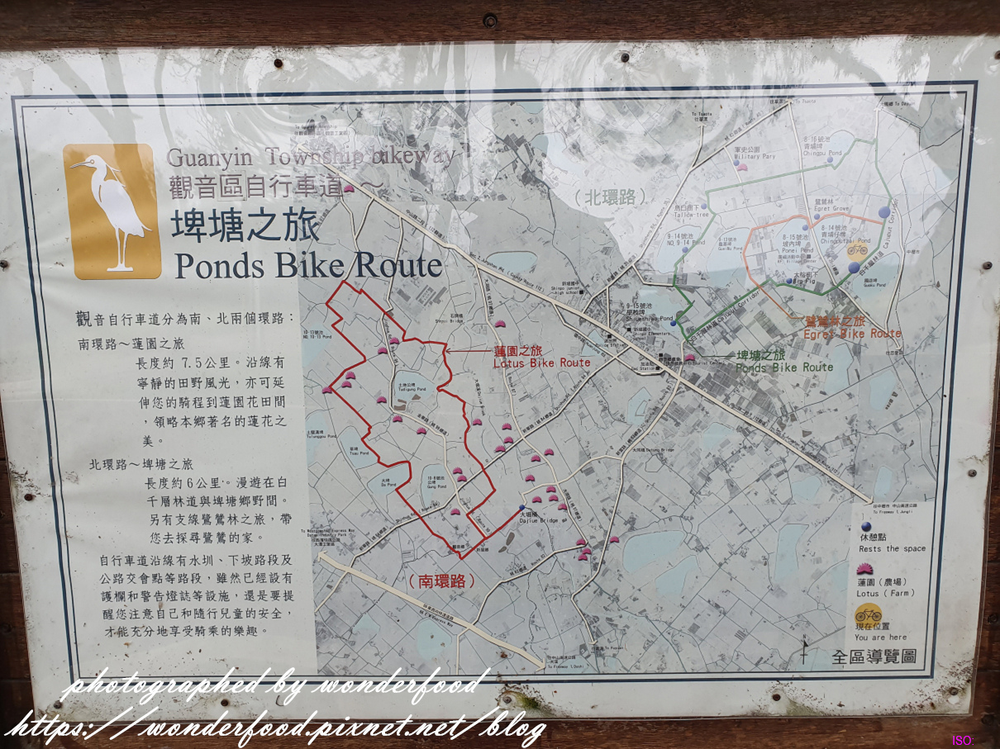

*圖說：PhotoCap_126.jpg｜圖片來源：未標示（文章未註明圖片來源）*

來看看地圖上的標示吧!

觀音鄉很美

若是沿著圖上推薦的自行車道繞一圈

更能領會埤塘、蓮園和鷺鷥林之美

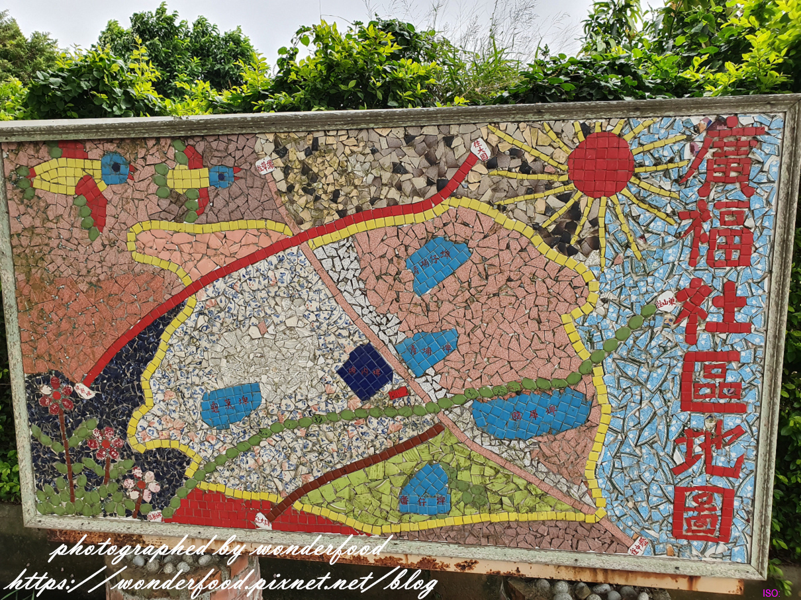

*圖說：PhotoCap_127.jpg｜圖片來源：未標示（文章未註明圖片來源）*

用壁貼做成充滿童趣的廣福社區地圖

我們今天不騎自行車

而是要走走圖上那條綠色的白千層林道

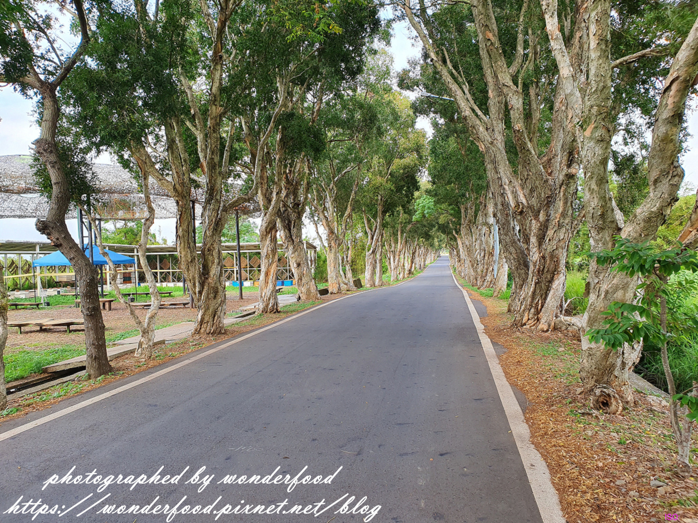

*圖說：PhotoCap_110.jpg｜圖片來源：未標示（文章未註明圖片來源）*

全長2.8公里的白千層大道

種植近700棵白千層樹

筆直的林道一眼望去

彷彿沒有盡頭

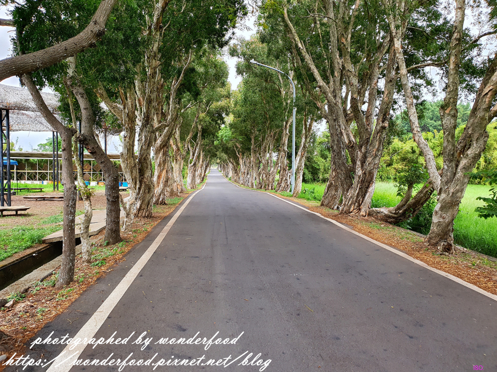

*圖說：PhotoCap_121.jpg｜圖片來源：未標示（文章未註明圖片來源）*

白千層是一種很有趣的樹種

隨著莖部內裡不斷孕育著新生，將外層老皮推出而斑駁脫落，層層疊疊般包覆著樹幹

也因這獨特生長方式而得名

而外層呈現剝落特色所以又俗稱<脫皮樹>

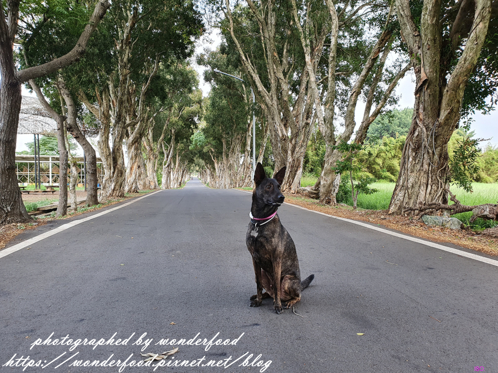

*圖說：PhotoCap_111.jpg｜圖片來源：未標示（文章未註明圖片來源）*

因為這個漂亮又獨特的風景

這裡成為了文青、網美、婚照照的熱門取景地

別人是拍日雜風美照

錢拔則是熱衷於拍錢錢帥照

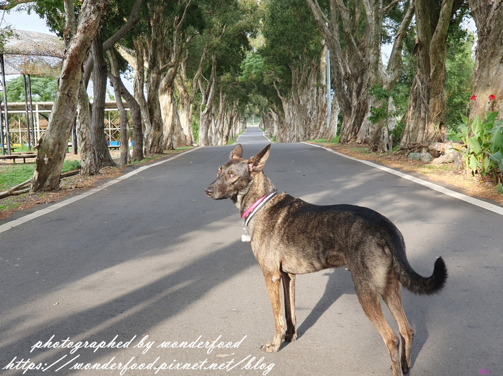

*圖說：PhotoCap_117.jpg｜圖片來源：未標示（文章未註明圖片來源）*

幫狗狗拍照不是一件簡單的事

雖然錢錢是一個稱職的犬模特

但牠有時候也會拍到不耐煩回頭瞪人

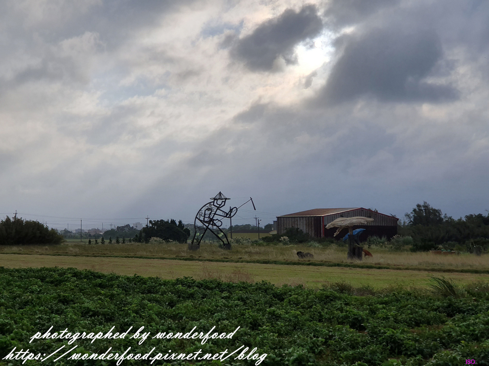

*圖說：PhotoCap_134.jpg｜圖片來源：未標示（文章未註明圖片來源）*

2017年桃園地景藝術節的主展場就在白千層林道旁邊

雖然目前大多拆除

但有些大型藝術創作仍保留

一邊享受綠蔭還能一邊觀賞田間的藝術品

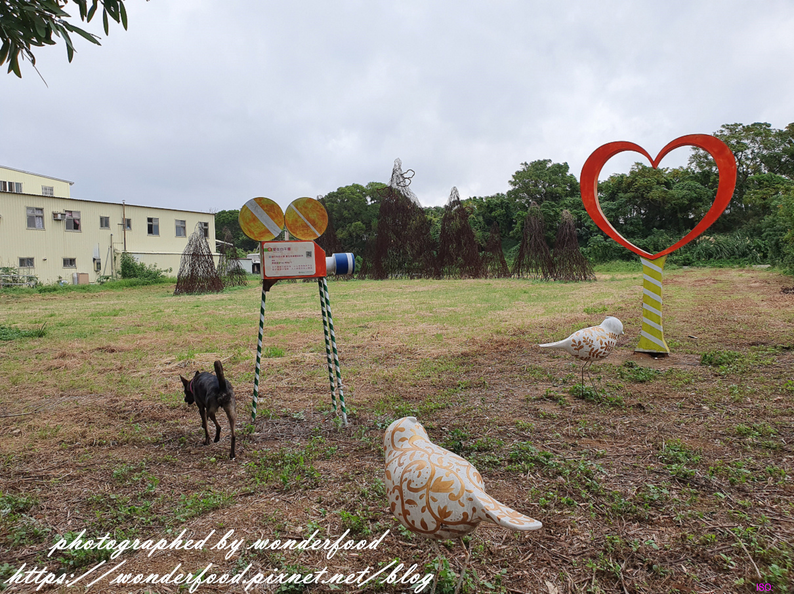

*圖說：PhotoCap_129.jpg｜圖片來源：未標示（文章未註明圖片來源）*

地景節過後

殘餘的藝術品散置

看起來格外頹廢

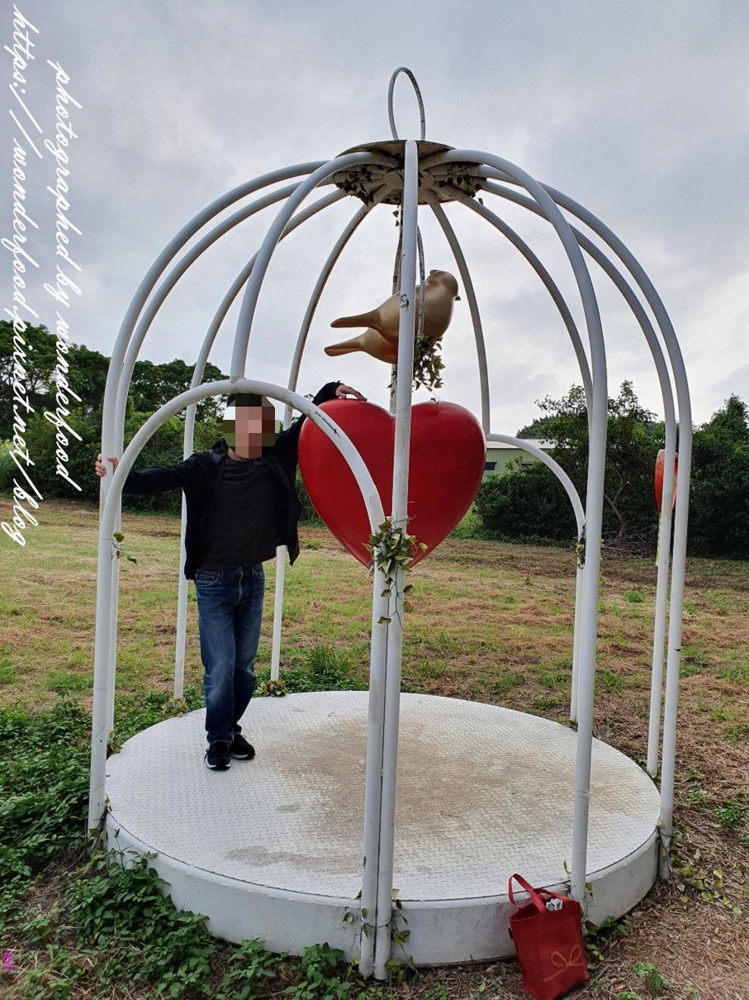

*圖說：PhotoCap_106-1.jpg｜圖片來源：未標示（文章未註明圖片來源）*

獸大與愛心鳥籠合照

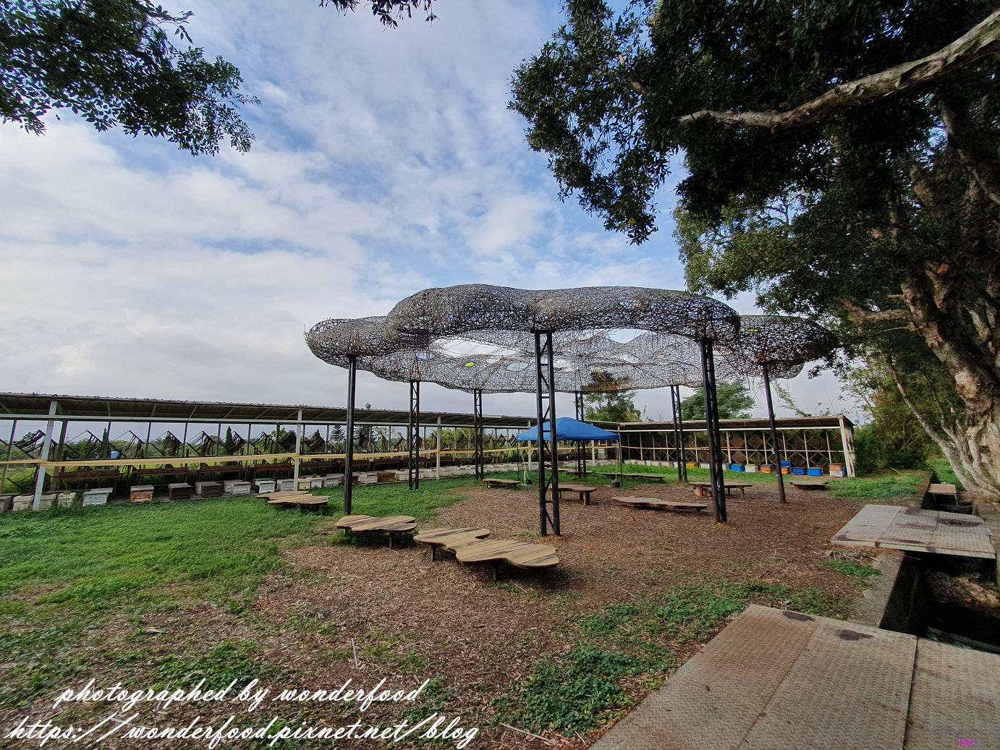

*圖說：PhotoCap_108.jpg｜圖片來源：未標示（文章未註明圖片來源）*

這個涼亭應該也是藝術品

但感覺沒啥實際用途

晴天不能遮陽，雨天無法遮雨

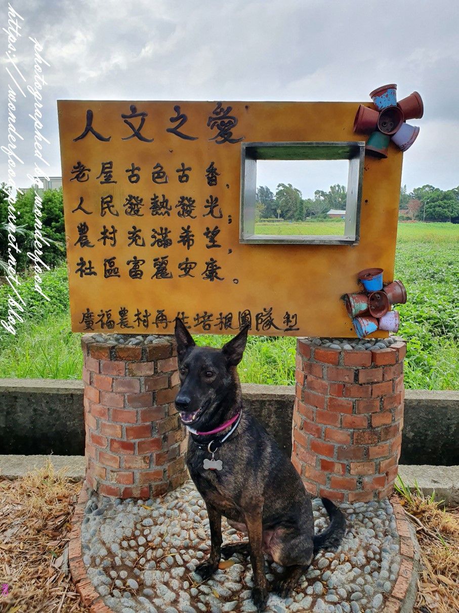

*圖說：PhotoCap_103.jpg｜圖片來源：未標示（文章未註明圖片來源）*

廣福農村的趣味拍照小景

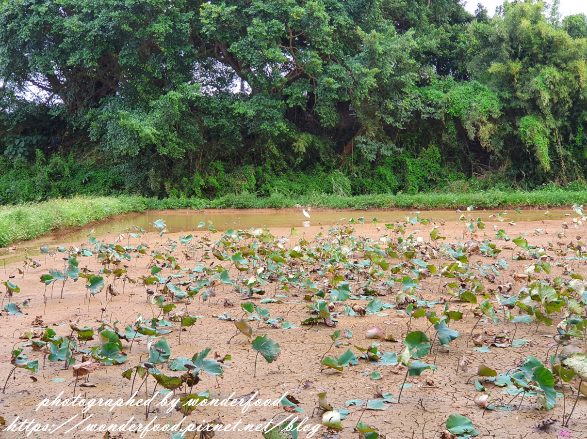

*圖說：PhotoCap_123.jpg｜圖片來源：未標示（文章未註明圖片來源）*

路旁經過的一畝蓮花池

池面都快乾涸了

蓮花也蕭條的垂頭喪氣

不過白鷺鷥靈活的跳來跳去倒是添了一絲生機

回頭再看一眼這美麗的白千層綠韻大道

觀音鄉還有許多景點

比如說: 古厝田園風光、美麗的海岸線、IG超夯的草漯沙丘、白沙岬燈塔、七月賞蓮等等

之後一一造訪!

桃園觀音白千層綠韻大道參觀資訊

參觀日期:2019.10.31

地點: 桃園市觀音區福山路二段

簡介: 全長2.8公里的白千層藝術大道，種植近700棵白千層樹

開放時間: 24小時(無門票)

## 圖片清單

| 檔案 | 圖說 | 圖片來源標示 | 對應段落 | 原始網址 |
| --- | --- | --- | --- | --- |
| images/D-007_image_01.jpg | PhotoCap_122.jpg | 未標示（文章未註明圖片來源） | 【桃園觀音白千層綠韻大道】IG熱門打卡文青風秘境 ★ 筆直的綠蔭大道：開放時間: 24小時(無門票) | https://pimg.1px.tw/wonderfood/1586103282-1873216182.jpg |
| images/D-007_image_02.jpg | PhotoCap_114.jpg | 未標示（文章未註明圖片來源） | 【桃園觀音白千層綠韻大道】IG熱門打卡文青風秘境 ★ 筆直的綠蔭大道：開放時間: 24小時(無門票) | https://pimg.1px.tw/wonderfood/1586103280-1012698860.jpg |
| images/D-007_image_03.jpg | PhotoCap_126.jpg | 未標示（文章未註明圖片來源） | 【桃園觀音白千層綠韻大道】IG熱門打卡文青風秘境 ★ 筆直的綠蔭大道：結果位在觀音鄉廣福村的這條綠道秘境雀屏中選 | https://pimg.1px.tw/wonderfood/1586103277-1758770352.jpg |
| images/D-007_image_04.jpg | PhotoCap_127.jpg | 未標示（文章未註明圖片來源） | 【桃園觀音白千層綠韻大道】IG熱門打卡文青風秘境 ★ 筆直的綠蔭大道：更能領會埤塘、蓮園和鷺鷥林之美 | https://pimg.1px.tw/wonderfood/1586103278-1560752952.jpg |
| images/D-007_image_05.jpg | PhotoCap_110.jpg | 未標示（文章未註明圖片來源） | 【桃園觀音白千層綠韻大道】IG熱門打卡文青風秘境 ★ 筆直的綠蔭大道：而是要走走圖上那條綠色的白千層林道 | https://pimg.1px.tw/wonderfood/1586103280-2224266933.jpg |
| images/D-007_image_06.jpg | PhotoCap_121.jpg | 未標示（文章未註明圖片來源） | 【桃園觀音白千層綠韻大道】IG熱門打卡文青風秘境 ★ 筆直的綠蔭大道：而是要走走圖上那條綠色的白千層林道 | https://pimg.1px.tw/wonderfood/1586103282-4086273537.jpg |
| images/D-007_image_07.jpg | PhotoCap_111.jpg | 未標示（文章未註明圖片來源） | 【桃園觀音白千層綠韻大道】IG熱門打卡文青風秘境 ★ 筆直的綠蔭大道：而外層呈現剝落特色所以又俗稱<脫皮樹> | https://pimg.1px.tw/wonderfood/1586103280-2428373770.jpg |
| images/D-007_image_08.jpg | PhotoCap_117.jpg | 未標示（文章未註明圖片來源） | 【桃園觀音白千層綠韻大道】IG熱門打卡文青風秘境 ★ 筆直的綠蔭大道：這裡成為了文青、網美、婚照照的熱門取景地 | https://pimg.1px.tw/wonderfood/1586103281-3910229092.jpg |
| images/D-007_image_09.jpg | PhotoCap_134.jpg | 未標示（文章未註明圖片來源） | 【桃園觀音白千層綠韻大道】IG熱門打卡文青風秘境 ★ 筆直的綠蔭大道：但牠有時候也會拍到不耐煩回頭瞪人 | https://pimg.1px.tw/wonderfood/1586103277-741331581.jpg |
| images/D-007_image_10.jpg | PhotoCap_129.jpg | 未標示（文章未註明圖片來源） | 【桃園觀音白千層綠韻大道】IG熱門打卡文青風秘境 ★ 筆直的綠蔭大道：一邊享受綠蔭還能一邊觀賞田間的藝術品 | https://pimg.1px.tw/wonderfood/1586103277-3608823886.jpg |
| images/D-007_image_11.jpg | PhotoCap_106-1.jpg | 未標示（文章未註明圖片來源） | 【桃園觀音白千層綠韻大道】IG熱門打卡文青風秘境 ★ 筆直的綠蔭大道：一邊享受綠蔭還能一邊觀賞田間的藝術品 | https://pimg.1px.tw/wonderfood/1586103279-3872380777.jpg |
| images/D-007_image_12.jpg | PhotoCap_108.jpg | 未標示（文章未註明圖片來源） | 【桃園觀音白千層綠韻大道】IG熱門打卡文青風秘境 ★ 筆直的綠蔭大道：一邊享受綠蔭還能一邊觀賞田間的藝術品 | https://pimg.1px.tw/wonderfood/1586103280-2707651742.jpg |
| images/D-007_image_13.jpg | PhotoCap_103.jpg | 未標示（文章未註明圖片來源） | 【桃園觀音白千層綠韻大道】IG熱門打卡文青風秘境 ★ 筆直的綠蔭大道：一邊享受綠蔭還能一邊觀賞田間的藝術品 | https://pimg.1px.tw/wonderfood/1586103278-1991345431.jpg |
| images/D-007_image_14.jpg | PhotoCap_123.jpg | 未標示（文章未註明圖片來源） | 【桃園觀音白千層綠韻大道】IG熱門打卡文青風秘境 ★ 筆直的綠蔭大道：一邊享受綠蔭還能一邊觀賞田間的藝術品 | https://pimg.1px.tw/wonderfood/1586103283-4276722590.jpg |

## 正文內連結

- [【白沙岬燈塔 & 觀音濱海遊憩區】桃園半日遊 ★ 觀燈塔、踩海浪、吹海風](https://wonderfood.pixnet.net/blog/post/228444359-%e3%80%90%e7%99%bd%e6%b2%99%e5%b2%ac%e7%87%88%e5%a1%94-%26-%e8%a7%80%e9%9f%b3%e6%bf%b1%e6%b5%b7%e9%81%8a%e6%86%a9%e5%8d%80%e3%80%91%e6%a1%83%e5%9c%92%e5%8d%8a%e6%97%a5%e9%81%8a)　← 觀音區相關
- [【桃園半日遊】軒獸微旅行之要吃也要動 ★ 野上麵包坊---第三航廈---祕密景點觀機---白沙岬燈塔---晚餐](https://wonderfood.pixnet.net/blog/post/201847942)　← 觀音區相關
- [【桃園白沙岬燈塔】觀音夕照 ★ 日落觀浪](https://wonderfood.pixnet.net/blog/post/201804730)　← 觀音區相關
- [【桃園機場觀機祕密景點】近距離看飛機 ★ 機場聯絡道](https://wonderfood.pixnet.net/blog/post/201783370)
- [痞客邦](https://www.pixnet.net)
