# 散步桃園觀音的自然愜意，在崙坪文化地景園區遇見失落遺跡、龜殼劇場還有客家食堂

- 編號：page_003
- 原始網址：https://smiletaiwan.cw.com.tw/article/6889
- 網站：微笑台灣（旅遊媒體）
- 作者：我的旅圖中（發布單位：微笑台灣）
- 發表日期：2023-12-14
- 取得時間：2026-11-07T21:47:45+08:00
- 擷取方式：site_rule[smiletaiwan.cw.com.tw]: main#first_article article
- 資料性質：**媒體／部落格內容，尚未經官方資料查核**（查核結果見 analysis/fact_check_D.md）

---

最近因工作的關係特別常來桃園，意外搜尋到崙坪文化地景園區這個從未聽過的景點，原本沒有太多期待，無意逛到廢墟建築的場景美到讓我們驚呼連連，宛如走進古文明的遺跡中！

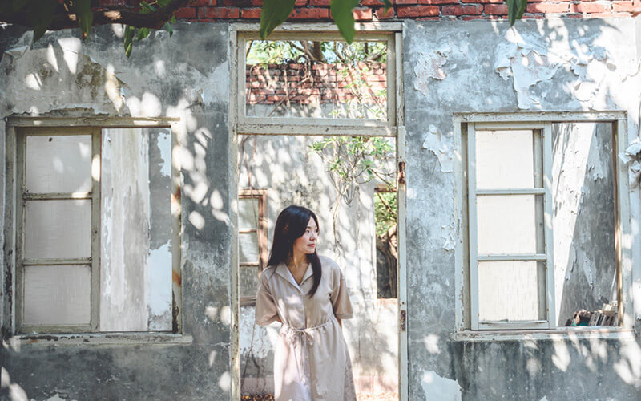

*圖說：（原網頁未提供圖說）｜圖片來源：未標示（文章未註明圖片來源）*

崙坪文化地景園區前身是日本時期國際電話株式會社觀音崙坪受信所，時間遺留下了不少廢墟老屋建築，在光影的穿梭下宛如走進失落的古城遺址，裸露的紅磚瓦牆描繪著歲月的輪廓，散發著神祕不可告人的氣息，另一邊則是被樹木佔據的廢墟老屋，宛如邂逅了奇幻故事中的場景，喜歡廢墟建築風格的人一定很愛這裡，園區內的另一個亮點就是巨大的龜殼劇場，內部的木造結構乍看有如天使展翅的羽翼，到處都充滿著奇幻的情境呢！

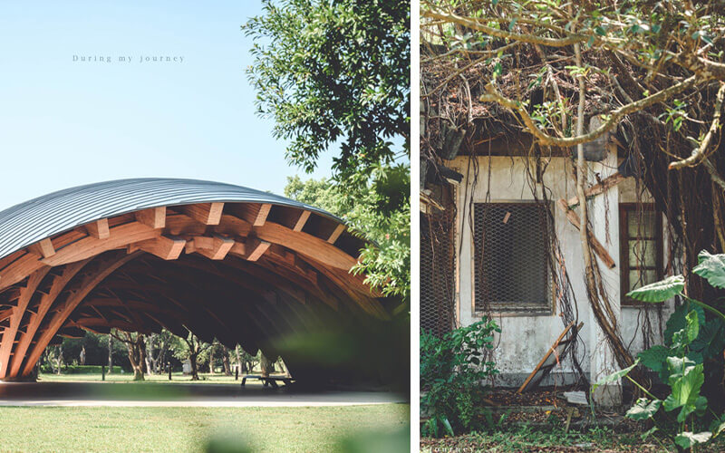

*圖說：（原網頁未提供圖說）｜圖片來源：未標示（文章未註明圖片來源）*

這陣子因工作的緣故較常來桃園，想利用工作的空檔順便踩點，無意間搜尋到崙坪文化地景園區這個位於觀音區的小祕境，開著車彎過了好幾條鄉間小巷，一下車空曠的草地與樹木延伸出綠意盎然的景色，讓人神清氣爽。

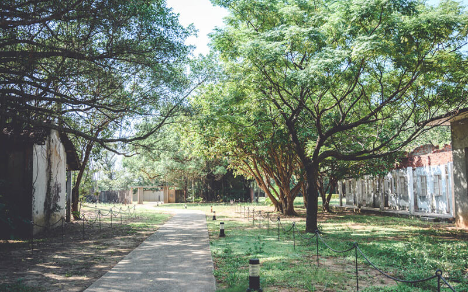

*圖說：（原網頁未提供圖說）｜圖片來源：未標示（文章未註明圖片來源）*

崙坪文化地景園區原為日本昭和時期國際電話株式會社觀音崙坪受信所的所在地，提供台灣至日本、中國之間的無線電通信業務，1986年後相關設施搬遷至交通部電信研究所，從此之後園區就逐漸荒廢，現在依舊能發現當年遺留下來的建築遺址。

## 崙坪文化地景園區｜龜殼劇場

龜殼劇場是仿生龜殼木結構設施，主要提供表演活動、小農市集的場地，雖然名為「龜殼」劇場，佇立於在草地上的模樣卻更像甲殼，內部的木造結構層疊交錯成幾何形狀，更像天使展翅的羽翼，好有奇幻的情境！當天忍不住在這裡拍了好多照片。

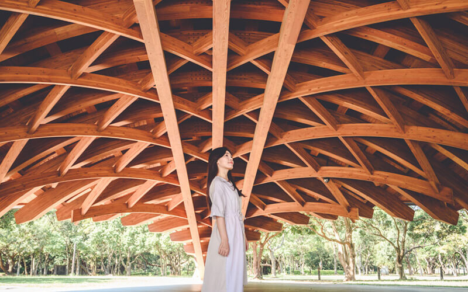

*圖說：（原網頁未提供圖說）｜圖片來源：未標示（文章未註明圖片來源）*

## 崙坪文化地景園區｜觀音崙坪受信所遺跡

「好美喔！！！」在園區裡閒晃時，意外發現了這處廢墟遺址，裸露的紅磚瓦牆描繪著歲月的輪廓，陽光穿透樹林投下斑駁的印記，瀰漫著一股神秘而悠遠的氛圍，還以為走進了失落的古城遺址，有種穿越時空的錯覺，讓我想起了馬雅文化、亞特蘭提斯等等。

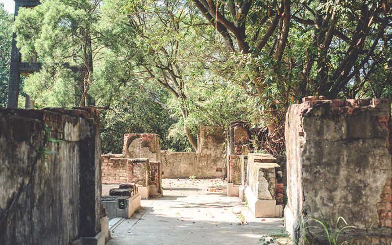

*圖說：（原網頁未提供圖說）｜圖片來源：未標示（文章未註明圖片來源）*

晃了一圈，大致能看出建築空間的規劃，雖然遺跡殘破不堪，連建築的外觀都已消失，在外人眼中就是毫無用途的廢墟，在我們眼裡卻散發著另一種古老神祕的美感，也因為喜歡神祕感的景點，在這裡消耗快門的時間比其他地方多上一倍，甚至拍到捨不得離開。

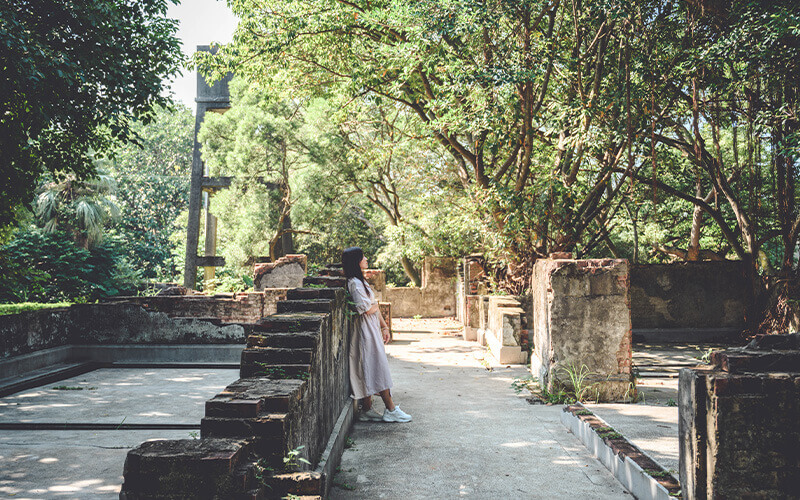

*圖說：（原網頁未提供圖說）｜圖片來源：未標示（文章未註明圖片來源）*

其他的廢墟老屋瀰漫著神祕又蕭瑟的景象，有的已經被樹木佔據為家，一條條樹藤遮蔽了屋簷、伸長了茂密的枝幹彷彿告訴旅人這是它的領地，不准任何人侵犯，這裡的樹屋活靈活現，有的像極了奇幻小說裡的場景。

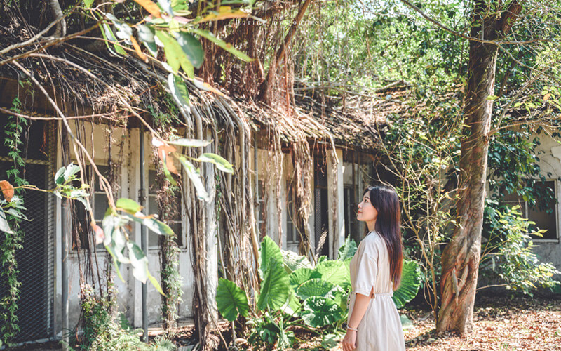

*圖說：（原網頁未提供圖說）｜圖片來源：未標示（文章未註明圖片來源）*

園區內的建築遺跡並不算很多，但都非常有韻味，彷彿是時空淬鍊而成的傑作，雖然沒有特別規劃整理、也沒有告示牌的介紹，保留著建築自然不修邊幅的美也是一件好事。

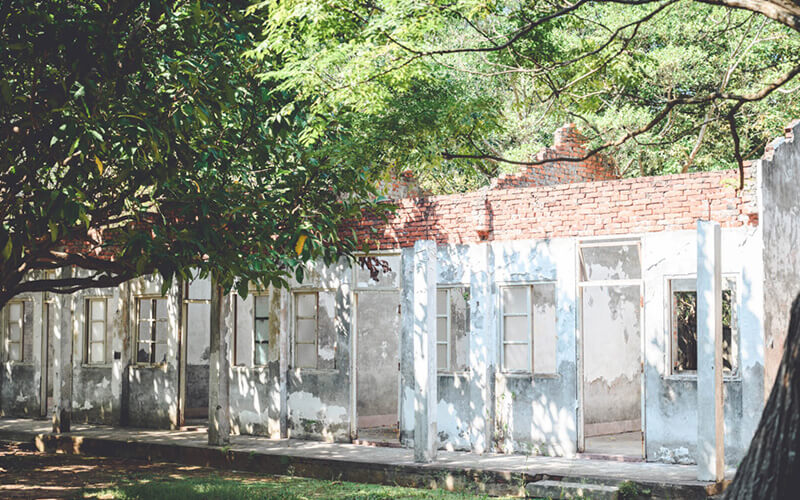

*圖說：（原網頁未提供圖說）｜圖片來源：未標示（文章未註明圖片來源）*

## 崙坪文化地景園區｜客家工藝館、好客食堂

由於這天天氣較炎熱，在園區走個20分鐘就會滿頭大汗了，於是我們直接開車繞到崙坪文化地景園區的另一個入口，一下車就是客家工藝館，這裡納入客家百工百業，包括木工、藍染、竹編、草編、服飾、家具等展覽，在不同的時間有不同的展覽可以觀賞，外頭木椅上的松鼠也是可愛的亮點之一。

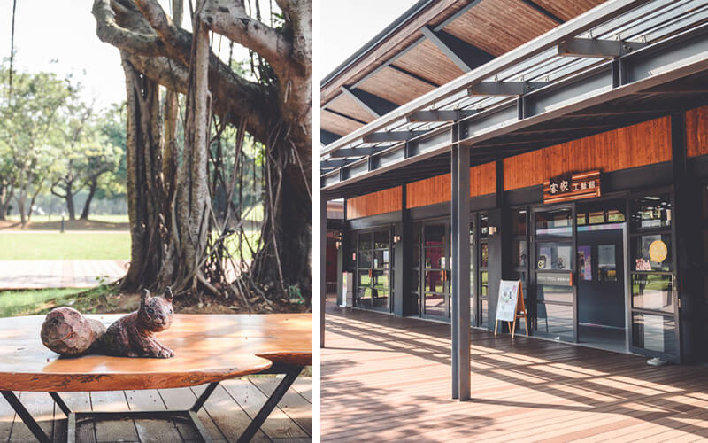

*圖說：（原網頁未提供圖說）｜圖片來源：未標示（文章未註明圖片來源）*

客家工藝館旁的好客食堂是提供客家料理的餐廳，有正餐和下午茶可以選擇，在一片靜謐的池畔邊用餐感覺特別愜意呢，只不過平日的客人超乎預期的多，想必假日更是一位難求了。

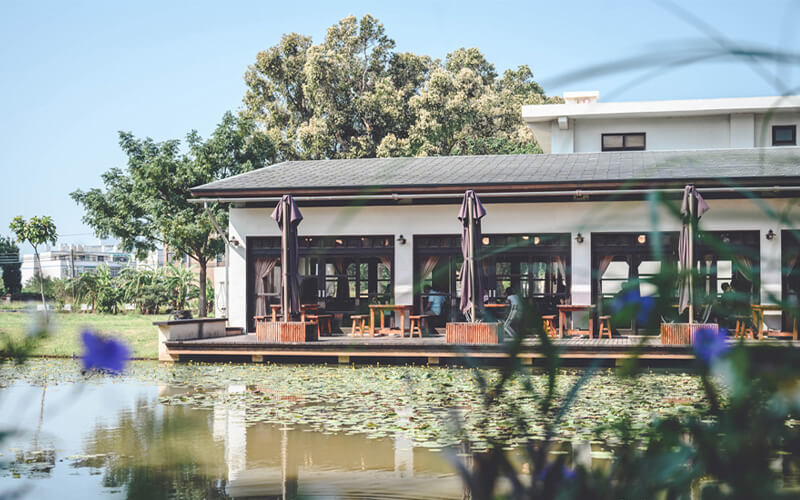

*圖說：（原網頁未提供圖說）｜圖片來源：未標示（文章未註明圖片來源）*

當天看到不少人自備野餐墊和食物坐在草地上休息、享受燦爛的午後時光，真的有點羨慕，也可以帶家裡的毛孩散步、順便運動，十分的愜意悠閒，整個園區有如一座森林公園，可以讓人好好的沉浸於大自然中放鬆，桃園有這處祕境真的太好了。

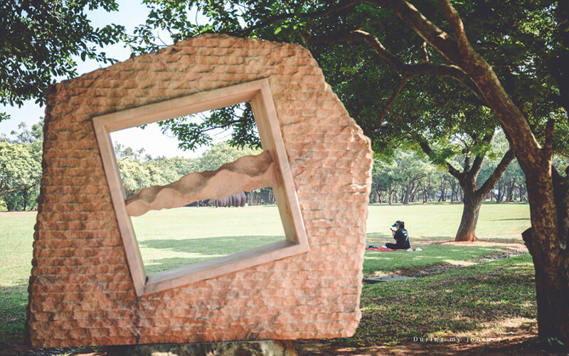

*圖說：（原網頁未提供圖說）｜圖片來源：未標示（文章未註明圖片來源）*

*本文轉載自《我的旅圖中》，非經同意請勿轉載。

## 光點

崙坪文化地景園區

地址：桃園市觀音區學府路350巷120號

電話：03-4984602

FB：崙坪文化地景園區

責任編輯：李家瑀

核稿編輯：林君翰

## 圖片清單

| 檔案 | 圖說 | 圖片來源標示 | 對應段落 | 原始網址 |
| --- | --- | --- | --- | --- |
| images/page_003_image_01.jpg | （原網頁未提供圖說） | 未標示（文章未註明圖片來源） | 散步桃園觀音的自然愜意，在崙坪文化地景園區遇見失落遺跡、龜殼劇場還有客家食堂：最近因工作的關係特別常來桃園，意外搜尋到崙坪文化地景園區這個從未聽過的景點，原本 | https://cdn-smiletaiwan.cw.com.tw/ckeditor/202312/ckeditor-6577c7f889001.jpg |
| images/page_003_image_02.jpg | （原網頁未提供圖說） | 未標示（文章未註明圖片來源） | 散步桃園觀音的自然愜意，在崙坪文化地景園區遇見失落遺跡、龜殼劇場還有客家食堂：崙坪文化地景園區前身是日本時期國際電話株式會社觀音崙坪受信所，時間遺留下了不少廢 | https://cdn-smiletaiwan.cw.com.tw/ckeditor/202312/ckeditor-6577d103e3530.jpg |
| images/page_003_image_03.jpg | （原網頁未提供圖說） | 未標示（文章未註明圖片來源） | 散步桃園觀音的自然愜意，在崙坪文化地景園區遇見失落遺跡、龜殼劇場還有客家食堂：這陣子因工作的緣故較常來桃園，想利用工作的空檔順便踩點，無意間搜尋到崙坪文化地景 | https://cdn-smiletaiwan.cw.com.tw/ckeditor/202312/ckeditor-6577ca6d3828c.jpg |
| images/page_003_image_04.jpg | （原網頁未提供圖說） | 未標示（文章未註明圖片來源） | 崙坪文化地景園區｜龜殼劇場：龜殼劇場是仿生龜殼木結構設施，主要提供表演活動、小農市集的場地，雖然名為「龜殼」 | https://cdn-smiletaiwan.cw.com.tw/ckeditor/202312/ckeditor-6577c7130e991.jpg |
| images/page_003_image_05.jpg | （原網頁未提供圖說） | 未標示（文章未註明圖片來源） | 崙坪文化地景園區｜觀音崙坪受信所遺跡：「好美喔！！！」在園區裡閒晃時，意外發現了這處廢墟遺址，裸露的紅磚瓦牆描繪著歲月 | https://cdn-smiletaiwan.cw.com.tw/ckeditor/202312/ckeditor-6577c7b9e59a0.jpg |
| images/page_003_image_06.jpg | （原網頁未提供圖說） | 未標示（文章未註明圖片來源） | 崙坪文化地景園區｜觀音崙坪受信所遺跡：晃了一圈，大致能看出建築空間的規劃，雖然遺跡殘破不堪，連建築的外觀都已消失，在外 | https://cdn-smiletaiwan.cw.com.tw/ckeditor/202312/ckeditor-6577c7815f45a.jpg |
| images/page_003_image_07.jpg | （原網頁未提供圖說） | 未標示（文章未註明圖片來源） | 崙坪文化地景園區｜觀音崙坪受信所遺跡：其他的廢墟老屋瀰漫著神祕又蕭瑟的景象，有的已經被樹木佔據為家，一條條樹藤遮蔽了屋 | https://cdn-smiletaiwan.cw.com.tw/ckeditor/202312/ckeditor-6577c7e2a0c3c.jpg |
| images/page_003_image_08.jpg | （原網頁未提供圖說） | 未標示（文章未註明圖片來源） | 崙坪文化地景園區｜觀音崙坪受信所遺跡：園區內的建築遺跡並不算很多，但都非常有韻味，彷彿是時空淬鍊而成的傑作，雖然沒有特 | https://cdn-smiletaiwan.cw.com.tw/ckeditor/202312/ckeditor-6577cadee7b47.jpg |
| images/page_003_image_09.jpg | （原網頁未提供圖說） | 未標示（文章未註明圖片來源） | 崙坪文化地景園區｜客家工藝館、好客食堂：由於這天天氣較炎熱，在園區走個20分鐘就會滿頭大汗了，於是我們直接開車繞到崙坪文 | https://cdn-smiletaiwan.cw.com.tw/ckeditor/202312/ckeditor-6577c92f053c9.jpg |
| images/page_003_image_10.jpg | （原網頁未提供圖說） | 未標示（文章未註明圖片來源） | 崙坪文化地景園區｜客家工藝館、好客食堂：客家工藝館旁的好客食堂是提供客家料理的餐廳，有正餐和下午茶可以選擇，在一片靜謐的 | https://cdn-smiletaiwan.cw.com.tw/ckeditor/202312/ckeditor-6577c9441813f.jpg |
| images/page_003_image_11.jpg | （原網頁未提供圖說） | 未標示（文章未註明圖片來源） | 崙坪文化地景園區｜客家工藝館、好客食堂：當天看到不少人自備野餐墊和食物坐在草地上休息、享受燦爛的午後時光，真的有點羨慕， | https://cdn-smiletaiwan.cw.com.tw/ckeditor/202312/ckeditor-6577c95c8a5e0.jpg |

## 正文內連結

- [去基隆「KEELUNG」地標那邊看看，西岸碼頭工人聚落、軍事遺跡，細雨中凝結的時光](https://smiletaiwan.cw.com.tw/article/6185)
- [稻草烏龜、草編蚱蜢、果實陀螺，新竹九讚頭手作展現在地智慧，重拾單純童玩回憶](https://smiletaiwan.cw.com.tw/article/4417)
- [我的旅圖中](https://duringmyjourney.com/lunping/)
