# 《桃園觀音》崙坪文化地景園區 內藏有如被遺忘的神祕古城遺跡、巨大龜殼劇場與茂密樹屋隱藏版秘境

- 編號：page_003_ext_01（父頁面 page_003）
- 原始網址：https://duringmyjourney.com/lunping/
- 網站：我的旅圖中 during my journey（部落格（我的旅圖中））
- 作者：安妮卡Ainycka（發布單位：我的旅圖中 during my journey）
- 發表日期：2023-11-16（最後更新 2024-10-21）
- 取得時間：2026-11-07T17:42:26+08:00
- 擷取方式：site_rule[duringmyjourney.com]: #penci-post-entry-inner
- 資料性質：**媒體／部落格內容，尚未經官方資料查核**（查核結果見 analysis/fact_check_D.md）

---

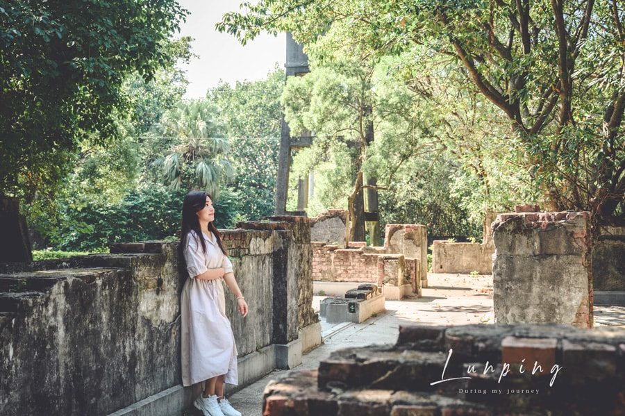

*圖說：《桃園觀音》崙坪文化地景園區 內藏有如被遺忘的神祕古城遺跡、巨大龜殼劇場與茂密樹屋隱藏版秘境｜圖片來源：未標示（文章未註明圖片來源）*

最近因工作的關係特別常來桃園，意外搜尋到崙坪文化地景園區這個從未聽過的景點，原本沒有太多期待，無意逛到廢墟建築的場景美到讓我們驚呼連連，宛如走進古文明的遺跡中！

崙坪文化地景園區前身是日治時期國際電話株式會社觀音崙坪受信所，時間遺留下了不少廢墟老屋建築，在光影的穿梭下宛如走進失落的古城遺址，裸露的紅磚瓦牆描繪著歲月的輪廓，散發著神秘不可告人的氣息，另一邊則是被樹木佔據的廢墟老屋，宛如邂逅了奇幻故事中的場景，喜歡廢墟建築風格的人一定很愛這裡，園區內的另一個亮點就是巨大的龜殼劇場了，內部的木造結構乍看有如天使展翅的羽翼，到處都充滿著奇幻的情境呢！

目錄

- 桃園觀音秘境景點｜崙坪文化地景園區

- 崙坪文化地景園區｜龜殼劇場

- 崙坪文化地景園區｜觀音崙坪受信所遺跡

- 崙坪文化地景園區｜客家工藝館、好客食堂

### 桃園觀音秘境景點｜ 崙坪文化地景園區

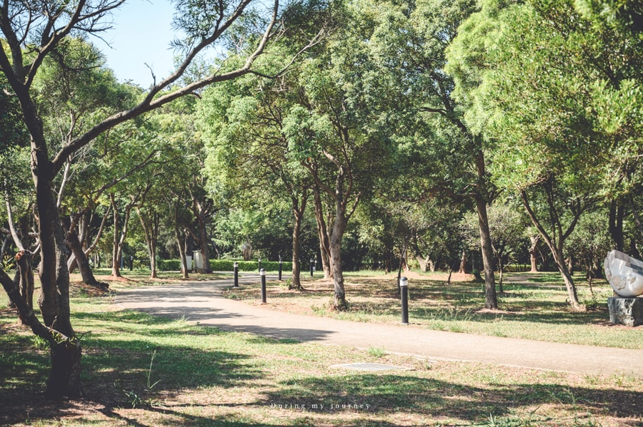

*圖說：《桃園觀音》崙坪文化地景園區 內藏有如被遺忘的神祕古城遺跡、巨大龜殼劇場與茂密樹屋隱藏版秘境｜圖片來源：未標示（文章未註明圖片來源）*

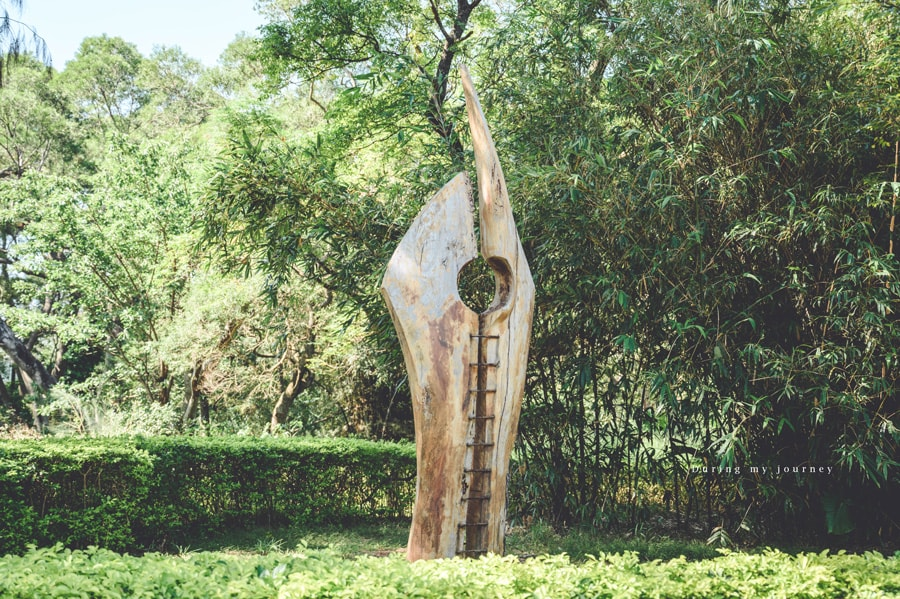

*圖說：《桃園觀音》崙坪文化地景園區 內藏有如被遺忘的神祕古城遺跡、巨大龜殼劇場與茂密樹屋隱藏版秘境｜圖片來源：未標示（文章未註明圖片來源）*

這陣子因工作的緣故較常來桃園，想利用工作的空檔順便踩點，無意間搜尋到崙坪文化地景園區這個位於觀音區的小秘境，開著車彎過了好幾條鄉間小巷，一下車空曠的草地與樹木延伸出綠意盎然的景色，讓人神清氣爽。

崙坪文化地景園區原為日治昭和時期國際電話株式會社觀音崙坪受信所的所在地，提供臺灣至日本、中國之間的無線電通信業務，1986年後相關設施搬遷至交通部電信研究所，從此之後園區就逐漸荒廢，現在依舊能發現當年遺留下來的建築遺址。

### 崙坪文化地景園區｜龜殼劇場

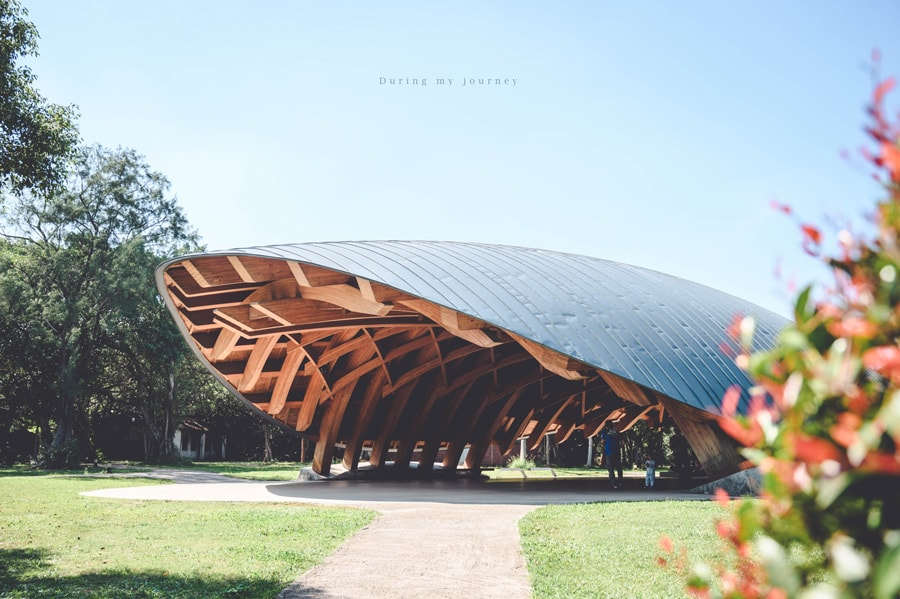

*圖說：《桃園觀音》崙坪文化地景園區 內藏有如被遺忘的神祕古城遺跡、巨大龜殼劇場與茂密樹屋隱藏版秘境｜圖片來源：未標示（文章未註明圖片來源）*

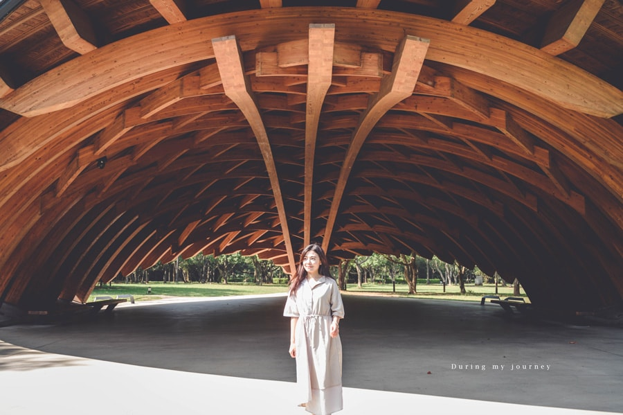

*圖說：《桃園觀音》崙坪文化地景園區 內藏有如被遺忘的神祕古城遺跡、巨大龜殼劇場與茂密樹屋隱藏版秘境｜圖片來源：未標示（文章未註明圖片來源）*

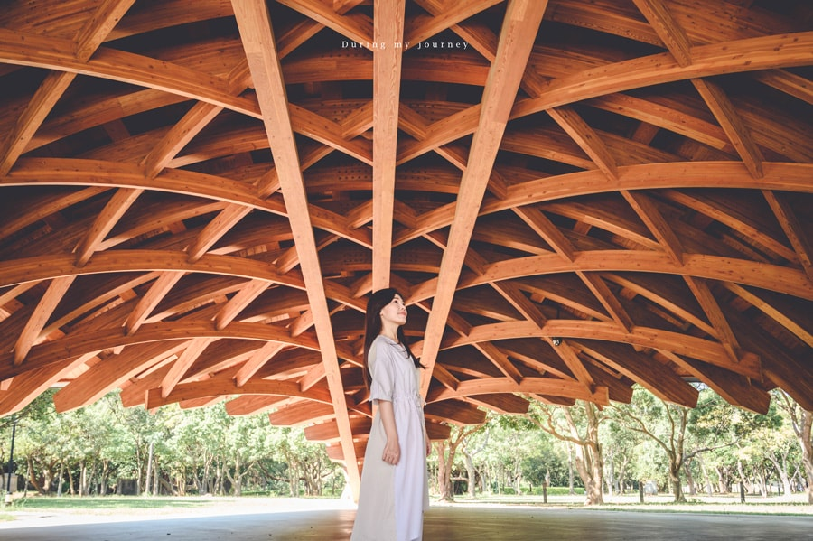

*圖說：《桃園觀音》崙坪文化地景園區 內藏有如被遺忘的神祕古城遺跡、巨大龜殼劇場與茂密樹屋隱藏版秘境｜圖片來源：未標示（文章未註明圖片來源）*

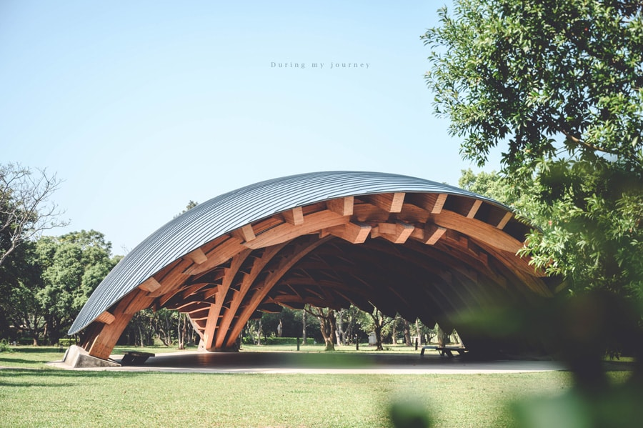

*圖說：龜殼劇場是仿生龜殼木結構設施，主要提供表演活動、小農市集的場地，雖然名為「龜殼」劇場，佇立於在草地上的模樣卻更像甲殼(笑)，內部的木造結構層疊交錯成幾何形狀，更像天使展翅的羽翼，好有奇幻的情境！當天忍不住在這裡拍了好多照片。｜圖片來源：未標示（文章未註明圖片來源）*

### 崙坪文化地景園區｜觀音崙坪受信所遺跡

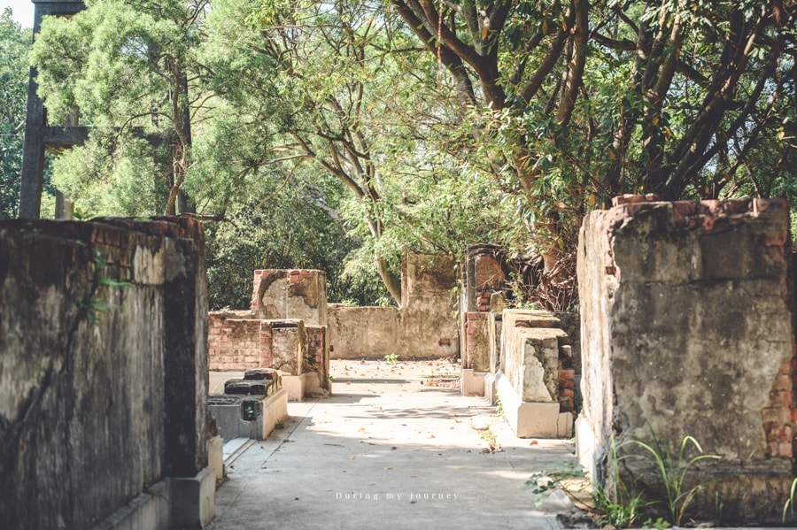

*圖說：《桃園觀音》崙坪文化地景園區 內藏有如被遺忘的神祕古城遺跡、巨大龜殼劇場與茂密樹屋隱藏版秘境｜圖片來源：未標示（文章未註明圖片來源）*

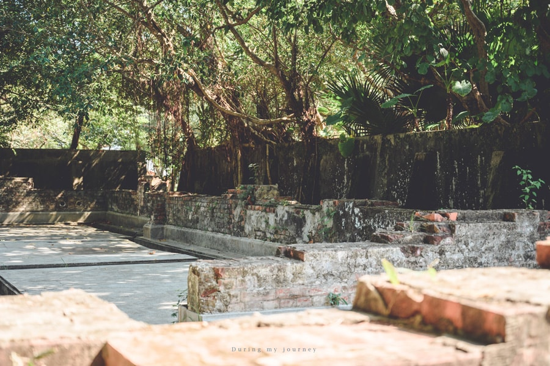

*圖說：《桃園觀音》崙坪文化地景園區 內藏有如被遺忘的神祕古城遺跡、巨大龜殼劇場與茂密樹屋隱藏版秘境｜圖片來源：未標示（文章未註明圖片來源）*

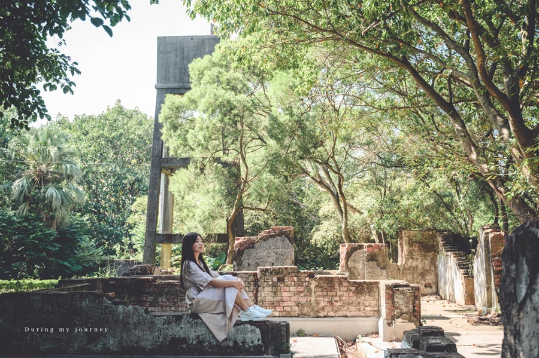

*圖說：《桃園觀音》崙坪文化地景園區 內藏有如被遺忘的神祕古城遺跡、巨大龜殼劇場與茂密樹屋隱藏版秘境｜圖片來源：未標示（文章未註明圖片來源）*

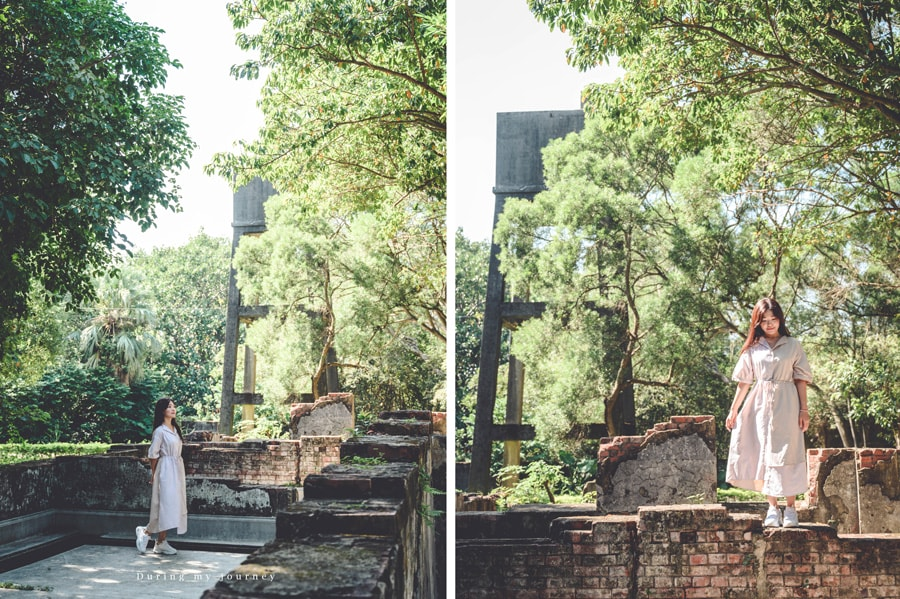

*圖說：《桃園觀音》崙坪文化地景園區 內藏有如被遺忘的神祕古城遺跡、巨大龜殼劇場與茂密樹屋隱藏版秘境｜圖片來源：未標示（文章未註明圖片來源）*

「好美喔！！！」在園區裡閒晃時，意外發現了這處廢墟遺址，裸露的紅磚瓦牆描繪著歲月的輪廓，陽光穿透樹林投下斑駁的印記，瀰漫著一股神秘而悠遠的氛圍，還以為走進了失落的古城遺址，有種穿越時空的錯覺，讓我想起了馬雅文化、亞特蘭提斯等等。

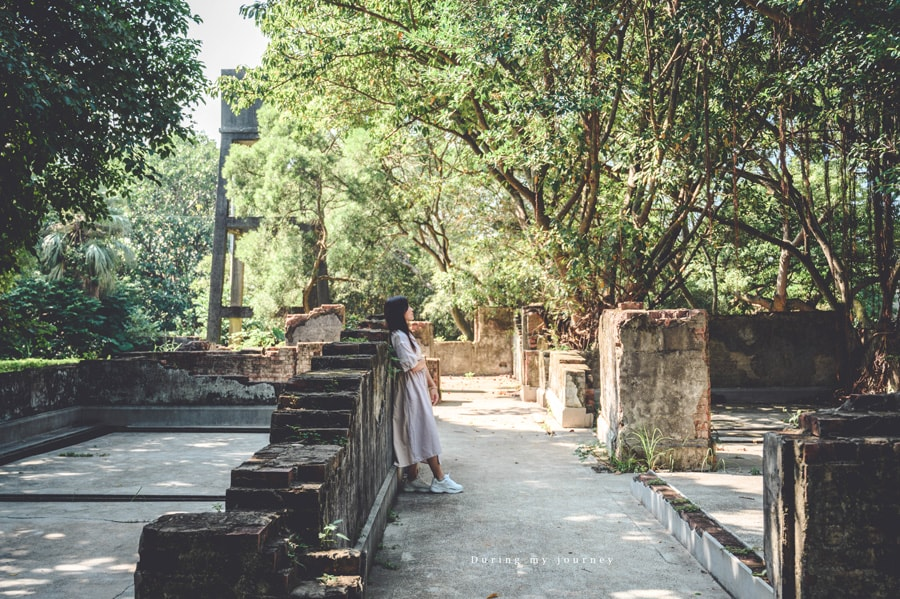

*圖說：《桃園觀音》崙坪文化地景園區 內藏有如被遺忘的神祕古城遺跡、巨大龜殼劇場與茂密樹屋隱藏版秘境｜圖片來源：未標示（文章未註明圖片來源）*

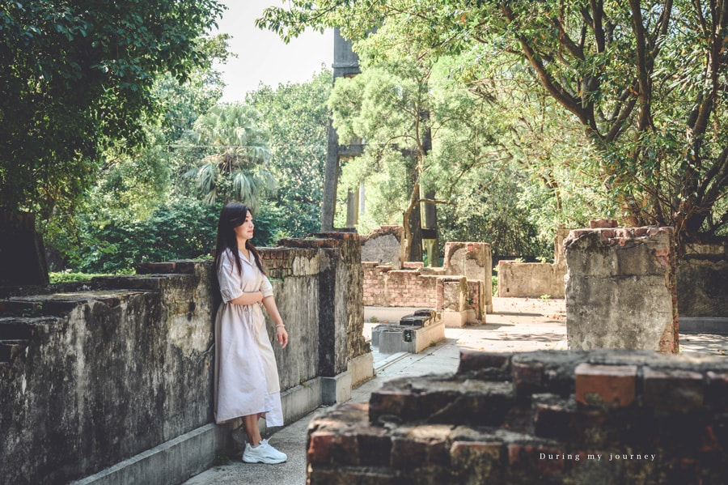

*圖說：《桃園觀音》崙坪文化地景園區 內藏有如被遺忘的神祕古城遺跡、巨大龜殼劇場與茂密樹屋隱藏版秘境｜圖片來源：未標示（文章未註明圖片來源）*

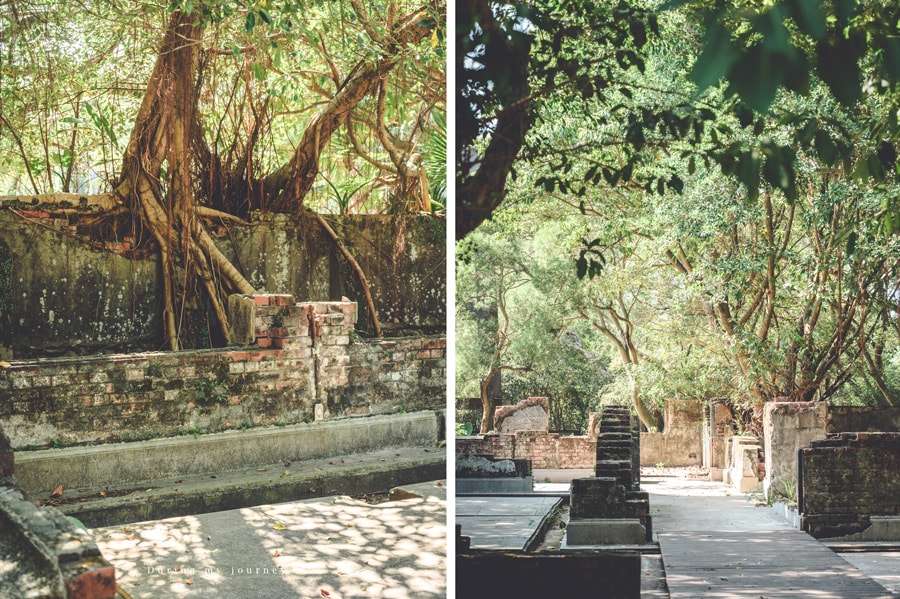

*圖說：《桃園觀音》崙坪文化地景園區 內藏有如被遺忘的神祕古城遺跡、巨大龜殼劇場與茂密樹屋隱藏版秘境｜圖片來源：未標示（文章未註明圖片來源）*

晃了一圈，大致能看出建築空間的規劃，雖然遺跡殘破不堪，連建築的外觀都已消失，在外人眼中就是毫無用途的廢墟，在我們眼裡卻散發著另一種古老神秘的美感，也因為我很喜歡神秘感的景點，在這裡消耗快門的時間比其他地方多上一倍(笑)，甚至拍到捨不得離開了。

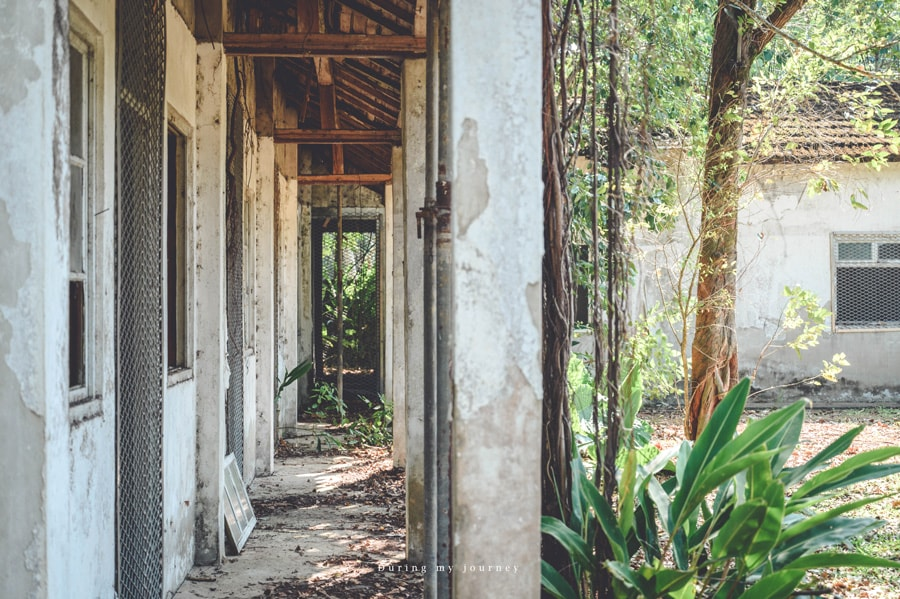

*圖說：《桃園觀音》崙坪文化地景園區 內藏有如被遺忘的神祕古城遺跡、巨大龜殼劇場與茂密樹屋隱藏版秘境｜圖片來源：未標示（文章未註明圖片來源）*

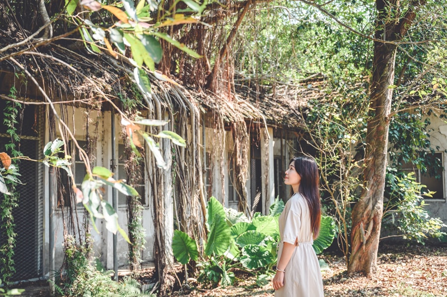

*圖說：《桃園觀音》崙坪文化地景園區 內藏有如被遺忘的神祕古城遺跡、巨大龜殼劇場與茂密樹屋隱藏版秘境｜圖片來源：未標示（文章未註明圖片來源）*

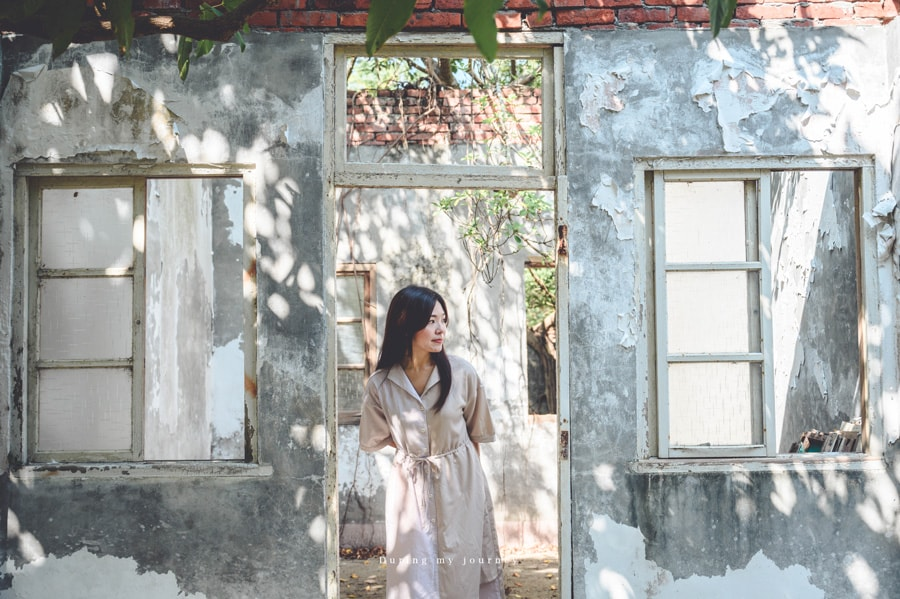

*圖說：《桃園觀音》崙坪文化地景園區 內藏有如被遺忘的神祕古城遺跡、巨大龜殼劇場與茂密樹屋隱藏版秘境｜圖片來源：未標示（文章未註明圖片來源）*

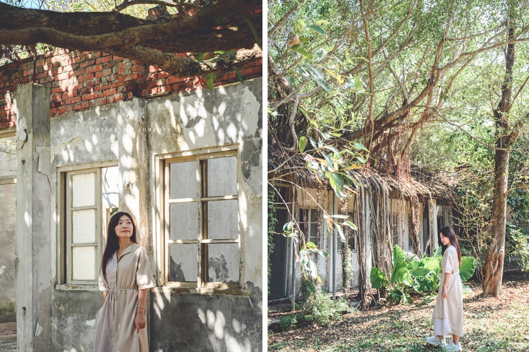

*圖說：《桃園觀音》崙坪文化地景園區 內藏有如被遺忘的神祕古城遺跡、巨大龜殼劇場與茂密樹屋隱藏版秘境｜圖片來源：未標示（文章未註明圖片來源）*

其他的廢墟老屋瀰漫著神秘又蕭瑟的景象，有的已經被樹木佔據為家，一條條樹藤遮蔽了屋簷、伸長了茂密的枝幹彷彿告訴旅人這是他的領地，不准任何人侵犯，這裡的樹屋活靈活現，有的像極了奇幻小說裡的場景。

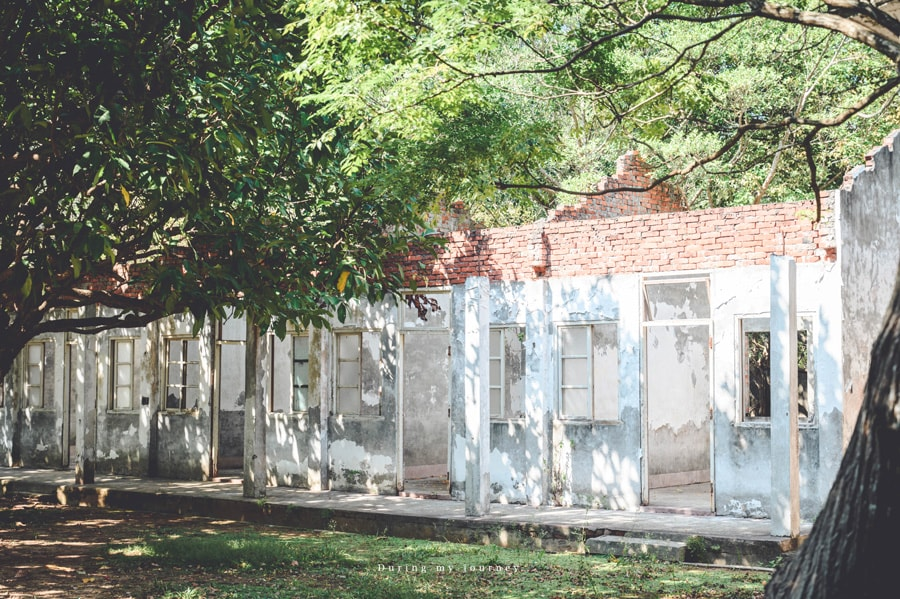

*圖說：《桃園觀音》崙坪文化地景園區 內藏有如被遺忘的神祕古城遺跡、巨大龜殼劇場與茂密樹屋隱藏版秘境｜圖片來源：未標示（文章未註明圖片來源）*

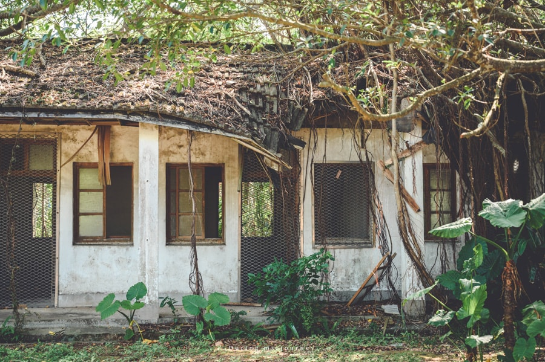

*圖說：《桃園觀音》崙坪文化地景園區 內藏有如被遺忘的神祕古城遺跡、巨大龜殼劇場與茂密樹屋隱藏版秘境｜圖片來源：未標示（文章未註明圖片來源）*

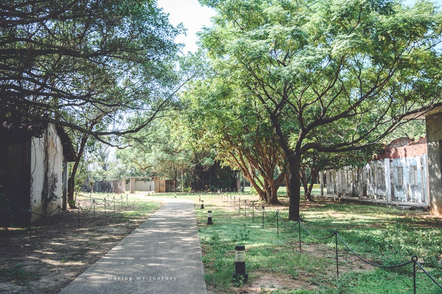

*圖說：《桃園觀音》崙坪文化地景園區 內藏有如被遺忘的神祕古城遺跡、巨大龜殼劇場與茂密樹屋隱藏版秘境｜圖片來源：未標示（文章未註明圖片來源）*

園區內的建築遺跡並不算很多，但是都非常有韻味，彷彿是時空淬鍊而成的傑作，雖然沒有特別規劃整理、也沒有告示牌的介紹，保留著建築自然不修邊幅的美也是一件好事。

### 崙坪文化地景園區｜客家工藝館、好客食堂

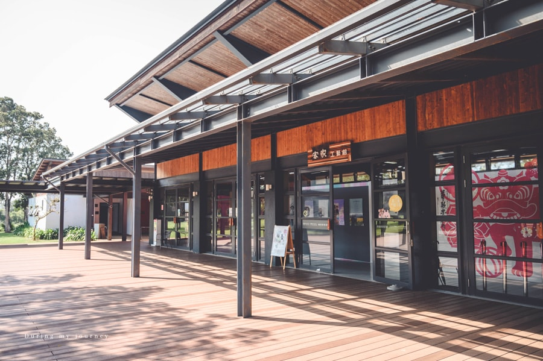

*圖說：《桃園觀音》崙坪文化地景園區 內藏有如被遺忘的神祕古城遺跡、巨大龜殼劇場與茂密樹屋隱藏版秘境｜圖片來源：未標示（文章未註明圖片來源）*

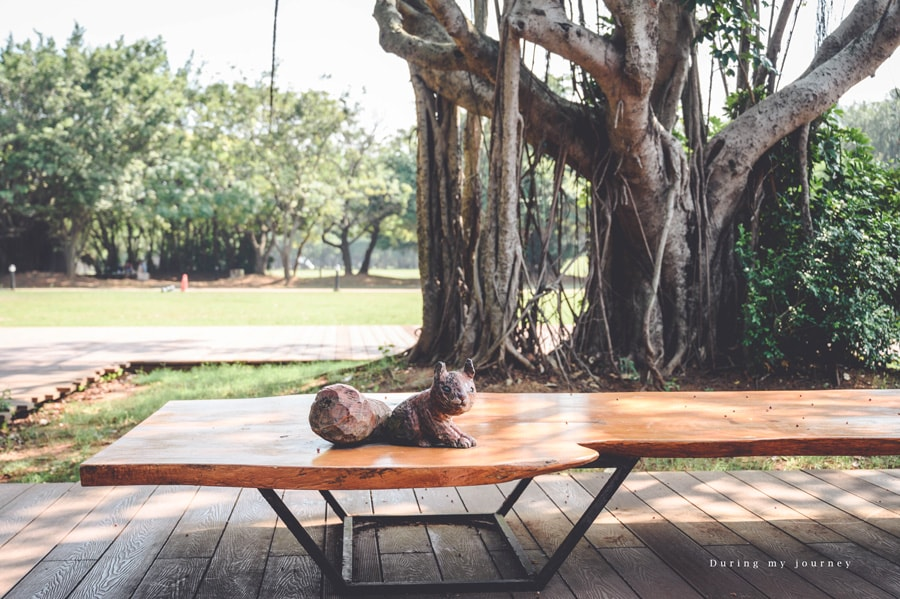

*圖說：《桃園觀音》崙坪文化地景園區 內藏有如被遺忘的神祕古城遺跡、巨大龜殼劇場與茂密樹屋隱藏版秘境｜圖片來源：未標示（文章未註明圖片來源）*

由於這天天氣較炎熱，在園區走個20分鐘就會滿頭大汗了，於是我們直接開車繞到崙坪文化地景園區的另一個入口，一下車就是客家工藝館，這裡納入客家百工百業，包括木工、藍染、竹編、草編、服飾、家具等展覽，在不同的時間有不同的展覽可以觀賞，外頭木椅上的松鼠也是可愛的亮點之一。

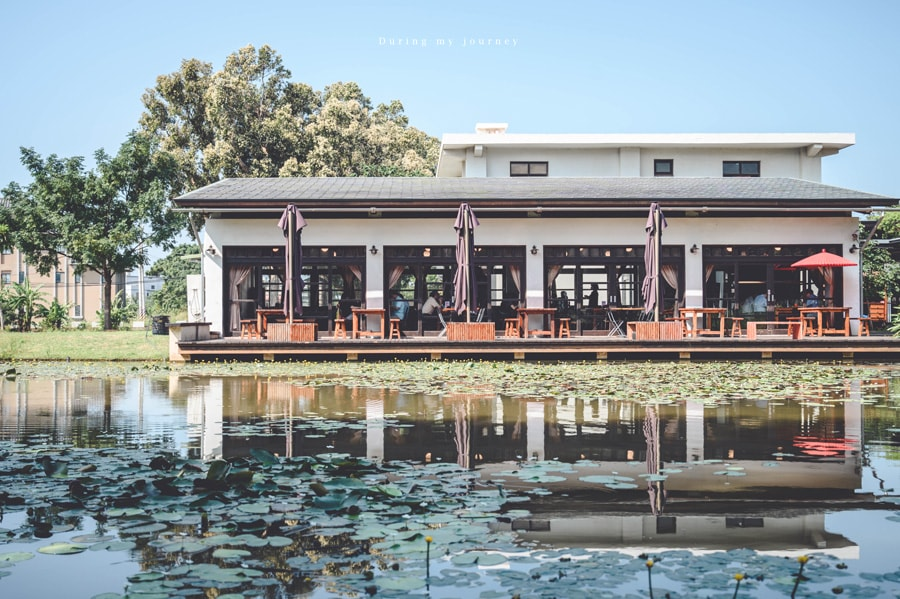

*圖說：《桃園觀音》崙坪文化地景園區 內藏有如被遺忘的神祕古城遺跡、巨大龜殼劇場與茂密樹屋隱藏版秘境｜圖片來源：未標示（文章未註明圖片來源）*

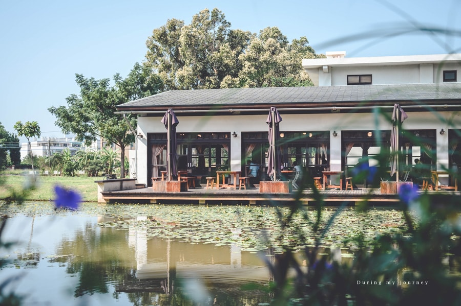

*圖說：《桃園觀音》崙坪文化地景園區 內藏有如被遺忘的神祕古城遺跡、巨大龜殼劇場與茂密樹屋隱藏版秘境｜圖片來源：未標示（文章未註明圖片來源）*

客家工藝館旁的好客食堂是提供客家料理的餐廳，有正餐和下午茶可以選擇，在一片靜謐的池畔邊用餐感覺特別愜意呢，只不過平日的客人超乎預期的多，想必假日更是一位難求了。

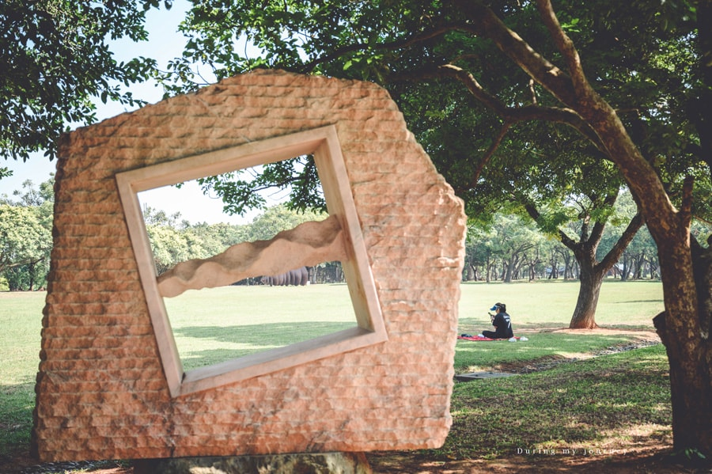

*圖說：《桃園觀音》崙坪文化地景園區 內藏有如被遺忘的神祕古城遺跡、巨大龜殼劇場與茂密樹屋隱藏版秘境｜圖片來源：未標示（文章未註明圖片來源）*

當天看到不少人自備野餐墊和食物坐在草地上休息、享受燦爛的午後時光，真的有點羨慕(笑)，也可以帶家裡的毛孩散步、順便運動，十分的愜意悠閒，整個園區有如一座森林公園，可以讓人好好的沉浸於大自然中放鬆，桃園有這處秘境真的太好了。

Info.

地址: 桃園市觀音區崙坪里16鄰學府路350巷120號

客家工藝館營業時間: 週二至週五 9:00 – 17:00 (週一公休)

崙坪文化地景園區｜官方網站｜Facebook粉絲團

*圖說：followfb｜圖片來源：未標示（文章未註明圖片來源）*

*圖說：followig｜圖片來源：未標示（文章未註明圖片來源）*

*圖說：《桃園觀音》崙坪文化地景園區 內藏有如被遺忘的神祕古城遺跡、巨大龜殼劇場與茂密樹屋隱藏版秘境｜圖片來源：未標示（文章未註明圖片來源）*

我的第一本著作 我們的私房漫旅：100個旅拍玩家嚴選的絕美IG打卡秘境

博客來｜誠品｜金石堂｜尖端

## 圖片清單

| 檔案 | 圖說 | 圖片來源標示 | 對應段落 | 原始網址 |
| --- | --- | --- | --- | --- |
| images/page_003_ext_01_image_01.jpg | 《桃園觀音》崙坪文化地景園區 內藏有如被遺忘的神祕古城遺跡、巨大龜殼劇場與茂密樹屋隱藏版秘境 | 未標示（文章未註明圖片來源） | 《桃園觀音》崙坪文化地景園區 內藏有如被遺忘的神祕古城遺跡、巨大龜殼劇場與茂密樹屋隱藏版秘境： | https://duringmyjourney.com/wp-content/uploads/2023/11/lunping.jpg |
| images/page_003_ext_01_image_02.jpg | 《桃園觀音》崙坪文化地景園區 內藏有如被遺忘的神祕古城遺跡、巨大龜殼劇場與茂密樹屋隱藏版秘境 | 未標示（文章未註明圖片來源） | 桃園觀音秘境景點｜ 崙坪文化地景園區：崙坪文化地景園區｜客家工藝館、好客食堂 | https://duringmyjourney.com/wp-content/uploads/2023/11/DSC_7806.jpg |
| images/page_003_ext_01_image_03.jpg | 《桃園觀音》崙坪文化地景園區 內藏有如被遺忘的神祕古城遺跡、巨大龜殼劇場與茂密樹屋隱藏版秘境 | 未標示（文章未註明圖片來源） | 桃園觀音秘境景點｜ 崙坪文化地景園區：崙坪文化地景園區｜客家工藝館、好客食堂 | https://duringmyjourney.com/wp-content/uploads/2023/11/DSC_7808.jpg |
| images/page_003_ext_01_image_04.jpg | 《桃園觀音》崙坪文化地景園區 內藏有如被遺忘的神祕古城遺跡、巨大龜殼劇場與茂密樹屋隱藏版秘境 | 未標示（文章未註明圖片來源） | 崙坪文化地景園區｜龜殼劇場：崙坪文化地景園區原為日治昭和時期國際電話株式會社觀音崙坪受信所的所在地，提供臺灣 | https://duringmyjourney.com/wp-content/uploads/2023/11/DSC_7803.jpg |
| images/page_003_ext_01_image_05.jpg | 《桃園觀音》崙坪文化地景園區 內藏有如被遺忘的神祕古城遺跡、巨大龜殼劇場與茂密樹屋隱藏版秘境 | 未標示（文章未註明圖片來源） | 崙坪文化地景園區｜龜殼劇場：崙坪文化地景園區原為日治昭和時期國際電話株式會社觀音崙坪受信所的所在地，提供臺灣 | https://duringmyjourney.com/wp-content/uploads/2023/11/DSC_7915.jpg |
| images/page_003_ext_01_image_06.jpg | 《桃園觀音》崙坪文化地景園區 內藏有如被遺忘的神祕古城遺跡、巨大龜殼劇場與茂密樹屋隱藏版秘境 | 未標示（文章未註明圖片來源） | 崙坪文化地景園區｜龜殼劇場：崙坪文化地景園區原為日治昭和時期國際電話株式會社觀音崙坪受信所的所在地，提供臺灣 | https://duringmyjourney.com/wp-content/uploads/2023/11/DSC_7794.jpg |
| images/page_003_ext_01_image_07.jpg | 龜殼劇場是仿生龜殼木結構設施，主要提供表演活動、小農市集的場地，雖然名為「龜殼」劇場，佇立於在草地上的模樣卻更像甲殼(笑)，內部的木造結構層疊交錯成幾何形狀，更像天使展翅的羽翼，好有奇幻的情境！當天忍不住在這裡拍了好多照片。 | 未標示（文章未註明圖片來源） | 崙坪文化地景園區｜龜殼劇場：崙坪文化地景園區原為日治昭和時期國際電話株式會社觀音崙坪受信所的所在地，提供臺灣 | https://duringmyjourney.com/wp-content/uploads/2023/11/DSC_7928.jpg |
| images/page_003_ext_01_image_08.jpg | 《桃園觀音》崙坪文化地景園區 內藏有如被遺忘的神祕古城遺跡、巨大龜殼劇場與茂密樹屋隱藏版秘境 | 未標示（文章未註明圖片來源） | 崙坪文化地景園區｜觀音崙坪受信所遺跡：龜殼劇場是仿生龜殼木結構設施，主要提供表演活動、小農市集的場地，雖然名為「龜殼」 | https://duringmyjourney.com/wp-content/uploads/2023/11/DSC_7858.jpg |
| images/page_003_ext_01_image_09.jpg | 《桃園觀音》崙坪文化地景園區 內藏有如被遺忘的神祕古城遺跡、巨大龜殼劇場與茂密樹屋隱藏版秘境 | 未標示（文章未註明圖片來源） | 崙坪文化地景園區｜觀音崙坪受信所遺跡：龜殼劇場是仿生龜殼木結構設施，主要提供表演活動、小農市集的場地，雖然名為「龜殼」 | https://duringmyjourney.com/wp-content/uploads/2023/11/DSC_7835.jpg |
| images/page_003_ext_01_image_10.jpg | 《桃園觀音》崙坪文化地景園區 內藏有如被遺忘的神祕古城遺跡、巨大龜殼劇場與茂密樹屋隱藏版秘境 | 未標示（文章未註明圖片來源） | 崙坪文化地景園區｜觀音崙坪受信所遺跡：龜殼劇場是仿生龜殼木結構設施，主要提供表演活動、小農市集的場地，雖然名為「龜殼」 | https://duringmyjourney.com/wp-content/uploads/2023/11/DSC_7818.jpg |
| images/page_003_ext_01_image_11.jpg | 《桃園觀音》崙坪文化地景園區 內藏有如被遺忘的神祕古城遺跡、巨大龜殼劇場與茂密樹屋隱藏版秘境 | 未標示（文章未註明圖片來源） | 崙坪文化地景園區｜觀音崙坪受信所遺跡：龜殼劇場是仿生龜殼木結構設施，主要提供表演活動、小農市集的場地，雖然名為「龜殼」 | https://duringmyjourney.com/wp-content/uploads/2023/11/01-3.jpg |
| images/page_003_ext_01_image_12.jpg | 《桃園觀音》崙坪文化地景園區 內藏有如被遺忘的神祕古城遺跡、巨大龜殼劇場與茂密樹屋隱藏版秘境 | 未標示（文章未註明圖片來源） | 崙坪文化地景園區｜觀音崙坪受信所遺跡：「好美喔！！！」在園區裡閒晃時，意外發現了這處廢墟遺址，裸露的紅磚瓦牆描繪著歲月 | https://duringmyjourney.com/wp-content/uploads/2023/11/DSC_7850.jpg |
| images/page_003_ext_01_image_13.jpg | 《桃園觀音》崙坪文化地景園區 內藏有如被遺忘的神祕古城遺跡、巨大龜殼劇場與茂密樹屋隱藏版秘境 | 未標示（文章未註明圖片來源） | 崙坪文化地景園區｜觀音崙坪受信所遺跡：「好美喔！！！」在園區裡閒晃時，意外發現了這處廢墟遺址，裸露的紅磚瓦牆描繪著歲月 | https://duringmyjourney.com/wp-content/uploads/2023/11/DSC_7855.jpg |
| images/page_003_ext_01_image_14.jpg | 《桃園觀音》崙坪文化地景園區 內藏有如被遺忘的神祕古城遺跡、巨大龜殼劇場與茂密樹屋隱藏版秘境 | 未標示（文章未註明圖片來源） | 崙坪文化地景園區｜觀音崙坪受信所遺跡：「好美喔！！！」在園區裡閒晃時，意外發現了這處廢墟遺址，裸露的紅磚瓦牆描繪著歲月 | https://duringmyjourney.com/wp-content/uploads/2023/11/02-3.jpg |
| images/page_003_ext_01_image_15.jpg | 《桃園觀音》崙坪文化地景園區 內藏有如被遺忘的神祕古城遺跡、巨大龜殼劇場與茂密樹屋隱藏版秘境 | 未標示（文章未註明圖片來源） | 崙坪文化地景園區｜觀音崙坪受信所遺跡：晃了一圈，大致能看出建築空間的規劃，雖然遺跡殘破不堪，連建築的外觀都已消失，在外 | https://duringmyjourney.com/wp-content/uploads/2023/11/DSC_7880.jpg |
| images/page_003_ext_01_image_16.jpg | 《桃園觀音》崙坪文化地景園區 內藏有如被遺忘的神祕古城遺跡、巨大龜殼劇場與茂密樹屋隱藏版秘境 | 未標示（文章未註明圖片來源） | 崙坪文化地景園區｜觀音崙坪受信所遺跡：晃了一圈，大致能看出建築空間的規劃，雖然遺跡殘破不堪，連建築的外觀都已消失，在外 | https://duringmyjourney.com/wp-content/uploads/2023/11/DSC_7891.jpg |
| images/page_003_ext_01_image_17.jpg | 《桃園觀音》崙坪文化地景園區 內藏有如被遺忘的神祕古城遺跡、巨大龜殼劇場與茂密樹屋隱藏版秘境 | 未標示（文章未註明圖片來源） | 崙坪文化地景園區｜觀音崙坪受信所遺跡：晃了一圈，大致能看出建築空間的規劃，雖然遺跡殘破不堪，連建築的外觀都已消失，在外 | https://duringmyjourney.com/wp-content/uploads/2023/11/DSC_7877.jpg |
| images/page_003_ext_01_image_18.jpg | 《桃園觀音》崙坪文化地景園區 內藏有如被遺忘的神祕古城遺跡、巨大龜殼劇場與茂密樹屋隱藏版秘境 | 未標示（文章未註明圖片來源） | 崙坪文化地景園區｜觀音崙坪受信所遺跡：晃了一圈，大致能看出建築空間的規劃，雖然遺跡殘破不堪，連建築的外觀都已消失，在外 | https://duringmyjourney.com/wp-content/uploads/2023/11/03-3.jpg |
| images/page_003_ext_01_image_19.jpg | 《桃園觀音》崙坪文化地景園區 內藏有如被遺忘的神祕古城遺跡、巨大龜殼劇場與茂密樹屋隱藏版秘境 | 未標示（文章未註明圖片來源） | 崙坪文化地景園區｜觀音崙坪受信所遺跡：其他的廢墟老屋瀰漫著神秘又蕭瑟的景象，有的已經被樹木佔據為家，一條條樹藤遮蔽了屋 | https://duringmyjourney.com/wp-content/uploads/2023/11/DSC_7900.jpg |
| images/page_003_ext_01_image_20.jpg | 《桃園觀音》崙坪文化地景園區 內藏有如被遺忘的神祕古城遺跡、巨大龜殼劇場與茂密樹屋隱藏版秘境 | 未標示（文章未註明圖片來源） | 崙坪文化地景園區｜觀音崙坪受信所遺跡：其他的廢墟老屋瀰漫著神秘又蕭瑟的景象，有的已經被樹木佔據為家，一條條樹藤遮蔽了屋 | https://duringmyjourney.com/wp-content/uploads/2023/11/DSC_7903.jpg |
| images/page_003_ext_01_image_21.jpg | 《桃園觀音》崙坪文化地景園區 內藏有如被遺忘的神祕古城遺跡、巨大龜殼劇場與茂密樹屋隱藏版秘境 | 未標示（文章未註明圖片來源） | 崙坪文化地景園區｜觀音崙坪受信所遺跡：其他的廢墟老屋瀰漫著神秘又蕭瑟的景象，有的已經被樹木佔據為家，一條條樹藤遮蔽了屋 | https://duringmyjourney.com/wp-content/uploads/2023/11/DSC_7901.jpg |
| images/page_003_ext_01_image_22.jpg | 《桃園觀音》崙坪文化地景園區 內藏有如被遺忘的神祕古城遺跡、巨大龜殼劇場與茂密樹屋隱藏版秘境 | 未標示（文章未註明圖片來源） | 崙坪文化地景園區｜客家工藝館、好客食堂：園區內的建築遺跡並不算很多，但是都非常有韻味，彷彿是時空淬鍊而成的傑作，雖然沒有 | https://duringmyjourney.com/wp-content/uploads/2023/11/DSC_7930.jpg |
| images/page_003_ext_01_image_23.jpg | 《桃園觀音》崙坪文化地景園區 內藏有如被遺忘的神祕古城遺跡、巨大龜殼劇場與茂密樹屋隱藏版秘境 | 未標示（文章未註明圖片來源） | 崙坪文化地景園區｜客家工藝館、好客食堂：園區內的建築遺跡並不算很多，但是都非常有韻味，彷彿是時空淬鍊而成的傑作，雖然沒有 | https://duringmyjourney.com/wp-content/uploads/2023/11/DSC_7934.jpg |
| images/page_003_ext_01_image_24.jpg | 《桃園觀音》崙坪文化地景園區 內藏有如被遺忘的神祕古城遺跡、巨大龜殼劇場與茂密樹屋隱藏版秘境 | 未標示（文章未註明圖片來源） | 崙坪文化地景園區｜客家工藝館、好客食堂：由於這天天氣較炎熱，在園區走個20分鐘就會滿頭大汗了，於是我們直接開車繞到崙坪文 | https://duringmyjourney.com/wp-content/uploads/2023/11/DSC_7942.jpg |
| images/page_003_ext_01_image_25.jpg | 《桃園觀音》崙坪文化地景園區 內藏有如被遺忘的神祕古城遺跡、巨大龜殼劇場與茂密樹屋隱藏版秘境 | 未標示（文章未註明圖片來源） | 崙坪文化地景園區｜客家工藝館、好客食堂：由於這天天氣較炎熱，在園區走個20分鐘就會滿頭大汗了，於是我們直接開車繞到崙坪文 | https://duringmyjourney.com/wp-content/uploads/2023/11/DSC_7945.jpg |
| images/page_003_ext_01_image_26.jpg | 《桃園觀音》崙坪文化地景園區 內藏有如被遺忘的神祕古城遺跡、巨大龜殼劇場與茂密樹屋隱藏版秘境 | 未標示（文章未註明圖片來源） | 崙坪文化地景園區｜客家工藝館、好客食堂：客家工藝館旁的好客食堂是提供客家料理的餐廳，有正餐和下午茶可以選擇，在一片靜謐的 | https://duringmyjourney.com/wp-content/uploads/2023/11/DSC_7949.jpg |
| images/page_003_ext_01_image_27.jpg | followfb | 未標示（文章未註明圖片來源） | 崙坪文化地景園區｜客家工藝館、好客食堂：崙坪文化地景園區｜官方網站｜Facebook粉絲團 | https://duringmyjourney.com/wp-content/uploads/pixnet/1530842070-4237429073.jpg |
| images/page_003_ext_01_image_28.jpg | followig | 未標示（文章未註明圖片來源） | 崙坪文化地景園區｜客家工藝館、好客食堂：崙坪文化地景園區｜官方網站｜Facebook粉絲團 | https://duringmyjourney.com/wp-content/uploads/pixnet/1530842078-972166105.jpg |
| images/page_003_ext_01_image_29.jpg | 《桃園觀音》崙坪文化地景園區 內藏有如被遺忘的神祕古城遺跡、巨大龜殼劇場與茂密樹屋隱藏版秘境 | 未標示（文章未註明圖片來源） | 崙坪文化地景園區｜客家工藝館、好客食堂：崙坪文化地景園區｜官方網站｜Facebook粉絲團 | https://lh3.googleusercontent.com/pw/AM-JKLUk7lg16FUQeIaES7fGF6UPlDuVvVGTzNVBwnTkJvvu6FfECwuV6-lbV7WDwJI1twwxkS0CFQ_GJX5n5ngcymf9r8LK6_BbNailkaJDaeuX6U1tWuJdIaerDAOEzJ6YnQ-4M06XcaV9zJky9aGwEGmq=w800-h250-no?authuser=0 |

## 正文內連結

- [官方網站](https://www.hakka.tycg.gov.tw/)
- [https://bit.ly/2HRWR5w](https://bit.ly/2HRWR5w)
- [https://www.books.com.tw/products/0010841980](https://www.books.com.tw/products/0010841980)
- [誠品](http://www.eslite.com/product.aspx?pgid=1001125622811451)
- [金石堂](https://www.kingstone.com.tw/new/basic/2017330247416)
- [尖端](https://sppbuy.91app.com/SalePage/Index/5956500)
