# 【白沙岬燈塔 & 觀音濱海遊憩區】桃園半日遊 ★ 觀燈塔、踩海浪、吹海風

- 編號：page_022_ext_02（父頁面 page_022）
- 原始網址：https://wonderfood.pixnet.net/blog/post/228444359
- 最終網址（轉址後）：https://wonderfood.pixnet.net/blog/posts/8228444359
- 網站：美食人生（部落格（痞客邦 PIXNET））
- 作者：美食人生（發布單位：美食人生）
- 發表日期：2019-10-29
- 取得時間：2026-11-07T17:41:53+08:00
- 擷取方式：site_rule[pixnet.net]: .article-body
- 資料性質：**媒體／部落格內容，尚未經官方資料查核**（查核結果見 analysis/fact_check_D.md）

---

白沙岬燈塔園區和附近的觀音濱海遊憩區

是一個很好的傍晚小旅遊放空行程

先緬懷歷史古蹟然後去踩浪踏灘

晚上再去桃園市區品嘗美食

桃園半日遊小旅行輕鬆寫意完成~~~

白沙岬燈塔參觀資訊

參觀日期:2019.5.19

地址:桃園市觀音區新坡下16號

開放時間:上午九時至下午六時(夏令時間4月1日至10月31日)，

上午九時至下午五時(冬令時間11月1日至3月31日)，每逢星期一內部整理不開放

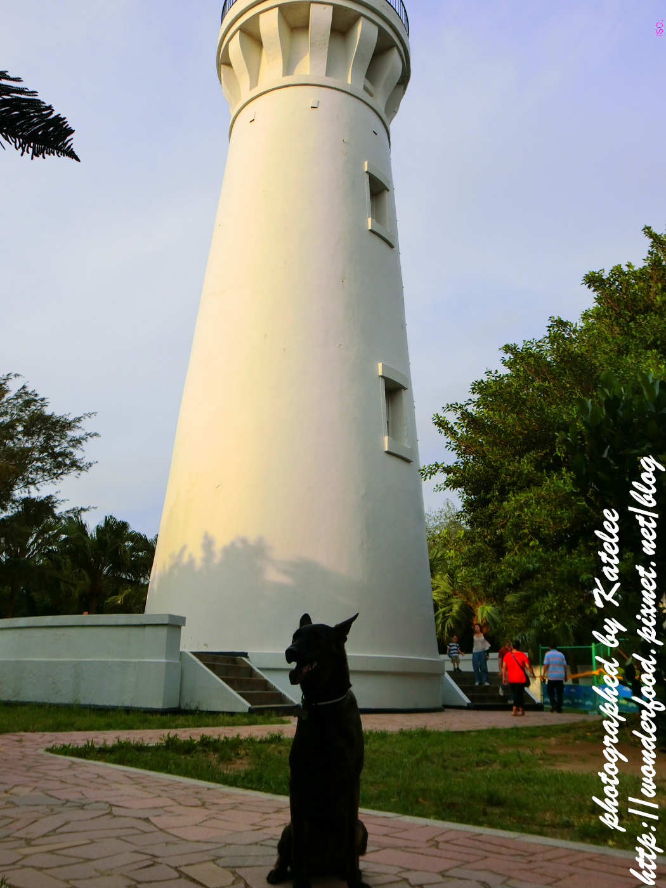

*圖說：PhotoCap_302.jpg｜圖片來源：未標示（文章未註明圖片來源）*

*圖說：2008112515147353｜圖片來源：未標示（文章未註明圖片來源）*

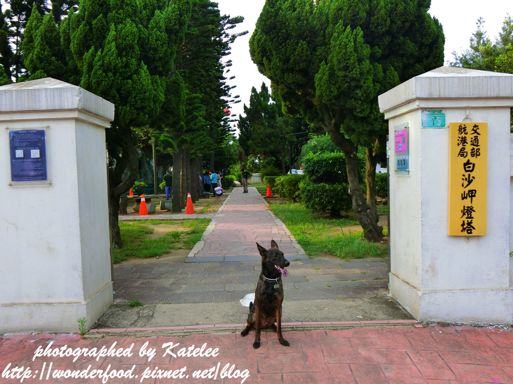

*圖說：PhotoCap_299.jpg｜圖片來源：未標示（文章未註明圖片來源）*

上次來白沙岬燈塔的時候已經是2015年了

想當年畫面中這隻小屁狗錢錢都還沒出生呢!

這天心血來潮

決定帶錢錢來看看燈塔踩踩海浪~~~

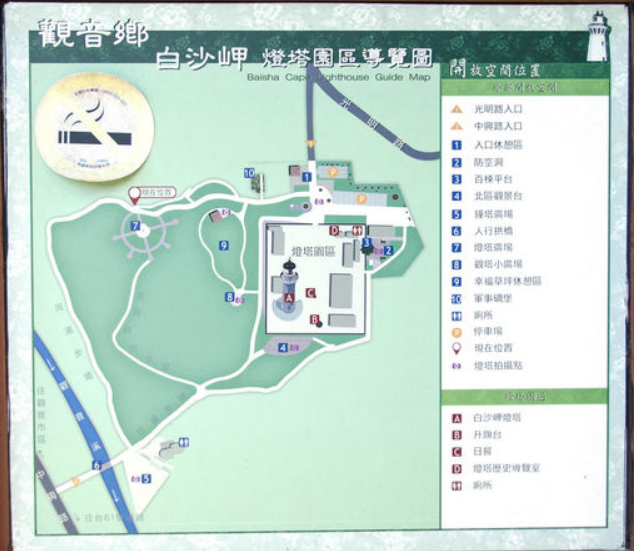

*圖說：觀音鄉白沙岬燈塔園區地圖.png｜圖片來源：未標示（文章未註明圖片來源）*

白沙岬燈塔園區規劃的很漂亮

有以前留存下來的防空洞和軍事碉堡、日治時期即存在的百年苦楝樹、鐘塔廣場、燈塔廣場、大草坪、觀景台等等

細細走一圈

回味百年前建塔的歷史背景與時空變遷

大概1小時左右

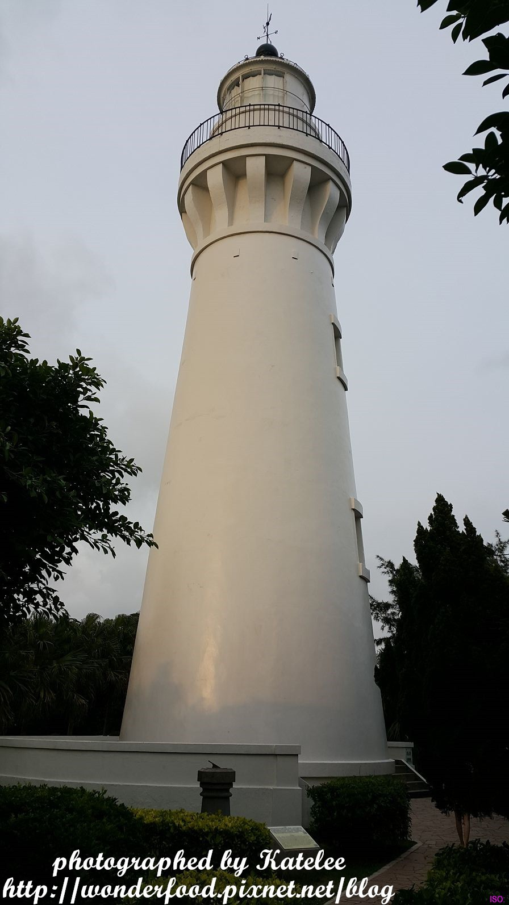

*圖說：PhotoCap_144.jpg｜圖片來源：未標示（文章未註明圖片來源）*

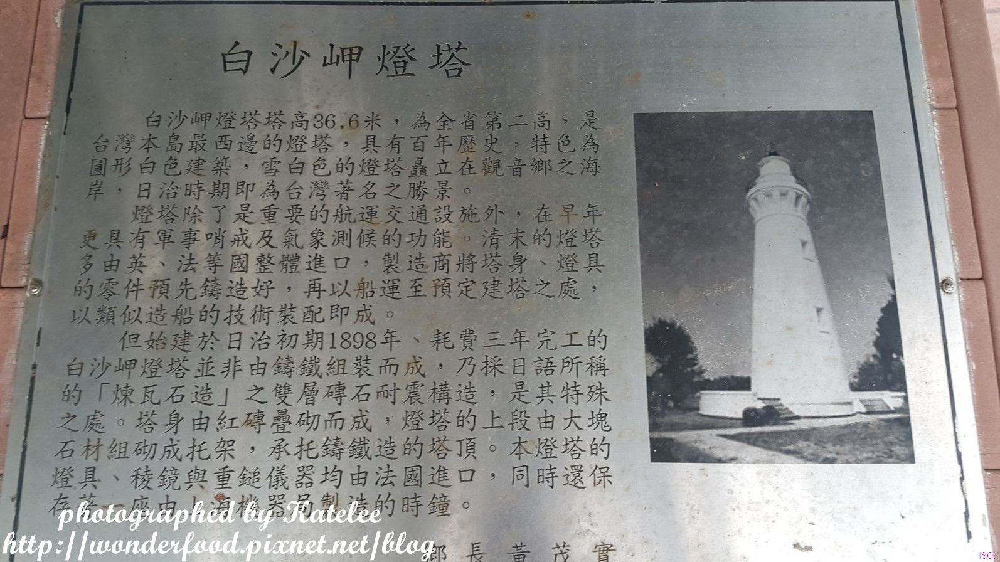

*圖說：PhotoCap_134.jpg｜圖片來源：未標示（文章未註明圖片來源）*

<白沙岬燈塔介紹>

白沙岬燈塔自西元1901年點燈啟用後，在日治時期就已是台灣著名勝景

現在則是桃園第一座縣定古蹟

這座燈塔最特殊的地方就在於，是台灣唯一使用紅磚與石頭建造而成的

不同於台灣其他使用水泥構成的燈塔

而是採用日語所稱的「煉瓦石造」之雙層磚石耐震構造為其特殊處

磚造圓形的塔身採用古法以糯米、黑糖、石灰等混合物黏合

燈塔上段則是由大塊石材組砌成托架，來承托鑄鐵造的塔頂

另外，還有一座由上海機器局製造的時鐘

以及從日治時代便存在的百年苦楝樹，依舊蒼勁挺拔的聳立在庭園中，一派幽然

參考資料: 桃園觀光導覽網---白沙岬燈塔

錢錢和純白的燈塔合照

黑白配XD

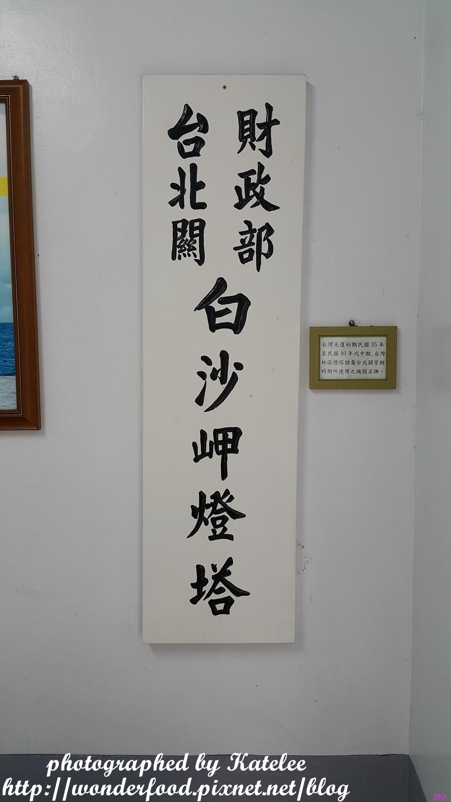

*圖說：PhotoCap_150.jpg｜圖片來源：未標示（文章未註明圖片來源）*

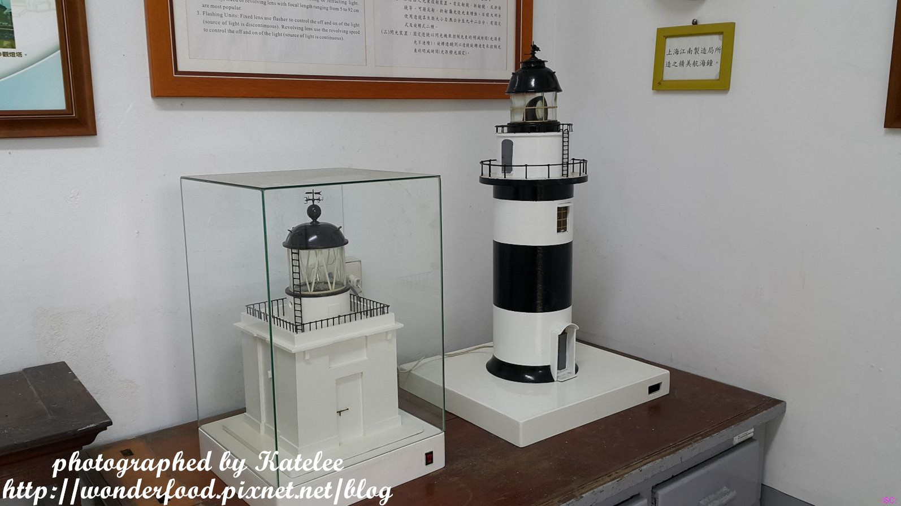

*圖說：PhotoCap_149.jpg｜圖片來源：未標示（文章未註明圖片來源）*

接著進到館內參觀

館內展示著許多燈塔模型、古董燈具、燈塔相關介紹等等

白沙岬燈塔是日本人在臺灣興建的第三座燈塔

燈塔塔高約37公尺，僅次於墾丁鵝鑾鼻燈塔

在台中港燈塔興建之前

是台灣最西邊的燈塔

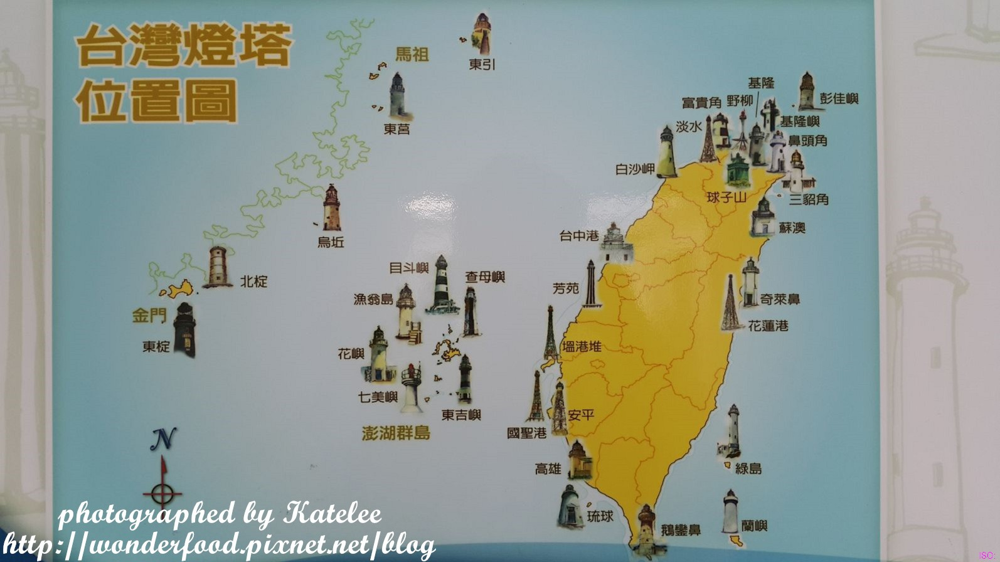

*圖說：PhotoCap_148.jpg｜圖片來源：未標示（文章未註明圖片來源）*

這張圖列出了台灣所有的燈塔

某軒的雄心壯志就是看能不能在有生之年把所有的燈塔都走過一遍

目前已經造訪過了白沙岬燈塔、芳苑燈塔、三貂角燈塔和富貴角燈塔

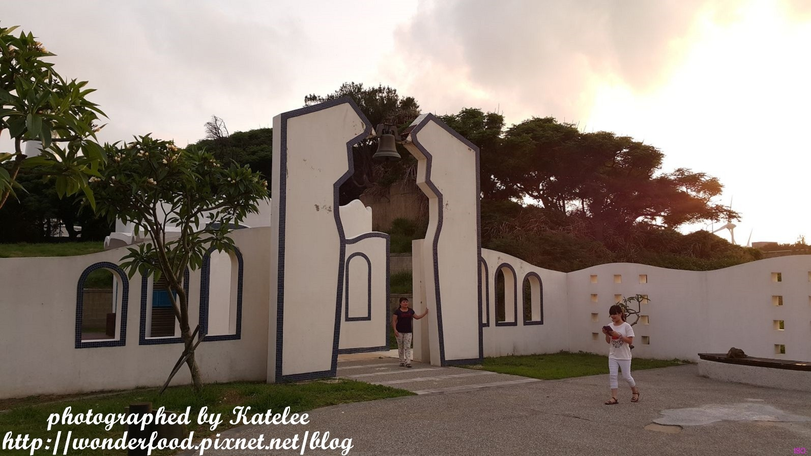

*圖說：PhotoCap_166.jpg｜圖片來源：未標示（文章未註明圖片來源）*

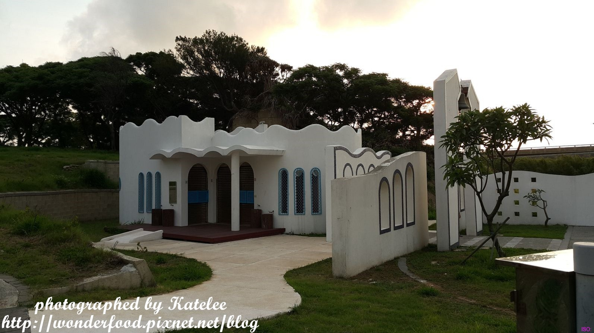

*圖說：PhotoCap_163.jpg｜圖片來源：未標示（文章未註明圖片來源）*

鐘塔廣場

藍白的建築很有地中海希臘風

聽說這裡也是熱門的婚紗取景地

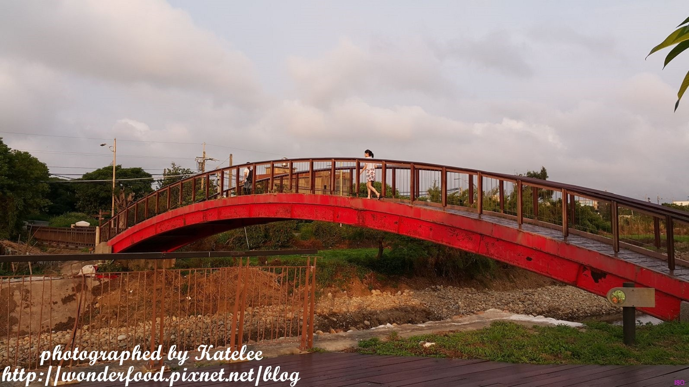

*圖說：PhotoCap_168.jpg｜圖片來源：未標示（文章未註明圖片來源）*

紅色的人行拱橋

這裡也滿適合拍婚紗的

和鐘塔廣場那裏拍出的風格絕對截然不同

這裡有股滄桑但又鮮豔的衝突美感

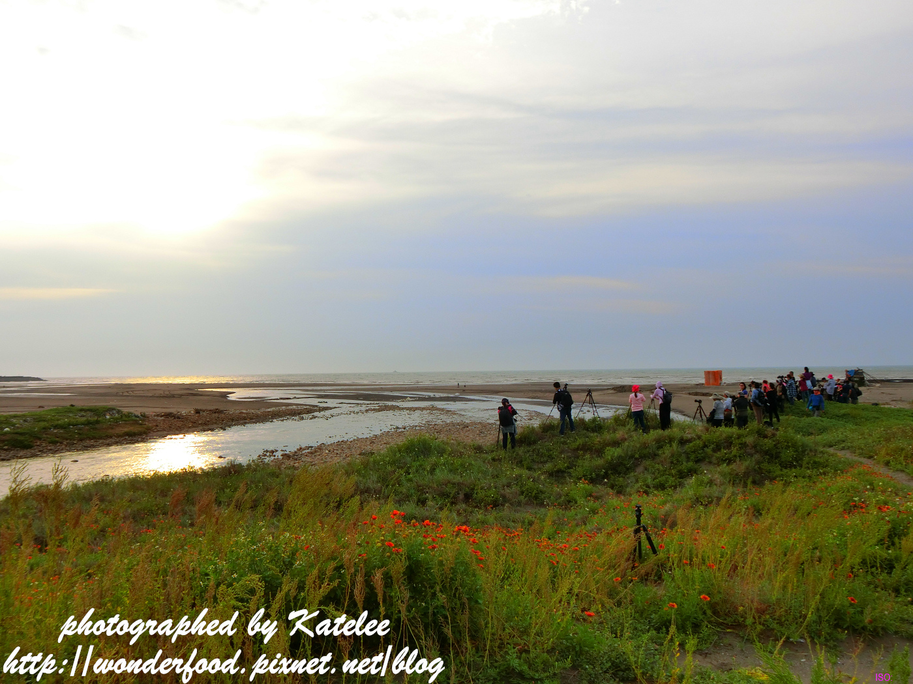

*圖說：PhotoCap_307.jpg｜圖片來源：未標示（文章未註明圖片來源）*

白沙岬燈塔園區到觀音濱海遊憩區非常近

走著走著就不小心到了

沿途經過民宅

聊天、煮晚餐、小狗和小孩跑來跑去嬉鬧、老人聚在一起泡茶聊天

好閒適的生活

看了也不禁放慢了腳步、鬆下了緊繃的肩膀

到了海邊

一堆人已經佔好位置備好器材

預備捕捉夕陽餘暉

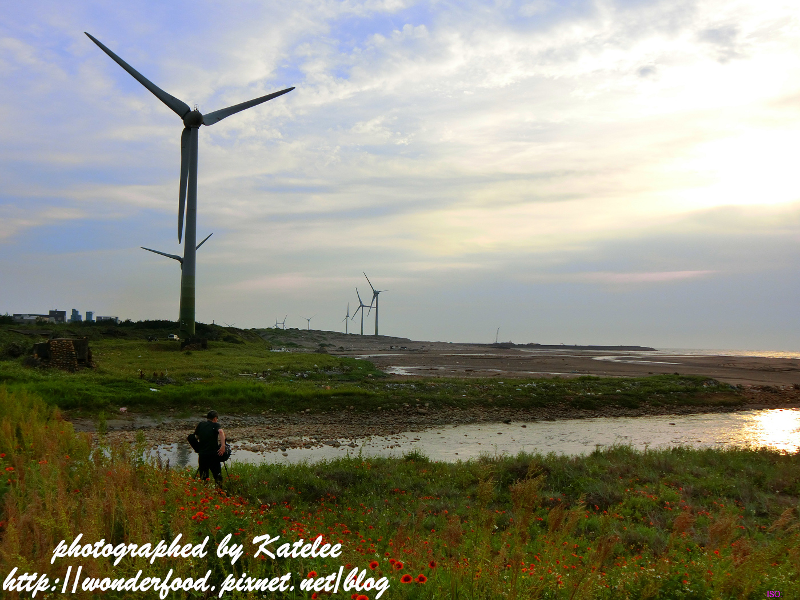

*圖說：PhotoCap_309.jpg｜圖片來源：未標示（文章未註明圖片來源）*

沿海的風力發電，乾淨的能源

像是一幅美麗的畫

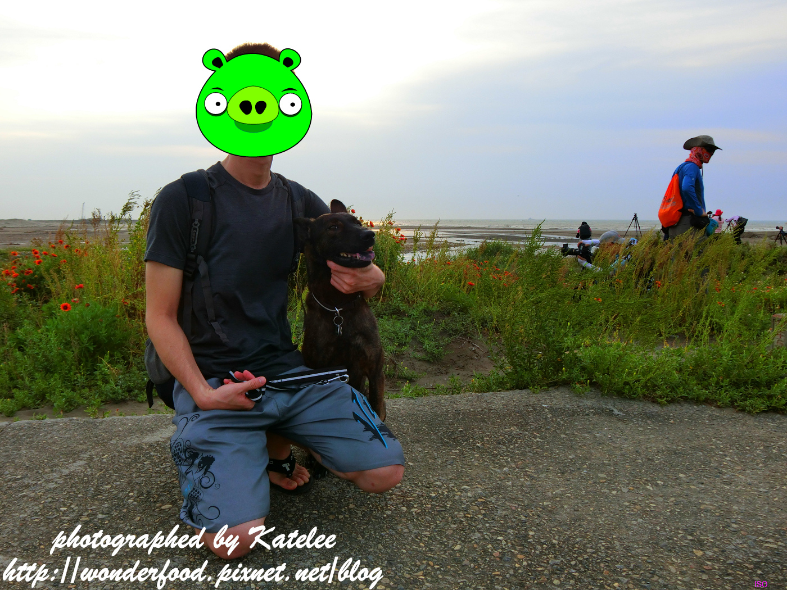

*圖說：PhotoCap_311-1.jpg｜圖片來源：未標示（文章未註明圖片來源）*

錢拔一把摟住錢錢拍張甜蜜的父子合照

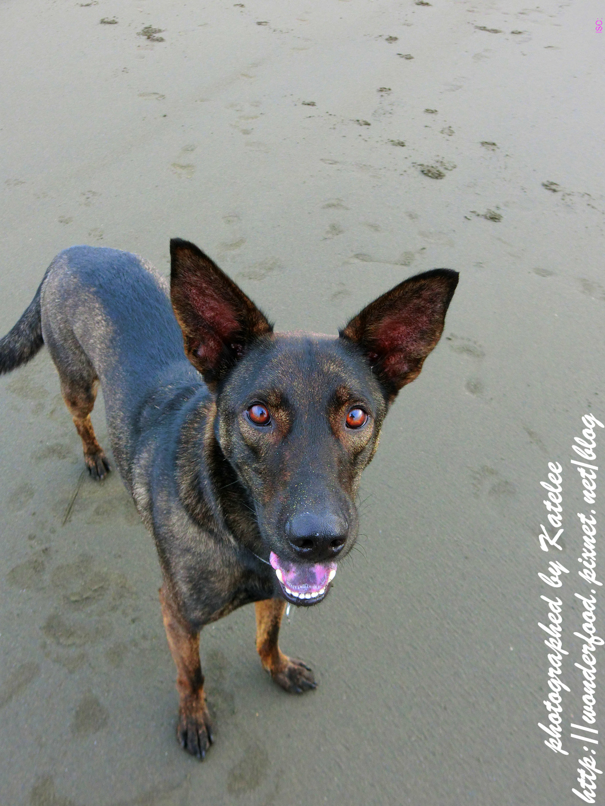

*圖說：PhotoCap_315.jpg｜圖片來源：未標示（文章未註明圖片來源）*

錢錢只要是出來玩

都一定會露出牠最燦爛的笑容

牠的開心藏也藏不住

看到錢那麼開心

身為拔拔麻麻的幸福感爆棚阿~~~

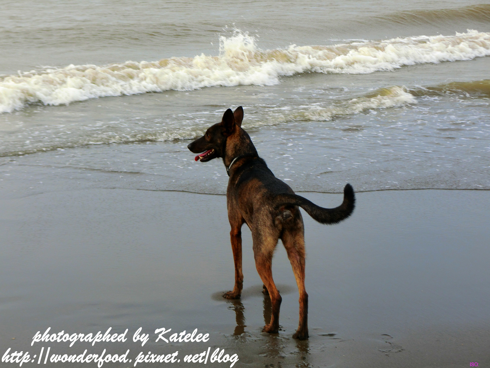

*圖說：PhotoCap_335.jpg｜圖片來源：未標示（文章未註明圖片來源）*

傍晚時分許多人都出來踏浪了

有附近居民、有攜家帶眷的遊客、也有在當地工作的外勞

每個人都在這兒找到了樂趣

錢錢也是

牠開心的衝來衝去

在沙灘上留下一排狗蹄花印

不過重度畏水的牠始終保持與海浪一定的距離

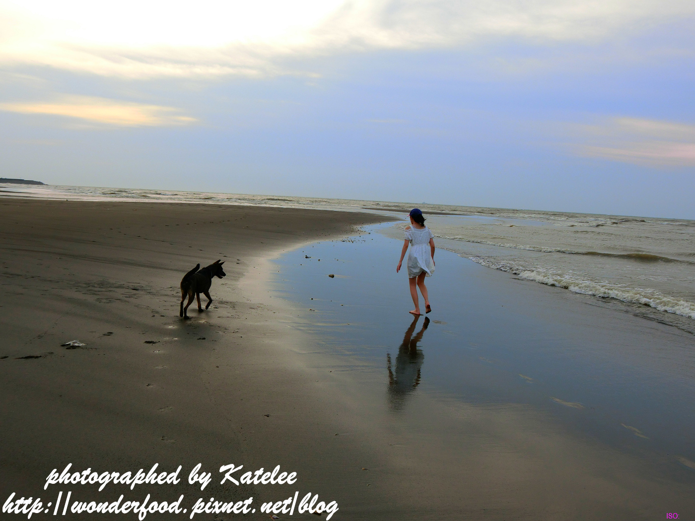

*圖說：PhotoCap_349.jpg｜圖片來源：未標示（文章未註明圖片來源）*

和麻麻開心的玩鬧、盡情地跑跳

我覺得這片海灘非常漂亮

但美中不足的是垃圾有點多...

改天拿個垃圾袋和夾子來淨灘好了~~~

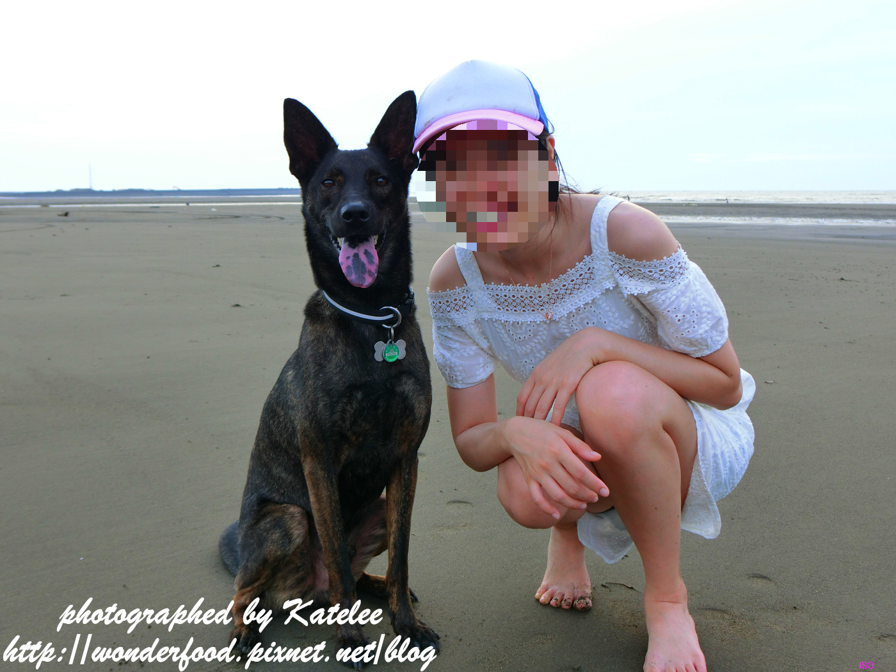

*圖說：PhotoCap_376-1.jpg｜圖片來源：未標示（文章未註明圖片來源）*

當年3公斤還抱在懷中的小奶狗

3年後的現在已經長成勇破20公斤威猛的大屁狗了

坐下來的高度幾乎和麻麻蹲下來差不多

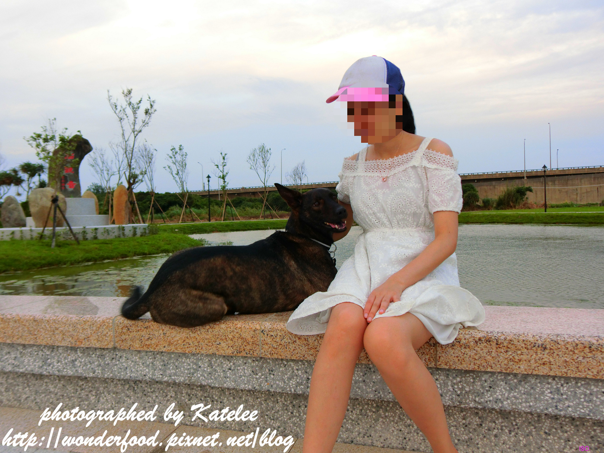

*圖說：PhotoCap_377-1.jpg｜圖片來源：未標示（文章未註明圖片來源）*

回程意外發現一個新建的小公園

這是上次來沒有的

有大片的草坪和小橋流水

好舒服的環境

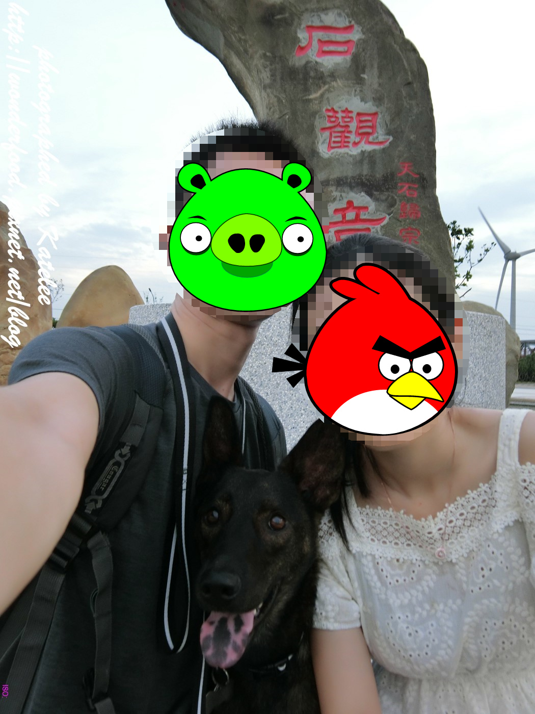

*圖說：PhotoCap_382-1.jpg｜圖片來源：未標示（文章未註明圖片來源）*

公園內的石碑題字---石觀音

某軒獸大和錢寶貝順手拍了一張全家福

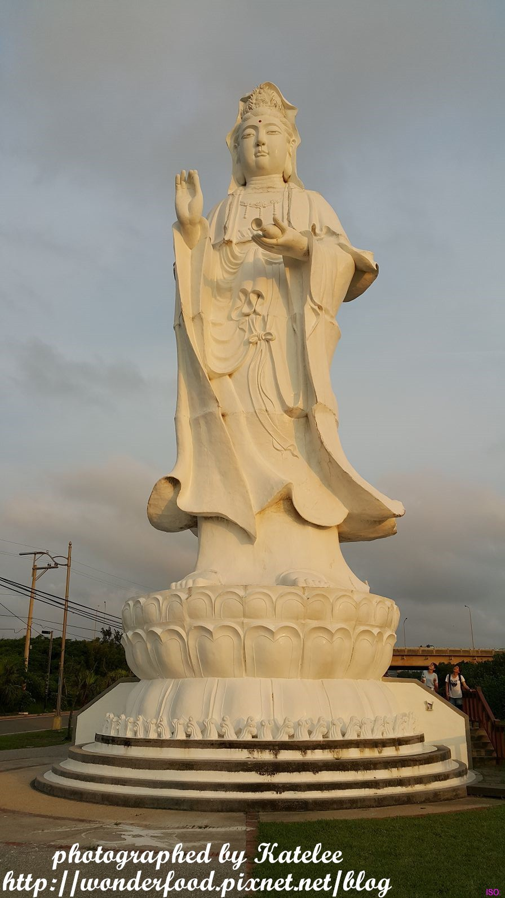

*圖說：PhotoCap_175.jpg｜圖片來源：未標示（文章未註明圖片來源）*

在這個公園的對面原本有一座巨大莊嚴的觀音像

這次來居然不見了!!!

原來是颱風拆除後至今一直未裝回去

希望能早日重建觀音娘娘的風采

畢竟都叫觀音鄉了

不能沒有觀音阿

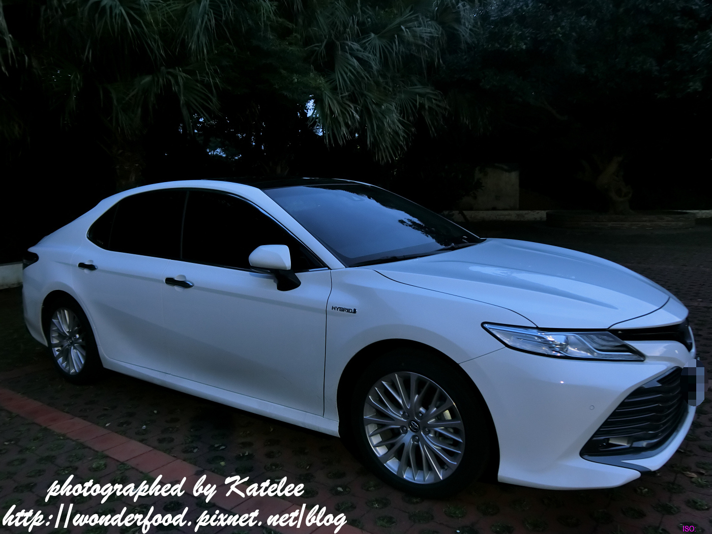

*圖說：PhotoCap_392-1.jpg｜圖片來源：未標示（文章未註明圖片來源）*

回程時天色已向晚

停車場只剩我們一台車了

燈塔的燈已亮了起來

結束這舒服寫意的燈塔踏浪遊

預備去吃晚餐囉~~~

ps.獸大這時候剛牽新車不到一個月

他非常寶貝他的愛車

喜歡載著某軒和錢寶貝四處趴趴走

## 圖片清單

| 檔案 | 圖說 | 圖片來源標示 | 對應段落 | 原始網址 |
| --- | --- | --- | --- | --- |
| images/page_022_ext_02_image_01.jpg | PhotoCap_302.jpg | 未標示（文章未註明圖片來源） | 【白沙岬燈塔 & 觀音濱海遊憩區】桃園半日遊 ★ 觀燈塔、踩海浪、吹海風：上午九時至下午五時(冬令時間11月1日至3月31日)，每逢星期一內部整理不開放 | https://pimg.1px.tw/wonderfood/1572353267-28992825.jpg |
| images/page_022_ext_02_image_02.jpg | 2008112515147353 | 未標示（文章未註明圖片來源） | 【白沙岬燈塔 & 觀音濱海遊憩區】桃園半日遊 ★ 觀燈塔、踩海浪、吹海風：上午九時至下午五時(冬令時間11月1日至3月31日)，每逢星期一內部整理不開放 | https://pimg.1px.tw/wonderfood/1423542200-1648998940.jpg |
| images/page_022_ext_02_image_03.jpg | PhotoCap_299.jpg | 未標示（文章未註明圖片來源） | 【白沙岬燈塔 & 觀音濱海遊憩區】桃園半日遊 ★ 觀燈塔、踩海浪、吹海風：上午九時至下午五時(冬令時間11月1日至3月31日)，每逢星期一內部整理不開放 | https://pimg.1px.tw/wonderfood/1572353266-2338920687.jpg |
| images/page_022_ext_02_image_04.png | 觀音鄉白沙岬燈塔園區地圖.png | 未標示（文章未註明圖片來源） | 【白沙岬燈塔 & 觀音濱海遊憩區】桃園半日遊 ★ 觀燈塔、踩海浪、吹海風：決定帶錢錢來看看燈塔踩踩海浪~~~ | https://pimg.1px.tw/wonderfood/1572355702-2486309041.png |
| images/page_022_ext_02_image_05.jpg | PhotoCap_144.jpg | 未標示（文章未註明圖片來源） | 【白沙岬燈塔 & 觀音濱海遊憩區】桃園半日遊 ★ 觀燈塔、踩海浪、吹海風：回味百年前建塔的歷史背景與時空變遷 | https://pimg.1px.tw/wonderfood/1438577527-2240284455.jpg |
| images/page_022_ext_02_image_06.jpg | PhotoCap_134.jpg | 未標示（文章未註明圖片來源） | 【白沙岬燈塔 & 觀音濱海遊憩區】桃園半日遊 ★ 觀燈塔、踩海浪、吹海風：回味百年前建塔的歷史背景與時空變遷 | https://pimg.1px.tw/wonderfood/1438577526-2199054669.jpg |
| images/page_022_ext_02_image_07.jpg | PhotoCap_150.jpg | 未標示（文章未註明圖片來源） | 【白沙岬燈塔 & 觀音濱海遊憩區】桃園半日遊 ★ 觀燈塔、踩海浪、吹海風：參考資料: 桃園觀光導覽網---白沙岬燈塔 | https://pimg.1px.tw/wonderfood/1438577600-2123784201.jpg |
| images/page_022_ext_02_image_08.jpg | PhotoCap_149.jpg | 未標示（文章未註明圖片來源） | 【白沙岬燈塔 & 觀音濱海遊憩區】桃園半日遊 ★ 觀燈塔、踩海浪、吹海風：參考資料: 桃園觀光導覽網---白沙岬燈塔 | https://pimg.1px.tw/wonderfood/1438577600-784060320.jpg |
| images/page_022_ext_02_image_09.jpg | PhotoCap_148.jpg | 未標示（文章未註明圖片來源） | 【白沙岬燈塔 & 觀音濱海遊憩區】桃園半日遊 ★ 觀燈塔、踩海浪、吹海風：燈塔塔高約37公尺，僅次於墾丁鵝鑾鼻燈塔 | https://pimg.1px.tw/wonderfood/1438577565-2946522139.jpg |
| images/page_022_ext_02_image_10.jpg | PhotoCap_166.jpg | 未標示（文章未註明圖片來源） | 【白沙岬燈塔 & 觀音濱海遊憩區】桃園半日遊 ★ 觀燈塔、踩海浪、吹海風：目前已經造訪過了白沙岬燈塔、芳苑燈塔、三貂角燈塔和富貴角燈塔 | https://pimg.1px.tw/wonderfood/1438577603-1807829301.jpg |
| images/page_022_ext_02_image_11.jpg | PhotoCap_163.jpg | 未標示（文章未註明圖片來源） | 【白沙岬燈塔 & 觀音濱海遊憩區】桃園半日遊 ★ 觀燈塔、踩海浪、吹海風：目前已經造訪過了白沙岬燈塔、芳苑燈塔、三貂角燈塔和富貴角燈塔 | https://pimg.1px.tw/wonderfood/1438577604-1179585588.jpg |
| images/page_022_ext_02_image_12.jpg | PhotoCap_168.jpg | 未標示（文章未註明圖片來源） | 【白沙岬燈塔 & 觀音濱海遊憩區】桃園半日遊 ★ 觀燈塔、踩海浪、吹海風：目前已經造訪過了白沙岬燈塔、芳苑燈塔、三貂角燈塔和富貴角燈塔 | https://pimg.1px.tw/wonderfood/1438577632-751039396.jpg |
| images/page_022_ext_02_image_13.jpg | PhotoCap_307.jpg | 未標示（文章未註明圖片來源） | 【白沙岬燈塔 & 觀音濱海遊憩區】桃園半日遊 ★ 觀燈塔、踩海浪、吹海風：這裡有股滄桑但又鮮豔的衝突美感 | https://pimg.1px.tw/wonderfood/1572353266-4164713774.jpg |
| images/page_022_ext_02_image_14.jpg | PhotoCap_309.jpg | 未標示（文章未註明圖片來源） | 【白沙岬燈塔 & 觀音濱海遊憩區】桃園半日遊 ★ 觀燈塔、踩海浪、吹海風：看了也不禁放慢了腳步、鬆下了緊繃的肩膀 | https://pimg.1px.tw/wonderfood/1572353266-3240633879.jpg |
| images/page_022_ext_02_image_15.jpg | PhotoCap_311-1.jpg | 未標示（文章未註明圖片來源） | 【白沙岬燈塔 & 觀音濱海遊憩區】桃園半日遊 ★ 觀燈塔、踩海浪、吹海風：看了也不禁放慢了腳步、鬆下了緊繃的肩膀 | https://pimg.1px.tw/wonderfood/1572353266-3454960675.jpg |
| images/page_022_ext_02_image_16.jpg | PhotoCap_315.jpg | 未標示（文章未註明圖片來源） | 【白沙岬燈塔 & 觀音濱海遊憩區】桃園半日遊 ★ 觀燈塔、踩海浪、吹海風：錢拔一把摟住錢錢拍張甜蜜的父子合照 | https://pimg.1px.tw/wonderfood/1572353266-4082149719.jpg |
| images/page_022_ext_02_image_17.jpg | PhotoCap_335.jpg | 未標示（文章未註明圖片來源） | 【白沙岬燈塔 & 觀音濱海遊憩區】桃園半日遊 ★ 觀燈塔、踩海浪、吹海風：身為拔拔麻麻的幸福感爆棚阿~~~ | https://pimg.1px.tw/wonderfood/1572353269-2978742925.jpg |
| images/page_022_ext_02_image_18.jpg | PhotoCap_349.jpg | 未標示（文章未註明圖片來源） | 【白沙岬燈塔 & 觀音濱海遊憩區】桃園半日遊 ★ 觀燈塔、踩海浪、吹海風：不過重度畏水的牠始終保持與海浪一定的距離 | https://pimg.1px.tw/wonderfood/1572353269-2514791244.jpg |
| images/page_022_ext_02_image_19.jpg | PhotoCap_376-1.jpg | 未標示（文章未註明圖片來源） | 【白沙岬燈塔 & 觀音濱海遊憩區】桃園半日遊 ★ 觀燈塔、踩海浪、吹海風：改天拿個垃圾袋和夾子來淨灘好了~~~ | https://pimg.1px.tw/wonderfood/1572353271-3011224009.jpg |
| images/page_022_ext_02_image_20.jpg | PhotoCap_377-1.jpg | 未標示（文章未註明圖片來源） | 【白沙岬燈塔 & 觀音濱海遊憩區】桃園半日遊 ★ 觀燈塔、踩海浪、吹海風：坐下來的高度幾乎和麻麻蹲下來差不多 | https://pimg.1px.tw/wonderfood/1572353269-2072875972.jpg |
| images/page_022_ext_02_image_21.jpg | PhotoCap_382-1.jpg | 未標示（文章未註明圖片來源） | 【白沙岬燈塔 & 觀音濱海遊憩區】桃園半日遊 ★ 觀燈塔、踩海浪、吹海風：坐下來的高度幾乎和麻麻蹲下來差不多 | https://pimg.1px.tw/wonderfood/1572353270-3888891296.jpg |
| images/page_022_ext_02_image_22.jpg | PhotoCap_175.jpg | 未標示（文章未註明圖片來源） | 【白沙岬燈塔 & 觀音濱海遊憩區】桃園半日遊 ★ 觀燈塔、踩海浪、吹海風：某軒獸大和錢寶貝順手拍了一張全家福 | https://pimg.1px.tw/wonderfood/1438577634-728592704.jpg |
| images/page_022_ext_02_image_23.jpg | PhotoCap_392-1.jpg | 未標示（文章未註明圖片來源） | 【白沙岬燈塔 & 觀音濱海遊憩區】桃園半日遊 ★ 觀燈塔、踩海浪、吹海風：原來是颱風拆除後至今一直未裝回去 | https://pimg.1px.tw/wonderfood/1572354413-1029222779.jpg |

## 正文內連結

- [https://wonderfood.pixnet.net/album/photo/190661349](https://wonderfood.pixnet.net/album/photo/190661349)
- [桃園觀光導覽網---白沙岬燈塔](https://travel.tycg.gov.tw/zh-tw/travel/attraction/276)　← 觀音區相關
- [【全新第八代大改款CAMRY】HYBRID旗艦款 ★ 人生首購車](https://wonderfood.pixnet.net/blog/post/227737586-%e3%80%90%e5%85%a8%e6%96%b0%e7%ac%ac%e5%85%ab%e4%bb%a3%e5%a4%a7%e6%94%b9%e6%ac%becamry%e3%80%91hybrid%e6%97%97%e8%89%a6%e6%ac%be-%e2%98%85-%e4%ba%ba)
- [【桃園白沙岬燈塔】觀音夕照 ★ 日落觀浪](https://wonderfood.pixnet.net/blog/post/201804730)　← 觀音區相關
- [【富貴角燈塔】台灣最北端/百年黑白相間矮胖燈塔 ★ 老梅石槽/風稜石、沙丘、礁岩特殊海岸地質](https://wonderfood.pixnet.net/blog/post/225052112-%e3%80%90%e5%af%8c%e8%b2%b4%e8%a7%92%e7%87%88%e5%a1%94%e3%80%91%e5%8f%b0%e7%81%a3%e6%9c%80%e5%8c%97%e7%ab%af-%e7%99%be%e5%b9%b4%e9%bb%91%e7%99%bd%e7%9b%b8%e9%96%93%e7%9f%ae)
- [【三貂角燈塔】台灣的眼睛，迎接第一道曙光 ★ 本島最東邊，無人能出其右](https://wonderfood.pixnet.net/blog/post/197837691-%e3%80%90%e4%b8%89%e8%b2%82%e8%a7%92%e7%87%88%e5%a1%94%e3%80%91%e5%8f%b0%e7%81%a3%e7%9a%84%e7%9c%bc%e7%9d%9b%ef%bc%8c%e8%bf%8e%e6%8e%a5%e7%ac%ac%e4%b8%80%e9%81%93%e6%9b%99%e5%85%89)
- [【彰化王功美食人文生態半日輕旅行】林家蚵仔炸/泉芳枝仔冰/芳苑燈塔/王者之弓橋/王功海岸 ★ 遊今日憶昔日盼明日](https://wonderfood.pixnet.net/blog/post/224084852)
- [痞客邦](https://www.pixnet.net)
