# 【桃園半日遊】軒獸微旅行之要吃也要動 ★ 野上麵包坊---第三航廈---祕密景點觀機---白沙岬燈塔---晚餐

- 編號：page_022_ext_03（父頁面 page_022）
- 原始網址：https://wonderfood.pixnet.net/blog/post/201847942
- 最終網址（轉址後）：https://wonderfood.pixnet.net/blog/posts/8201847942
- 網站：美食人生（部落格（痞客邦 PIXNET））
- 作者：美食人生（發布單位：美食人生）
- 發表日期：2015-08-04
- 取得時間：2026-11-07T17:42:48+08:00
- 擷取方式：site_rule[pixnet.net]: .article-body
- 資料性質：**媒體／部落格內容，尚未經官方資料查核**（查核結果見 analysis/fact_check_D.md）

---

因為獸大是個超級無敵大忙人

因此大部分的旅行也都以微旅行的方式進行

在短短的半天內

就可以去好多地方呢

這也算是一種效率的展現吧~

桃園半日遊路線圖:約下午一點半從台北出發---約一個小時到達

野上麵包坊

第三航廈

桃園機場觀機祕密景點

白沙岬燈塔，觀音，海岸

---晚餐中原大學旁

Cooking boss料理屋

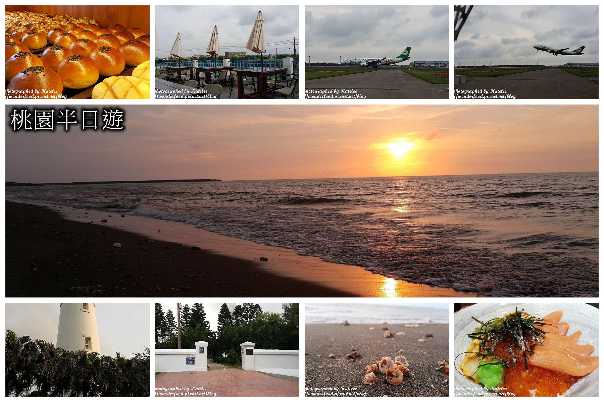

*圖說：P01｜圖片來源：未標示（文章未註明圖片來源）*

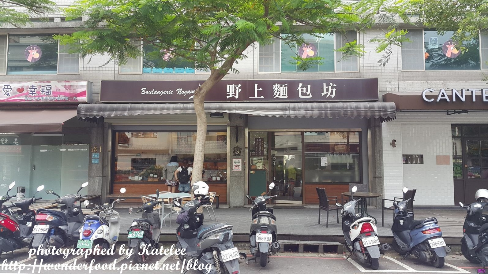

*圖說：PhotoCap_001.jpg｜圖片來源：未標示（文章未註明圖片來源）*

野上麵包坊

購買日期:2015.05.17

地址: 桃園縣蘆竹鄉南平街58號

電話:(03)312-0433

營業時間:周一~周日10:00~20:30

網站: https://www.nogami.com.tw/

粉絲團: 野上麵包坊粉絲團

出爐時間:11:00、13:30、15:30、17:30、19:30

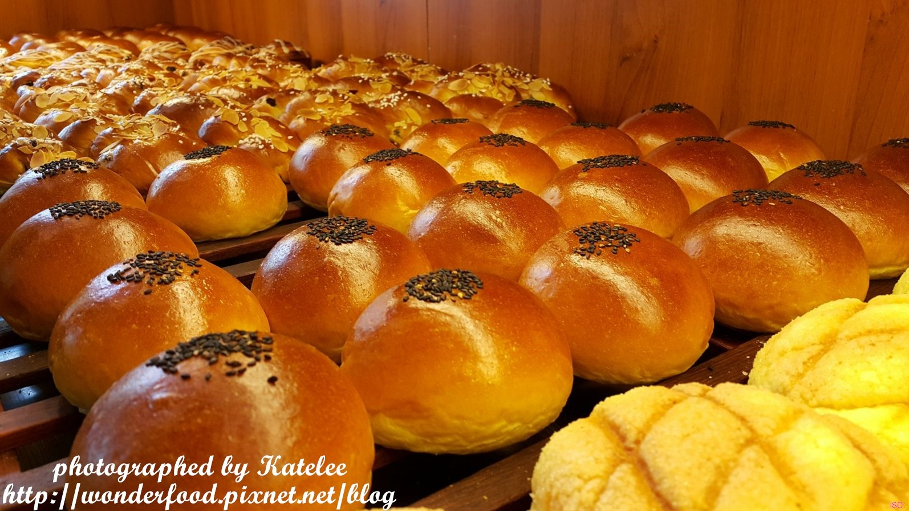

*圖說：PhotoCap_012.jpg｜圖片來源：未標示（文章未註明圖片來源）*

很有名的野上麵包

很多人都特地跑來買呢~

這裡的麵包都很漂亮

色澤均勻，擺盤整齊

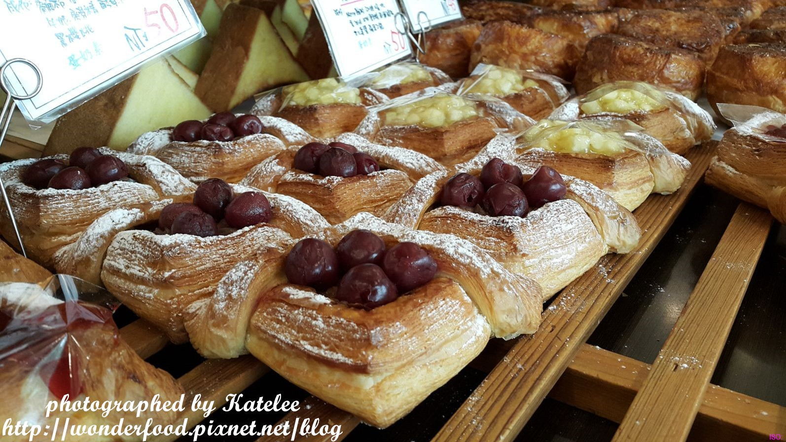

*圖說：PhotoCap_027.jpg｜圖片來源：未標示（文章未註明圖片來源）*

看到這麼漂亮的水果麵包

口水都快滴下來了...

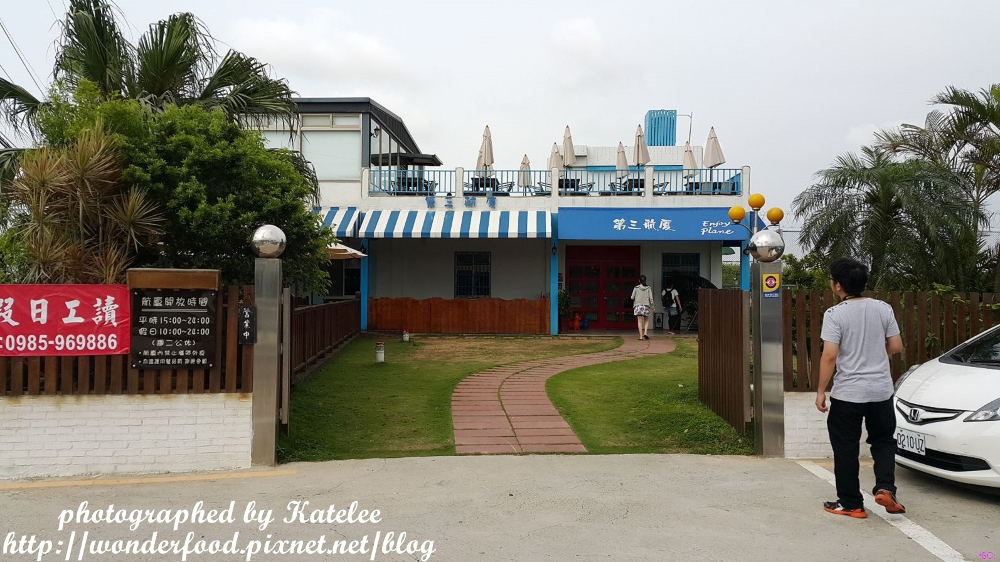

*圖說：PhotoCap_042.jpg｜圖片來源：未標示（文章未註明圖片來源）*

第三航廈用餐資訊

用餐時間:2015.05.14

地址: 桃園縣大園鄉埔心村海豐坡15鄰6-3號

電話: (03)381-9969

營業時間: 平日15:00~24:00，假日10:00~24:00(周二公休)

餐飲價位: 100~300元

粉絲團: 第三航廈粉絲團

評價:食物美味★★☆☆☆，CP值★★★☆☆，服務態度★★★☆☆， 再訪意願★★★★☆

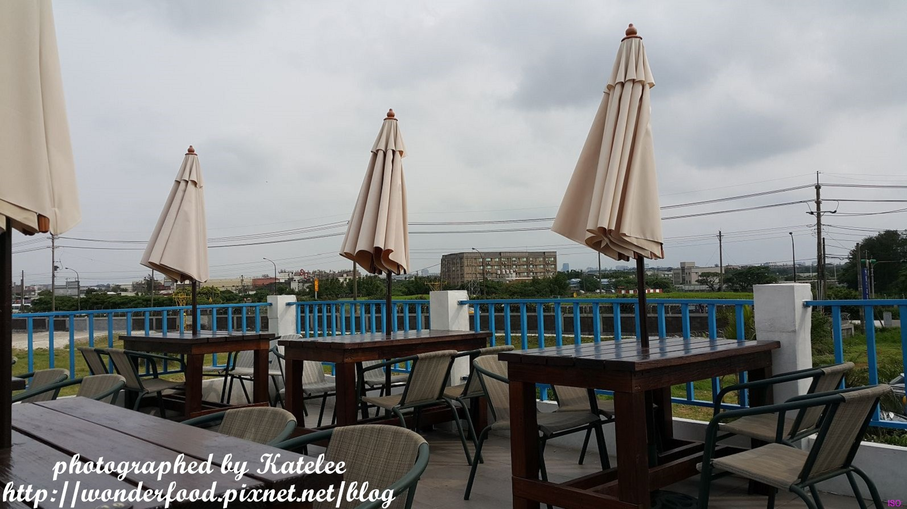

*圖說：PhotoCap_063.jpg｜圖片來源：未標示（文章未註明圖片來源）*

接著來到第三航廈

是一間觀機的小餐廳

提供輕食與飲料

許多愛好攝影者都喜歡帶著大砲來這兒捕捉飛機的身影

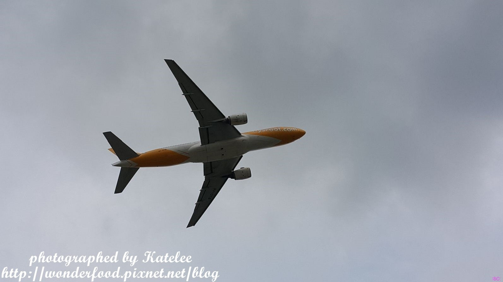

*圖說：PhotoCap_090.jpg｜圖片來源：未標示（文章未註明圖片來源）*

享受各式各樣的飛機從頭頂飛過的臨場感

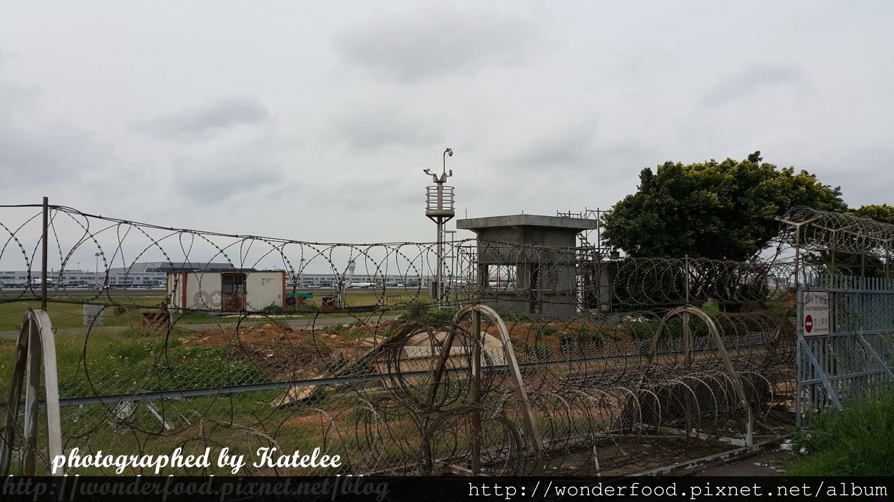

*圖說：PhotoCap_110.jpg｜圖片來源：未標示（文章未註明圖片來源）*

仍然覺得看不過癮嗎?

那再提供一個觀機祕密景點

桃園機場祕密景點觀機資訊

觀機時間:2015.05.14

地址: 桃園縣大園鄉下坡路機場聯絡道

GPS:E121°14'09" ( 121.2358) N 25°04'04" ( 25.0678)

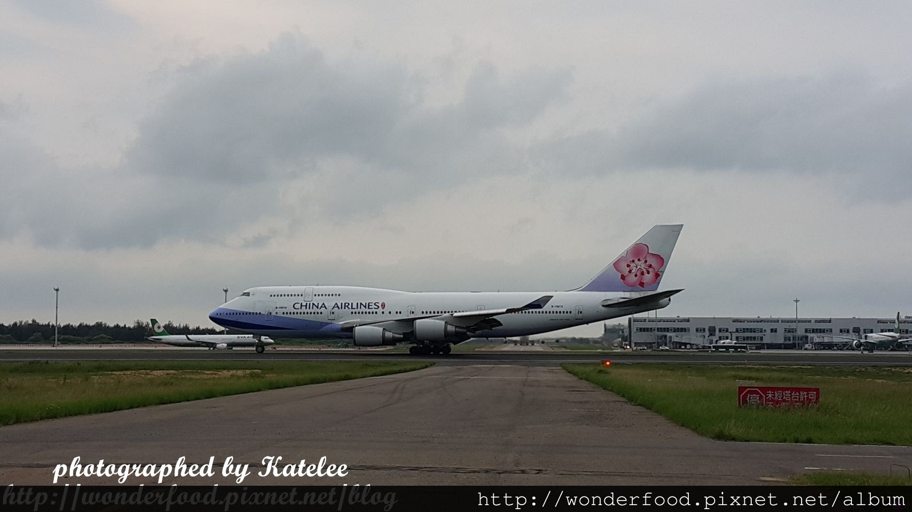

*圖說：PhotoCap_125.jpg｜圖片來源：未標示（文章未註明圖片來源）*

近距離觀賞飛機的起降

相信來這裡看的人一定都會愛上看飛機

視野超棒!

以華航和長榮為大宗

不過也可以看到各式各樣的航空

像我們當天看到的還有復興，新加坡航空...等等

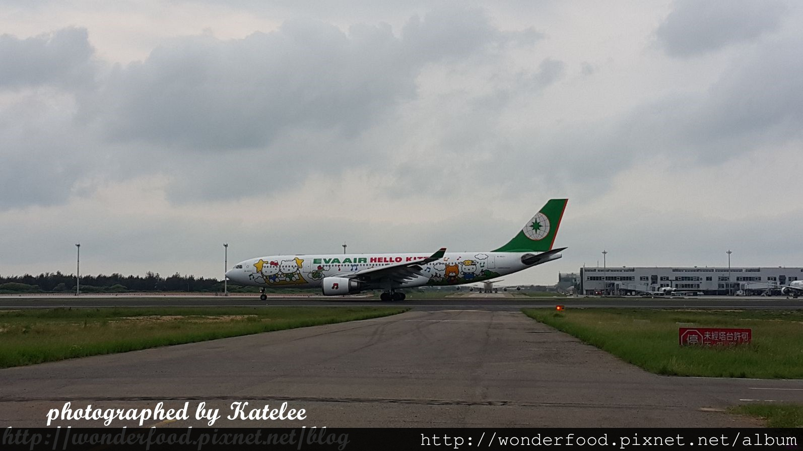

*圖說：PhotoCap_128.jpg｜圖片來源：未標示（文章未註明圖片來源）*

居然還看到了飛日本的超可愛Hello Kitty機

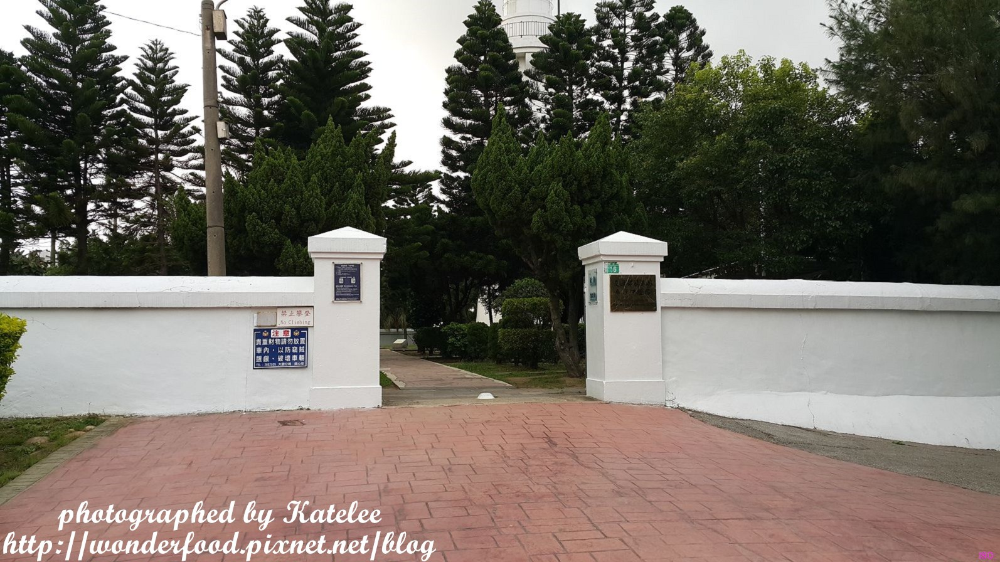

*圖說：PhotoCap_138.jpg｜圖片來源：未標示（文章未註明圖片來源）*

白沙岬燈塔參觀資訊

參觀日期:2015.5.14

地址:桃園市觀音區新坡下16號

開放時間:上午九時至下午六時(夏令時間4月1日至10月31日)，

上午九時至下午五時(冬令時間11月1日至3月31日)，每逢星期一內部整理不開放

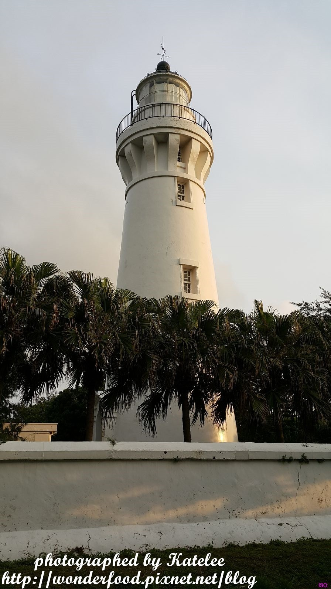

*圖說：PhotoCap_155.jpg｜圖片來源：未標示（文章未註明圖片來源）*

這座宏偉的燈塔矗立在這兒已經超過百年囉

指引著海上的船隻

是一座充滿著歷史的燈塔!

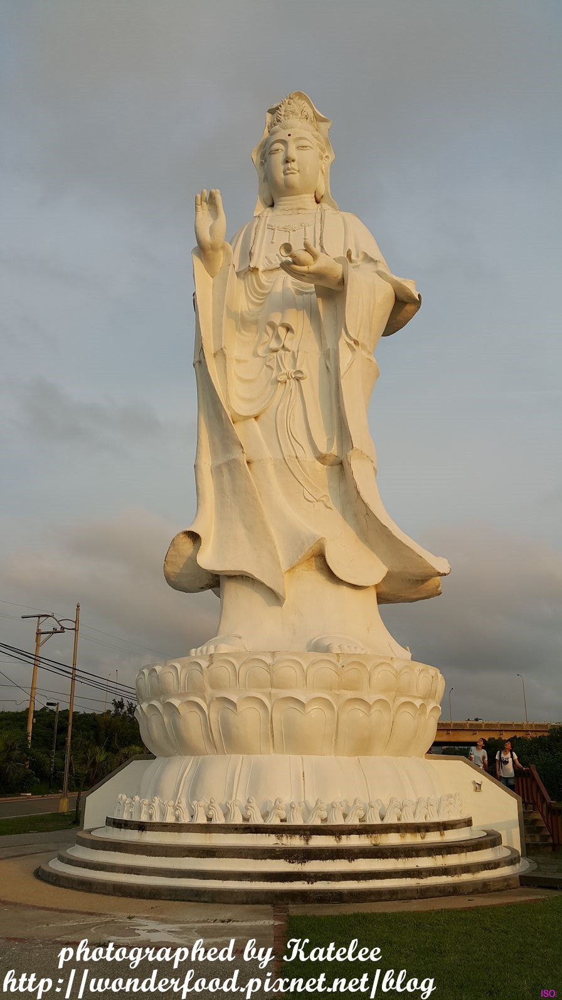

*圖說：PhotoCap_175.jpg｜圖片來源：未標示（文章未註明圖片來源）*

離燈塔不遠處有座大觀音

莊嚴肅穆

是當地的信仰中心

守護著這片海域與居民的平安

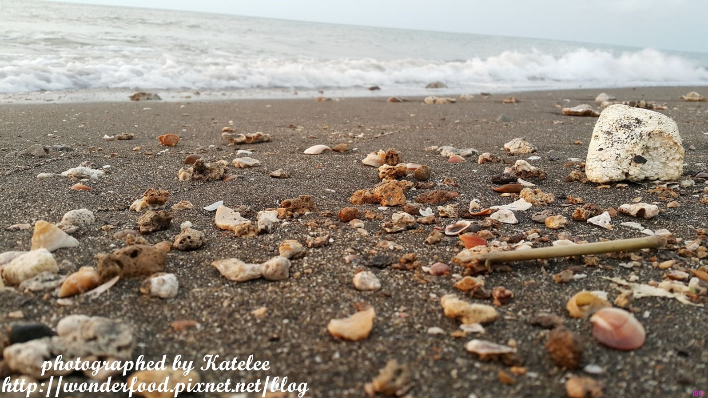

*圖說：PhotoCap_203.jpg｜圖片來源：未標示（文章未註明圖片來源）*

往海邊走

吹吹海風

踏踏海水

撿海邊漂亮的貝殼~

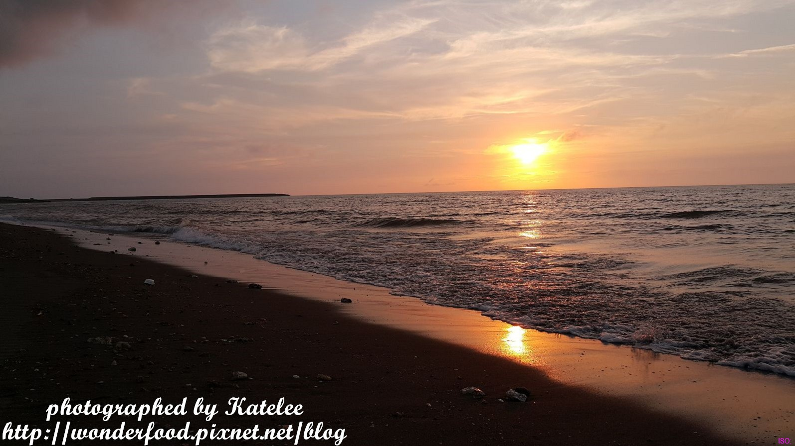

*圖說：PhotoCap_190.jpg｜圖片來源：未標示（文章未註明圖片來源）*

靜靜坐在海邊

欣賞落日餘暉

在海面上灑下一大片的金黃

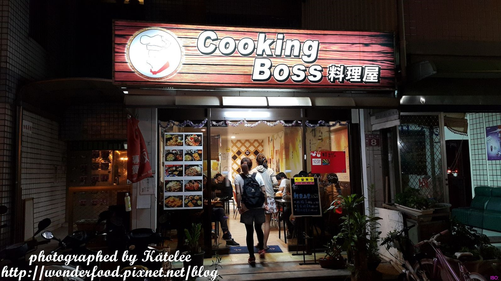

*圖說：PhotoCap_224.jpg｜圖片來源：未標示（文章未註明圖片來源）*

逛了那麼多景點後

肚子餓得咕嚕咕嚕叫

來到中原大學附近

看看大學生們都吃些什麼吧~

Cooking boss料理屋用餐資訊

用餐時間:2015.05.14

地址: 桃園市中壢區新中二街8號

網站: https://www.cooking-boss.com/index.asp

粉絲團: https://www.facebook.com/CookingBoss?fref=ts

電話:(03)462-4587

價位: 80~200元

營業時間: 11:30~14:00，17:30~21:00(周三公休)

## 圖片清單

| 檔案 | 圖說 | 圖片來源標示 | 對應段落 | 原始網址 |
| --- | --- | --- | --- | --- |
| images/page_022_ext_03_image_01.jpg | P01 | 未標示（文章未註明圖片來源） | 【桃園半日遊】軒獸微旅行之要吃也要動 ★ 野上麵包坊---第三航廈---祕密景點觀機---白沙岬燈塔---晚餐：Cooking boss料理屋 | https://pimg.1px.tw/wonderfood/1438678023-3795455475.jpg |
| images/page_022_ext_03_image_02.jpg | PhotoCap_001.jpg | 未標示（文章未註明圖片來源） | 【桃園半日遊】軒獸微旅行之要吃也要動 ★ 野上麵包坊---第三航廈---祕密景點觀機---白沙岬燈塔---晚餐：Cooking boss料理屋 | https://pimg.1px.tw/wonderfood/1432102521-2645654675.jpg |
| images/page_022_ext_03_image_03.jpg | PhotoCap_012.jpg | 未標示（文章未註明圖片來源） | 【桃園半日遊】軒獸微旅行之要吃也要動 ★ 野上麵包坊---第三航廈---祕密景點觀機---白沙岬燈塔---晚餐：出爐時間:11:00、13:30、15:30、17:30、19:30 | https://pimg.1px.tw/wonderfood/1432102524-1204100235.jpg |
| images/page_022_ext_03_image_04.jpg | PhotoCap_027.jpg | 未標示（文章未註明圖片來源） | 【桃園半日遊】軒獸微旅行之要吃也要動 ★ 野上麵包坊---第三航廈---祕密景點觀機---白沙岬燈塔---晚餐：出爐時間:11:00、13:30、15:30、17:30、19:30 | https://pimg.1px.tw/wonderfood/1432102517-598046537.jpg |
| images/page_022_ext_03_image_05.jpg | PhotoCap_042.jpg | 未標示（文章未註明圖片來源） | 【桃園半日遊】軒獸微旅行之要吃也要動 ★ 野上麵包坊---第三航廈---祕密景點觀機---白沙岬燈塔---晚餐：出爐時間:11:00、13:30、15:30、17:30、19:30 | https://pimg.1px.tw/wonderfood/1432113761-3819952411.jpg |
| images/page_022_ext_03_image_06.jpg | PhotoCap_063.jpg | 未標示（文章未註明圖片來源） | 【桃園半日遊】軒獸微旅行之要吃也要動 ★ 野上麵包坊---第三航廈---祕密景點觀機---白沙岬燈塔---晚餐：評價:食物美味★★☆☆☆，CP值★★★☆☆，服務態度★★★☆☆， 再訪意願★★★ | https://pimg.1px.tw/wonderfood/1432113754-2385763004.jpg |
| images/page_022_ext_03_image_07.jpg | PhotoCap_090.jpg | 未標示（文章未註明圖片來源） | 【桃園半日遊】軒獸微旅行之要吃也要動 ★ 野上麵包坊---第三航廈---祕密景點觀機---白沙岬燈塔---晚餐：許多愛好攝影者都喜歡帶著大砲來這兒捕捉飛機的身影 | https://pimg.1px.tw/wonderfood/1432113760-3965170820.jpg |
| images/page_022_ext_03_image_08.jpg | PhotoCap_110.jpg | 未標示（文章未註明圖片來源） | 【桃園半日遊】軒獸微旅行之要吃也要動 ★ 野上麵包坊---第三航廈---祕密景點觀機---白沙岬燈塔---晚餐：享受各式各樣的飛機從頭頂飛過的臨場感 | https://pimg.1px.tw/wonderfood/1438527980-2544833028.jpg |
| images/page_022_ext_03_image_09.jpg | PhotoCap_125.jpg | 未標示（文章未註明圖片來源） | 【桃園半日遊】軒獸微旅行之要吃也要動 ★ 野上麵包坊---第三航廈---祕密景點觀機---白沙岬燈塔---晚餐：GPS:E121°14'09" ( 121.2358) N 25°04'04"  | https://pimg.1px.tw/wonderfood/1438527976-129329138.jpg |
| images/page_022_ext_03_image_10.jpg | PhotoCap_128.jpg | 未標示（文章未註明圖片來源） | 【桃園半日遊】軒獸微旅行之要吃也要動 ★ 野上麵包坊---第三航廈---祕密景點觀機---白沙岬燈塔---晚餐：像我們當天看到的還有復興，新加坡航空...等等 | https://pimg.1px.tw/wonderfood/1438527977-4232248246.jpg |
| images/page_022_ext_03_image_11.jpg | PhotoCap_138.jpg | 未標示（文章未註明圖片來源） | 【桃園半日遊】軒獸微旅行之要吃也要動 ★ 野上麵包坊---第三航廈---祕密景點觀機---白沙岬燈塔---晚餐：居然還看到了飛日本的超可愛Hello Kitty機 | https://pimg.1px.tw/wonderfood/1438577527-3306932532.jpg |
| images/page_022_ext_03_image_12.jpg | PhotoCap_155.jpg | 未標示（文章未註明圖片來源） | 【桃園半日遊】軒獸微旅行之要吃也要動 ★ 野上麵包坊---第三航廈---祕密景點觀機---白沙岬燈塔---晚餐：上午九時至下午五時(冬令時間11月1日至3月31日)，每逢星期一內部整理不開放 | https://pimg.1px.tw/wonderfood/1438577603-760086354.jpg |
| images/page_022_ext_03_image_13.jpg | PhotoCap_175.jpg | 未標示（文章未註明圖片來源） | 【桃園半日遊】軒獸微旅行之要吃也要動 ★ 野上麵包坊---第三航廈---祕密景點觀機---白沙岬燈塔---晚餐：這座宏偉的燈塔矗立在這兒已經超過百年囉 | https://pimg.1px.tw/wonderfood/1438577634-728592704.jpg |
| images/page_022_ext_03_image_14.jpg | PhotoCap_203.jpg | 未標示（文章未註明圖片來源） | 【桃園半日遊】軒獸微旅行之要吃也要動 ★ 野上麵包坊---第三航廈---祕密景點觀機---白沙岬燈塔---晚餐：這座宏偉的燈塔矗立在這兒已經超過百年囉 | https://pimg.1px.tw/wonderfood/1438577672-4027136810.jpg |
| images/page_022_ext_03_image_15.jpg | PhotoCap_190.jpg | 未標示（文章未註明圖片來源） | 【桃園半日遊】軒獸微旅行之要吃也要動 ★ 野上麵包坊---第三航廈---祕密景點觀機---白沙岬燈塔---晚餐：這座宏偉的燈塔矗立在這兒已經超過百年囉 | https://pimg.1px.tw/wonderfood/1438577670-2041610874.jpg |
| images/page_022_ext_03_image_16.jpg | PhotoCap_224.jpg | 未標示（文章未註明圖片來源） | 【桃園半日遊】軒獸微旅行之要吃也要動 ★ 野上麵包坊---第三航廈---祕密景點觀機---白沙岬燈塔---晚餐：這座宏偉的燈塔矗立在這兒已經超過百年囉 | https://pimg.1px.tw/wonderfood/1431875456-3534492629.jpg |

## 正文內連結

- [野上麵包坊](https://wonderfood.pixnet.net/blog/post/198590493)
- [第三航廈](https://wonderfood.pixnet.net/blog/post/198605667)
- [桃園機場觀機祕密景點](https://wonderfood.pixnet.net/blog/post/201783370)
- [白沙岬燈塔，觀音，海岸](https://wonderfood.pixnet.net/blog/post/201804730)　← 觀音區相關
- [Cooking boss料理屋](https://wonderfood.pixnet.net/blog/post/198495537)
- [https://wonderfood.pixnet.net/album/photo/194401326](https://wonderfood.pixnet.net/album/photo/194401326)
- [https://www.nogami.com.tw/](https://www.nogami.com.tw/)
- [https://wonderfood.pixnet.net/album/photo/194412624](https://wonderfood.pixnet.net/album/photo/194412624)
- [https://wonderfood.pixnet.net/album/photo/198768864](https://wonderfood.pixnet.net/album/photo/198768864)
- [https://wonderfood.pixnet.net/album/photo/198792696](https://wonderfood.pixnet.net/album/photo/198792696)
- [https://wonderfood.pixnet.net/album/photo/190661349](https://wonderfood.pixnet.net/album/photo/190661349)
- [https://www.cooking-boss.com/index.asp](https://www.cooking-boss.com/index.asp)
- [痞客邦](https://www.pixnet.net)
