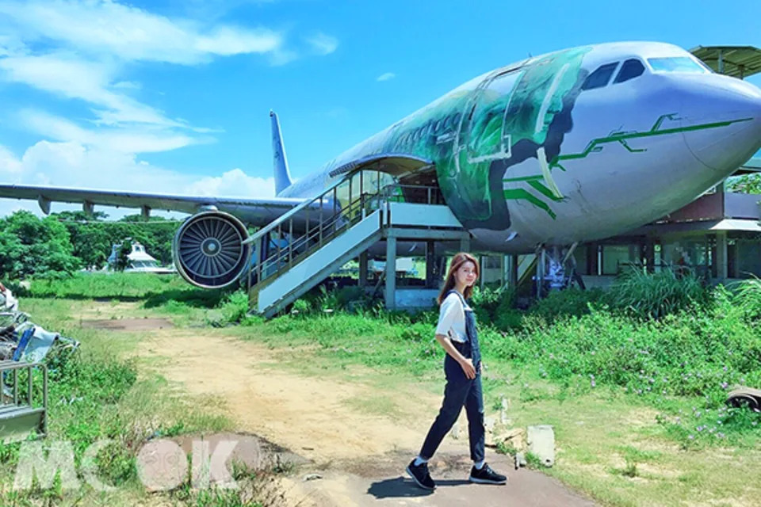
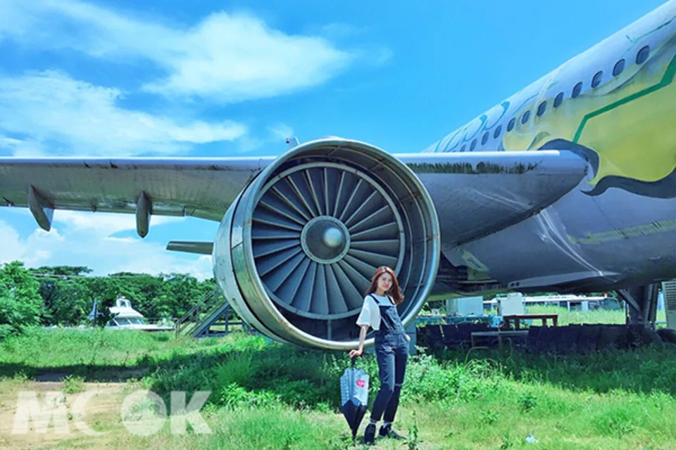
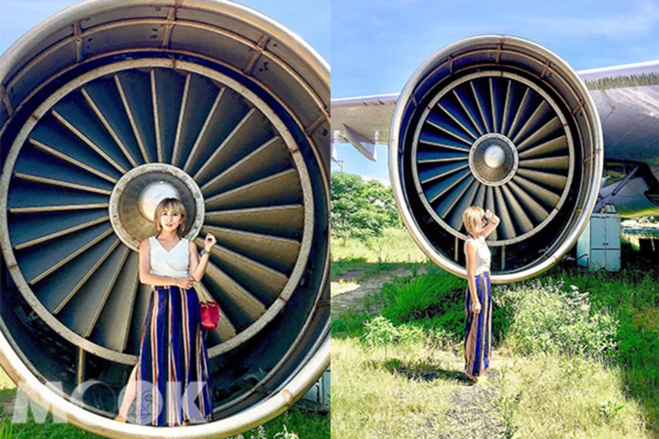
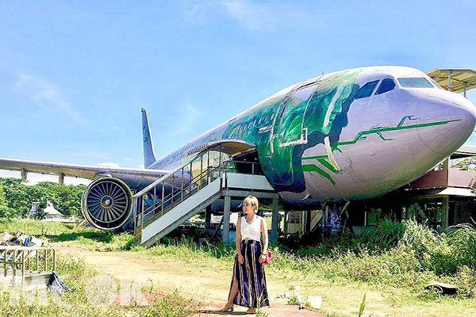
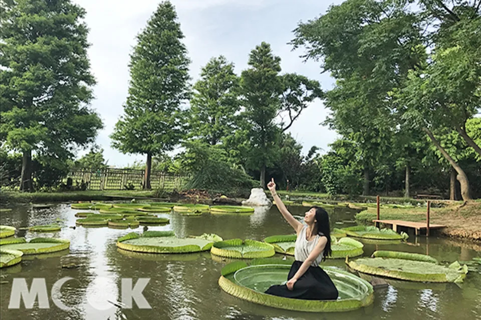
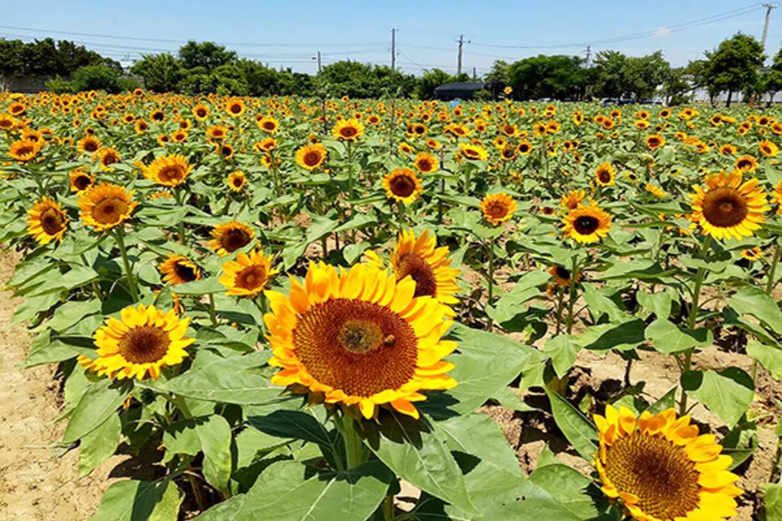
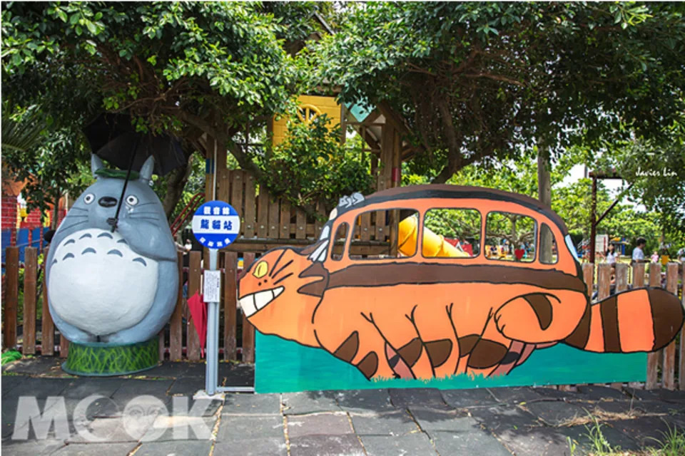
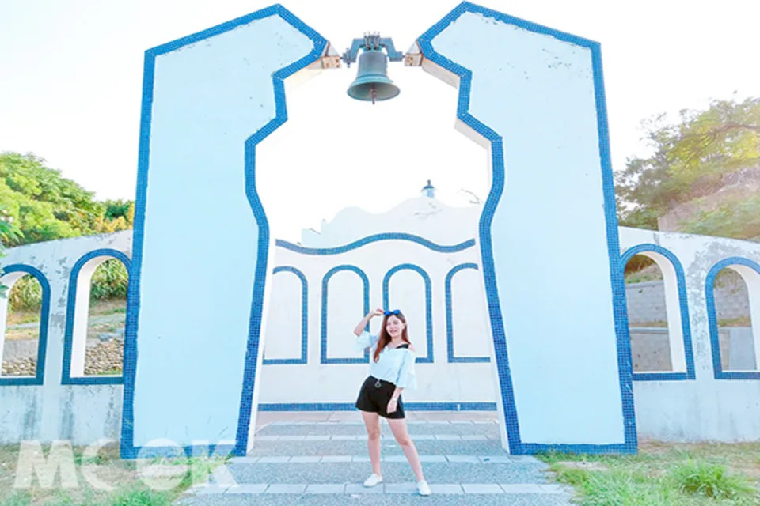

# 巨大飛機當背景！廢墟變身熱門打卡點

- 編號：page_023
- 原始網址：https://tw.news.yahoo.com/%E5%B7%A8%E5%A4%A7%E9%A3%9B%E6%A9%9F%E7%95%B6%E8%83%8C%E6%99%AF-%E5%BB%A2%E5%A2%9F%E8%AE%8A%E8%BA%AB%E7%86%B1%E9%96%80%E6%89%93%E5%8D%A1%E9%BB%9E-083000098.html
- 網站：Yahoo News（新聞（Yahoo 奇摩新聞））
- 作者：MOOK景點家編輯部整理報導（發布單位：Yahoo News）
- 發表日期：2018-07-09
- 取得時間：2026-11-05T13:02:15+08:00
- 擷取方式：site_rule[tw.news.yahoo.com]: article[id^="article-"] div.atoms
- 資料性質：**媒體／部落格內容，尚未經官方資料查核**（查核結果見 analysis/fact_check_D.md）

---

文／MOOK景點家編輯部整理報導
2015年桃園觀音區曾要興建一座飛機景觀餐廳，還特別運來已報廢的真實飛機降落在餐廳外，不過因該建築屬違建，違反了土地使用管制規定，被強制拆除。不過飛機仍留在原地，因此吸引許多網友前往打卡拍照。

*圖說：觀音飛機 (圖片提供／yuga1211)｜圖片來源：yuga1211*

原本要在觀音區打造的金湖景觀餐廳，從早期將真實飛機運來，到餐廳建築的施工，都引起當地人的重視，當時希望讓機場餐廳與蓮花季相呼應，帶起觀音區的觀光產業，後來因違建而拆除，令許多人感到不捨。

*圖說：因違建而被拆除的金湖景觀餐廳外，有真實的飛機可拍照 (圖片提供／yuga1211)｜圖片來源：yuga1211*

不過當時的飛機依舊留在原地，日後吸引許多網友前往打卡拍照，想近距離地跟真實飛機合照，反而成為另類的景點。

*圖說：飛機吸引許多網友前往打卡拍照 (圖片提供／fly_travel120205040610)｜圖片來源：fly_travel120205040610*

*圖說：網友可以近距離接觸飛機 (圖片提供／fly_travel120205040610)｜圖片來源：fly_travel120205040610*

除了到觀音區跟飛機拍照外，還可以趁著蓮花季前往各大蓮園，體驗坐在大王蓮花上的樂趣。另外也能順遊其他景點，包括向陽農場、龍貓公車站、白沙岬燈塔等，可以安排一日遊行程。

*圖說：2018桃園蓮花季開跑 (圖／桃園市政府)｜圖片來源：桃園市政府*

佔地18,000坪的向陽農場，為北台灣最大的向日葵主題農場，每年5至10月是向日葵的花季，一株株比人還高的花，形成大片的金黃花海，景色十分壯觀，園區免費入園。另外還有窯烤區、戶外教學、DIY樂趣、紀念品、主題餐廳等。

*圖說：向陽農場向日葵盛開 (圖／向陽農場)｜圖片來源：向陽農場*

觀音區龍貓公車站，位在和美幼稚園外牆，據說是幼稚園園長喜愛龍貓卡通，因此打造了龍貓公車站的場景，吸引了許多大小朋友們遊客前來駐足停留，園方更貼心的在一旁提供了雨傘道具，讓每個來拍照的遊客都能很快融入。

*圖說：位於桃園觀音的龍貓公車 (圖片提供／林亦倫)｜圖片來源：林亦倫*

白沙岬燈塔位於觀音海岸，塔高約37公尺，僅次於墾丁鵝鑾鼻燈塔，是台灣唯一使用紅磚與石頭建造而成的，不同於台灣其他使用水泥構成的燈塔。燈塔旁的環形步道有湛藍結合純白的鐘塔，有地中海的浪漫景色。

*圖說：白沙岬燈塔 (圖片提供／tiffany.1103)｜圖片來源：tiffany.1103*

【Info】
觀音飛機
地址：桃園市觀音區號中山路一段1115號

## 巨大飛機超吸睛！曼谷文創新指標好拍又好逛

## 圖片清單

| 檔案 | 圖說 | 圖片來源標示 | 對應段落 | 原始網址 |
| --- | --- | --- | --- | --- |
| images/page_023_image_01.jpg | 觀音飛機 (圖片提供／yuga1211) | yuga1211 | 巨大飛機當背景！廢墟變身熱門打卡點：文／MOOK景點家編輯部整理報導 2015年桃園觀音區曾要興建一座飛機景觀餐廳， | https://s.yimg.com/lo/mysterio/api/d8a3aea4f67e832987016df27b4a34b1cf235c0dc9cb88b47b947236189103dc/lightyear_networkapi/resizefill_w960%3Bquality_80%3Bformat_webp/http%3A%2F%2Fmedia.zenfs.com%2Fzh-Hant-TW%2Fhomerun%2Fmook__193%2Feb63f4bbe98583d6daeaee445e6bf82a |
| images/page_023_image_02.jpg | 因違建而被拆除的金湖景觀餐廳外，有真實的飛機可拍照 (圖片提供／yuga1211) | yuga1211 | 巨大飛機當背景！廢墟變身熱門打卡點：原本要在觀音區打造的金湖景觀餐廳，從早期將真實飛機運來，到餐廳建築的施工，都引起 | https://s.yimg.com/lo/mysterio/api/0691443a828305ed6b9ca4421873dee3fa5cc500e2e313db194364e44d607daf/lightyear_networkapi/resizefill_w960%3Bquality_80%3Bformat_webp/http%3A%2F%2Fmedia.zenfs.com%2Fzh-Hant-TW%2Fhomerun%2Fmook__193%2F7d7f30d66d83e5fe21b69b6df402c3a2 |
| images/page_023_image_03.jpg | 飛機吸引許多網友前往打卡拍照 (圖片提供／fly_travel120205040610) | fly_travel120205040610 | 巨大飛機當背景！廢墟變身熱門打卡點：不過當時的飛機依舊留在原地，日後吸引許多網友前往打卡拍照，想近距離地跟真實飛機合 | https://s.yimg.com/lo/mysterio/api/e302eaaf3f073f4de3d667057ce6cf7011913bca12a1712a5c1a42fedf7d2095/lightyear_networkapi/resizefill_w960%3Bquality_80%3Bformat_webp/http%3A%2F%2Fmedia.zenfs.com%2Fzh-Hant-TW%2Fhomerun%2Fmook__193%2F2adf4d4f4b177338b6101f1d1b95e815 |
| images/page_023_image_04.jpg | 網友可以近距離接觸飛機 (圖片提供／fly_travel120205040610) | fly_travel120205040610 | 巨大飛機當背景！廢墟變身熱門打卡點：飛機吸引許多網友前往打卡拍照 (圖片提供／fly_travel120205040 | https://s.yimg.com/lo/mysterio/api/6c176d7136920e035613bf2340e798f5aa1531bed9815bf3225fa58a2d84344e/lightyear_networkapi/resizefill_w960%3Bquality_80%3Bformat_webp/http%3A%2F%2Fmedia.zenfs.com%2Fzh-Hant-TW%2Fhomerun%2Fmook__193%2Fde2fe34e20aadb8c4c2d939f1f9e4e33 |
| images/page_023_image_05.jpg | 2018桃園蓮花季開跑 (圖／桃園市政府) | 桃園市政府 | 巨大飛機當背景！廢墟變身熱門打卡點：除了到觀音區跟飛機拍照外，還可以趁著蓮花季前往各大蓮園，體驗坐在大王蓮花上的樂趣 | https://s.yimg.com/lo/mysterio/api/4aa20d19921ea31d7492adeec4eab6c319ba49cc813b5b44dca9d3783c440ef3/lightyear_networkapi/resizefill_w960%3Bquality_80%3Bformat_webp/http%3A%2F%2Fmedia.zenfs.com%2Fzh-Hant-TW%2Fhomerun%2Fmook__193%2Fb23a0df65a38942c2fcf2c51badd4cde |
| images/page_023_image_06.jpg | 向陽農場向日葵盛開 (圖／向陽農場) | 向陽農場 | 巨大飛機當背景！廢墟變身熱門打卡點：佔地18,000坪的向陽農場，為北台灣最大的向日葵主題農場，每年5至10月是向日 | https://s.yimg.com/lo/mysterio/api/cce4b833ae1c11c476aa8d0652ddadb5904bcd33268656ef51a320d75a79cb68/lightyear_networkapi/resizefill_w960%3Bquality_80%3Bformat_webp/http%3A%2F%2Fmedia.zenfs.com%2Fzh-Hant-TW%2Fhomerun%2Fmook__193%2F1bb888d6102befbf9ef66983ed7ba9ff |
| images/page_023_image_07.jpg | 位於桃園觀音的龍貓公車 (圖片提供／林亦倫) | 林亦倫 | 巨大飛機當背景！廢墟變身熱門打卡點：觀音區龍貓公車站，位在和美幼稚園外牆，據說是幼稚園園長喜愛龍貓卡通，因此打造了龍 | https://s.yimg.com/lo/mysterio/api/29eb102a4afcceb29ddc73752bd085d8584fe7bb62d766aac9024111fafffbd4/lightyear_networkapi/resizefill_w960%3Bquality_80%3Bformat_webp/http%3A%2F%2Fmedia.zenfs.com%2Fzh-Hant-TW%2Fhomerun%2Fmook__193%2F289856ccc03e7dc8e056345c7e6bc453 |
| images/page_023_image_08.jpg | 白沙岬燈塔 (圖片提供／tiffany.1103) | tiffany.1103 | 巨大飛機當背景！廢墟變身熱門打卡點：白沙岬燈塔位於觀音海岸，塔高約37公尺，僅次於墾丁鵝鑾鼻燈塔，是台灣唯一使用紅磚 | https://s.yimg.com/lo/mysterio/api/9eb62d0215ebf90259b0a809fccc4b5c1c683c0eaac98cfa48389d850c86f390/lightyear_networkapi/resizefill_w960%3Bquality_80%3Bformat_webp/http%3A%2F%2Fmedia.zenfs.com%2Fzh-Hant-TW%2Fhomerun%2Fmook__193%2F1618ecd596a426caa006d20af12d8cdf |

## 正文內連結

- [https://www.mook.com.tw/article.php?op=articleinfo&articleid=16960](https://www.mook.com.tw/article.php?op=articleinfo&articleid=16960)
