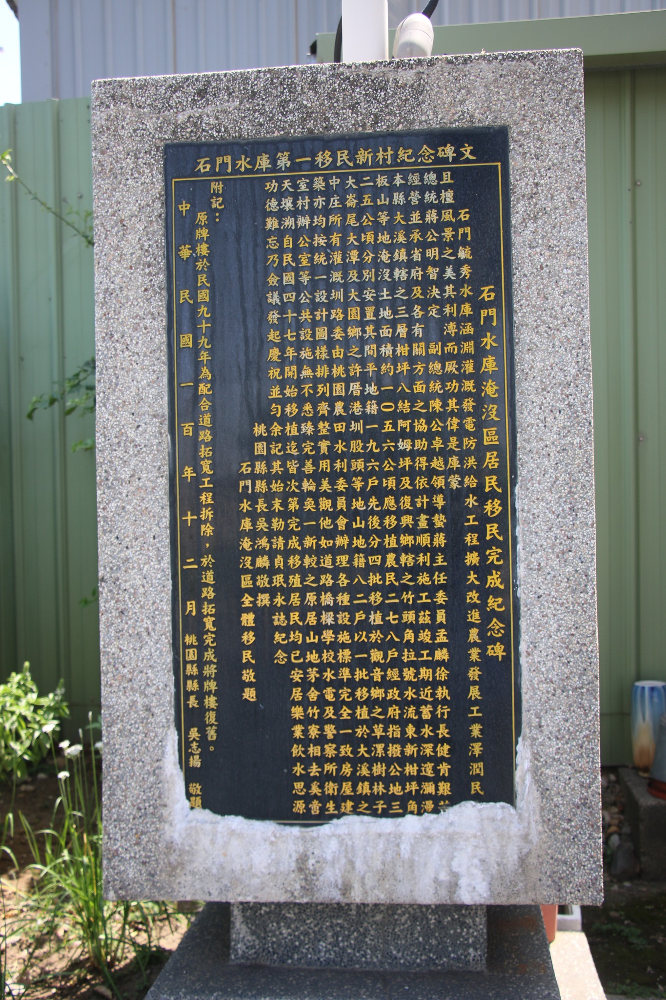
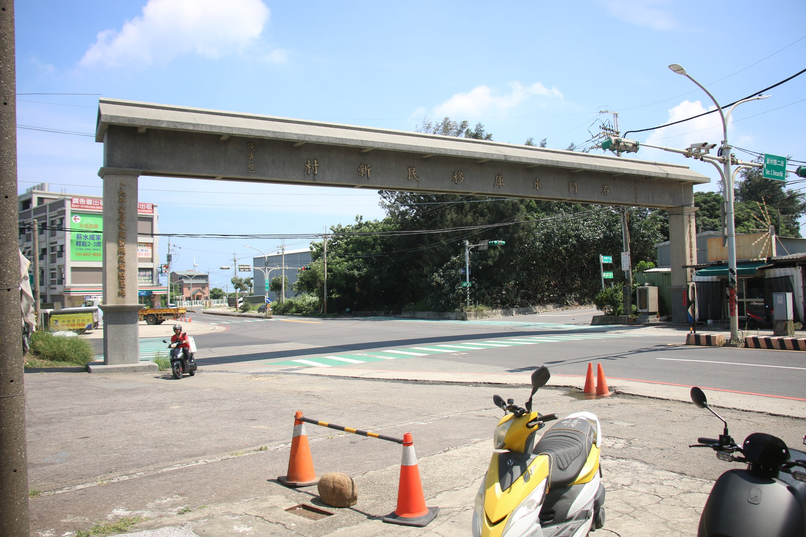

# 後人飲水，莫忘前人犧牲－1958年石門水庫大移民(本文曾刊登於聚傳媒樂風專欄)

- 編號：page_029
- 原始網址：https://vocus.cc/article/6692021dfd89780001850bb9
- 網站：vocus（部落格（方格子 vocus））
- 作者：樂風的民藝筆記（發布單位：vocus）
- 發表日期：2024-07-13（最後更新 2026-07-24）
- 取得時間：2026-11-05T13:02:23+08:00
- 擷取方式：site_rule[vocus.cc]: article.editor-content-block
- 資料性質：**媒體／部落格內容，尚未經官方資料查核**（查核結果見 analysis/fact_check_D.md）

---

*圖說：石門水庫淹沒區居民移民完成紀念碑｜圖片來源：未標示（文章未註明圖片來源）*

過去，桃園與新竹湖口一帶，時有旱情，你若有空到這些地方的宮廟逛逛，會發現這裡的神明有個很重要的業務，就是祈雨。每有旱情，農民苦不堪言。

1955年，為防洪、灌溉與民生用水的需求，新竹、桃園二縣議員到處奔走(其中包含吳志揚之祖父吳鴻麟，後來當上桃園縣長)，終促使政府成立石門水庫建設籌備委員會。

此委員會以副總統陳誠為主委，臺大教授徐世大為總工程師，並有美國高壩工程權威薩凡奇博士協助。

破土典禮當天，桃園、新竹兩地農民歡天喜地，大放鞭炮，豎立牌樓，還有公司為慶祝石門水庫破土，放假一天的，前往觀禮的民眾遠遠超出預期，導致主辦單位臨時換了更大的場地，還是十分擁擠，坐在圍牆上的，爬到樹上觀禮的比比皆是，就可知兩地居民有多需要水了。

興建過程中還有番外篇，當時被軟禁的孫立人將軍，因曾經在普度大學研究過工程學，請陳誠副總統代為轉告蔣總統說：

「如果我能以一位工程師的身份獻身於正在興建中之偉大石門水庫工程，則我將樂於服務。」

雖只有簡單兩句話，但軟禁已久的孫將軍那悸動的心，可深深體會。惜哉，昔日國府二把手，竟如此際遇......

石門水庫1964年完工，當時為遠東第一大水庫，共耗資32億元，其中19億為美援。

此建設造福一方百姓，農民不用擔心水源，自然感謝政府德政，不過，在集水區世代居住的居民就是另外一番心情了。

水庫建立後，共計淹沒1056公頃土地，範圍內居民當年共分五批遷移(1958~1963年)，政府為之建設住宅，分給田地，發放補償金，建設衛生所、學校等公共設施。沒有他們的犧牲，就沒有現在兼具民生、產業及觀光功能的石門水庫。

當時的安置，考慮到族群不同，共分兩移民村，第一移民村為「平地人」，第二移民村為「山地人」(當時用語，正確說法應為原住民)，1962年底舉行落成慶祝大會，陳誠親臨主持，不過當時他的健康似乎已經不好，據說是最後一次在公開場合亮相。

*圖說：位於觀音樹林，整修後的移民新村牌樓｜圖片來源：未標示（文章未註明圖片來源）*

話說有田有新屋，還有公共建設一次到位，第二移民村居民還因為是以原住民為主體，甚至建有教堂，1962年落成時，蔣宋美齡親臨剪綵。一切看來似乎其樂融融，實則不然，要找到這麼大塊地安置居民，一定不可能是什麼太好的地，第一移民村位於觀音海邊，居民原本住在大溪山上，從山民變海民，耕地貧瘠鹽分高，不可能種什麼太好的作物，生計馬上面臨問題，而且祖祖輩輩都是山民，想討海也沒有相關技術。

第二移民村以泰雅族為主，位於中庄，倒是離石門水庫不算太遠，結果1963年葛樂禮颱風來襲，石門水庫水位不斷上漲，便開始了首度洩洪，結果把前一年才剛遷過去的移民村又給淹了，只好再遷到大潭。

真相永遠沒有政府說的那麼美好。1966年，有59名原住民到縣政府陳情，因為大潭一帶土壤貧瘠，不適合耕種，要求補助土壤改良費用每戶三千元。而第一移民新村因政府在桃園沿海開發工業區，原本貧瘠的土壤雪上加霜，遭受工業汙染，人口不斷外流。1992年，居民因無法忍受汙染，要求政府協助他們遷村，成了台灣環保史上第一次，因汙染主動要求集體遷村的例子。問題是，能移去哪？

有居民向記者提起老家和新村的差別，舉了幾個例子，比如在老家想燒柴，山上處處有柴可撿，也沒人管。搬到海邊後，想到防風林撿柴，結果被林務局移送法辦。也有居民說，剛搬來的時候，每天都是走路出門，跑步回家。

因為當初剛搬到海邊，沒什麼經驗的山上人，早上光赤腳出門，下午要回家的時候，被路上的沙子燙到受不了，只好又跑又跳的回家。

小小例子，道盡離家背井，無謀生技能，適應不良的無奈。

2010年，觀音草漯忠孝路欲拓寬，居民在聽取政府簡報後方知，「石門水庫移民新村」紀念牌樓，將在道路拓寬工程中拆除。居民不願意這個當年他們為政府做出犧牲的證物，就這樣消失，於是發動發動聯署和陳情，後經施工單位同意道路拓寬工程結束後，予以復原。

不過，我到現地一看，似乎跟老照片裡的牌樓差很多。

目前能見證移民史的地景，除牌樓外，還有衛生所、樹林國小和復興宮，其中衛生所已經被列為歷史建築。

看看石門水庫移民，想想目前航空城，我們在享受重大建設便利的同時，莫忘前人苦，飲水要思源啊！

## 圖片清單

| 檔案 | 圖說 | 圖片來源標示 | 對應段落 | 原始網址 |
| --- | --- | --- | --- | --- |
| images/page_029_image_01.jpg | 石門水庫淹沒區居民移民完成紀念碑 | 未標示（文章未註明圖片來源） | 後人飲水，莫忘前人犧牲－1958年石門水庫大移民(本文曾刊登於聚傳媒樂風專欄)： | https://images.vocus.cc/b83c255d-4317-4b1a-8a2a-126077e5fcc1.jpg |
| images/page_029_image_02.jpg | 位於觀音樹林，整修後的移民新村牌樓 | 未標示（文章未註明圖片來源） | 後人飲水，莫忘前人犧牲－1958年石門水庫大移民(本文曾刊登於聚傳媒樂風專欄)：當時的安置，考慮到族群不同，共分兩移民村，第一移民村為「平地人」，第二移民村為「 | https://images.vocus.cc/066c8179-febc-4991-bb3e-ceaef758122e.jpg |

## 正文內連結

- （無）
