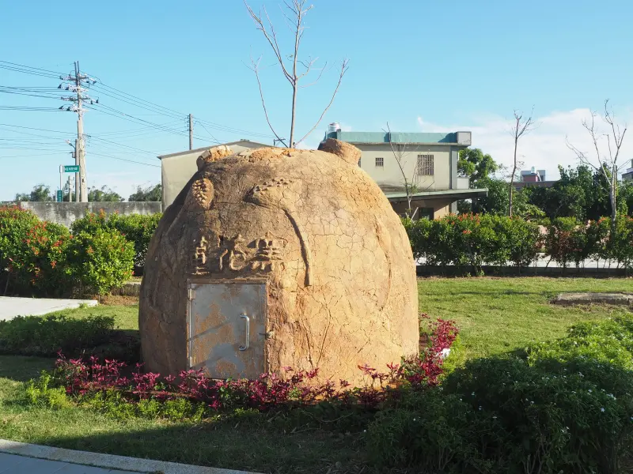
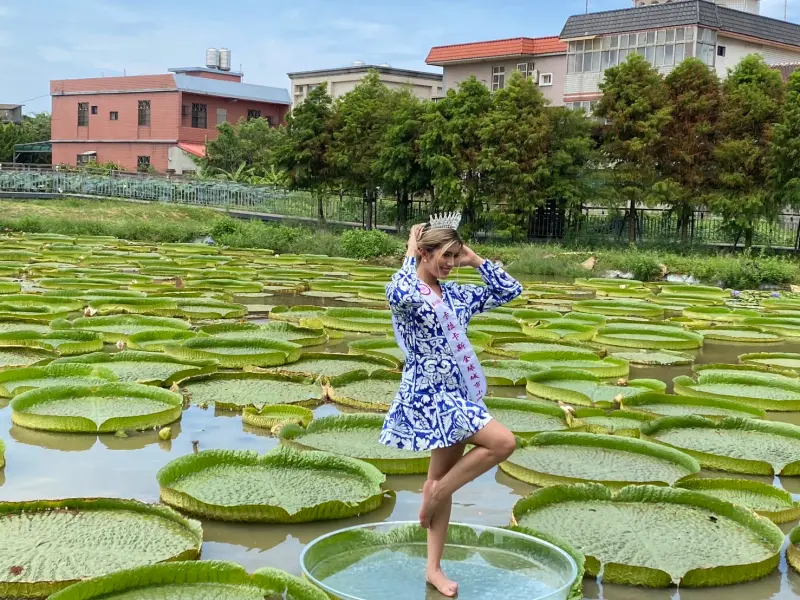
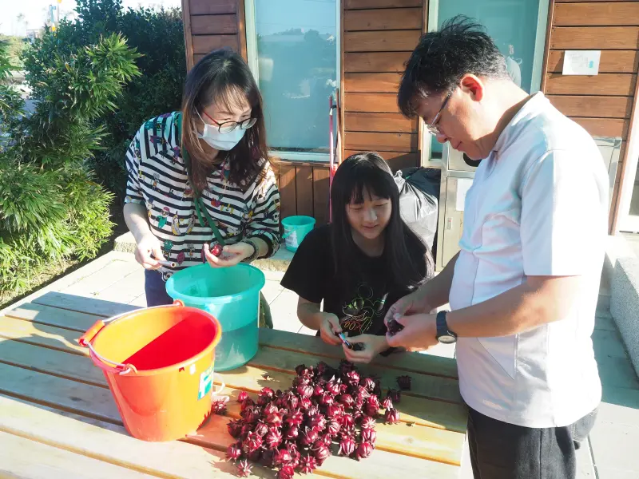

# 不是清境、武陵！台灣最強農場擠進127萬人 藏身北部還免費入場 | 新奇網搜 | 生活 | NOWnews今日新聞

- 編號：page_035
- 原始網址：https://www.nownews.com/news/6738456
- 網站：NOWnews今日新聞（其他媒體）
- 作者：潘毅（發布單位：NOWnews今日新聞）
- 發表日期：2025-10-05（最後更新 2025-10-11）
- 取得時間：2026-11-05T13:18:40+08:00
- 擷取方式：trafilatura (no site rule matched)
- 資料性質：**媒體／部落格內容，尚未經官方資料查核**（查核結果見 analysis/fact_check_D.md）

---

中秋節連假來，10月份還有雙十國慶、光復節兩個3天連假，但已經找不到新景點可去了嗎？2025年最強農場景點排行榜或許能成為遊客們的最佳參考！！說到台灣農場，很多人第一時間都會想到清境農場、武陵農場等。不過，據觀光署最新統計資料，2025年暫居最強農場寶座的是位於桃園觀音的「蓮花園休閒農業區」，7個月吸引超過127萬餘人參訪，當地不但門票免費，每個月都還有不同節日、體驗活動！

據觀光署公布國內遊憩景點人數統計，在台灣農場的景點類別當中，2025年1至7月間，台灣最多人參訪的農場是位於桃園市觀音區的「蓮花園休閒農業區」，7個月吸引127萬人次遊客造訪，第二名則是位於桃園大溪「月眉休閒農業區」，7個月造訪人數約為109萬；季軍則是位於南投「清境農場」，有38萬多人次造訪，2025年農場類景點名次如下：

2025年台灣農場景點觀光人次排行（統計期間1至7月）

第1名：蓮花園休閒農業區，127萬7694人次。

第2名：桃園大溪月眉休閒農業區，109萬0523人次。

第3名：南投清境農場，38萬7746人次。

第4名：桃園楊梅埔心牧場，38萬7746人次。

第5名：台中武陵農場，21萬5177人次。

第6名：新竹綠世界休閒農場，18萬9560人次。

第7名：台南走馬瀨農場，11萬5424人次。

台灣最強農場亮點超多！蓮花季、南瓜節體驗活動一次看

「蓮花園休閒農業區」，自2022年至2024年，每年觀光遊客數皆突破220萬人次，早已是台灣「休閒農場」的長年人氣冠軍。

蓮花園休閒農業區裡，有許多參考蓮花的圓盤造型的涼亭，成為特色地標。園區入口處映入眼簾的是由瓜果搭建的綠色隧道，穿過後別有洞天，遼闊的綠地上，超大竹筍與西瓜片造景在藍天綠野下格外醒目。蜿蜒的步道兩旁，蓮荷花池綿延，各自展現不同生態風貌。

觀音蓮花園每一年蓮花季在6至8月，只要是90公斤以下的遊客，都可以坐上大王蓮，擺拍下超獨特的美照；即使非花季，也能看見農家忙碌挖蓮藕或曬蓮蓬的身影。園區內更有洛神、楊梅、向日葵、油菜花、秋葵、狗尾花等花田輪番綻放，10公頃腹地幾乎匯聚了觀音的自然之美。

蓮花園休閒農業區免費入園，花海皆為遊客而栽種，加上交通便利、停車方便，常成為旅客造訪觀音、認識蓮花的第一站。園區入口處設有遊客服務中心，不僅提供地方農特產品，也能協助活動報名、導覽及相關諮詢。

蓮花園周邊景點還有白沙岬燈塔、甘泉寺、桃園觀新藻礁野生動物保護區、永安漁港與埤塘等。每年園區更會舉辦蓮花季（6至8月）、西瓜節（7月）、南瓜節（10月）、洛神花季，以及千人焢窯（9至11月）等活動，加上交通相對高山農場方便許多，適合規劃半日或一日遊，吸引大批北部家庭客到訪，登上台灣農場冠軍絕對實至名歸。

*圖說：▲南投「清境農場」2025年前7個月有38萬多人次造訪，拿下季軍頭銜。（圖／翻攝清境農場臉書，2025.08.11）｜圖片來源：翻攝清境農場臉書，2025.08.11*

*圖說：▲蓮花園休閒農業區內的造型土窯，每年都要為重要活動「千人控窯」做準備。（圖／桃園好農臉書）｜圖片來源：桃園好農臉書*

*圖說：▲觀音蓮花園每一年蓮花季在6至8月，只要是90公斤以下的遊客，都可以被大王蓮乘載。（圖／桃園好農臉書）｜圖片來源：桃園好農臉書*

*圖說：▲蓮花園休閒農業區還能體驗各種活動，洛神花DIY，有專人指導製作，成品零失敗。（圖／特色農場網）｜圖片來源：特色農場網*

## 圖片清單

| 檔案 | 圖說 | 圖片來源標示 | 對應段落 | 原始網址 |
| --- | --- | --- | --- | --- |
| images/page_035_image_01.webp | ▲南投「清境農場」2025年前7個月有38萬多人次造訪，拿下季軍頭銜。（圖／翻攝清境農場臉書，2025.08.11） | 翻攝清境農場臉書，2025.08.11 | 不是清境、武陵！台灣最強農場擠進127萬人 藏身北部還免費入場 ／ 新奇網搜 ／ 生活 ／ NOWnews今日新聞：蓮花園周邊景點還有白沙岬燈塔、甘泉寺、桃園觀新藻礁野生動物保護區、永安漁港與埤塘 | https://media.nownews.com/nn_media/thumbnail/2025/08/1754876660684-7005b61558204b129a740698e146d570-800x450.webp?unShow=false&waterMark=false |
| images/page_035_image_02.webp | ▲蓮花園休閒農業區內的造型土窯，每年都要為重要活動「千人控窯」做準備。（圖／桃園好農臉書） | 桃園好農臉書 | 不是清境、武陵！台灣最強農場擠進127萬人 藏身北部還免費入場 ／ 新奇網搜 ／ 生活 ／ NOWnews今日新聞：蓮花園周邊景點還有白沙岬燈塔、甘泉寺、桃園觀新藻礁野生動物保護區、永安漁港與埤塘 | https://media.nownews.com/nn_media/thumbnail/2025/10/1759519277978-15410315249b40fb85d1c8baafdd48e8-800x600.webp?unShow=false&waterMark=false |
| images/page_035_image_03.webp | ▲觀音蓮花園每一年蓮花季在6至8月，只要是90公斤以下的遊客，都可以被大王蓮乘載。（圖／桃園好農臉書） | 桃園好農臉書 | 不是清境、武陵！台灣最強農場擠進127萬人 藏身北部還免費入場 ／ 新奇網搜 ／ 生活 ／ NOWnews今日新聞：蓮花園周邊景點還有白沙岬燈塔、甘泉寺、桃園觀新藻礁野生動物保護區、永安漁港與埤塘 | https://media.nownews.com/nn_media/thumbnail/2025/10/1759519146240-0fa9d50e0e9b4da09531c01fd1dd127b-800x600.webp?unShow=false&waterMark=false |
| images/page_035_image_04.webp | ▲蓮花園休閒農業區還能體驗各種活動，洛神花DIY，有專人指導製作，成品零失敗。（圖／特色農場網） | 特色農場網 | 不是清境、武陵！台灣最強農場擠進127萬人 藏身北部還免費入場 ／ 新奇網搜 ／ 生活 ／ NOWnews今日新聞：蓮花園周邊景點還有白沙岬燈塔、甘泉寺、桃園觀新藻礁野生動物保護區、永安漁港與埤塘 | https://media.nownews.com/nn_media/thumbnail/2025/10/1759519193008-cb7c28ad82dd48daa15e9845c29c4bf2-800x600.webp?unShow=false&waterMark=false |

## 正文內連結

- （無）
