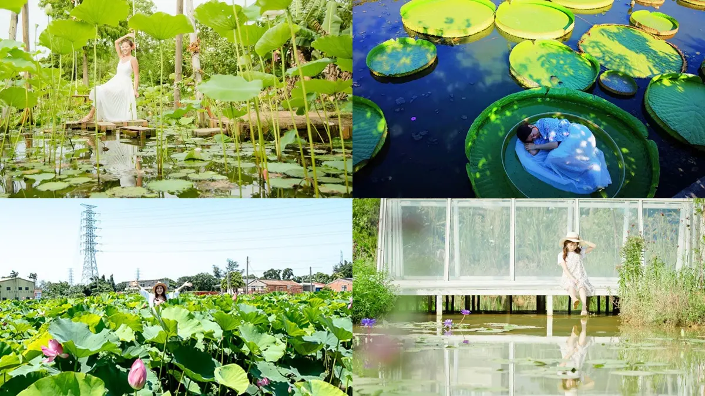
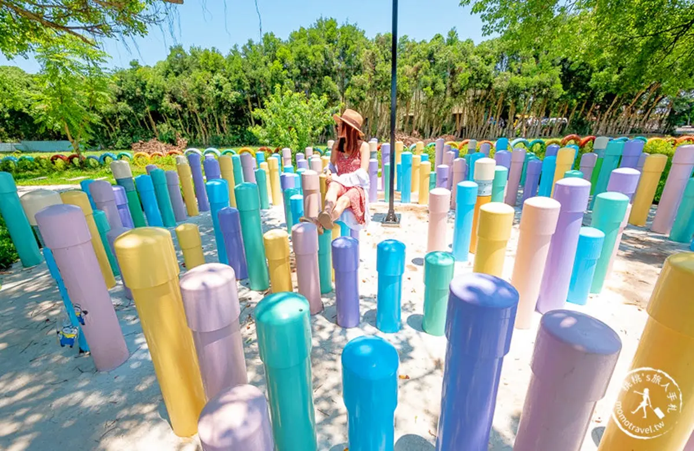
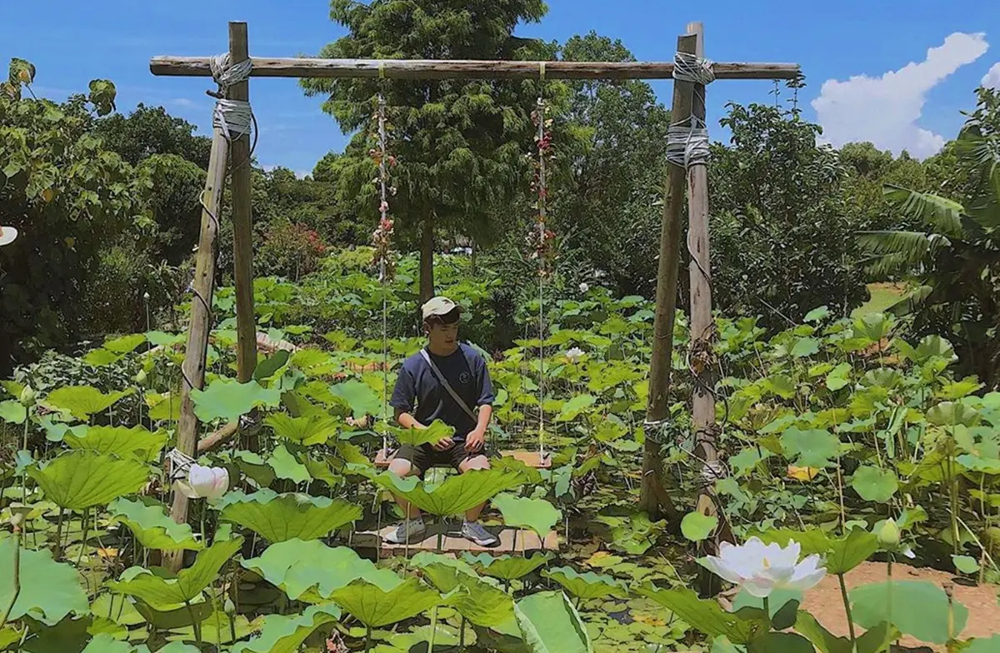
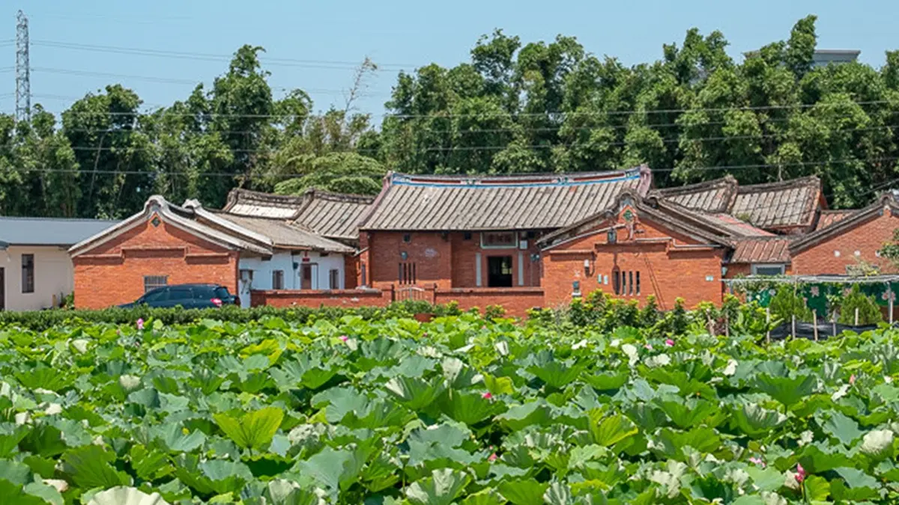
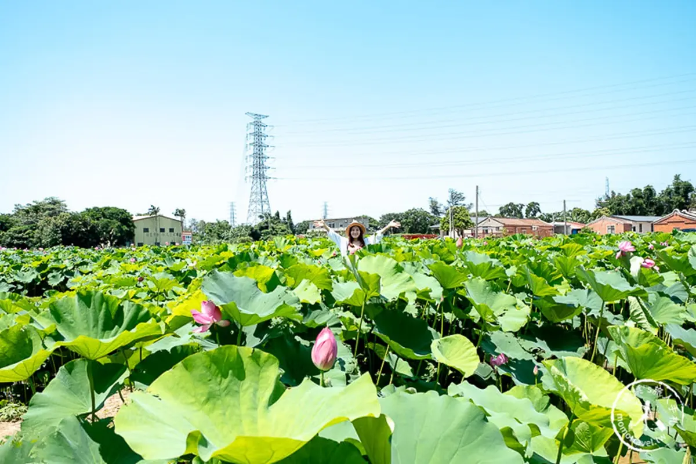
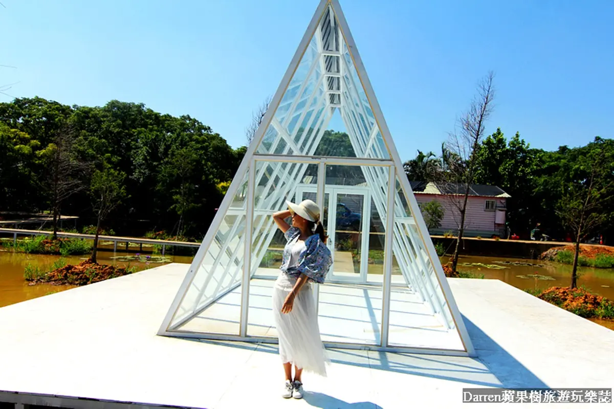

# 快來這裡當網美！睡在蓮葉上扮拇指姑娘，彩色鉛筆迷宮、蓮花盪鞦韆超美拍

- 編號：page_036
- 原始網址：https://supertaste.tvbs.com.tw/travel/318067
- 網站：食尚玩家（新聞／飲食媒體（TVBS 食尚玩家））
- 作者：食尚編輯部（發布單位：食尚玩家）
- 發表日期：2019-08-15
- 取得時間：2026-11-07T21:47:53+08:00
- 擷取方式：site_rule[supertaste.tvbs.com.tw]: article#article-content
- 資料性質：**媒體／部落格內容，尚未經官方資料查核**（查核結果見 analysis/fact_check_D.md）

---

*圖說：快來這裡當網美！睡在蓮葉上扮拇指姑娘，彩色鉛筆迷宮、蓮花盪鞦韆超美拍｜圖片來源：未標示（文章未註明圖片來源）*

*圖說：快來這裡當網美！睡在蓮葉上扮拇指姑娘，彩色鉛筆迷宮、蓮花盪鞦韆超美拍｜圖片來源：未標示（文章未註明圖片來源）*

每到夏天便是蓮花的季節，「北觀音、南白河 」，除了台南白河蓮花有名之外，桃園的觀音近郊也有一處「蓮花園休閒農業區」，同樣以種植蓮花聞名，每年夏季時分也會舉辦「觀音蓮花季」，一路到8月底。園內除了有占地約2萬平方米的蓮荷園，以及多種蓮花品種供應大家賞蓮、拍照，更有機會踏上一塊比身形還要大的蓮葉上，就像是拇指姑娘一樣，在水面上漂浮著，此外園內還有多處精心設置景點，隨便拍都能變成超美花仙子。

[編輯 食尚編輯部] 整理 黃品儒／圖片提供 食尚玩家編輯部、桃桃'S旅人手札、Darren蘋果樹、IG@je__bao、觀音區蓮花園休閒農業區-2019桃園蓮花季／核稿主編 方君民

桃園蓮花季在觀音地區其實可賞蓮花田的範圍很大，以蓮花季活動主會場新華路一段及金華路交叉口為中心，可徒步慢慢欣賞沿途蓮花美景。整個蓮花季聯合了許多蓮花園及店家共同參與，也會舉辦一系列活動供遊客參與，更設置許多景點讓人拍照，遊玩一整天都不是問題！其中一個打卡熱點就是「鉛筆迷宮陣」，放大的繽紛彩色鉛筆可愛得讓人一直拍不停。

*圖說：▲超可愛的彩色鉛筆迷宮，讓人拍照拍上癮。（圖片提供：桃桃'S旅人手札）｜圖片來源：桃桃'S旅人手札*

緊接而來的重頭戲就是「康莊蓮園」裡的大王蓮，且可以開放乘坐，每年都會吸引許多人前往，而大王蓮能乘載120公斤，所以一般人都能體驗「水上漂浮」的感覺，在大王蓮上，整個人就像是縮小一般，感覺就像是「拇指姑娘」一樣。

*圖說：▲躺在大王蓮上，整個人就像是「拇指姑娘」一樣。（圖片提供：Darren蘋果樹）｜圖片來源：Darren蘋果樹*

另一個打卡熱點則是「蓮荷園休閒農場」的盪鞦韆，在偌大的蓮葉叢中盪鞦韆，就好像化身蓮花仙子一樣，吸引許多網美前來拍一波美照。

*圖說：▲蓮花盪鞦韆是今年蓮花季最熱打卡點。（圖片提供：觀音區蓮花園休閒農業區-2019桃園蓮花季）｜圖片來源：觀音區蓮花園休閒農業區-2019桃園蓮花季*

*圖說：快來這裡當網美！睡在蓮葉上扮拇指姑娘，彩色鉛筆迷宮、蓮花盪鞦韆超美拍｜圖片來源：未標示（文章未註明圖片來源）*

而附近的「林家古厝」前，就有一大片的蓮花田，且免費參觀，以四合院為背景的蓮花田，拍起來也是別有氛圍，有股淡淡的幽靜古典美，這邊有步道可以走進蓮花田中，而且步道很寬很好走，漫步其間能近距離欣賞蓮花及蓮葉荷田田美景。

*圖說：▲以四合院為背景，別有一番古色古香的氛圍。（圖片提供：桃桃'S旅人手札）｜圖片來源：桃桃'S旅人手札*

*圖說：快來這裡當網美！睡在蓮葉上扮拇指姑娘，彩色鉛筆迷宮、蓮花盪鞦韆超美拍｜圖片來源：未標示（文章未註明圖片來源）*

如果有帶小孩前往，不妨可以順道去「青林農場」，花海花田、叢林迷宮、兒童遊具以及親子DIY體驗，還可以搭乘小火車以及餵兔子吃紅蘿蔔，近期又有三角玻璃屋變成桃園IG景點，也非常適合拍照打卡，只能說來這趟真的是值回票價，IG又多了好多美照可以發！

*圖說：快來這裡當網美！睡在蓮葉上扮拇指姑娘，彩色鉛筆迷宮、蓮花盪鞦韆超美拍｜圖片來源：未標示（文章未註明圖片來源）*

*圖說：▲青林農場也可以拍得十分夢幻、可愛。（圖片提供：觀音區蓮花園休閒農業區-2019桃園蓮花季）｜圖片來源：觀音區蓮花園休閒農業區-2019桃園蓮花季*

2019桃園蓮花季
時間：即日起至8月25日
地址：桃園市觀音區新華路一段及金華路交叉口
網站：2019桃園蓮花季

康莊蓮園
地址：桃園市觀音區大堀村下大堀184號
電話：（03）408-1517

蓮荷園休閒農場
地址：桃園市觀音區藍埔村金華路690號
電話：（03）477-6972
時間：09：00～17：30（週六、日至18：00）

林家古厝
地址：桃園市觀音區大富路221號
電話：（03）498-0753
時間：09：30～17：00（週六、日至18：00）

青林農場
地址：桃園市觀音區大湖路二段131-1號
電話：（03）498-7747
時間：09：30～17：30

## 圖片清單

| 檔案 | 圖說 | 圖片來源標示 | 對應段落 | 原始網址 |
| --- | --- | --- | --- | --- |
| images/page_036_image_01.jpg | 快來這裡當網美！睡在蓮葉上扮拇指姑娘，彩色鉛筆迷宮、蓮花盪鞦韆超美拍 | 未標示（文章未註明圖片來源） | 快來這裡當網美！睡在蓮葉上扮拇指姑娘，彩色鉛筆迷宮、蓮花盪鞦韆超美拍： | https://supertaste-images.tvbs.com.tw/api/v1/legacy/img/program/upload/2019/08/15/20190815173827-6e8f3262.jpg?w=1200&q=75 |
| images/page_036_image_02.jpg | 快來這裡當網美！睡在蓮葉上扮拇指姑娘，彩色鉛筆迷宮、蓮花盪鞦韆超美拍 | 未標示（文章未註明圖片來源） | 快來這裡當網美！睡在蓮葉上扮拇指姑娘，彩色鉛筆迷宮、蓮花盪鞦韆超美拍： | https://supertaste-images.tvbs.com.tw/api/v1/legacy/img/program/upload/2019/04/17/20190417190204-b356a4b9.jpg?w=1440&q=75 |
| images/page_036_image_03.jpg | ▲超可愛的彩色鉛筆迷宮，讓人拍照拍上癮。（圖片提供：桃桃'S旅人手札） | 桃桃'S旅人手札 | 快來這裡當網美！睡在蓮葉上扮拇指姑娘，彩色鉛筆迷宮、蓮花盪鞦韆超美拍：桃園蓮花季在觀音地區其實可賞蓮花田的範圍很大，以蓮花季活動主會場新華路一段及金華 | https://supertaste-images.tvbs.com.tw/api/v1/legacy/img/program/upload/2019/08/15/20190815164512-95f72933.jpg?w=1440&q=75 |
| images/page_036_image_04.jpg | ▲躺在大王蓮上，整個人就像是「拇指姑娘」一樣。（圖片提供：Darren蘋果樹） | Darren蘋果樹 | 快來這裡當網美！睡在蓮葉上扮拇指姑娘，彩色鉛筆迷宮、蓮花盪鞦韆超美拍：緊接而來的重頭戲就是「康莊蓮園」裡的大王蓮，且可以開放乘坐，每年都會吸引許多人前 | https://supertaste-images.tvbs.com.tw/api/v1/legacy/img/program/upload/2019/08/15/20190815165835-a890f9ee.jpg?w=1440&q=75 |
| images/page_036_image_05.jpg | ▲蓮花盪鞦韆是今年蓮花季最熱打卡點。（圖片提供：觀音區蓮花園休閒農業區-2019桃園蓮花季） | 觀音區蓮花園休閒農業區-2019桃園蓮花季 | 快來這裡當網美！睡在蓮葉上扮拇指姑娘，彩色鉛筆迷宮、蓮花盪鞦韆超美拍：另一個打卡熱點則是「蓮荷園休閒農場」的盪鞦韆，在偌大的蓮葉叢中盪鞦韆，就好像化身 | https://supertaste-images.tvbs.com.tw/api/v1/legacy/img/program/upload/2019/08/15/20190815170350-06a08f22.jpg?w=1440&q=75 |
| images/page_036_image_06.jpg | 快來這裡當網美！睡在蓮葉上扮拇指姑娘，彩色鉛筆迷宮、蓮花盪鞦韆超美拍 | 未標示（文章未註明圖片來源） | 快來這裡當網美！睡在蓮葉上扮拇指姑娘，彩色鉛筆迷宮、蓮花盪鞦韆超美拍：▲蓮花盪鞦韆是今年蓮花季最熱打卡點。（圖片提供：觀音區蓮花園休閒農業區-2019 | https://supertaste-images.tvbs.com.tw/api/v1/legacy/img/program/upload/2019/08/15/20190815164506-56fbd444.jpg?w=1440&q=75 |
| images/page_036_image_07.jpg | ▲以四合院為背景，別有一番古色古香的氛圍。（圖片提供：桃桃'S旅人手札） | 桃桃'S旅人手札 | 快來這裡當網美！睡在蓮葉上扮拇指姑娘，彩色鉛筆迷宮、蓮花盪鞦韆超美拍：而附近的「林家古厝」前，就有一大片的蓮花田，且免費參觀，以四合院為背景的蓮花田， | https://supertaste-images.tvbs.com.tw/api/v1/legacy/img/program/upload/2019/08/15/20190815164513-38ff51b7.jpg?w=1440&q=75 |
| images/page_036_image_08.jpg | 快來這裡當網美！睡在蓮葉上扮拇指姑娘，彩色鉛筆迷宮、蓮花盪鞦韆超美拍 | 未標示（文章未註明圖片來源） | 快來這裡當網美！睡在蓮葉上扮拇指姑娘，彩色鉛筆迷宮、蓮花盪鞦韆超美拍：▲以四合院為背景，別有一番古色古香的氛圍。（圖片提供：桃桃'S旅人手札） | https://supertaste-images.tvbs.com.tw/api/v1/legacy/img/program/upload/2019/08/15/20190815164508-9802b321.jpg?w=1440&q=75 |
| images/page_036_image_09.jpg | 快來這裡當網美！睡在蓮葉上扮拇指姑娘，彩色鉛筆迷宮、蓮花盪鞦韆超美拍 | 未標示（文章未註明圖片來源） | 快來這裡當網美！睡在蓮葉上扮拇指姑娘，彩色鉛筆迷宮、蓮花盪鞦韆超美拍：如果有帶小孩前往，不妨可以順道去「青林農場」，花海花田、叢林迷宮、兒童遊具以及親 | https://supertaste-images.tvbs.com.tw/api/v1/legacy/img/program/upload/2019/08/15/20190815171536-8a659981.jpg?w=1440&q=75 |
| images/page_036_image_10.jpg | ▲青林農場也可以拍得十分夢幻、可愛。（圖片提供：觀音區蓮花園休閒農業區-2019桃園蓮花季） | 觀音區蓮花園休閒農業區-2019桃園蓮花季 | 快來這裡當網美！睡在蓮葉上扮拇指姑娘，彩色鉛筆迷宮、蓮花盪鞦韆超美拍：【看更多】 ■ 花草系網美最愛！彰化田尾美拍5景點：公路花園、仙人掌綠洲、玻璃屋 | https://supertaste-images.tvbs.com.tw/api/v1/legacy/img/program/upload/2019/08/15/20190815171538-90ff5778.jpg?w=1440&q=75 |

## 正文內連結

- [桃桃'S旅人手札](http://momotravel.tw/)
- [Darren蘋果樹](https://www.darren0322.com)
- [■ 「美人魚」游進海科館！真人版出沒基隆，最後一天兩場快衝](https://supertaste.tvbs.com.tw/topic/article/318056)
- [■ 網美最愛！花東8間超美拍旅店：面太平洋Villa、270度縱谷景觀房、水中玻璃屋](https://supertaste.tvbs.com.tw/topic/article/315874)
- [■ 花草系網美最愛！彰化田尾美拍5景點：公路花園、仙人掌綠洲、玻璃屋景觀餐廳](https://supertaste.tvbs.com.tw/topic/article/317335)
- [2019桃園蓮花季](http://2019taoyuanlotus.com.tw/index.php)　← 觀音區相關
