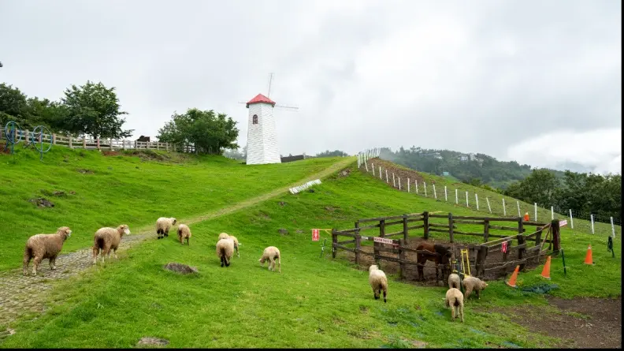

# 清境農場、埔心牧場都輸了！全台最夯農場狂吸86萬人，免費入園、拍美照

- 編號：page_037
- 原始網址：https://supertaste.tvbs.com.tw/hot/355979
- 網站：食尚玩家（新聞／飲食媒體（TVBS 食尚玩家））
- 作者：李艾庭（發布單位：食尚玩家）
- 發表日期：2025-08-17（最後更新 2025-08-26）
- 取得時間：2026-11-07T21:47:59+08:00
- 擷取方式：site_rule[supertaste.tvbs.com.tw]: article#article-content
- 資料性質：**媒體／部落格內容，尚未經官方資料查核**（查核結果見 analysis/fact_check_D.md）

---

*圖說：清境農場、埔心牧場都輸了！全台最夯農場狂吸86萬人，免費入園、拍美照｜圖片來源：未標示（文章未註明圖片來源）*

全台休閒農場及觀光區蓬勃發展，特色景點成為民眾國旅首選。交通部觀光署最新數據顯示，2025年１月至５月期間，許多人至農場觀光，其中位於桃園的「觀音蓮花園休閒農業區」以超過86萬人次奪下全台之冠，成為最受歡迎的觀光農場。此外，清境農場、武陵農場等知名景點，也因優美環境及豐富體驗活動，吸引大量遊客造訪。

## 最受歡迎農場排行榜

交通部觀光署統計，在休閒農業區及休閒農場類別，2025年１至５月觀光人次如下：
１、觀音蓮花園休閒農業區：86萬7391人次
２、清境農場：29萬3019人次
３、武陵農場：18萬8656人次
４、埔心牧場：17萬9472人次
５、綠世界休閒農場：14萬9940人次
６、飛牛牧場：８萬7123人次
７、福壽山農場：８萬1397人次
８、走馬瀨農場：７萬9946人次

## 觀音蓮花園休閒農業區免費入園

桃園觀音區的蓮花園休閒農業區以超過86萬人次成為人氣王，園區內擁有超過百種的蓮花品種，且免費入園，每年夏季吸引大量攝影愛好者前來取景。除了賞花，園區也規畫完善步道及多項農事DIY活動，假日甚至可以付費乘坐大王蓮，吸引許多遊客前來體驗。此外，園區也提供多款蓮花相關料理，像是蓮子竹筒飯、蓮子豆花等等。

## 觀音蓮花園休閒農業區評價

實際查看Google評論，蓮花園休閒農業區平均獲得4.1顆星的好評，網友留言表示，「停車很方便，除了荷花，還看到好多胡蘆、瓠瓜、蛇瓜、大大的絲瓜等，是賞荷的好去處」「跟朋友來坐大王蓮，一次收費100元不算便宜，但可以體驗看看挺不錯的，工作人員超級親切很讚，園內很乾淨」「位於觀音區的蓮花園休閒農業區，每年固定有蓮花活動，並且超級多白、粉蓮花，很漂亮又可以走進田內賞花，近距離拍照都不是問題」。

*圖說：▲觀音蓮花園休閒農業區內有許多農場、蓮園。（圖片來源：shutterstock達志影像）｜圖片來源：shutterstock達志影像*

#### 觀音區蓮花園休閒農業區 地址：桃園市觀音區金華路33之１號 電話號碼：03-497-0166 營業時間：週一至日08：30～17：30

## 圖片清單

| 檔案 | 圖說 | 圖片來源標示 | 對應段落 | 原始網址 |
| --- | --- | --- | --- | --- |
| images/page_037_image_01.jpg | 清境農場、埔心牧場都輸了！全台最夯農場狂吸86萬人，免費入園、拍美照 | 未標示（文章未註明圖片來源） | 清境農場、埔心牧場都輸了！全台最夯農場狂吸86萬人，免費入園、拍美照： | https://supertaste-images.tvbs.com.tw/api/v1/legacy/img/program/_data/i/upload/2025/08/14/20250814160524-fbcc6916-me.jpg?w=1200&q=75 |
| images/page_037_image_02.jpg | ▲觀音蓮花園休閒農業區內有許多農場、蓮園。（圖片來源：shutterstock達志影像） | shutterstock達志影像 | 觀音蓮花園休閒農業區評價：實際查看Google評論，蓮花園休閒農業區平均獲得4.1顆星的好評，網友留言表示 | https://supertaste-images.tvbs.com.tw/api/v1/legacy/img/program/_data/i/upload/2025/08/14/20250814160513-6b2fb55b-me.jpg?w=1440&q=75 |

## 正文內連結

- （無）
