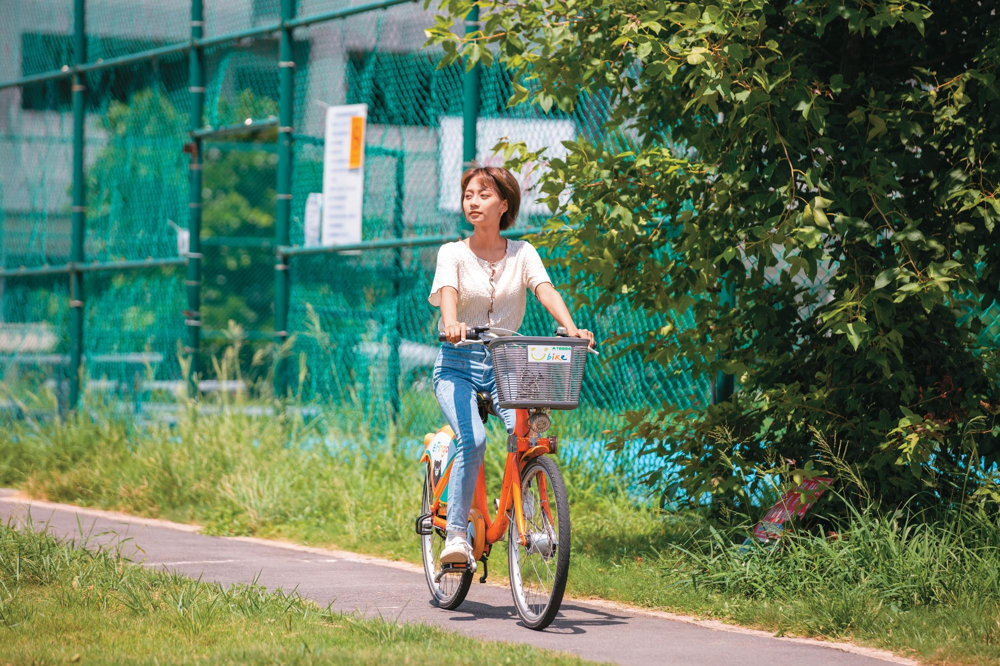
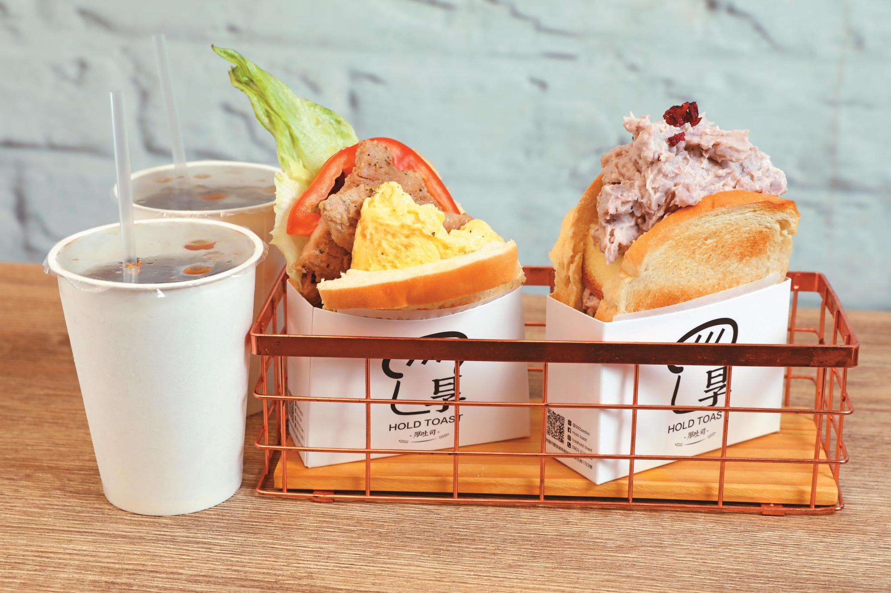
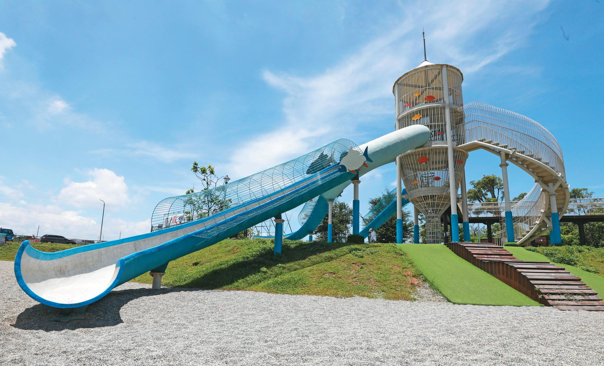
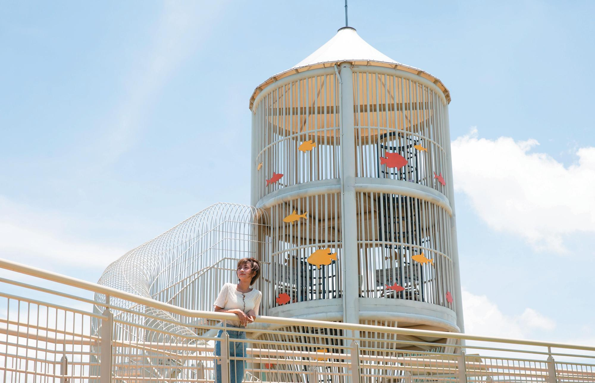
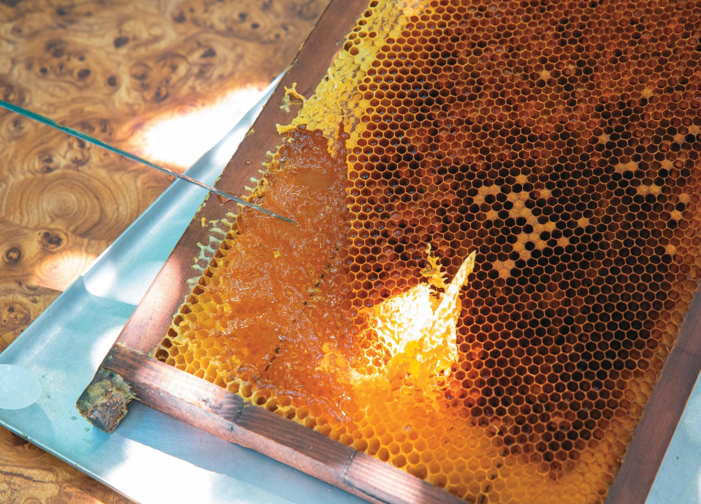
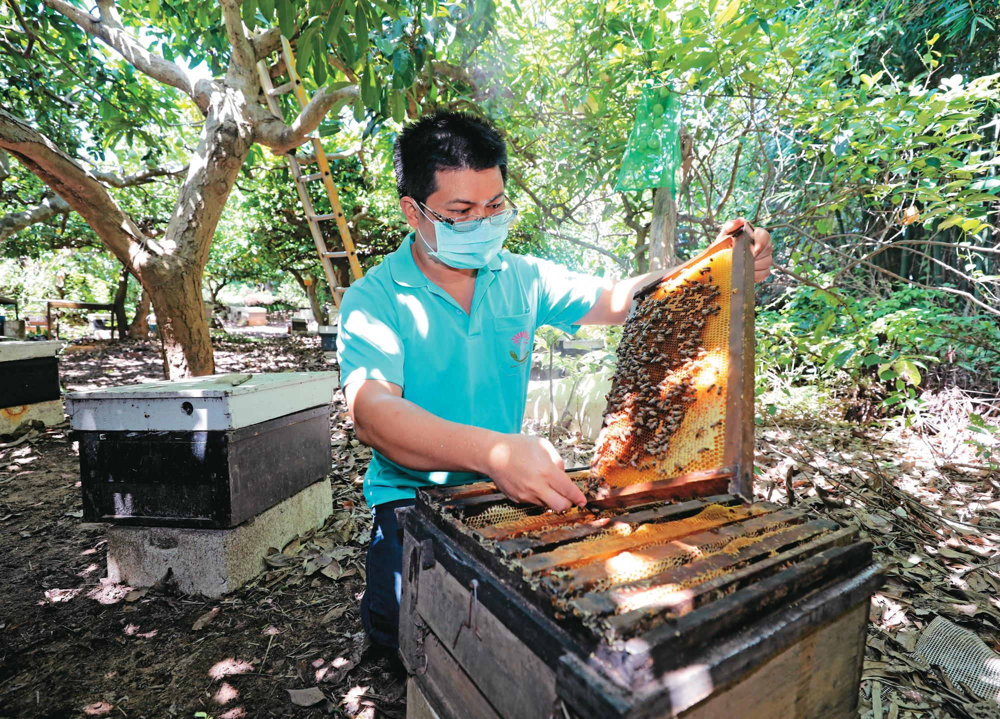
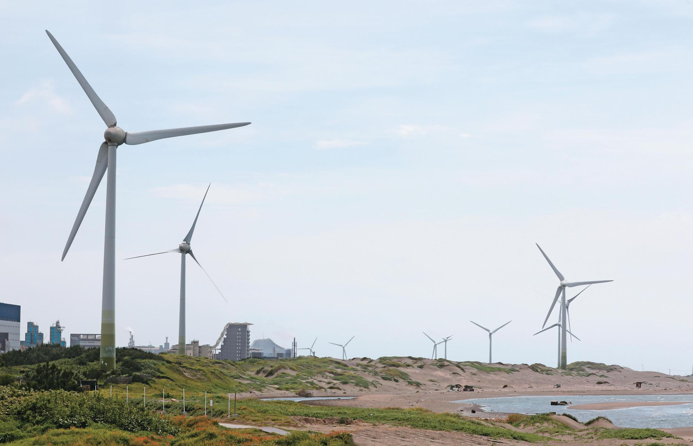
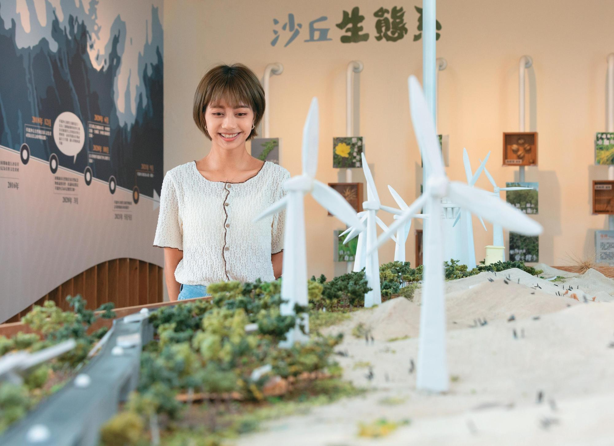
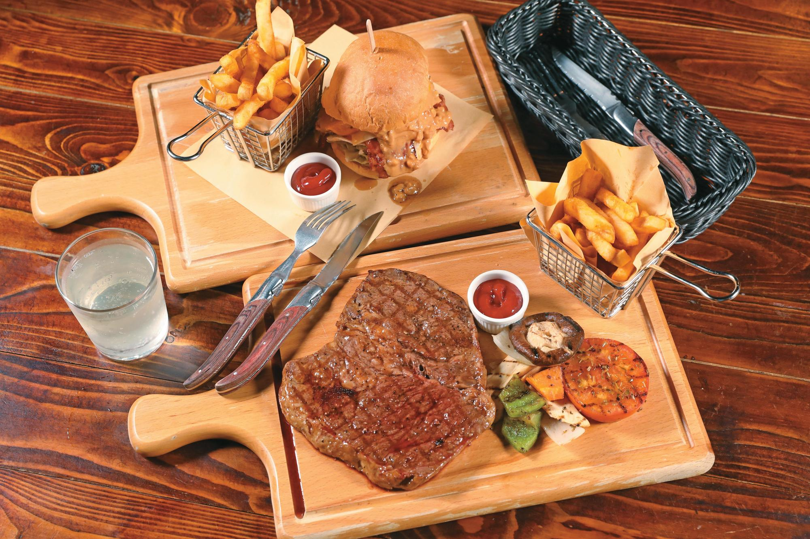
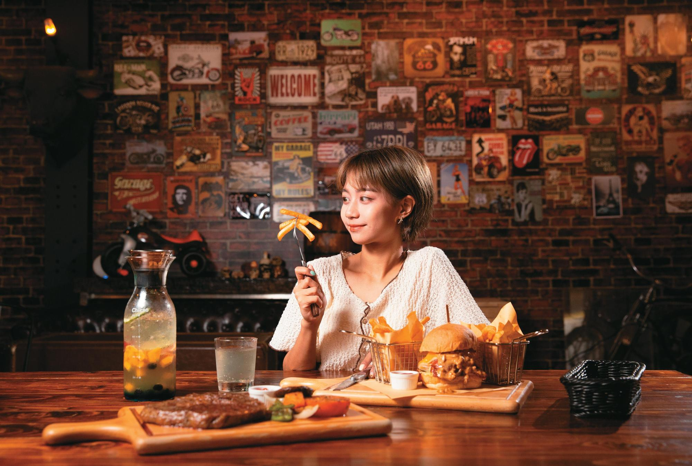

# 【桃園誌】觀音親自然 來場獨一無二的邂逅 - 鏡週刊 Mirror Media

- 編號：page_039
- 原始網址：https://www.mirrormedia.mg/story/20220809cnt001/
- 最終網址（轉址後）：https://www.mirrormedia.mg/story/20220809cnt001
- 網站：鏡週刊 Mirror Media（其他媒體）
- 作者：鏡週刊 Mirror Media（發布單位：鏡週刊 Mirror Media）
- 發表日期：2022-08-12（最後更新 2023-09-12）
- 取得時間：2026-11-07T21:48:06+08:00
- 擷取方式：trafilatura (no site rule matched)
- 資料性質：**媒體／部落格內容，尚未經官方資料查核**（查核結果見 analysis/fact_check_D.md）

---

【桃園誌】觀音親自然 來場獨一無二的邂逅

循著西濱公路來到觀音區，讓自己貼近大自然的原生脈動，玩轉角度重新認識這裡，與隱藏其中的驚喜來場獨特邂逅！

享受現點現做的手工爆餡厚吐司，讓早晨作為完美開場；暢快體驗高速驚險的溜滑梯，找回失落已久的童心；蜜蜂生態見學，佐以沁涼入心的蜂蜜檸檬和雪蜜；走讀草漯沙丘地景，深入認識沙丘隱藏的奧祕；最後歇腳在公路驛站，豪爽大口享用鮮美汁多的美式霜降牛排，身心皆富足地作為美好旅程的句點。

驚奇豐盛的早餐時光 Hold Toast厚吐司

美好的觀音一日行，就從享受豐盛早餐開始。到訪當地的人氣厚吐司早餐店「Hold Toast」，熱愛吃早餐的店主阿仁，最喜歡看到為客人送上現點現做、餡料爆滿的手作厚吐司時，客人那「哇！」的驚歎表情。

Hold Toast有鹹、甜兩種口味，阿仁選用新鮮的原形食材，口感及味覺體驗上講求層次與變化，只為讓每位食客吃得健康開心。「豬排厚吐司」是回頭率最高的鹹口味，以自製蒜味調料，將厚實大塊的在地溫體黑豬里肌醃漬入味，煎製成口感十足的豬排，再與滑嫩的歐姆蛋、多汁牛番茄及爽脆生菜一併夾入抹上芥末醬、切達起司醬的柔軟厚吐司中；大口咬下，層疊豐富的口感，滿足了一日之初所需的元氣。人氣甜口味「鮮奶芋泥厚吐司」，將大甲芋頭、鮮奶及奶油製成的滑順芋泥，拌入酸甜的蔓越莓乾形成點綴，再夾入鬆軟香甜的蜂蜜蛋糕，出乎意料的搭配卻有著令人驚豔的和諧。吃著顛覆想像的手作厚吐司，配上一杯自家熬煮的古早味紅茶，幸福感滿溢的旅行序曲，就此揭幕。

Hold Toast

萌發童心的自然遊樂場 水之丘主題公園

享用完豐盛早餐，來到「水之丘主題公園」活動一下身體。這座甫完工啟用的主題公園佔地面積相當廣大，設有遊戲場、湖濱步道及觀景平台。開闊的腹地讓人不論是在遊戲場溜滑梯、在湖畔悠閒散步，或展望開闊湖景，都能盡情享受陽光、綠樹與風帶來的舒爽氣息。

水之丘主題公園最令人眼睛一亮、玩興爆發的是「草魚遊戲場」，場內有一座以在地埤塘特有元素「飼料桶」設計而成的大型溜滑梯，藍白二色的可愛搭配，三線滑道採分齡設計，滑道之間以鑽籠、樓梯連通，上爬下鑽饒富趣味。最高的一道滑梯十分陡峭，高速滑下的驚心動魄讓人來不及驚呼；次高的滑梯採弧形設計，讓人感受峰迴路轉的刺激；若對高速溜滑有所懼怕，可以選擇第三道滑梯，委婉貼心的設計讓所有人都可以在這裡享受遊玩樂趣、找回童心。

水之丘主題公園

蜜蜂生態見學 三奇蜜蜂生態農園

暢玩滑梯，意猶未盡地拜訪蜜峰的家園。觀音區第一座養蜂場「三奇蜜蜂生態農園」，由祖傳三代的養蜂世家經營，一家人從養蜂到採集加工蜂產品都親力親為，不假他人之手。2003年小老闆全哥受到觀音蓮花季的啟發，轉型為生態農園，為想認識蜜蜂生態的來客，提供深入淺出的生態導覽，以及夏季限定的採蓮子體驗。

來到這裡，先喝一杯自家祕製的蜂蜜檸檬水，再到放置蜂箱的樹園聽故事。從阿公以一個蜂箱起家的創業史講起，再介紹園區裡的原生蜜源植物，荔枝、龍眼、月桃、白千層，甚至還有一株來自東南亞的山刺番荔枝。全哥輔以燻煙開啟蜂箱，傳授辨認工蜂、女王蜂的祕訣，介紹牠們的習性，再引領觀察蜂巢裡的蜂蛹、蜂蜜和花粉。導覽最後，全哥發給每人一匙現挖的新鮮蜂巢蜜，說明蜂蜜於不同四季的風味差異。另外，絕不能錯過全哥獨家研發中的「雪蜜」，以冷凍乾燥水果打成粉末，結合蜂蜜再結晶，嚐起來竟有冰淇淋般的綿密口感，為炎熱夏天帶點消暑風味。

三奇蜜蜂生態農園

走讀台灣撒哈拉 草漯沙丘地景展示館

穿過豔陽四射的大地，來到有著台版撒哈拉的「草漯沙丘」，它不僅是台灣最完整的沙丘地形，更是桃園市第一座市定地質公園。動身出遊前，為避免走馬看沙，不妨先在「草漯沙丘地景展示館」認識草漯沙丘。展示館由原先觀音海水浴場遊客中心活化改建，以地景環境教育和海洋生態保育為展示主題，寓教於樂，是爸媽帶孩子來放電的好去處。

走進展示館，映入眼簾的是座大型「草漯沙丘主視覺模型」，北起老街溪、南至大堀溪的沙丘全域景勝一覽無遺，模型上更放置了沙丘常見的濱刺麥、礁石提供把玩，亦有沙丘常見動植物知識介紹，讓遊客能進一步認識沙丘生態圈。而最有趣的是館內的互動體驗設施，透過磁力、季風模擬、等高線偵測儀等裝置，提供直覺式的知識教學，讓各年齡層的遊客都能輕鬆瞭解大自然與沙丘間的關係。接著來到展示館2樓觀景台，隨興選個靠窗的座位，讓身心在連綿沙丘與遼闊大海的絕景中獲得療癒。

草漯沙丘地景展示館

大口吃肉的暢快美味 六六驛站美式餐廳

循著沙丘漫步，帶著舒緩的滿足來到西濱公路上的「六六驛站美式餐廳」。位於哈雷重型機車桃園旗艦店2樓的餐廳，替南來北往的哈雷車友提供一處餐飲休憩之地。餐廳以「六六」命名呼應美國66號公路，店內陳設也取材公路上餐廳的常見元素，牆面上的莫哈維沙漠景色、美國國旗、復古鐵牌、霓虹燈字牌及飛鏢機，讓人宛如置身美國西部，洋溢美式豪爽風格。

菜單上的美國霜降牛排，就是哈雷車友間口耳相傳的「騎士牛排」，將20盎司的美牛背脊肉以胡椒、鹽簡單調味，直火炭烤後，牛肉的原汁原味搭配滿溢炙烤香氣，每一口都回味無窮；「花生醬培根起司牛肉」也是人氣選項，手打出筋道的牛肉排扎實多汁，與煙燻培根、生菜、雙起司及帶有顆粒的花生醬一同夾入麵包，香氣馥郁且富有層次，令人驚喜的食感在口中連環迸發，再佐以清涼的鮮果氣泡飲，沒什麼比暢快美味更適合作為旅程的收尾。

六六驛站美式餐廳

*圖說：騎乘YouBike遨遊在洋溢自然氣息的觀音區街道。｜圖片來源：未標示（文章未註明圖片來源）*

*圖說：厚吐司裡夾入滿溢的手作餡料，顛覆一成不變的早餐選擇。｜圖片來源：未標示（文章未註明圖片來源）*

*圖說：新鮮現作的美味厚吐司，只限外帶品嚐。｜圖片來源：未標示（文章未註明圖片來源）*

*圖說：水之丘主題公園引起話題的滑梯，配色呼應藍天白雲，舒心自適之情油然而生。｜圖片來源：未標示（文章未註明圖片來源）*

*圖說：漫步於湖濱步道，沿途可展望開闊景致及湖岸風光。｜圖片來源：未標示（文章未註明圖片來源）*

*圖說：拿出蜂箱巢片，全哥切開以蜂蠟密封的蜂巢，展示儲存其中的琥珀色蜂蜜。｜圖片來源：未標示（文章未註明圖片來源）*

*圖說：全哥展示蜂箱中的蜜蜂生活，看女王蜂、工蜂各司其職，以及剛破蛹而出的蜂寶寶。｜圖片來源：未標示（文章未註明圖片來源）*

*圖說：從地景展示館可向周邊順遊，看百年的白沙岬燈塔，走大園潮音海或觀音白沙屯觀景步道。｜圖片來源：未標示（文章未註明圖片來源）*

*圖說：草漯沙丘地景展示館的模型，帶領初次到訪的人一覽沙丘的地理位置及地形概況，以及周邊景點。｜圖片來源：未標示（文章未註明圖片來源）*

*圖說：六六驛站美式餐廳的美國牛肉餐點原汁原味，讓人感受在66號公路上旅行的豪放暢快。｜圖片來源：未標示（文章未註明圖片來源）*

*圖說：美式料理風格不必多加修飾，大口吃肉的爽快感，才是精華所在。｜圖片來源：未標示（文章未註明圖片來源）*

## 圖片清單

| 檔案 | 圖說 | 圖片來源標示 | 對應段落 | 原始網址 |
| --- | --- | --- | --- | --- |
| images/page_039_image_01.jpg | 騎乘YouBike遨遊在洋溢自然氣息的觀音區街道。 | 未標示（文章未註明圖片來源） | 【桃園誌】觀音親自然 來場獨一無二的邂逅 - 鏡週刊 Mirror Media：●更多內容．請看《桃園誌》電子書：https://ebook.tycg.gov. | https://v3-statics.mirrormedia.mg/images/20220809101059-3c3b1ee3c3bf244f40a71e237bde88c4-w2400.jpg |
| images/page_039_image_02.jpg | 厚吐司裡夾入滿溢的手作餡料，顛覆一成不變的早餐選擇。 | 未標示（文章未註明圖片來源） | 【桃園誌】觀音親自然 來場獨一無二的邂逅 - 鏡週刊 Mirror Media：●更多內容．請看《桃園誌》電子書：https://ebook.tycg.gov. | https://v3-statics.mirrormedia.mg/images/20220809101121-f62821573b8e3ce01832244eb004a1b8-w2400.jpg |
| images/page_039_image_03.jpg | 新鮮現作的美味厚吐司，只限外帶品嚐。 | 未標示（文章未註明圖片來源） | 【桃園誌】觀音親自然 來場獨一無二的邂逅 - 鏡週刊 Mirror Media：●更多內容．請看《桃園誌》電子書：https://ebook.tycg.gov. | https://v3-statics.mirrormedia.mg/images/20220809101115-da003d989360e5a9914a87289fe25270-w2400.jpg |
| images/page_039_image_04.jpg | 水之丘主題公園引起話題的滑梯，配色呼應藍天白雲，舒心自適之情油然而生。 | 未標示（文章未註明圖片來源） | 【桃園誌】觀音親自然 來場獨一無二的邂逅 - 鏡週刊 Mirror Media：●更多內容．請看《桃園誌》電子書：https://ebook.tycg.gov. | https://v3-statics.mirrormedia.mg/images/20220809101132-78d8876c384b597bc396feccafbb2c46-w2400.jpg |
| images/page_039_image_05.jpg | 漫步於湖濱步道，沿途可展望開闊景致及湖岸風光。 | 未標示（文章未註明圖片來源） | 【桃園誌】觀音親自然 來場獨一無二的邂逅 - 鏡週刊 Mirror Media：●更多內容．請看《桃園誌》電子書：https://ebook.tycg.gov. | https://v3-statics.mirrormedia.mg/images/20220809101133-f78e7a542db5cc512f78b2d6c8e19f3b-w2400.jpg |
| images/page_039_image_06.jpg | 拿出蜂箱巢片，全哥切開以蜂蠟密封的蜂巢，展示儲存其中的琥珀色蜂蜜。 | 未標示（文章未註明圖片來源） | 【桃園誌】觀音親自然 來場獨一無二的邂逅 - 鏡週刊 Mirror Media：●更多內容．請看《桃園誌》電子書：https://ebook.tycg.gov. | https://v3-statics.mirrormedia.mg/images/20220809101149-d5545bd376c77562f1b18fff55a3b6ab-w2400.jpg |
| images/page_039_image_07.jpg | 全哥展示蜂箱中的蜜蜂生活，看女王蜂、工蜂各司其職，以及剛破蛹而出的蜂寶寶。 | 未標示（文章未註明圖片來源） | 【桃園誌】觀音親自然 來場獨一無二的邂逅 - 鏡週刊 Mirror Media：●更多內容．請看《桃園誌》電子書：https://ebook.tycg.gov. | https://v3-statics.mirrormedia.mg/images/20220809101205-df9a07de53555461ffde05392c226aeb-w2400.jpg |
| images/page_039_image_08.jpg | 從地景展示館可向周邊順遊，看百年的白沙岬燈塔，走大園潮音海或觀音白沙屯觀景步道。 | 未標示（文章未註明圖片來源） | 【桃園誌】觀音親自然 來場獨一無二的邂逅 - 鏡週刊 Mirror Media：●更多內容．請看《桃園誌》電子書：https://ebook.tycg.gov. | https://v3-statics.mirrormedia.mg/images/20220809101201-61568df42dee1ce9e5d95ec6df72f53a-w2400.jpg |
| images/page_039_image_09.jpg | 草漯沙丘地景展示館的模型，帶領初次到訪的人一覽沙丘的地理位置及地形概況，以及周邊景點。 | 未標示（文章未註明圖片來源） | 【桃園誌】觀音親自然 來場獨一無二的邂逅 - 鏡週刊 Mirror Media：●更多內容．請看《桃園誌》電子書：https://ebook.tycg.gov. | https://v3-statics.mirrormedia.mg/images/20220809101211-512099d90b3b8268a8dba860b41cdca1-w2400.jpg |
| images/page_039_image_10.jpg | 六六驛站美式餐廳的美國牛肉餐點原汁原味，讓人感受在66號公路上旅行的豪放暢快。 | 未標示（文章未註明圖片來源） | 【桃園誌】觀音親自然 來場獨一無二的邂逅 - 鏡週刊 Mirror Media：●更多內容．請看《桃園誌》電子書：https://ebook.tycg.gov. | https://v3-statics.mirrormedia.mg/images/20220809101217-4920b21d3aa94aa7eab471e92cf38e78-w2400.jpg |
| images/page_039_image_11.jpg | 美式料理風格不必多加修飾，大口吃肉的爽快感，才是精華所在。 | 未標示（文章未註明圖片來源） | 【桃園誌】觀音親自然 來場獨一無二的邂逅 - 鏡週刊 Mirror Media：●更多內容．請看《桃園誌》電子書：https://ebook.tycg.gov. | https://v3-statics.mirrormedia.mg/images/20220809101218-e7bc96885acd170fb45e1f3bf41c61fc-w2400.jpg |

## 正文內連結

- （無）
