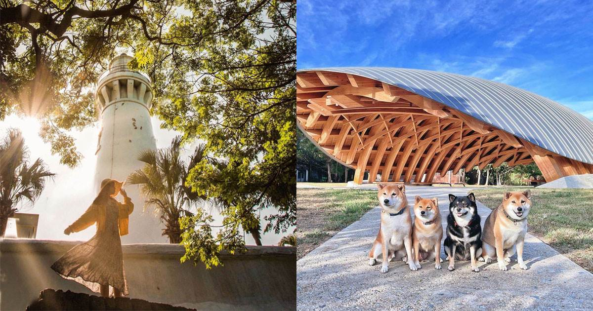
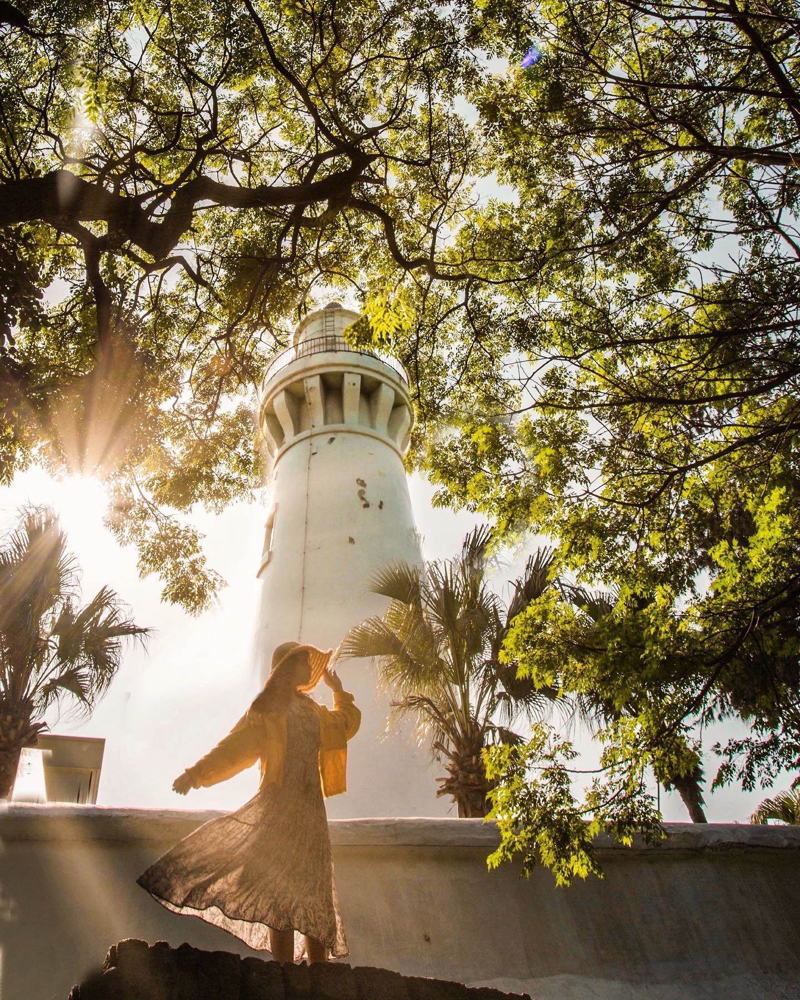
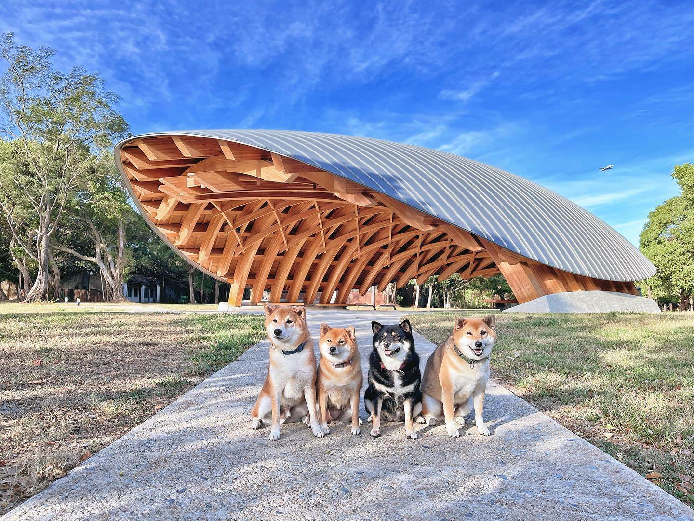
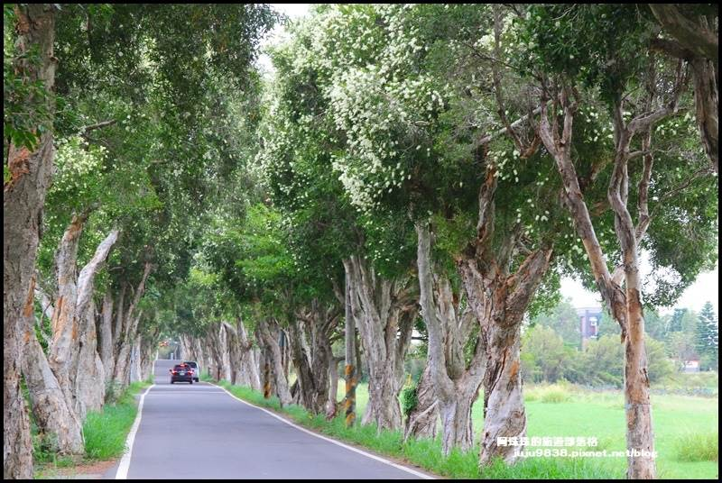
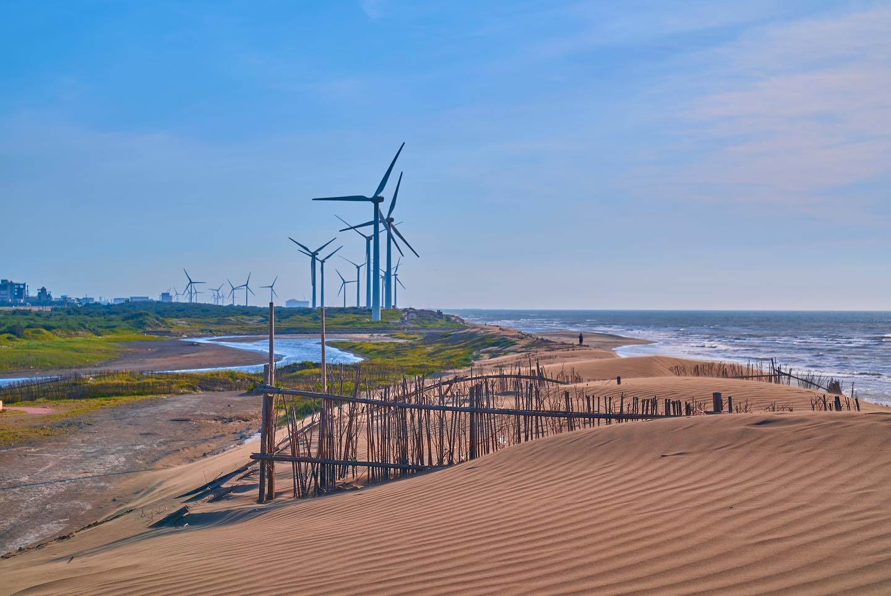

# 桃園｜觀音4個秘境景點!從百年燈塔到台版撒哈拉，讓你一次體驗海岸、山林、沙漠的多元之美-輕旅行

- 編號：page_040
- 原始網址：https://travel.yam.com/article/127695
- 網站：輕旅行（其他媒體）
- 作者：輕旅行_阿諺（發布單位：輕旅行）
- 發表日期：2022-04-25（最後更新 2023-04-07）
- 取得時間：2026-11-07T21:38:07+08:00
- 擷取方式：trafilatura (no site rule matched)
- 資料性質：**媒體／部落格內容，尚未經官方資料查核**（查核結果見 analysis/fact_check_D.md）

---

桃園觀音區有著令人放鬆的鄉間悠哉氛圍，也有著蘊藏珍貴生態的海岸。此外，這裡更隱藏著不少秘境！跟著【輕旅行秘境指南】，發現守望百年的白燈塔；造訪舊營區改造的親子天堂；穿梭3公里長的白千層隧道；闖入台版撒哈拉，一起看見這些秘境的無窮魅力！更多秘境系列文章請見：輕旅行秘境指南。

文章重點

桃園觀音秘境｜白沙岬燈塔

守望百年的白燈塔，台灣唯一使用紅磚與石頭建造而成

白沙岬燈塔曾經是本島最西側的燈塔，從1901年起就守護著濱海的安全直到現今。除了塔身建築與內部設施跨越一世紀之外，這裡還保存著日治時期的日晷、一座由上海機器局製造的時鐘，以及從日治時代便存在的百年苦楝樹，至今依舊蒼勁挺拔的聳立在庭園中。 燈塔旁設有環形步道，沿著觀音溪畔修築，除了有小橋流水、稻田與池塘，還可遠眺觀音海濱著名的風車景觀；鐘塔廣場及觀音溪人形拱橋則成了拍攝婚紗照的好去處，不論是一個人、兩個人還是一群人，和亮眼潔白的燈塔合影，都是讓人永遠難忘的美麗記憶！

(圖／ IG@taiwan.4fun 授權提供)

【輕旅行秘境評分】

鮮為人知指數：★★★☆☆

到達難易度：★★★☆☆

有故事指數：★★★★☆

白沙岬燈塔 Info.

白沙岬燈塔

- 星期一: 休息

- 星期二: 09:00 – 17:00

- 星期三: 09:00 – 17:00

- 星期四: 09:00 – 17:00

- 星期五: 09:00 – 17:00

- 星期六: 09:00 – 17:00

- 星期日: 09:00 – 17:00

桃園觀音秘境｜崙坪文化地景園區

舊營區改造的隱藏親子天堂

這裡原本是日本電信公司「國際電話株式會社」所屬觀音崙坪受信所的所在地，1970年代國防部在此設立崙坪營區宿舍，後來在軍營搬出後，閒置達12年之久。如今，這座園區保留下原本的宿舍，以及蓊鬱的綠林，轉型成為不能錯過的休閒場域。整個園區可以分為中央大草坪、龜殼劇場及客家工藝聚落區等，其中的「客家工藝聚落」包含客家工藝館及好客食堂，客家工藝館展出客家百工百業的獨特，並提供相關職人體驗。以落葉為設計理念，暱稱為「龜殼劇場」的木結構設施，提供表演活動使用；「中央大草坪」則是野餐踏青，盡情放電的最好地方。找個閒暇的日子，全家人一起到崙坪文化地景園區，享受客家文化魅力與綠意盎然的環境，度過快樂的悠哉時光！

(圖／ IG @masaki771004 授權提供)

【輕旅行秘境評分】

鮮為人知指數：★★★★☆

到達難易度：★★★☆☆

好好拍指數：★★★★☆

崙坪文化地景園區 Info.

地址：桃園市觀音區學府路350巷120號

崙坪文化地景園區

- 星期一: 休息

- 星期二: 09:00 – 17:00

- 星期三: 09:00 – 17:00

- 星期四: 09:00 – 17:00

- 星期五: 09:00 – 17:00

- 星期六: 09:00 – 17:00

- 星期日: 09:00 – 17:00

桃園觀音秘境｜白千層綠色隧道

以埤塘與蓮花為主題的3公里長的白千層隧道「南北環自行車道」

南環讓旅人可以悠遊在蓮池間，感受清心自在；北環則使人放鬆於埤塘邊，感受心曠神怡。而北環路線除了埤塘，更特別的是還有700棵白千層樹林秘境，綿延近3公里，隨著陽光灑落，形成最夢幻迷人的畫面，騎著單車穿梭其間，彷彿會通往一個神祕而快樂的地方，讓人充滿想像！

(圖／輕旅行 阿珠珠)

【輕旅行秘境評分】

鮮為人知指數：★★★★☆

到達難易度：★★★☆☆

好好拍指數：★★★★☆

白千層綠色隧道 Info.

地址：桃園市觀音區福山路二段51-1號

白千層綠色隧道

- 星期一: 24 小時營業

- 星期二: 24 小時營業

- 星期三: 24 小時營業

- 星期四: 24 小時營業

- 星期五: 24 小時營業

- 星期六: 24 小時營業

- 星期日: 24 小時營業

桃園觀音秘境｜草漯沙丘

台版撒哈拉，8.1公里的沿海沙漠

「台版撒哈拉」之稱的草漯沙丘，不用到非洲，也能感受沙漠的荒涼美。這片全台少見的沿海沙漠足足綿延8.1 公里，最高的沙丘還可達15公尺，爬到頂端，就能享受到無與倫比的視野。草漯沙丘正式被規劃為桃園市第一座地質公園，打造出可沿著潮音北路欣賞海岸美景的「潮音海觀景步道」，其中有段黃槿步道更是保留完整樣貌，有如走入「龍貓隧道」一般，神秘而夢幻。在這能感受人類的渺小，感受到蒼涼的淒美，特別是夕陽西下，光線從海面照射到綿延沙丘上時，搭配著遠方慢慢自轉的風車，眼前的畫面會讓人永生難忘。

(圖／ IG@alston_ch 授權提供)

【輕旅行秘境評分】

鮮為人知指數：★★★☆☆

到達難易度：★★★★☆

好好拍指數：★★★★★

草漯沙丘 Info.

地址：桃園市大園區老街溪口南岸至觀音區大堀溪口北岸

*圖說：白沙岬燈塔,草漯沙丘,崙坪文化地景園區,白千層綠色隧道,觀音海濱風車,客家工藝聚落,潮音海觀景步道,桃園,觀音區,秘境,輕旅行秘境指南,燈塔,沙漠,綠色隧道,觀音秘境,自行車道,龍貓隧道,桃園觀｜圖片來源：未標示（文章未註明圖片來源）*

*圖說：白沙岬燈塔,草漯沙丘,崙坪文化地景園區,白千層綠色隧道,觀音海濱風車,客家工藝聚落,潮音海觀景步道,桃園,觀音區,秘境,輕旅行秘境指南,燈塔,沙漠,綠色隧道,觀音秘境,自行車道,龍貓隧道,桃園觀｜圖片來源：未標示（文章未註明圖片來源）*

*圖說：白沙岬燈塔,草漯沙丘,崙坪文化地景園區,白千層綠色隧道,觀音海濱風車,客家工藝聚落,潮音海觀景步道,桃園,觀音區,秘境,輕旅行秘境指南,燈塔,沙漠,綠色隧道,觀音秘境,自行車道,龍貓隧道,桃園觀｜圖片來源：未標示（文章未註明圖片來源）*

*圖說：白沙岬燈塔,草漯沙丘,崙坪文化地景園區,白千層綠色隧道,觀音海濱風車,客家工藝聚落,潮音海觀景步道,桃園,觀音區,秘境,輕旅行秘境指南,燈塔,沙漠,綠色隧道,觀音秘境,自行車道,龍貓隧道,桃園觀｜圖片來源：未標示（文章未註明圖片來源）*

*圖說：白沙岬燈塔,草漯沙丘,崙坪文化地景園區,白千層綠色隧道,觀音海濱風車,客家工藝聚落,潮音海觀景步道,桃園,觀音區,秘境,輕旅行秘境指南,燈塔,沙漠,綠色隧道,觀音秘境,自行車道,龍貓隧道,桃園觀｜圖片來源：未標示（文章未註明圖片來源）*

## 圖片清單

| 檔案 | 圖說 | 圖片來源標示 | 對應段落 | 原始網址 |
| --- | --- | --- | --- | --- |
| images/page_040_image_01.jpg | 白沙岬燈塔,草漯沙丘,崙坪文化地景園區,白千層綠色隧道,觀音海濱風車,客家工藝聚落,潮音海觀景步道,桃園,觀音區,秘境,輕旅行秘境指南,燈塔,沙漠,綠色隧道,觀音秘境,自行車道,龍貓隧道,桃園觀 | 未標示（文章未註明圖片來源） | 桃園｜觀音4個秘境景點!從百年燈塔到台版撒哈拉，讓你一次體驗海岸、山林、沙漠的多元之美-輕旅行：地址：桃園市大園區老街溪口南岸至觀音區大堀溪口北岸 | https://ytimg.yam.com/images/article/202308/2810412280.jpg |
| images/page_040_image_02.jpg | 白沙岬燈塔,草漯沙丘,崙坪文化地景園區,白千層綠色隧道,觀音海濱風車,客家工藝聚落,潮音海觀景步道,桃園,觀音區,秘境,輕旅行秘境指南,燈塔,沙漠,綠色隧道,觀音秘境,自行車道,龍貓隧道,桃園觀 | 未標示（文章未註明圖片來源） | 桃園｜觀音4個秘境景點!從百年燈塔到台版撒哈拉，讓你一次體驗海岸、山林、沙漠的多元之美-輕旅行：地址：桃園市大園區老街溪口南岸至觀音區大堀溪口北岸 | https://ytimg.yam.com/images/article/202204/2511220772.jpg |
| images/page_040_image_03.jpg | 白沙岬燈塔,草漯沙丘,崙坪文化地景園區,白千層綠色隧道,觀音海濱風車,客家工藝聚落,潮音海觀景步道,桃園,觀音區,秘境,輕旅行秘境指南,燈塔,沙漠,綠色隧道,觀音秘境,自行車道,龍貓隧道,桃園觀 | 未標示（文章未註明圖片來源） | 桃園｜觀音4個秘境景點!從百年燈塔到台版撒哈拉，讓你一次體驗海岸、山林、沙漠的多元之美-輕旅行：地址：桃園市大園區老街溪口南岸至觀音區大堀溪口北岸 | https://ytimg.yam.com/images/article/202204/2709081138.jpg |
| images/page_040_image_04.jpg | 白沙岬燈塔,草漯沙丘,崙坪文化地景園區,白千層綠色隧道,觀音海濱風車,客家工藝聚落,潮音海觀景步道,桃園,觀音區,秘境,輕旅行秘境指南,燈塔,沙漠,綠色隧道,觀音秘境,自行車道,龍貓隧道,桃園觀 | 未標示（文章未註明圖片來源） | 桃園｜觀音4個秘境景點!從百年燈塔到台版撒哈拉，讓你一次體驗海岸、山林、沙漠的多元之美-輕旅行：地址：桃園市大園區老街溪口南岸至觀音區大堀溪口北岸 | https://ytimg.yam.com/images/article/202204/2709114782.jpg |
| images/page_040_image_05.jpg | 白沙岬燈塔,草漯沙丘,崙坪文化地景園區,白千層綠色隧道,觀音海濱風車,客家工藝聚落,潮音海觀景步道,桃園,觀音區,秘境,輕旅行秘境指南,燈塔,沙漠,綠色隧道,觀音秘境,自行車道,龍貓隧道,桃園觀 | 未標示（文章未註明圖片來源） | 桃園｜觀音4個秘境景點!從百年燈塔到台版撒哈拉，讓你一次體驗海岸、山林、沙漠的多元之美-輕旅行：地址：桃園市大園區老街溪口南岸至觀音區大堀溪口北岸 | https://ytimg.yam.com/images/article/202204/2511560126.jpg |

## 正文內連結

- （無）
