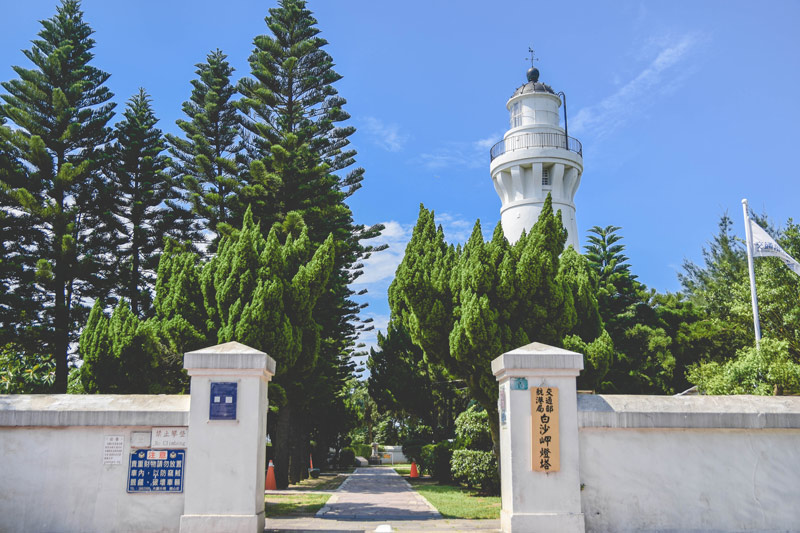
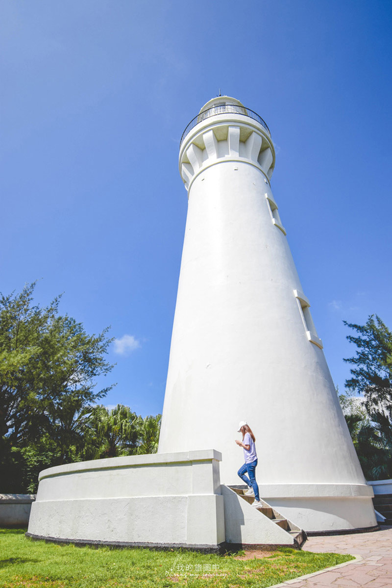
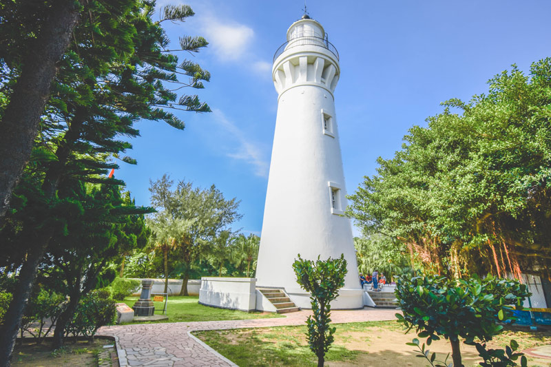
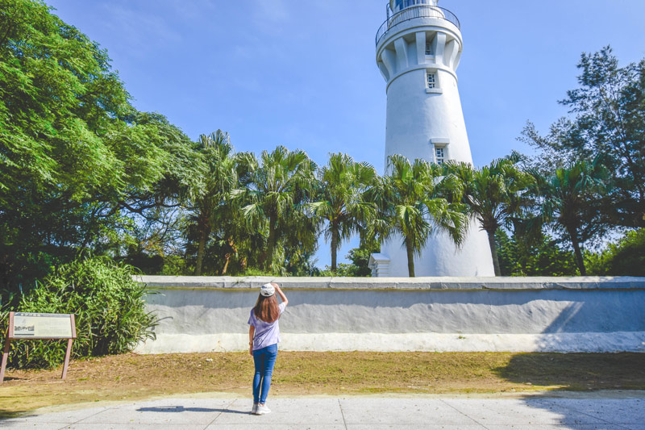
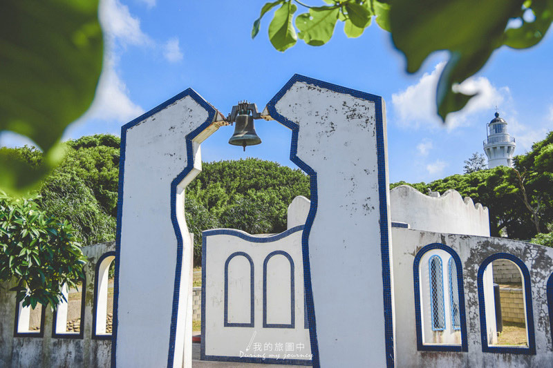
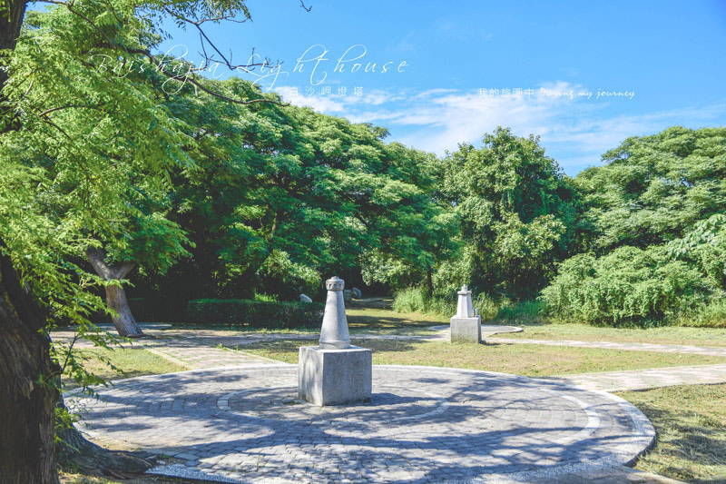
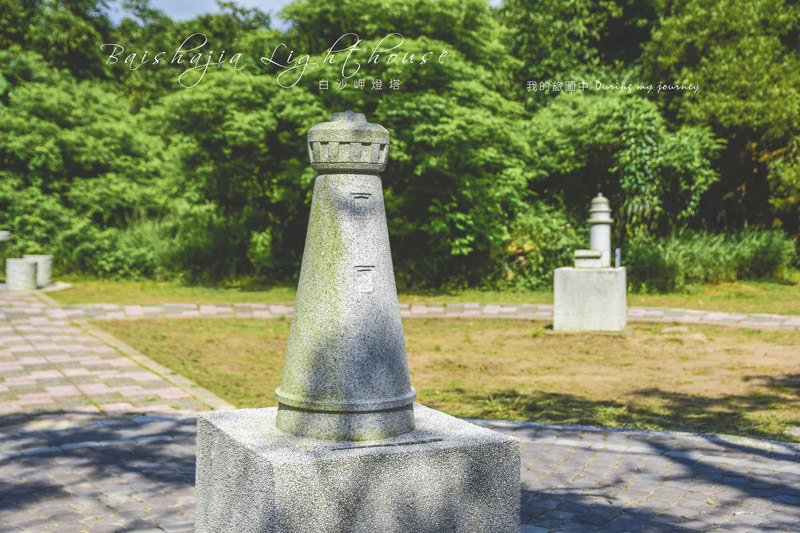
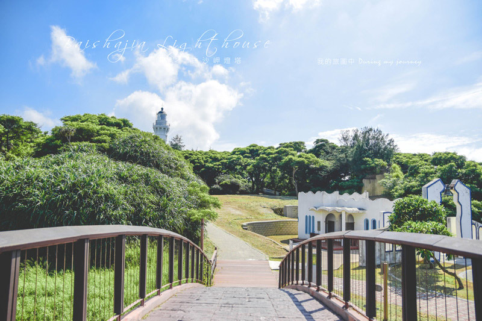

# 藍天下的低調美 桃園觀音白沙岬燈塔，走過百年歲月的台灣歷史建築百景

- 編號：page_041
- 原始網址：https://smiletaiwan.cw.com.tw/article/3012
- 網站：微笑台灣（旅遊媒體）
- 作者：我的旅圖中（發布單位：微笑台灣）
- 發表日期：2019-05-31（最後更新 2020-02-28）
- 取得時間：2026-11-07T21:48:13+08:00
- 擷取方式：site_rule[smiletaiwan.cw.com.tw]: main#first_article article
- 資料性質：**媒體／部落格內容，尚未經官方資料查核**（查核結果見 analysis/fact_check_D.md）

---

之前蒐集了兩個北部燈塔：富貴角燈塔、三貂角燈塔，除了剩下還未開放的鼻頭角燈塔，意外發現桃園也有個相當低調的白沙岬燈塔。

白沙岬燈塔與其它燈塔相比，沒有遼闊的大海景觀、沒有壯麗的山景，只是被樹叢包圍著，靜靜地聳立在清澈的藍天下，格外低調，卻也多了一些清幽靜謐的氣氛。

*圖說：（原網頁未提供圖說）｜圖片來源：未標示（文章未註明圖片來源）*

白沙岬燈塔曾經被票選為台灣歷史建築百景之一，是保存最完整的日治時期燈塔，有別於其他用水泥製成的燈塔，是台灣唯一使用紅磚和石頭建造而成的燈塔，到現在仍默默守護著台灣海峽的船隻。

*圖說：（原網頁未提供圖說）｜圖片來源：未標示（文章未註明圖片來源）*

當天來的時候燈塔周遭在進行維修，不過卻不影響前來觀賞燈塔的興致，有不少單車族以燈塔為打卡點，由最北部的燈塔為起點一路騎單車過來，很佩服他們的毅力。潔白高聳的燈塔被包圍在綠意繚繞的空間裡，與藍色的天空互相襯托，還隱約能看到燈塔後方被曬到閃閃發光的大海。

*圖說：（原網頁未提供圖說）｜圖片來源：未標示（文章未註明圖片來源）*

接著往北區的觀景台移動，發現這邊也是很好取景的位置，白色燈塔的窗戶和圓弧狀的塔頂構造一目了然，燈塔前方排排站的幾棵棕櫚樹帶來夏日的活力和熱情，熱烈的陽光穿透樹木形成明顯的光影變化，似乎早已揭開了夏天的序曲。

*圖說：（原網頁未提供圖說）｜圖片來源：未標示（文章未註明圖片來源）*

再來是到燈塔必拍的打卡景點「鐘塔廣場」，使用藍白色彩和簡單的線條與燈塔的景色相呼應，從牆面斑駁老舊的痕跡來看似乎沒有特別維護，真的很可惜啊。

*圖說：（原網頁未提供圖說）｜圖片來源：未標示（文章未註明圖片來源）*

接著我選擇另一條路往回走，出現了這座燈塔廣場，還以為是紀念碑之類的東西，沒特別留意就想快速經過，眼角餘光才發現有熟悉的燈塔樣貌，「這不是富貴角燈塔嗎！」我內心出現了驚嘆號，仔細觀察，台灣的燈塔都被做成石雕放在這裡，並以白沙岬燈塔為中心點，形成巨石陣的概念，真的很可愛！

*圖說：（原網頁未提供圖說）｜圖片來源：未標示（文章未註明圖片來源）*

*圖說：（原網頁未提供圖說）｜圖片來源：未標示（文章未註明圖片來源）*

白沙岬燈塔並不大，或許待上20到30分鐘就夠了。對於喜歡燈塔的人，很推薦來探訪一下，因為樹蔭較多也不用擔心會被陽光直曬，適合夏日午後來散步，順便算一下自己到目前為止總共蒐集多少座燈塔呢？

*圖說：（原網頁未提供圖說）｜圖片來源：未標示（文章未註明圖片來源）*

*本文轉載自《我的旅圖中》，非經同意請勿轉載。

更多燈塔旅行

資訊

白沙岬燈塔

地址：桃園市觀音區新坡下16號（有停車場）

開放時間：4月~10月 09:00~18:00；11月~隔年3月 09:00~17:00（週一皆公休）

責任編輯：黃佩瑄

核稿編輯：張惠萱

## 圖片清單

| 檔案 | 圖說 | 圖片來源標示 | 對應段落 | 原始網址 |
| --- | --- | --- | --- | --- |
| images/page_041_image_01.jpg | （原網頁未提供圖說） | 未標示（文章未註明圖片來源） | 藍天下的低調美 桃園觀音白沙岬燈塔，走過百年歲月的台灣歷史建築百景：白沙岬燈塔與其它燈塔相比，沒有遼闊的大海景觀、沒有壯麗的山景，只是被樹叢包圍著， | https://cdn-smiletaiwan.cw.com.tw/ckeditor/202002/ckeditor-5e57638b8a345.jpg |
| images/page_041_image_02.jpg | （原網頁未提供圖說） | 未標示（文章未註明圖片來源） | 藍天下的低調美 桃園觀音白沙岬燈塔，走過百年歲月的台灣歷史建築百景：白沙岬燈塔曾經被票選為台灣歷史建築百景之一，是保存最完整的日治時期燈塔，有別於其 | https://cdn-smiletaiwan.cw.com.tw/ckeditor/202002/ckeditor-5e5763a7daf60.jpg |
| images/page_041_image_03.jpg | （原網頁未提供圖說） | 未標示（文章未註明圖片來源） | 藍天下的低調美 桃園觀音白沙岬燈塔，走過百年歲月的台灣歷史建築百景：當天來的時候燈塔周遭在進行維修，不過卻不影響前來觀賞燈塔的興致，有不少單車族以燈 | https://cdn-smiletaiwan.cw.com.tw/ckeditor/202002/ckeditor-5e5764e50ae35.jpg |
| images/page_041_image_04.jpg | （原網頁未提供圖說） | 未標示（文章未註明圖片來源） | 藍天下的低調美 桃園觀音白沙岬燈塔，走過百年歲月的台灣歷史建築百景：接著往北區的觀景台移動，發現這邊也是很好取景的位置，白色燈塔的窗戶和圓弧狀的塔頂 | https://cdn-smiletaiwan.cw.com.tw/ckeditor/202002/ckeditor-5e5763c5ba943.jpg |
| images/page_041_image_05.jpg | （原網頁未提供圖說） | 未標示（文章未註明圖片來源） | 藍天下的低調美 桃園觀音白沙岬燈塔，走過百年歲月的台灣歷史建築百景：再來是到燈塔必拍的打卡景點「鐘塔廣場」，使用藍白色彩和簡單的線條與燈塔的景色相呼 | https://cdn-smiletaiwan.cw.com.tw/ckeditor/202002/ckeditor-5e5763d7d8e3b.jpg |
| images/page_041_image_06.jpg | （原網頁未提供圖說） | 未標示（文章未註明圖片來源） | 藍天下的低調美 桃園觀音白沙岬燈塔，走過百年歲月的台灣歷史建築百景：接著我選擇另一條路往回走，出現了這座燈塔廣場，還以為是紀念碑之類的東西，沒特別留 | https://cdn-smiletaiwan.cw.com.tw/ckeditor/202002/ckeditor-5e5763e2898ca.jpg |
| images/page_041_image_07.jpg | （原網頁未提供圖說） | 未標示（文章未註明圖片來源） | 藍天下的低調美 桃園觀音白沙岬燈塔，走過百年歲月的台灣歷史建築百景：接著我選擇另一條路往回走，出現了這座燈塔廣場，還以為是紀念碑之類的東西，沒特別留 | https://cdn-smiletaiwan.cw.com.tw/ckeditor/202002/ckeditor-5e5763e9e2349.jpg |
| images/page_041_image_08.jpg | （原網頁未提供圖說） | 未標示（文章未註明圖片來源） | 藍天下的低調美 桃園觀音白沙岬燈塔，走過百年歲月的台灣歷史建築百景：白沙岬燈塔並不大，或許待上20到30分鐘就夠了。對於喜歡燈塔的人，很推薦來探訪一 | https://cdn-smiletaiwan.cw.com.tw/ckeditor/202002/ckeditor-5e57641346a65.jpg |

## 正文內連結

- [龍潭大平紅橋 台灣歷史建築百景，三坑遙慕古風之旅](https://smiletaiwan.cw.com.tw/article/1515)
- [為漁船點亮回家的路 三十年如一日，富貴角燈塔守尤義華](https://smiletaiwan.cw.com.tw/article/2447)
- [我的旅圖中](https://ainycka0815.pixnet.net/blog/post/467728208)
- [漁港 石滬 綠色隧道，無麥之鄉有桃園最美的海岸](https://smiletaiwan.cw.com.tw/article/407)
- [來珍珠蚵的故鄉—王功，做一份屬於自己的蚵藝品](https://smiletaiwan.cw.com.tw/article/633)
- [逆風跨越七股大沙漠，只為一探台灣極西點「國聖燈塔」](https://smiletaiwan.cw.com.tw/article/2359)
- [日出拍東莒燈塔、日落拍福正沙灘，馬祖旅行推薦取景地點](https://smiletaiwan.cw.com.tw/article/2198)
