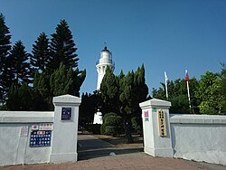
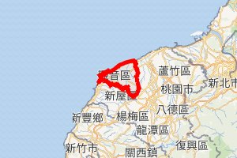
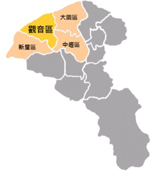
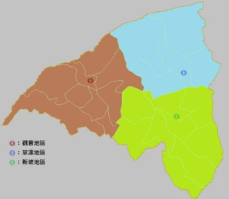

# 觀音區

- id：A_page_001
- 類型：article
- 原始網址：https://zh.wikipedia.org/zh-tw/%E8%A7%80%E9%9F%B3%E5%8D%80
- 網站名稱：維基百科（中文）
- 擷取策略：wikipedia:mw-parser-output
- 爬取狀態：**success**（HTTP 200）
- 發佈／更新日期：2019-12-19
- 爬取時間：2026-11-05T18:43:31+08:00
- 分類：歷史文化
- 關鍵字：觀音區、石觀音、地名由來、桃園市、沿海
- 備註：
  - 此頁未偵測到 video／audio 標籤或嵌入播放器，無合法可處理影片。

## 內文（清理後）

25°2′10.70″N 121°4′54.10″E / 25.0363056°N 121.0816944°E / 25.0363056; 121.0816944
| 觀音區Guanyin District舊稱：石觀音 |
| 區 |
| 白沙岬燈塔 |
| 觀音區位置圖 |
| 坐標：25°02′N 121°06′E / 25.03°N 121.1°E / 25.03; 121.1 |
| 國家 | 中華民國 |
| 上級區劃 | 桃園市 |
| 下級區劃 | 24里402鄰 |
| • 區長 | 劉草典 |
| 面積 |
| • 總計 | 87.9807平方公里（33.9695平方英里） |
| 海拔 | 44公尺（144英尺） |
| 人口（2026年7月）（32,515戶） |
| • 總計 | 78,137人（桃園市的第11位） |
| • 密度 | 888人/平方公里（2,300人/平方英里） |
| 時區 | 國家標準時間（UTC+08:00） |
| 郵遞區號 | 328 |
| 戶政資料代碼 | 68000120 |
| 毗鄰 | 大園區、新屋區、中壢區 |
| 網站 | www.guanyin.tycg.gov.tw |

| 觀音區－台灣語言寫法及拼音 |
| 注音 | ㄍㄨㄢ- ㄧㄣ- ㄑㄩ- |
| 漢語拼音 | Guān yīn qū |
| 通用拼音 | Guan yin cyu |
| 威妥瑪拼音 | Kuan yin ch'ü |
| 台語白話字 | Koan-im Khu |
| 台語羅馬字 | Kuan-im Khu |
| 客語白話字 | Kôn-yîm Khî |
| 客羅 | 海陸腔：gonˋ rhimˋ kiˋ四縣腔：gonˊ imˊ ki^饒平腔：guanˇ rhimˇ kiˇ |

觀音區，舊稱「石觀音」臺灣桃園市西部沿海。東臨大園區、中壢區，南邊與新屋區相臨，西濱臺灣海峽。區內人口約7.8萬人客家族群。當地原為農業鄉鎮，1970年代以後隨著臺灣工業的蓬勃發展而設立工業區，境內有觀音工業區和新創的桃園科技工業園區。觀音區也盛產蓮花，每年夏天會舉辦蓮花季。

## 歷史
觀音區舊稱「石觀音」竹北二堡石牌嶺庄（今屬新屋區）的農民往返耕作途中，在當地的小溪中撿到一顆酷似觀音佛的天然石，供奉瞻拜，故名。直至1920年設庄時，石觀音改稱「觀音」
日治時期，1895年，觀音屬臺北縣新竹支廳，一部份隸屬桃澗堡，一部份則隸屬竹北二堡。1896年3月，全臺設3縣1廳，觀音隸屬臺北縣桃園廳觀音庄隸屬新竹州中壢郡
二戰後1946年，隸屬新竹縣中壢區觀音鄉桃園縣

## 地理

### 地形
觀音區屬於桃園沖積扇的一部分。

### 水文
- 河川：富林溪、大堀溪、觀音溪、新屋溪。
- 灌溉系統：桃園大圳（大漢溪）。

### 人口
| 年份 | 人口 | ±% |
| 1946 | 27,040 | — |
| 1951 | 29,951 | +10.8% |
| 1956 | 33,454 | +11.7% |
| 1961 | 38,317 | +14.5% |
| 1966 | 44,283 | +15.6% |
| 1971 | 47,698 | +7.7% |
| 1976 | 47,408 | −0.6% |
| 1981 | 45,758 | −3.5% |
| 1986 | 44,069 | −3.7% |
| 1991 | 43,911 | −0.4% |
| 1996 | 49,808 | +13.4% |
| 2001 | 54,227 | +8.9% |
| 2006 | 58,901 | +8.6% |
| 2011 | 61,676 | +4.7% |
| 2016 | 65,555 | +6.3% |
| 2021 | 69,995 | +6.8% |
| 來源： 謝公倉 1986，第128頁 內政部統計月報-各鄉鎮市區人口數. 內政部. [2019-12-19]. （原始內容存檔於2020-11-10）. |

根據桃園市政府觀音區戶政事務所統計，2025年底觀音區戶數約3.2萬戶，人口約7.8萬人，區內人口最多與最少的里分別是草新里與新興里，2025年底兩里人口分別為8,599人與909人

## 政治

### 歷任首長

#### 鄉長
| 任次 | 姓名 | 備註 |
| 1 | 古萬桂 |
| 2 | 黃阿壁 |
| 3 | 廖德景 |
| 4 |
| 5 | 許金燦 |
| 6 |
| 7 | 廖運清 |
| 8 | 黃金春 | 民主進步黨 |
| 9 |
| 10 | 李文貴 |
| 11 |
| 12 | 郭榮宗 | 民主進步黨 |
| 13 | 當選立委 |
| 13 | 張永輝 | 民主進步黨 |
| 14 | 解職 |
| 14 | 黃茂實 | 補選 |
| 15 |
| 16 | 歐炳辰 | 民主進步黨 |

#### 區長（指派）
| 任次 | 姓名 | 備註 |
| 1 | 洪清淵 |
| 2 | 林國甯 |
| 3 | 劉草典 | 現任 |

### 區政組織
觀音區公所是桃園市政府在觀音區的派出機關，在中華民國政府架構中為市政府綜理區政的執行機關，上級業務監督機關為桃園市政府。區長由市長任命，其任期為無任期保障。在區長及主任秘書之下，設有5課4室等9個內部單位桃園市議會第十二選區，在市議會的63席市議員中，觀音區共選出2席區域市議員（不含平地原住民與山地原住民議員）

### 行政區

#### 沿革
現今觀音區行政範圍的確立，來自於1920年，日本將臺灣十二廳改為五州二廳，設觀音庄屬新竹州中壢郡。觀音庄轄茄苳坑、大潭、觀音、三座屋、坑尾、坡寮、白沙屯、樹林仔、新坡、上大堀、下青埔、草漯、塔子腳、崙坪、下大堀、苦苓腳等16個大字。1945年，改為「觀音鄉」，屬新竹縣中壢區。1950年，調整行政區域並裁撤區署，觀音鄉改隸新成立的桃園縣
觀音區共轄24里，其行政區域分布情形為
| 次分區 | 里名 |
| 觀音區 | 觀音里 | 廣興里 | 白玉里 | 武威里 | 保生里 | 坑尾里 | 三和里 | 新興里 | 大潭里 |
| 草漯區 | 草漯里 | 富林里 | 樹林里 | 保障里 | 塔腳里 | 草新里 |
| 新坡區 | 新坡里 | 大同里 | 崙坪里 | 廣福里 | 上大里 | 藍埔里 | 富源里 | 金湖里 | 大堀里 |

#### 次分區
*圖說：觀音區的次分區*
- 觀音次分區指大堀溪以南，坑尾以西地帶，包括觀音、白沙屯、大潭、茄苳坑、三座屋、坑尾地段及坡寮一部分。早年移墾較其他二區有成就故莊役場設於觀音次分區。但日治時代後，交通改道，發展變緩
- 草漯次分區位於觀音區東北角，指大堀溪以東地帶；範圍最小，是觀音區開發最早的地區。草漯素來與大園區有深厚感情，因其居民大多同為台灣閩南人，而觀音區則以台灣客家人為主，位於草漯村內，供奉主神為媽祖的草漯保障宮更是香火鼎盛，已有兩百多年的歷史，是當地居民信仰中心，而且廟內建築格局奇特，參拜時不需爬高爬低，僅需要一炷香就能拜眾神，因此，草漯保障宮有「通天香」的美名。而現今草漯里由於農地重劃，釋出150公頃的建地，成為桃園航空城被徵收戶的標的，房價已大幅攀升
- 新坡次分區包括新坡、上下大堀、苦練腳、下青埔、崙坪及坡寮一部分。發展迅速是在日治時代以後，尤其大正十三年（1924年）桃園大圳完成後，農村的繁榮，使其與觀音次分區立於分庭抗禮之地位；觀音次分區雖為行政中心，但全區的農會和郵局卻在新坡。公路交通發達後，新坡以接近中壢，地當中壢往觀音中途，且為南北往新屋、大園道路交會點，市況繁榮超過觀音。此次分區因毗鄰中壢，富源里部份區域被劃入中壢都會區都市計畫區。

## 文化

### 藝文活動
- 桃園蓮花季

### 宗教信仰
- 觀音甘泉寺，供奉觀世音菩薩，香火鼎盛，十分靈驗。
- 草漯保障宮，位於草漯里，主神供奉媽姐，香火十分鼎盛。
- 觀音復興宮：位於臺灣桃園市觀音區觀音工業區的開漳聖王廟，前身為大溪區的阿姆坪復興宮。
- 石橋應天宮，主神供奉關聖帝君。
- 協天宮，主神供奉關聖帝君，在地的居民稱關平爺公廟。
- 理教石橋復興宮，主神供奉開漳聖王。
- 觀音永興宮，主神供奉天上聖母。
- 正大宮，主神供奉五年千歲十二王爺。
- 溥濟宮，主神供奉保生大帝，俗稱保生廟。
- 慈母宮，主神供奉驪山老母、王母娘娘、地母娘娘、觀音菩薩、九天玄女。

### 語言
觀音的本土語言以臺灣客家語海陸腔及臺灣閩南語偏漳腔為主。
- 富源，臺灣閩南語、臺灣客家語。
- 白玉，臺灣閩南語、臺灣客家語。
- 大潭，臺灣閩南語、臺灣客家語。
- 草漯，臺灣閩南語。
- 崙坪，臺灣閩南語。
- 上大，臺灣閩南語。
- 新坡，臺灣閩南語。

## 教育
大潭發電廠坐落於觀音區，桃園市政府以發電廠回饋金實施國中、國小學生免費營養午餐

### 大專院校
觀音區現有為國立臺灣海洋大學（桃園觀音校區）一校，於2018年11月1日揭牌

### 公立高級中學
- 桃園市立觀音高級中等學校一校，並附設國中部。

### 國民中學
- 桃園市立觀音國民中學
- 桃園市立草漯國民中學

### 國民小學
- 桃園市觀音區觀音國民小學
- 桃園市觀音區上大國民小學
- 桃園市觀音區大潭國民小學
- 桃園市觀音區育仁國民小學
- 桃園市觀音區保生國民小學
- 桃園市觀音區草漯國民小學
- 桃園市觀音區崙坪國民小學
- 桃園市觀音區新坡國民小學
- 桃園市觀音區富林國民小學
- 桃園市觀音區樹林國民小學

## 交通

### 省道
- 台15線：西濱公路
- 台61線：西濱快速公路 33 草漯草漯交流道 38 桃科桃科交流道 42 觀音觀音交流道
- 台66線：東西向快速公路（觀音－大溪線） 0 觀音觀音交流道 5 觀音一觀音一交流道

### 市道
- 市道112號
- 市道115號

### 公車
- 桃園客運觀音站 L512愛心福利專車長庚B線（觀音、高鐵桃園站到長庚） L513愛心福利專車長庚C線（白玉、藍埔到高鐵桃園站） L515愛心福利專車長庚D線
（埔頂、觀音工業區、草漯到高鐵桃園站）
- L516免費公車草漯線 L516A免費公車草漯線延駛高鐵桃園站 L516B免費公車草漯線延駛觀音高中 L517免費公車新坡線 L517免費公車新坡線延駛蘭亭集序社區 5032中壢-新屋-石橋-觀音 5033中壢-新屋-保生-觀音 5039中壢-觀崁（先進觀音、永安） 5039中壢-崁觀（先進新屋、永安） 5040桃園-大園-草漯-觀音 5040A桃園-大園-草漯-觀音（繞駛大園國中） 5040B桃園-大園-草漯-觀音（繞駛開南大學） 5041中壢-觀音工業區-白玉-觀音 5042中壢-新坡-觀音 5043中壢-草漯-樹林新村-觀音工業區 5043A中壢-草漯-樹林新村-觀音工業區（延駛回觀音）

### 輕便軌道
觀音區曾有輕便軌道的舖設，目前均已拆除，而當年的輕便軌道是由中壢軌道公司經營，共有二條路線分別如下
- 中壢－觀音：1918年營運，1953年廢除
- 新坡－草漯：1918年營運，1935年廢除

### 自行車租賃系統
桃園市公共自行車租賃系統至2020年7月，在觀音區設有4站：
- 觀音高中
- 觀音國小
- 觀音中興停車場
- 觀音區棒壘球場

## 旅遊
觀音區每年夏天會舉辦蓮花季，2017年經行政院農業委員會公告劃定「觀音蓮花園休閒農業區」，配合觀音區蓮花產業、蓮花農場、休閒農場及古厝等農村景點進行整體規劃及行銷

### 景點
- 草漯沙丘地質公園
- 觀音海水浴場
- 觀音藻礁
- 白沙岬燈塔：1901年啟用（全臺第二高的燈塔）
- 觀音鉤漕陂生態園區（桃園大圳第8-2號池）：位於崙坪里
- 觀音蓮花池：位於市中心東側，是清領時期農民為灌溉而開挖的埤塘
- 觀音蓮花園休閒農業區 林家古厝休閒農場 吳厝楊家莊 蓮荷園農場 青林農場 向陽農場
- 漢聲廣播電台光華之聲觀音分台：光華之聲在觀音區設有一分台
- 7-Eleven千塘門市
- 白玉里的三合院
- 觀音里的林投

## 相關條目
- 觀音庄
- 桃園市立法委員第二選舉區

## 注釋

## 參考資料
引用來源
書籍
- 謝公倉等編纂. 《觀音鄉志》. 桃園縣: 觀音鄉公所. 1986 （中文（臺灣））.
- 施添福等編纂. 第三章·觀音鄉. 《臺灣地名辭書》. 卷十五·桃園縣（上）. 南投縣: 國史館臺灣文獻館. 2009. ISBN 978-986-01-8864-6 （中文（臺灣））.

## 外部連結
- 觀音區公所 （頁面存檔備份，存於網際網路檔案館）
- 觀音區公所的Facebook專頁
- YouTube上的觀音小編頻道

## 影片／音訊

此頁無影片或音訊元素，亦無嵌入播放器，故無合法可處理之影片。

## 內文圖片對應

- 檔案：output/images/A_page_001_image_01.jpg
- 原始網址：https://thumb.wikimedia.org/wikipedia/commons/thumb/4/41/%E7%99%BD%E6%B2%99%E5%B2%AC%E7%87%88%E5%A1%94%E5%85%A5%E5%8F%A3.jpg/250px-%E7%99%BD%E6%B2%99%E5%B2%AC%E7%87%88%E5%A1%94%E5%85%A5%E5%8F%A3.jpg?utm_source=zh.wikipedia.org&utm_campaign=parser&utm_content=thumbnail
- 說明：白沙岬燈塔
- 授權：來源網站內容，授權狀態未標示

- 檔案：output/images/A_page_001_image_02.jpg
- 原始網址：https://maps.wikimedia.org/img/osm-intl,9,a,a,300x200.png?lang=zh&domain=zh.wikipedia.org&title=%E8%A7%80%E9%9F%B3%E5%8D%80&revid=95104651&groups=_1356c5a5669b736994baded2376326244a652599&parser=legacy
- 說明：地圖
- 授權：來源網站內容，授權狀態未標示

- 檔案：output/images/A_page_001_image_03.jpg
- 原始網址：https://thumb.wikimedia.org/wikipedia/commons/thumb/3/33/Guanyin_district.png/330px-Guanyin_district.png?utm_source=zh.wikipedia.org&utm_campaign=parser&utm_content=thumbnail
- 說明：觀音區位置圖
- 授權：來源網站內容，授權狀態未標示

- 檔案：output/images/A_page_001_image_04.jpg
- 原始網址：https://thumb.wikimedia.org/wikipedia/commons/thumb/f/fc/GuanyinMap.png/330px-GuanyinMap.png?utm_source=zh.wikipedia.org&utm_campaign=parser&utm_content=thumbnail
- 說明：觀音區的次分區
- 授權：來源網站內容，授權狀態未標示

## 頁面超連結（前 40 筆）

- [首頁](https://zh.wikipedia.org/wiki/Wikipedia:%E9%A6%96%E9%A1%B5)
- [分類索引](https://zh.wikipedia.org/wiki/Wikipedia:%E5%88%86%E7%B1%BB%E7%B4%A2%E5%BC%95)
- [特色內容](https://zh.wikipedia.org/wiki/Portal:%E7%89%B9%E8%89%B2%E5%85%A7%E5%AE%B9)
- [新聞動態](https://zh.wikipedia.org/wiki/Portal:%E6%96%B0%E8%81%9E%E5%8B%95%E6%85%8B)
- [聯絡我們](https://zh.wikipedia.org/wiki/Wikipedia:%E8%81%94%E7%BB%9C%E6%88%91%E4%BB%AC)
- [關於維基百科](https://zh.wikipedia.org/wiki/Wikipedia:%E5%85%B3%E4%BA%8E)
- [說明](https://zh.wikipedia.org/wiki/Help:%E9%A6%96%E9%A1%B5)
- [維基社群](https://zh.wikipedia.org/wiki/Wikipedia:%E7%A4%BE%E7%BE%A4%E9%A6%96%E9%A1%B5)
- [編輯入門](https://zh.wikipedia.org/wiki/Help:%E5%85%A5%E9%97%A8)
- [互助客棧](https://zh.wikipedia.org/wiki/Wikipedia:%E4%BA%92%E5%8A%A9%E5%AE%A2%E6%A0%88)
- [IRC即時聊天](https://zh.wikipedia.org/wiki/Wikipedia:IRC%E8%81%8A%E5%A4%A9%E9%A2%91%E9%81%93)
- [資助維基百科](https://donate.wikimedia.org/?wmf_source=donate&wmf_medium=sidebar&wmf_campaign=zh.wikipedia.org&uselang=zh)（外部）
- [Deutsch](https://de.wikipedia.org/wiki/Guanyin_(Taoyuan))（外部）
- [English](https://en.wikipedia.org/wiki/Guanyin_District)（外部）
- [Français](https://fr.wikipedia.org/wiki/District_de_Guanyin)（外部）
- [客家語 / Hak-kâ-ngî](https://hak.wikipedia.org/wiki/K%C3%B4n-y%C3%AEm-kh%C3%AE)（外部）
- [Italiano](https://it.wikipedia.org/wiki/Distretto_di_Guanyin)（外部）
- [日本語](https://ja.wikipedia.org/wiki/%E8%A6%B3%E9%9F%B3%E5%8C%BA)（外部）
- [한국어](https://ko.wikipedia.org/wiki/%EA%B4%80%EC%9D%B8%EA%B5%AC)（外部）
- [Lietuvių](https://lt.wikipedia.org/wiki/Guanjinas)（外部）
- [اردو](https://ur.wikipedia.org/wiki/%DA%AF%D9%88%D8%A2%D9%86%DB%8C%D8%A6%D9%86_%D8%B6%D9%84%D8%B9)（外部）
- [Tiếng Việt](https://vi.wikipedia.org/wiki/Quan_%C3%82m,_%C4%90%C3%A0o_Vi%C3%AAn)（外部）
- [閩南語 / Bân-lâm-gí](https://zh-min-nan.wikipedia.org/wiki/Koan-im-khu)（外部）
- [粵語](https://zh-yue.wikipedia.org/wiki/%E8%A7%80%E9%9F%B3%E5%8D%80)（外部）
- [條目](https://zh.wikipedia.org/wiki/%E8%A7%80%E9%9F%B3%E5%8D%80)
- [討論](https://zh.wikipedia.org/wiki/Talk:%E8%A7%80%E9%9F%B3%E5%8D%80)
- [不转换](https://zh.wikipedia.org/zh/%E8%A7%80%E9%9F%B3%E5%8D%80)
- [简体](https://zh.wikipedia.org/zh-hans/%E8%A7%80%E9%9F%B3%E5%8D%80)
- [繁體](https://zh.wikipedia.org/zh-hant/%E8%A7%80%E9%9F%B3%E5%8D%80)
- [大陆简体](https://zh.wikipedia.org/zh-cn/%E8%A7%80%E9%9F%B3%E5%8D%80)
- [香港繁體](https://zh.wikipedia.org/zh-hk/%E8%A7%80%E9%9F%B3%E5%8D%80)
- [澳門繁體](https://zh.wikipedia.org/zh-mo/%E8%A7%80%E9%9F%B3%E5%8D%80)
- [大马简体](https://zh.wikipedia.org/zh-my/%E8%A7%80%E9%9F%B3%E5%8D%80)
- [新加坡简体](https://zh.wikipedia.org/zh-sg/%E8%A7%80%E9%9F%B3%E5%8D%80)
- [臺灣正體](https://zh.wikipedia.org/zh-tw/%E8%A7%80%E9%9F%B3%E5%8D%80)
- [編輯](https://zh.wikipedia.org/w/index.php?title=%E8%A7%80%E9%9F%B3%E5%8D%80&action=edit&variant=zh-tw)
- [檢視歷史](https://zh.wikipedia.org/w/index.php?title=%E8%A7%80%E9%9F%B3%E5%8D%80&action=history)
- [上傳檔案](https://zh.wikipedia.org/wiki/Project:上传)
- [固定連結](https://zh.wikipedia.org/w/index.php?title=%E8%A7%80%E9%9F%B3%E5%8D%80&oldid=95104651)
- [頁面資訊](https://zh.wikipedia.org/w/index.php?title=%E8%A7%80%E9%9F%B3%E5%8D%80&action=info)
