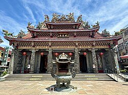
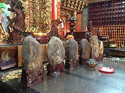
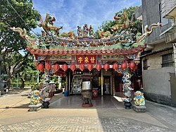
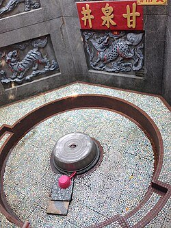

# 甘泉寺 (桃園市)

- id：A_page_010
- 類型：article
- 原始網址：https://zh.wikipedia.org/wiki/%E7%94%98%E6%B3%89%E5%AF%BA_(%E6%A1%83%E5%9C%92%E5%B8%82)
- 網站名稱：維基百科（中文）
- 擷取策略：wikipedia:mw-parser-output
- 爬取狀態：**success**（HTTP 200）
- 發佈／更新日期：未標示
- 爬取時間：2026-11-05T18:44:09+08:00
- 分類：歷史文化
- 關鍵字：甘泉寺、石觀音、觀音信仰、甘泉井、桃園觀音
- 備註：
  - 此頁未偵測到 video／audio 標籤或嵌入播放器，無合法可處理影片。

## 內文（清理後）

25°02′13″N 121°04′54″E / 25.037070°N 121.081593°E / 25.037070; 121.081593
| 甘泉寺 |
| 基本資訊 |
| 位置 | 桃園市觀音區觀音里甘泉街一號 |
| 宗教 | 佛教 |
| 本尊 | 觀世音菩薩 |
| 例祭 | 農曆九月十九 |
| 開山時間 | 咸豐十年（1860年） |
| 地圖 |

甘泉寺，舊稱福龍寺、福龍山寺，是位於臺灣桃園市觀音區觀音里的觀音寺，為觀音區地名的由來。

## 沿革
在咸豐十年（1860年），相傳竹北二堡石牌嶺庄一名叫黃等的人在河流中撿到近似觀音的石像，並將此像建置於路傍，成為眾人崇拜的對象。半年後，白沙墩庄黃雲中
同治十一年（1872年），徐水曾獻殿聯，上書：「法雨化甘泉蒼海波中聞貝葉，慈雲流淡水白沙堆土顯曇花。」
光緒十二年（1886年）由於廟宇破損嚴重，埔頂庄曾坤房、石觀音庄劉文進等鄉紳發起修建募款，六個月完工，並改名為「甘泉寺」明治三十八年（1905年）建立的南崁公學校石觀音分校（今觀音國小）過去尚無校舍時，借用廟堂上課
1991年，廟前廣場被徵地為桃園客運汽車停車場和調度站，引起信眾不滿
2002年報導時，地址在觀音鄉觀音村甘泉街一號，緊鄰觀音鄉公所

## 祭祀
*圖說：石觀音*
農曆正月二十天穿日，當地客家人會來此廟膜拜。除頂禮還願外，因客家習俗在天穿日工作會招來不幸，因此來廟祭拜也有消災解厄效果。日治時期，觀音庄長還選在這日開放白沙岬燈塔，讓上完香的客家人至燈塔遊玩，藉此攏絡人心。觀音文化工作陣，曾在這天舉辦燈塔節活動，讓觀音的客人耆老重溫當年。
農曆九月十九，觀世音菩薩成道日，會舉行神豬比賽。在2011年報導時，臺灣動物社會研究院主任陳玉敏說，全臺灣839間觀音寺中，只有竹林山觀音寺、石觀音甘泉寺和竹北蓮華寺這三間會舉辦此比賽。
昔日，此地的客家人會讓小孩拜此石觀音為契母雲林古坑、臺中太平及苗栗獅頭等地找到8尊聖石，其中5尊以分香形式作為其他廟宇供奉主神，自留3尊奉祀，在石觀音文化節活動也以會邀請各地的石觀音回家掃街繞境

## 地名
因此寺皈依者增加，當地形成聚落，地方名「石觀音街」，後來發展成石觀音庄。1920年，總督府施行州廳制度，刪除「石」字，定名「觀音庄」，戰後改名「觀音鄉」。

## 名井
*圖說：甘泉亭*
此廟的甘泉井傳說以能治病聞名。該井處於低窪處，南方及東南方地勢較高且均為受壓地下水層，在加上泉井旁約一百公尺處為觀音溪，因此為自流井。
逢農曆二月十九日觀音誕辰時，多有信徒會來此泉水取水明治二十八年（1895年）七月，當時有患眼疾者用此廟挖出的泉水洗眼，洗之即癒，人們皆感到驚訝，數十里外之百姓亦來參謁，聲名遠播，便改寺名為「甘泉寺」
*圖說：甘泉井*
丁善璽在拍《八百壯士》被爆傷，在醫院躺了一個月。這時丁妻蕭蓉夢到南極仙翁要她去中壢找觀音治療她先生的病，輾轉到觀音鄉找到甘泉寺。丁善璽喝了該寺的井水後傷痛減輕，後來又在一場高速公路的車禍中幸運生還。因此，夫妻從天主教改宗佛教，太太還皈依華嚴蓮社的南亭法師。丁導演為了還願遂拍攝佛教主題電影的故事《陰陽有情天》，由妻子親自飾演觀音，男女主角分別是秦漢、徐楓。在電影上映時，丁善璽本想把妻子夢中景況寫一篇文字大肆宣傳一番，但唯恐被人說成導人迷信，招致影片禁映，之後才在佛教會對居士說。李翰祥在1981年投稿在《民生報》的連載文章，以多篇文章詳述此事。
在拍《旗正飄飄》時，丁善璽及妻子蕭蓉、林青霞、楊麗菁等人參加此寺的一百零一年周年慶典與抗戰殉難軍民追悼會

## 註釋

## 參考文獻

## 影片／音訊

此頁無影片或音訊元素，亦無嵌入播放器，故無合法可處理之影片。

## 內文圖片對應

- 檔案：output/images/A_page_010_image_01.jpg
- 原始網址：https://thumb.wikimedia.org/wikipedia/commons/thumb/0/03/%E8%A7%80%E9%9F%B3%E7%94%98%E6%B3%89%E5%AF%BA.jpg/250px-%E8%A7%80%E9%9F%B3%E7%94%98%E6%B3%89%E5%AF%BA.jpg?utm_source=zh.wikipedia.org&utm_campaign=parser&utm_content=thumbnail
- 說明：（原頁無圖說）
- 授權：來源網站內容，授權狀態未標示

- 檔案：output/images/A_page_010_image_02.jpg
- 原始網址：https://maps.wikimedia.org/img/osm-intl,13,a,a,270x200.png?lang=zh&domain=zh.wikipedia.org&title=%E7%94%98%E6%B3%89%E5%AF%BA_%28%E6%A1%83%E5%9C%92%E5%B8%82%29&revid=88894640&groups=_d653a4567c9cba2333f2c7b87534a00bb2efb859&parser=legacy
- 說明：地圖
- 授權：來源網站內容，授權狀態未標示

- 檔案：output/images/A_page_010_image_03.jpg
- 原始網址：https://thumb.wikimedia.org/wikipedia/commons/thumb/e/e6/%E7%94%98%E6%B3%89%E5%AF%BA%E7%9F%B3%E8%A7%80%E9%9F%B3.jpg/250px-%E7%94%98%E6%B3%89%E5%AF%BA%E7%9F%B3%E8%A7%80%E9%9F%B3.jpg?utm_source=zh.wikipedia.org&utm_campaign=parser&utm_content=thumbnail
- 說明：石觀音
- 授權：來源網站內容，授權狀態未標示

- 檔案：output/images/A_page_010_image_04.jpg
- 原始網址：https://thumb.wikimedia.org/wikipedia/commons/thumb/5/5e/%E8%A7%80%E9%9F%B3%E7%94%98%E6%B3%89%E5%AF%BA%E7%94%98%E6%B3%89%E4%BA%AD.jpg/250px-%E8%A7%80%E9%9F%B3%E7%94%98%E6%B3%89%E5%AF%BA%E7%94%98%E6%B3%89%E4%BA%AD.jpg?utm_source=zh.wikipedia.org&utm_campaign=parser&utm_content=thumbnail
- 說明：甘泉亭
- 授權：來源網站內容，授權狀態未標示

- 檔案：output/images/A_page_010_image_05.jpg
- 原始網址：https://thumb.wikimedia.org/wikipedia/commons/thumb/8/83/%E7%94%98%E6%B3%89%E5%AF%BA%E7%94%98%E6%B3%89%E4%BA%95.jpg/250px-%E7%94%98%E6%B3%89%E5%AF%BA%E7%94%98%E6%B3%89%E4%BA%95.jpg?utm_source=zh.wikipedia.org&utm_campaign=parser&utm_content=thumbnail
- 說明：甘泉井
- 授權：來源網站內容，授權狀態未標示

## 頁面超連結（前 40 筆）

- [首頁](https://zh.wikipedia.org/wiki/Wikipedia:%E9%A6%96%E9%A1%B5)
- [分類索引](https://zh.wikipedia.org/wiki/Wikipedia:%E5%88%86%E7%B1%BB%E7%B4%A2%E5%BC%95)
- [特色內容](https://zh.wikipedia.org/wiki/Portal:%E7%89%B9%E8%89%B2%E5%85%A7%E5%AE%B9)
- [新聞動態](https://zh.wikipedia.org/wiki/Portal:%E6%96%B0%E8%81%9E%E5%8B%95%E6%85%8B)
- [聯絡我們](https://zh.wikipedia.org/wiki/Wikipedia:%E8%81%94%E7%BB%9C%E6%88%91%E4%BB%AC)
- [關於維基百科](https://zh.wikipedia.org/wiki/Wikipedia:%E5%85%B3%E4%BA%8E)
- [說明](https://zh.wikipedia.org/wiki/Help:%E9%A6%96%E9%A1%B5)
- [維基社群](https://zh.wikipedia.org/wiki/Wikipedia:%E7%A4%BE%E7%BE%A4%E9%A6%96%E9%A1%B5)
- [編輯入門](https://zh.wikipedia.org/wiki/Help:%E5%85%A5%E9%97%A8)
- [互助客棧](https://zh.wikipedia.org/wiki/Wikipedia:%E4%BA%92%E5%8A%A9%E5%AE%A2%E6%A0%88)
- [IRC即時聊天](https://zh.wikipedia.org/wiki/Wikipedia:IRC%E8%81%8A%E5%A4%A9%E9%A2%91%E9%81%93)
- [資助維基百科](https://donate.wikimedia.org/?wmf_source=donate&wmf_medium=sidebar&wmf_campaign=zh.wikipedia.org&uselang=zh)（外部）
- [條目](https://zh.wikipedia.org/wiki/%E7%94%98%E6%B3%89%E5%AF%BA_(%E6%A1%83%E5%9C%92%E5%B8%82))
- [討論](https://zh.wikipedia.org/wiki/Talk:%E7%94%98%E6%B3%89%E5%AF%BA_(%E6%A1%83%E5%9C%92%E5%B8%82))
- [不转换](https://zh.wikipedia.org/zh/%E7%94%98%E6%B3%89%E5%AF%BA_(%E6%A1%83%E5%9C%92%E5%B8%82))
- [简体](https://zh.wikipedia.org/zh-hans/%E7%94%98%E6%B3%89%E5%AF%BA_(%E6%A1%83%E5%9C%92%E5%B8%82))
- [繁體](https://zh.wikipedia.org/zh-hant/%E7%94%98%E6%B3%89%E5%AF%BA_(%E6%A1%83%E5%9C%92%E5%B8%82))
- [大陆简体](https://zh.wikipedia.org/zh-cn/%E7%94%98%E6%B3%89%E5%AF%BA_(%E6%A1%83%E5%9C%92%E5%B8%82))
- [香港繁體](https://zh.wikipedia.org/zh-hk/%E7%94%98%E6%B3%89%E5%AF%BA_(%E6%A1%83%E5%9C%92%E5%B8%82))
- [澳門繁體](https://zh.wikipedia.org/zh-mo/%E7%94%98%E6%B3%89%E5%AF%BA_(%E6%A1%83%E5%9C%92%E5%B8%82))
- [大马简体](https://zh.wikipedia.org/zh-my/%E7%94%98%E6%B3%89%E5%AF%BA_(%E6%A1%83%E5%9C%92%E5%B8%82))
- [新加坡简体](https://zh.wikipedia.org/zh-sg/%E7%94%98%E6%B3%89%E5%AF%BA_(%E6%A1%83%E5%9C%92%E5%B8%82))
- [臺灣正體](https://zh.wikipedia.org/zh-tw/%E7%94%98%E6%B3%89%E5%AF%BA_(%E6%A1%83%E5%9C%92%E5%B8%82))
- [編輯](https://zh.wikipedia.org/w/index.php?title=%E7%94%98%E6%B3%89%E5%AF%BA_(%E6%A1%83%E5%9C%92%E5%B8%82)&action=edit)
- [檢視歷史](https://zh.wikipedia.org/w/index.php?title=%E7%94%98%E6%B3%89%E5%AF%BA_(%E6%A1%83%E5%9C%92%E5%B8%82)&action=history)
- [上傳檔案](https://zh.wikipedia.org/wiki/Project:上传)
- [固定連結](https://zh.wikipedia.org/w/index.php?title=%E7%94%98%E6%B3%89%E5%AF%BA_(%E6%A1%83%E5%9C%92%E5%B8%82)&oldid=88894640)
- [頁面資訊](https://zh.wikipedia.org/w/index.php?title=%E7%94%98%E6%B3%89%E5%AF%BA_(%E6%A1%83%E5%9C%92%E5%B8%82)&action=info)
- [維基共享資源](https://commons.wikimedia.org/wiki/Category:Ganquan_Temple)（外部）
- [座標](https://zh.wikipedia.org/wiki/%E5%9C%B0%E7%90%86%E5%9D%90%E6%A0%87)
- [25°02′13″N 121°04′54″E / 25.037070°N 121.081593°E / 25.037070; 121.081593](https://geohack.toolforge.org/geohack.php?language=zh&pagename=%E7%94%98%E6%B3%89%E5%AF%BA_(%E6%A1%83%E5%9C%92%E5%B8%82)&params=25.03707_N_121.081593_E_)（外部）
- [https://zh.wikipedia.org/wiki/File:%E8%A7%80%E9%9F%B3%E7%94%98%E6%B3%89%E5%AF%BA.jpg](https://zh.wikipedia.org/wiki/File:%E8%A7%80%E9%9F%B3%E7%94%98%E6%B3%89%E5%AF%BA.jpg)
- [桃園市](https://zh.wikipedia.org/wiki/%E6%A1%83%E5%9C%92%E5%B8%82)
- [觀音區](https://zh.wikipedia.org/wiki/%E8%A7%80%E9%9F%B3%E5%8D%80)
- [佛教](https://zh.wikipedia.org/wiki/%E4%BD%9B%E6%95%99)
- [觀世音菩薩](https://zh.wikipedia.org/wiki/%E8%A7%80%E4%B8%96%E9%9F%B3%E8%8F%A9%E8%96%A9)
- [臺灣](https://zh.wikipedia.org/wiki/%E8%87%BA%E7%81%A3)
- [觀音寺](https://zh.wikipedia.org/wiki/%E8%A7%80%E9%9F%B3%E5%AF%BA)
- [咸豐](https://zh.wikipedia.org/wiki/%E5%92%B8%E8%B1%90)
- [竹北二堡](https://zh.wikipedia.org/wiki/%E7%AB%B9%E5%8C%97%E4%BA%8C%E5%A0%A1)
