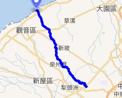

# 大堀溪

- id：A_page_016
- 類型：article
- 原始網址：https://zh.wikipedia.org/wiki/%E5%A4%A7%E5%A0%80%E6%BA%AA
- 網站名稱：維基百科（中文）
- 擷取策略：wikipedia:mw-parser-output
- 爬取狀態：**success**（HTTP 200）
- 發佈／更新日期：未標示
- 爬取時間：2026-11-05T18:44:32+08:00
- 分類：自然景觀
- 關鍵字：大堀溪、市管河川、觀音區、蓮花、流域
- 備註：
  - 此頁未偵測到 video／audio 標籤或嵌入播放器，無合法可處理影片。

## 內文（清理後）

| 大堀溪 |
| 流域 |
| 流向 | 臺灣海峽 |
| 源頭 |
| • 位置 | 東高山頂 |
| 河口 | 崁頭仔 |
| 流域面積 | 47.38平方公里（18平方英里） |
| 位置 | 桃園市觀音區、新屋區、中壢區、楊梅區 |
| 本貌 |
| 長度 | 18.59公里（12英里） |

大堀溪為一位於台灣北部之縣市管河川，幹流長度18.59公里，流域面積47.38平方公里，分佈於桃園市觀音區、新屋區、中壢區、楊梅區。主流（最長河道）上游為頭洲溪，發源於楊梅區高榮里東高山頂西側埤塘台灣堡圖》標示地名「六古」，Google地圖將部分六古溪誤植為大古溪。六股溪至富源附近改稱富源溪，並成為新屋區、觀音區界河。續流至泉州厝，匯入大堀溪本流。
大堀溪本流則發源於中壢區過嶺里雙堂屋東側台灣海峽。

## 水系主要河川
- 大堀溪：桃園市觀音區、新屋區、中壢區、楊梅區 瓦窯溝：桃園市觀音區 富源溪：桃園市觀音區、新屋區、楊梅區 六股溪：桃園市新屋區、楊梅區 頭洲溪：桃園市新屋區、楊梅區

## 相關條目
- 縣市管河川
- 台灣河流列表

## 參考資料及注釋

## 影片／音訊

此頁無影片或音訊元素，亦無嵌入播放器，故無合法可處理之影片。

## 內文圖片對應

- 檔案：output/images/A_page_016_image_01.jpg
- 原始網址：https://maps.wikimedia.org/img/osm-intl,a,a,a,250x200.png?lang=zh&domain=zh.wikipedia.org&title=%E5%A4%A7%E5%A0%80%E6%BA%AA&revid=85607001&groups=_b39eee3035ef976a286cd55055d35a4bc0fc90a0&parser=legacy
- 說明：地圖
- 授權：來源網站內容，授權狀態未標示

## 頁面超連結（前 40 筆）

- [首頁](https://zh.wikipedia.org/wiki/Wikipedia:%E9%A6%96%E9%A1%B5)
- [分類索引](https://zh.wikipedia.org/wiki/Wikipedia:%E5%88%86%E7%B1%BB%E7%B4%A2%E5%BC%95)
- [特色內容](https://zh.wikipedia.org/wiki/Portal:%E7%89%B9%E8%89%B2%E5%85%A7%E5%AE%B9)
- [新聞動態](https://zh.wikipedia.org/wiki/Portal:%E6%96%B0%E8%81%9E%E5%8B%95%E6%85%8B)
- [聯絡我們](https://zh.wikipedia.org/wiki/Wikipedia:%E8%81%94%E7%BB%9C%E6%88%91%E4%BB%AC)
- [關於維基百科](https://zh.wikipedia.org/wiki/Wikipedia:%E5%85%B3%E4%BA%8E)
- [說明](https://zh.wikipedia.org/wiki/Help:%E9%A6%96%E9%A1%B5)
- [維基社群](https://zh.wikipedia.org/wiki/Wikipedia:%E7%A4%BE%E7%BE%A4%E9%A6%96%E9%A1%B5)
- [編輯入門](https://zh.wikipedia.org/wiki/Help:%E5%85%A5%E9%97%A8)
- [互助客棧](https://zh.wikipedia.org/wiki/Wikipedia:%E4%BA%92%E5%8A%A9%E5%AE%A2%E6%A0%88)
- [IRC即時聊天](https://zh.wikipedia.org/wiki/Wikipedia:IRC%E8%81%8A%E5%A4%A9%E9%A2%91%E9%81%93)
- [資助維基百科](https://donate.wikimedia.org/?wmf_source=donate&wmf_medium=sidebar&wmf_campaign=zh.wikipedia.org&uselang=zh)（外部）
- [Cebuano](https://ceb.wikipedia.org/wiki/Daku_Xi)（外部）
- [條目](https://zh.wikipedia.org/wiki/%E5%A4%A7%E5%A0%80%E6%BA%AA)
- [討論](https://zh.wikipedia.org/wiki/Talk:%E5%A4%A7%E5%A0%80%E6%BA%AA)
- [不转换](https://zh.wikipedia.org/zh/%E5%A4%A7%E5%A0%80%E6%BA%AA)
- [简体](https://zh.wikipedia.org/zh-hans/%E5%A4%A7%E5%A0%80%E6%BA%AA)
- [繁體](https://zh.wikipedia.org/zh-hant/%E5%A4%A7%E5%A0%80%E6%BA%AA)
- [大陆简体](https://zh.wikipedia.org/zh-cn/%E5%A4%A7%E5%A0%80%E6%BA%AA)
- [香港繁體](https://zh.wikipedia.org/zh-hk/%E5%A4%A7%E5%A0%80%E6%BA%AA)
- [澳門繁體](https://zh.wikipedia.org/zh-mo/%E5%A4%A7%E5%A0%80%E6%BA%AA)
- [大马简体](https://zh.wikipedia.org/zh-my/%E5%A4%A7%E5%A0%80%E6%BA%AA)
- [新加坡简体](https://zh.wikipedia.org/zh-sg/%E5%A4%A7%E5%A0%80%E6%BA%AA)
- [臺灣正體](https://zh.wikipedia.org/zh-tw/%E5%A4%A7%E5%A0%80%E6%BA%AA)
- [編輯](https://zh.wikipedia.org/w/index.php?title=%E5%A4%A7%E5%A0%80%E6%BA%AA&action=edit)
- [檢視歷史](https://zh.wikipedia.org/w/index.php?title=%E5%A4%A7%E5%A0%80%E6%BA%AA&action=history)
- [上傳檔案](https://zh.wikipedia.org/wiki/Project:上传)
- [固定連結](https://zh.wikipedia.org/w/index.php?title=%E5%A4%A7%E5%A0%80%E6%BA%AA&oldid=85607001)
- [頁面資訊](https://zh.wikipedia.org/w/index.php?title=%E5%A4%A7%E5%A0%80%E6%BA%AA&action=info)
- [臺灣海峽](https://zh.wikipedia.org/wiki/%E8%87%BA%E7%81%A3%E6%B5%B7%E5%B3%BD)
- [桃園市](https://zh.wikipedia.org/wiki/%E6%A1%83%E5%9C%92%E5%B8%82)
- [觀音區](https://zh.wikipedia.org/wiki/%E8%A7%80%E9%9F%B3%E5%8D%80)
- [新屋區](https://zh.wikipedia.org/wiki/%E6%96%B0%E5%B1%8B%E5%8D%80)
- [中壢區](https://zh.wikipedia.org/wiki/%E4%B8%AD%E5%A3%A2%E5%8D%80)
- [楊梅區](https://zh.wikipedia.org/wiki/%E6%A5%8A%E6%A2%85%E5%8D%80)
- [台灣](https://zh.wikipedia.org/wiki/%E5%8F%B0%E7%81%A3)
- [縣市管河川](https://zh.wikipedia.org/wiki/%E7%B8%A3%E5%B8%82%E7%AE%A1%E6%B2%B3%E5%B7%9D)
- [頭洲溪](https://zh.wikipedia.org/w/index.php?title=%E9%A0%AD%E6%B4%B2%E6%BA%AA&action=edit&redlink=1)
- [台灣堡圖](https://zh.wikipedia.org/wiki/%E5%8F%B0%E7%81%A3%E5%A0%A1%E5%9C%96)
- [富源溪](https://zh.wikipedia.org/wiki/%E5%AF%8C%E6%BA%90%E6%BA%AA)
