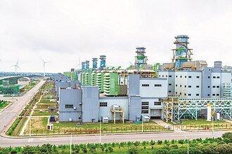
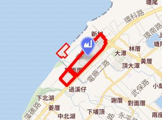

# 大潭發電廠

- id：A_page_020
- 類型：article
- 原始網址：https://zh.wikipedia.org/wiki/%E5%A4%A7%E6%BD%AD%E7%99%BC%E9%9B%BB%E5%BB%A0
- 網站名稱：維基百科（中文）
- 擷取策略：wikipedia:mw-parser-output
- 爬取狀態：**success**（HTTP 200）
- 發佈／更新日期：2008-11-19
- 爬取時間：2026-11-05T18:45:07+08:00
- 分類：地方產業
- 關鍵字：大潭發電廠、台電、天然氣、觀音區、電力
- 備註：
  - 此頁未偵測到 video／audio 標籤或嵌入播放器，無合法可處理影片。
  - 圖片略過：https://thumb.wikimedia.org/wikipedia/commons/thumb/6/66/%E5%A4%A7%E6%BD%AD%E7%99%BC%E9%9B%BB%E5%BB%A0.png/250px-%E5%A4%A7%E6%BD%AD%E7%99%BC%E9%9B%BB%E5%BB%A0.png?utm_source=zh.wikipedia.org&utm_campaign=parser&utm_content=thumbnail（尺寸過小（250x135））
  - 圖片略過：https://thumb.wikimedia.org/wikipedia/commons/thumb/9/9a/2021.11.25_%E5%A4%A7%E6%BD%AD%E9%9B%BB%E5%BB%A002.jpg/250px-2021.11.25_%E5%A4%A7%E6%BD%AD%E9%9B%BB%E5%BB%A002.jpg?utm_source=zh.wikipedia.org&utm_campaign=parser&utm_content=thumbnail（尺寸過小（250x137））

## 內文（清理後）

| 大潭發電廠 |
| 國家／地區 | 中華民國（臺灣） |
| 位置 | 桃園市觀音區電廠路1號 |
| 坐標 | 25°1′34″N 121°2′50″E / 25.02611°N 121.04722°E / 25.02611; 121.04722 坐標：參數： "type=" 應為 "type:" |
| 現況 | 商轉中 |
| 啟用時間 | 2005年 |
| 持有單位 | 台灣電力公司 |
| 操作單位 | 台灣電力公司 |
| 火力發電廠 |
| 主要燃料 | 液化天然氣 |
| 類型 | 燃氣複循環發電 |
| 複循環 | Stage I：3部氣渦輪機+1部汽輪機Stage II：2部氣渦輪機+1部汽輪機 |
| 冷卻來源 | 海水 |
| 水力發電廠遙控中心 |
| 總裝置容量 | 7,540.2MW |
| 發電概況 |
| 計劃建設機組 | 4部 |
| 裝置容量 | 7,540.2MW |
| 年發電量 | 132.74億度 |
| 網站 |
| 大潭發電廠簡介 |
| （本資訊框數據截至2013年） |

*圖說：遠望大潭發電廠*
大潭發電廠，是台灣最大的天然氣電廠，同時是世界第四大燃氣發電廠，隸屬台灣電力公司，位於台灣桃園市觀音區大潭里，佔地約102公頃，廠區有台61線（西濱快速公路）及台66線穿越，東側為台15線，南臨新屋溪。機組分為Stage I、Stage II、緊急燃油及主要燃氣系統。

## 沿革
*圖說：大潭發電廠*
大潭發電廠最初為台灣電力公司為配合國家長期經濟發展及電力負載逐年增長之需求，以及解決臺灣北部地區長期缺電，導致南電北送的常態狀況，因此選定於桃園市觀音區大潭濱海工業區內設置一座天然氣複循環發電廠，稱為大潭發電廠。
2001年，大潭複循環發電計畫開始動工，由台電核能火力工程處旗下的北部施工處進駐施工。
2008年11月19日，大潭複循環六號機完工商轉，大潭發電計畫告一段落。
2017年6月，政府因應臺灣可能發生缺電之危機，推動大潭緊急發電計畫，向美國奇異（GE）採購兩部容量各300MW的單循環的汽渦輪發電機組，空運來臺後安裝於大潭複循環6號機左(南)側之空地。
同時間，台灣電力公司也開始推動大潭擴建計畫，預計利用大潭發電廠南側的空地新增四部天然氣複循環發電機組，共增加3,168MW之發電量，而稍早推動的大潭緊急發電計畫中，兩部單循環汽渦輪發電機組，也改稱為大潭7-1與7-2號機，以作為接下來安裝熱回收爐與汽輪發電機後，成為大潭複循環7號機。
2017年8月15日，發生815全臺大停電，肇因於台灣中油施工不慎，誤關天然氣供氣管線的關斷閥，導致大潭複循環1至6號機組因無燃料可燒全部跳脫，發電量瞬間缺少4,384MW，全臺各地傳出停電狀況，事件爆發後，政府進行究責與檢討，時任經濟部長李世光於該次事件後請辭獲准。

## 設備
廠內複循環機組，由三菱重工製造氣渦輪發電機組，第一級渦輪葉片溫度在1400℃以上，產生熱燃氣加熱鍋爐推動汽輪機發電機組，複循環發電優點為電力調度反應快速，熱效率接近60%，碳排放量低於燃煤與燃油發電，僅高於核能發電，缺點為每度電燃氣成本約新台幣3元，高於核能與燃煤發電。
複循環機組及風力發電機組的總裝機容量為4,418.7MW，為台灣北部地區最大單一電廠，次於台中發電廠居台灣第二位奇異公司製造之7HA.02燃氣渦輪機，淨效率64%，可在30分鐘內從冷機啟動到滿載發電，同時增強使用燃料的靈活性，可容納各種氣體燃料（頁岩氣、高乙烷、氫氣）和液體燃料（柴油、原油）
大潭發電廠為全台電唯一具有電力系統崩潰，機組自動卸載House Load以及全黑快速啟動功能的火力發電廠。

### 發電機組
Stage I
| 氣渦輪發電機類型 | 熱回收爐類型 | 汽輪發電機類型 | 機組數量（汽渦輪機+汽輪機） | 發電燃料 | 裝置容量（MW） | 商轉日期 | 狀態 |
| 1-1 日本三菱重工製M501F型氣渦輪發電機1-2 日本三菱重工製M501F型氣渦輪發電機1-3 日本三菱重工製M501F型氣渦輪發電機 | 日本三菱重工製立式排熱回收自然循環三壓熱回收爐 | ST-1 日本三菱重工製汽輪發電機 | 3部氣渦輪機1部汽輪機 | 天然氣 | 742.7MW | 2006年8月27日 | 商轉中 |
| 2-1 日本三菱重工製M501F型氣渦輪發電機2-2 日本三菱重工製M501F型氣渦輪發電機2-3 日本三菱重工製M501F型氣渦輪發電機 | 日本三菱重工製立式排熱回收自然循環三壓熱回收爐 | ST-2 日本三菱重工製汽輪發電機 | 3部氣渦輪機1部汽輪機 | 天然氣 | 742.7MW | 2006年12月26日 | 商轉中 |

Stage II
| 氣渦輪發電機類型 | 熱回收爐類型 | 汽輪發電機類型 | 機組數量（氣渦輪機+汽輪機） | 發電燃料 | 裝置容量（MW） | 商轉日期 | 狀態 |
| 3-1 日本三菱重工製M501G型氣渦輪發電機3-2 日本三菱重工製M501G型氣渦輪發電機 | 日本三菱重工製立式排熱回收自然循環三壓熱回收爐 | ST-3 日本三菱重工製汽輪發電機 | 2部氣渦輪機1部汽輪機 | 天然氣 | 724.7MW | 2007年11月12日 | 商轉中 |
| 4-1 日本三菱重工製M501G型氣渦輪發電機4-2 日本三菱重工製M501G型氣渦輪發電機 | 日本三菱重工製立式排熱回收自然循環三壓熱回收爐 | ST-4 日本三菱重工製汽輪發電機 | 2部氣渦輪機1部汽輪機 | 天然氣 | 724.7MW | 2007年11月12日 | 商轉中 |
| 5-1 日本三菱重工製M501G型氣渦輪發電機5-2 日本三菱重工製M501G型氣渦輪發電機 | 日本三菱重工製立式排熱回收自然循環三壓熱回收爐 | ST-5 日本三菱重工製汽輪發電機 | 2部氣渦輪機1部汽輪機 | 天然氣 | 724.7MW | 2008年7月3日 | 商轉中 |
| 6-1 日本三菱重工製M501G型氣渦輪發電機6-2 日本三菱重工製M501G型氣渦輪發電機 | 日本三菱重工製立式排熱回收自然循環三壓熱回收爐 | ST-6 日本三菱重工製汽輪發電機 | 2部氣渦輪機1部汽輪機 | 天然氣 | 724.7MW | 2009年1月14日 | 商轉中 |

大潭複循環增建機組
| 氣渦輪發電機類型 | 熱回收爐類型 | 汽輪發電機類型 | 機組數量（氣渦輪機+汽輪機） | 發電燃料 | 裝置容量（MW） | 商轉日期 | 狀態 |
| 7-1 美國奇異公司製7HA.02型氣渦輪發電機7-2 美國奇異公司製7HA.02型氣渦輪發電機 | ST-7 日本三菱重工製汽輪發電機 | 2部氣渦輪機1部汽輪機 | 天然氣 | 913MW | 更新施工中 |
| 8-1 美國奇異公司製7HA.02型氣渦輪發電機8-2 美國奇異公司製7HA.02型氣渦輪發電機 | ST-8 美國奇異公司製汽輪發電機 | 2部氣渦輪機1部汽輪機 | 天然氣 | 1,123.6MW | 2024年7月31日 | 商轉中 |
| 9-1 美國奇異公司製7HA.02型氣渦輪發電機9-2 美國奇異公司製7HA.02型氣渦輪發電機 | ST-9 美國奇異公司製汽輪發電機 | 2部氣渦輪機1部汽輪機 | 天然氣 | 1,123.6MW | 2025年7月23日 | 商轉中 |

## 回饋金
觀音區、新屋區因受到大潭發電廠影響，桃園市政府以發電廠回饋金實施國中國小學生免費營養午餐，教職員健康雖同受影響，但仍自費使用營養午餐

## 工安意外
2021年12月15日，電廠委外包商丸紅的工程師與同事因西側大門未關閉而前往查看，關門時大門推引不慎導致脫軌倒塌並壓住工程師桃園醫院新屋分院急救後再轉往桃園醫院，最終因頭顱破裂且內出血嚴重，於次日不治逝世。

## 參見
- 臺灣發電廠列表
- 觀塘液化天然氣接收站（三接）

## 參考文獻

## 外部連結
- （繁體中文）台灣電力股份有限公司 - 大潭發電廠簡介 （頁面存檔備份，存於網際網路檔案館）
- 桃園市政府-產業園區聯合服務中心-大潭電廠簡介 （頁面存檔備份，存於網際網路檔案館）

## 影片／音訊

此頁無影片或音訊元素，亦無嵌入播放器，故無合法可處理之影片。

## 內文圖片對應

- 檔案：output/images/A_page_020_image_01.jpg
- 原始網址：https://thumb.wikimedia.org/wikipedia/commons/thumb/8/85/Tatan_Power_Plant_20190606.jpg/330px-Tatan_Power_Plant_20190606.jpg?utm_source=zh.wikipedia.org&utm_campaign=parser&utm_content=thumbnail
- 說明：（原頁無圖說）
- 授權：來源網站內容，授權狀態未標示

- 檔案：output/images/A_page_020_image_02.jpg
- 原始網址：https://maps.wikimedia.org/img/osm-intl,13,a,a,270x200.png?lang=zh&domain=zh.wikipedia.org&title=%E5%A4%A7%E6%BD%AD%E7%99%BC%E9%9B%BB%E5%BB%A0&revid=94099281&groups=_3df58c961856034f275e77481f0b8b20eb00b127&parser=legacy
- 說明：地圖
- 授權：來源網站內容，授權狀態未標示

## 頁面超連結（前 40 筆）

- [首頁](https://zh.wikipedia.org/wiki/Wikipedia:%E9%A6%96%E9%A1%B5)
- [分類索引](https://zh.wikipedia.org/wiki/Wikipedia:%E5%88%86%E7%B1%BB%E7%B4%A2%E5%BC%95)
- [特色內容](https://zh.wikipedia.org/wiki/Portal:%E7%89%B9%E8%89%B2%E5%85%A7%E5%AE%B9)
- [新聞動態](https://zh.wikipedia.org/wiki/Portal:%E6%96%B0%E8%81%9E%E5%8B%95%E6%85%8B)
- [聯絡我們](https://zh.wikipedia.org/wiki/Wikipedia:%E8%81%94%E7%BB%9C%E6%88%91%E4%BB%AC)
- [關於維基百科](https://zh.wikipedia.org/wiki/Wikipedia:%E5%85%B3%E4%BA%8E)
- [說明](https://zh.wikipedia.org/wiki/Help:%E9%A6%96%E9%A1%B5)
- [維基社群](https://zh.wikipedia.org/wiki/Wikipedia:%E7%A4%BE%E7%BE%A4%E9%A6%96%E9%A1%B5)
- [編輯入門](https://zh.wikipedia.org/wiki/Help:%E5%85%A5%E9%97%A8)
- [互助客棧](https://zh.wikipedia.org/wiki/Wikipedia:%E4%BA%92%E5%8A%A9%E5%AE%A2%E6%A0%88)
- [IRC即時聊天](https://zh.wikipedia.org/wiki/Wikipedia:IRC%E8%81%8A%E5%A4%A9%E9%A2%91%E9%81%93)
- [資助維基百科](https://donate.wikimedia.org/?wmf_source=donate&wmf_medium=sidebar&wmf_campaign=zh.wikipedia.org&uselang=zh)（外部）
- [Deutsch](https://de.wikipedia.org/wiki/Kraftwerk_Datan)（外部）
- [English](https://en.wikipedia.org/wiki/Tatan_Power_Plant)（外部）
- [فارسی](https://fa.wikipedia.org/wiki/%D9%86%DB%8C%D8%B1%D9%88%DA%AF%D8%A7%D9%87_%D8%AA%D8%A7%D8%AA%D8%A7%D9%86)（外部）
- [Français](https://fr.wikipedia.org/wiki/Centrale_de_Tatan)（外部）
- [日本語](https://ja.wikipedia.org/wiki/%E5%A4%A7%E6%BD%AD%E7%99%BA%E9%9B%BB%E6%89%80)（外部）
- [Norsk bokmål](https://no.wikipedia.org/wiki/Tatan_gasskraftverk)（外部）
- [條目](https://zh.wikipedia.org/wiki/%E5%A4%A7%E6%BD%AD%E7%99%BC%E9%9B%BB%E5%BB%A0)
- [討論](https://zh.wikipedia.org/wiki/Talk:%E5%A4%A7%E6%BD%AD%E7%99%BC%E9%9B%BB%E5%BB%A0)
- [不转换](https://zh.wikipedia.org/zh/%E5%A4%A7%E6%BD%AD%E7%99%BC%E9%9B%BB%E5%BB%A0)
- [简体](https://zh.wikipedia.org/zh-hans/%E5%A4%A7%E6%BD%AD%E7%99%BC%E9%9B%BB%E5%BB%A0)
- [繁體](https://zh.wikipedia.org/zh-hant/%E5%A4%A7%E6%BD%AD%E7%99%BC%E9%9B%BB%E5%BB%A0)
- [大陆简体](https://zh.wikipedia.org/zh-cn/%E5%A4%A7%E6%BD%AD%E7%99%BC%E9%9B%BB%E5%BB%A0)
- [香港繁體](https://zh.wikipedia.org/zh-hk/%E5%A4%A7%E6%BD%AD%E7%99%BC%E9%9B%BB%E5%BB%A0)
- [澳門繁體](https://zh.wikipedia.org/zh-mo/%E5%A4%A7%E6%BD%AD%E7%99%BC%E9%9B%BB%E5%BB%A0)
- [大马简体](https://zh.wikipedia.org/zh-my/%E5%A4%A7%E6%BD%AD%E7%99%BC%E9%9B%BB%E5%BB%A0)
- [新加坡简体](https://zh.wikipedia.org/zh-sg/%E5%A4%A7%E6%BD%AD%E7%99%BC%E9%9B%BB%E5%BB%A0)
- [臺灣正體](https://zh.wikipedia.org/zh-tw/%E5%A4%A7%E6%BD%AD%E7%99%BC%E9%9B%BB%E5%BB%A0)
- [編輯](https://zh.wikipedia.org/w/index.php?title=%E5%A4%A7%E6%BD%AD%E7%99%BC%E9%9B%BB%E5%BB%A0&action=edit)
- [檢視歷史](https://zh.wikipedia.org/w/index.php?title=%E5%A4%A7%E6%BD%AD%E7%99%BC%E9%9B%BB%E5%BB%A0&action=history)
- [上傳檔案](https://zh.wikipedia.org/wiki/Project:上传)
- [固定連結](https://zh.wikipedia.org/w/index.php?title=%E5%A4%A7%E6%BD%AD%E7%99%BC%E9%9B%BB%E5%BB%A0&oldid=94099281)
- [頁面資訊](https://zh.wikipedia.org/w/index.php?title=%E5%A4%A7%E6%BD%AD%E7%99%BC%E9%9B%BB%E5%BB%A0&action=info)
- [維基共享資源](https://commons.wikimedia.org/wiki/Category:Tatan_Power_Plant)（外部）
- [座標](https://zh.wikipedia.org/wiki/%E5%9C%B0%E7%90%86%E5%9D%90%E6%A0%87)
- [25°1′34″N 121°2′50″E / 25.02611°N 121.04722°E / 25.02611; 121.04722](https://geohack.toolforge.org/geohack.php?language=zh&pagename=%E5%A4%A7%E6%BD%AD%E7%99%BC%E9%9B%BB%E5%BB%A0&params=25_1_34_N_121_2_50_E_)（外部）
- [https://zh.wikipedia.org/wiki/File:Tatan_Power_Plant_20190606.jpg](https://zh.wikipedia.org/wiki/File:Tatan_Power_Plant_20190606.jpg)
- [中華民國](https://zh.wikipedia.org/wiki/%E4%B8%AD%E8%8F%AF%E6%B0%91%E5%9C%8B)
- [臺灣](https://zh.wikipedia.org/wiki/%E8%87%BA%E7%81%A3)
