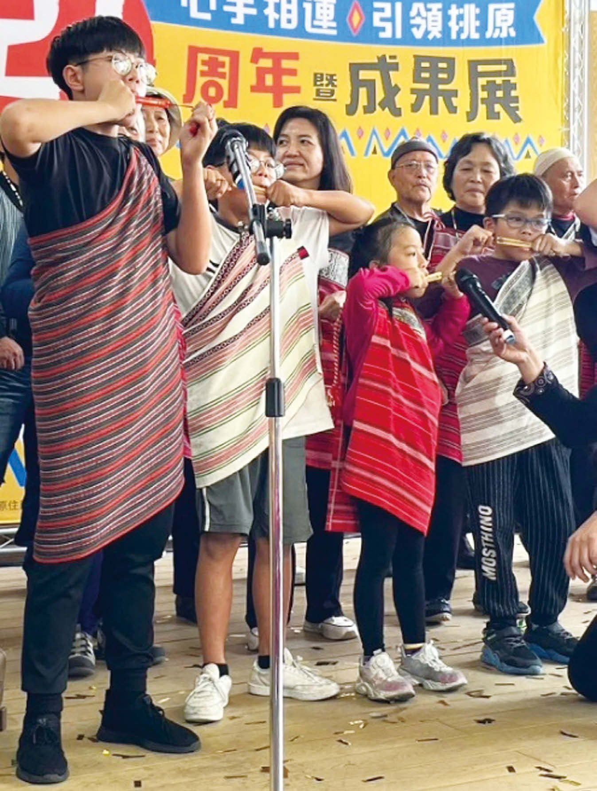
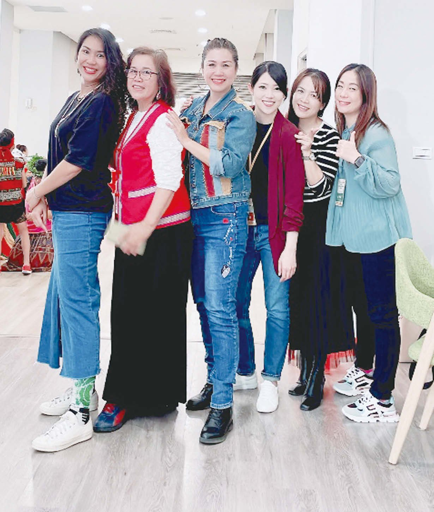
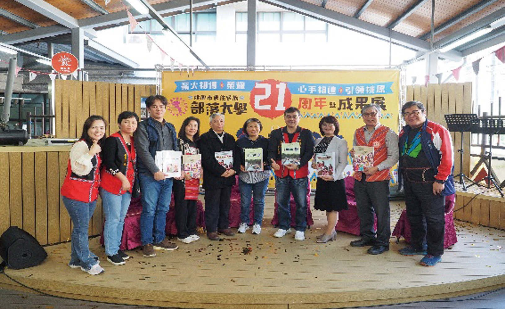
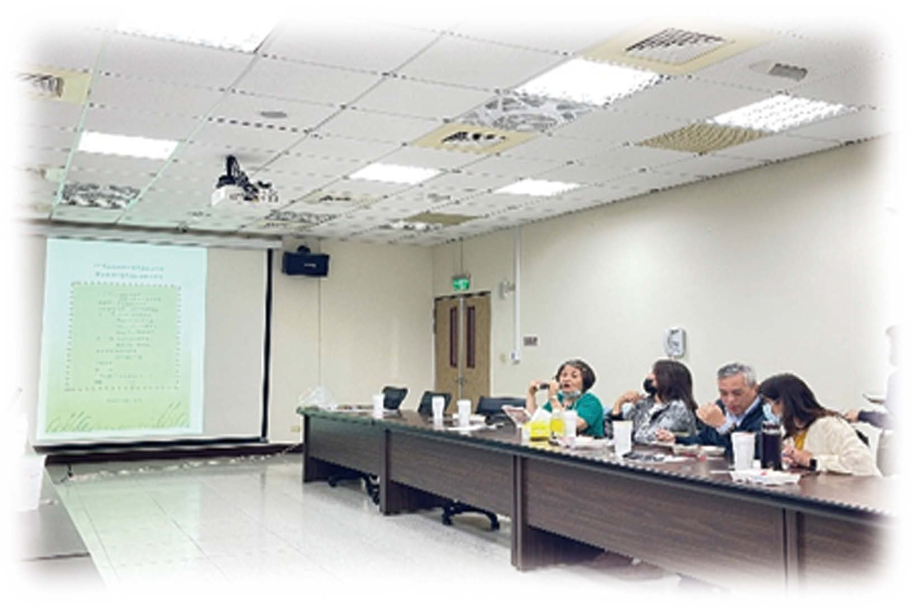

# 原住民族文獻

- id：A_page_031_ext_02
- 類型：article_ext
- 原始網址：https://ihc.cip.gov.tw/EJournal/EJournalCat/735
- 網站名稱：原住民族委員會《原住民族文獻》
- 擷取策略：ihc:mainArea
- 爬取狀態：**success**（HTTP 200）
- 發佈／更新日期：2023-12-09
- 爬取時間：2026-11-05T18:46:08+08:00
- 分類：歷史文化
- 關鍵字：原住民族文獻、泰雅族、石門水庫、卡拉社、口述歷史、電子期刊第 59 期另一
- 備註：
  - 此頁未偵測到 video／audio 標籤或嵌入播放器，無合法可處理影片。
  - 延伸來源說明：原住民族文獻｜電子期刊第 59 期另一篇

## 內文（清理後）

## 妳自信、我驕傲：族語績效的桃園女力崛起 時事快遞 第59期 2024/06
李慧慧
桃園市原住民族行政局教育文化科科長
語言是傳承族群文化重要的載體及認同的依據。傳統上，臺灣原住民族語言是口耳相傳，在經歷不同殖民政權統治後，語言快速流失（浦忠勇 1996；孫大川 2000）。直至1980年代原住民族運動的覺醒，提倡族語復振，建立書寫系統，藉由文字標準化進行語言保存，族語教材之編纂工作自1987年解嚴後就未曾間斷（黃金美 2014：68-70）。桃園市原住民族部落大學自2002年成立，至今已編製72本教材，為全臺最多。2023年編撰6本均為族語教材，泰雅語及阿美語各3本。於2023年12月9日年度辦理成果展時也發表6本書，作者群共有19位，女性15位，男性4位，女性參與明顯多於男性。
新書發表時，由作者分享外，也邀請國立清華大學劉柳書琴教授與談，她強調臺灣原住民族語尚未以國家語言概念出現時，猶如枯乾的河流，流出少數的水塘，族語老師如同水塘是知識體系的蓄水池與寶庫。也就是說，1980年後啟動族語復振，迄今40餘年，族語老師站在第一線「保育」母語，從族語教材回望傳統，如何走向現代的文化樣貌。讓筆者好奇，族語維繫、教學、資料採集與整理，何以女性參與壓倒性的遠超過男性？
桃園市原住民族語老師男女比為2：8、原住民族語言推廣人員僅有1位男性、申請原住族語保母獎勵金全為女性，從這樣的參與，顯見政府推動族語向下札根政策，女性參與為多。從部落大學族語教材女性作者群的背景，歸結共有的特質：均為人母、樂於學習、重新學族語、中年轉業、具有文化使命與高度族群認同。這些媽媽們族語的口說能力並非原本熟練，書寫更是投入大量時間學習，取得高級族語認證，方才具備族語老師資格，在投入心力進行語料採集與紀錄時，面對耆老快速凋零，積極以訪談、紀綠的方式護住文化，熱心參與部大教材編撰。
這些作者們原本在家相夫教子，為家庭付出心力，兒女成長之後，適逢社會環境重視原住民文化生存處境，推動語言復振，提供媽媽們自我學習、展現能力及自我實現的機會，扛起了族語及文化傳承的使命。其中如泰雅族的Sugiy Tosi老師參與2023年族語教材，從詞根、詞彙與構詞了解文化的面貌，被祖先的智慧感動，更從族語找回認同與自信。另一位Mongna Payas也說，泰雅族語是祖先的智慧，讓她不斷去追尋與學習，詞彙延伸的句子，蘊含著深沈意涵，在過程中找回了自信心。
阿美族的作者Miko Ito認為，文化傳承與語言永續密切相關，體認教材是學習族語的工具書；Ilis Tingtingan則說，族語是族群文化與自我認同的重要脈絡，參與編撰是保存祖先傳承的生命智慧，提升自我價值；Naomi Otay視族語教材為一個寶典，讓族語充滿傳承的活力。上述三位女性的阿美族族語老師，不僅參與2023年族語教材的編撰，也代表桃園市參與2023年全國原住民族語戲劇競賽，帶領孩子參演，也擔任要角，如Miko Ito及Naomi Otay分別撰寫家庭組及社會組的族語劇本，分別榮獲全國第一名及第二名亮眼成績。
她們體悟到，族語教學不再只是口耳相傳，更需透過書寫保存，因而參與教材編撰及導入戲劇增加學習動力，這些保存方式需經田野調查，投入心力與時間採集語料及收集故事題材，也是集結教學經驗，希冀幫助學習族語者一看就懂，成為學習的範本。她們相信這一小步的努力，在進入網路數位時代，會以更具創意方式展現與推廣。
族語老師需通過高級族語認證，根據財團法人原住民族語言發展基金會統計資料，2014年至2022年通過高級及優級之男女比為4：6，1通過的男性不算少數，但族語老師男女比卻為2：8，這樣的比例，筆者認男性報考動機並非是為了擔任族語老師或本身已有本職工作有關。然而，女性通過族語認證的動機是否為了從事族語教學？恐亦不然。筆者所見，參與部落大學族語教材編纂的女性作者們，原初動機是對自我文化的認同，努力學習族語，找回自我。筆者認為嬰兒從呱呱落地後，通常也是最先開始跟媽媽學說話，因而媽媽責無旁貸的扛起了維護「母」語的責任；再者，女性原本被塑造具有包容與耐心教導孩子的特質；另因族語老師一開始以鐘點費進用，後經爭取才有現今之權益，以致我們看到多半由女性擔任族語老師，撐起半邊天的現象。
她們並不年輕，以50-60歲為多。年輕時因無法在體制內的教育實現自我，婚後是家庭照顧者，在完成養兒育女階段任務，適逢政策大力振興族語，掌握了被鼓勵追求自我的契機，於是透過探索文化與學習族語，開展了人生第二春，也能貼補家庭經濟負擔。在語言流失的危機中，族語老師帶領大家走出新的世界，族語傳承透過母性天賦發揮作用，成了轉變與接受的力量。女性認同傳承母語是媽媽的責任，當有能力補救時，更懂得抓住機會，尤其環境條件已被形塑為友善女性，自然有更多女性投入族語教學。她們經由田野調查採集語料，忠實的紀錄文化知識，雖不同於需要分析的研究工作，但勇於付出心力與時間，過程中看見了女性的自信與能力，以身作則成為語言及文化保存的典範。還有群聚與放大效應，女性看到這個團體多半是女性時，產生姐妹情誼，一起跟進，抵抗長期的文化壓迫（Dill 1994: 42-43）。年輕女性也加入學習及研究族語的行列。族語的新血輪，後浪接前浪，持續注入族語傳承的大河流！
當然，母語不是母親專有的語言，男性一樣擅長，也用心傳承，尤其過往語言與文化的延續上，耆老要角，多半男性。只是，時至今日，女性投入族語傳承明顯增多，她們從族語找回自信，更是我們的驕傲。

##### 附註
2014-2022年共辦理6次族語認證高級測驗總計有234人通過，其中女生有142人，男生有92人；辦理5次族語認證優級測驗，總計有74人通過，其中女生有41人，男生有33人。

##### 引用書目
浦忠勇
1996 〈從原住民教育看母語教學問題〉。《人類與文化》31：151-156。
孫大川
2000 《夾縫中的族群建構》。臺北：聯合文學。
黃美金
2014 〈台灣原住民族語復振工作之回顧與展望〉。《臺灣語文研究》9(2)：67-88。
Dill, B. T.
1994 Race, Class and Gender: Prospects for an All-Inclusive Sisterhood. In The Education Feminism Reader. L. Stone, ed. Pp.42-56. New York: Routledge.

## 影片／音訊

此頁無影片或音訊元素，亦無嵌入播放器，故無合法可處理之影片。

## 內文圖片對應

- 檔案：output/images/A_page_031_ext_02_image_01.jpg
- 原始網址：https://ihc.cip.gov.tw/ihcfile/EJournals/59/Content/P69_0001.jpg
- 說明：P69_0001
- 授權：原住民族委員會《原住民族文獻》（政府出版品）

- 檔案：output/images/A_page_031_ext_02_image_02.jpg
- 原始網址：https://ihc.cip.gov.tw/ihcfile/EJournals/59/Content/P69_0002.jpg
- 說明：P69_0002
- 授權：原住民族委員會《原住民族文獻》（政府出版品）

- 檔案：output/images/A_page_031_ext_02_image_03.jpg
- 原始網址：https://ihc.cip.gov.tw/ihcfile/EJournals/59/Content/P69_0003.jpg
- 說明：P69_0003
- 授權：原住民族委員會《原住民族文獻》（政府出版品）

- 檔案：output/images/A_page_031_ext_02_image_04.jpg
- 原始網址：https://ihc.cip.gov.tw/ihcfile/EJournals/59/Content/P69_0004.jpg
- 說明：P69_0004
- 授權：原住民族委員會《原住民族文獻》（政府出版品）

## 頁面超連結（前 40 筆）

- [https://ihc.cip.gov.tw/](https://ihc.cip.gov.tw/)
- [網站導覽](https://ihc.cip.gov.tw/SiteMap)
- [客服諮詢](https://ihc.cip.gov.tw/Service)
- [關於原住民族文獻會](https://ihc.cip.gov.tw/Aboutus/Index)
- [原住民族文獻會設置要點](https://ihc.cip.gov.tw/Aboutus/Rules)
- [委員介紹](https://ihc.cip.gov.tw/Aboutus/Committee)
- [歷次會議記錄](https://ihc.cip.gov.tw/Aboutus/Minutes)
- [網站訊息](https://ihc.cip.gov.tw/News/Index)
- [徵稿訊息](https://ihc.cip.gov.tw/News/Call4Paper)
- [本會出版品列表](https://ihc.cip.gov.tw/Publication/Index)
- [與國史館共同出版品介紹](https://ihc.cip.gov.tw/Publication/WithDrnh)
- [出版品查詢](https://ihc.cip.gov.tw/Publication/Search)
- [本期內容](https://ihc.cip.gov.tw/EJournal/Index)
- [歷史期刊](https://ihc.cip.gov.tw/EJournal/EJournals)
- [訂閱電子報](https://ihc.cip.gov.tw/EJournal/EPaper)
- [徵稿說明](https://ihc.cip.gov.tw/EJournal/Call4PaperNote)
- [期刊查詢](https://ihc.cip.gov.tw/EJournal/Search)
- [相關連結](https://ihc.cip.gov.tw/Link)
- [回期刊列表](https://ihc.cip.gov.tw/EJournal/EJournalDetail/59)
- [隱私權保護政策](https://ihc.cip.gov.tw/Privacy)
- [網站安全政策](https://ihc.cip.gov.tw/Policy)
- [本會地圖](https://ihc.cip.gov.tw/Map)
