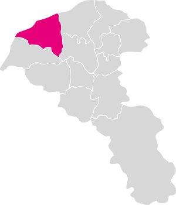
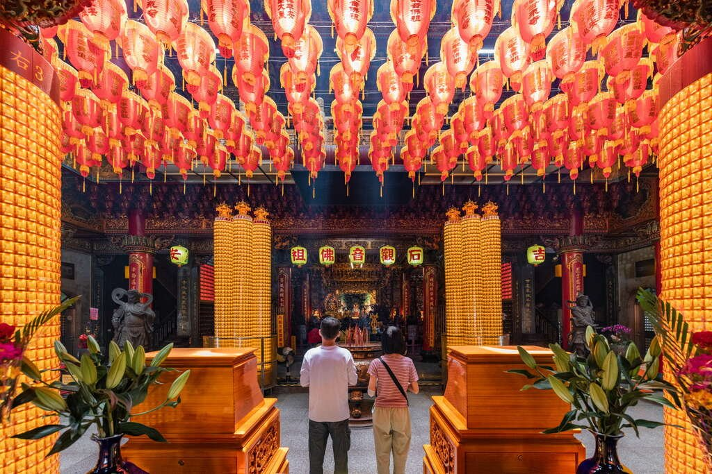

# 甘泉寺 | 桃園觀光導覽網

- id：page_010_ext_01
- 類型：article_ext
- 原始網址：https://travel.tycg.gov.tw/zh-tw/Travel/Attraction/292
- 網站名稱：桃園觀光導覽網
- 擷取策略：chrome-headless+generic:max-text-density
- 爬取狀態：**success**（HTTP 200）
- 發佈／更新日期：未標示
- 爬取時間：2026-11-05T18:44:13+08:00
- 分類：歷史文化
- 關鍵字：甘泉寺、石觀音、觀音信仰、甘泉井、桃園觀音、甘泉寺（景點介紹）
- 備註：
  - 伺服器端只回傳框架：改以 headless Chrome 實際執行 JS 後擷取正文（非推測內容）。
  - 圖片略過：https://travel.tycg.gov.tw/content/images/2022/static/google-map.png（檔案過小（1757 bytes））
  - 圖片略過：https://travel.tycg.gov.tw/content/images/global/a11y.png（檔案過小（2707 bytes））
  - 圖片略過：https://travel.tycg.gov.tw/content/images/global/chat-mascot.png（尺寸過小（138x118））
  - 延伸來源說明：桃園觀光導覽網｜甘泉寺（景點介紹）

## 內文（清理後）

## 甘泉寺
- 濱海追風
- 歷史人文
- 探訪甘泉井，親嘗傳說中清甜可口的神奇泉水
- 欣賞三層宮殿式廟宇，探索精美絢麗的建築細節
- 參加觀世音佛誕、石觀音文化節，感受濃厚地方傳統文化
- 觀賞全台唯一三層高的銅雕觀世音圖像，莊嚴且震撼
- 照片照片
- 街景街景
- 星期日：06:00 - 21:00
- 星期一：06:00 - 21:00
- 星期二：06:00 - 21:00
- 星期三：06:00 - 21:00
- 星期四：06:00 - 21:00
- 星期五：06:00 - 21:00
- 星期六：06:00 - 21:00
- 公車站
- 廁所
- 分享到 facebook
- 分享到 Weibo
- 分享到 line

## 影片／音訊

- video 標籤：2；audio 標籤：0
- 影片檔未下載（僅記錄來源與型別，未繞過平台／版權限制）。

## 內文圖片對應

- 檔案：output/images/page_010_ext_01_image_01.jpg
- 原始網址：https://travel.tycg.gov.tw/content/images/2022/attraction-region/328.png
- 說明：（原頁無圖說）
- 授權：桃園市政府網站（政府網站資料開放宣告）

- 檔案：output/images/page_010_ext_01_image_02.jpg
- 原始網址：https://travel.tycg.gov.tw/Image/111540/?r=1753948157355
- 說明：參拜香客
- 授權：桃園市政府網站（政府網站資料開放宣告）

## 頁面超連結（前 40 筆）

- [ios下載](https://itunes.apple.com/tw/app/%E6%A1%83%E5%9C%92%E6%99%BA%E6%85%A7%E9%81%8A/id1317672236?mt=8)（外部）
- [Android下載](https://play.google.com/store/apps/details?id=com.csii.fusing)（外部）
- [桃園觀光導覽網](https://travel.tycg.gov.tw/zh-tw)
- [節慶與活動](https://travel.tycg.gov.tw/zh-tw/event/calendar/)
- [即時影像](https://travel.tycg.gov.tw/zh-tw/multimedia/live-camera/)
- [線上遊桃園](https://travel.tycg.gov.tw/zh-tw/immersive/)
- [虛擬旅行新體驗](https://travel.tycg.gov.tw/zh-tw/digital-twin/)
- [最新消息](https://travel.tycg.gov.tw/zh-tw/event)
- [桃園夯話題](https://travel.tycg.gov.tw/zh-tw/reports)
- [優惠情報](https://travel.tycg.gov.tw/zh-tw/event/couponlist)
- [上週最熱門](https://travel.tycg.gov.tw/zh-tw/interesting-things)
- [桃園花訊](https://travel.tycg.gov.tw/zh-tw/event/scenicalbumlist)
- [探索珍珠海岸](https://travel.tycg.gov.tw/pearl-coast/)
- [行程、票券預購專區](https://travel.tycg.gov.tw/zh-tw/travel/ota)
- [大龍門主題網](https://travel.tycg.gov.tw/dalongmen/)
- [行程快搜](https://travel.tycg.gov.tw/zh-tw/travel/tourlist)
- [遊臺灣從桃園開始](https://travel.tycg.gov.tw/zh-tw/travel/start-itinerary-in-taoyuan)
- [旅遊懶人包](https://travel.tycg.gov.tw/zh-tw/travel/travel-guide)
- [北橫觀星指南](https://travel.tycg.gov.tw/lalashan-dark-sky/)
- [搭機捷遊桃園](https://travel.tycg.gov.tw/zh-tw/travel/get-around-by-airport-mrt)
- [宮廟祈福之旅](https://travel.tycg.gov.tw/zh-tw/travel/temple-blessing-tour)
- [親子放電場館](https://travel.tycg.gov.tw/zh-tw/travel/child-venue)
- [體驗觀光工廠](https://travel.tycg.gov.tw/zh-tw/travel/factory-tours)
- [四季賞花情報](https://travel.tycg.gov.tw/zh-tw/travel/flower-viewing)
- [初次造訪桃園](https://travel.tycg.gov.tw/zh-tw/travel/new-traveler)
- [大龍門古道](https://travel.tycg.gov.tw/zh-tw/travel/dalongmentrail)
- [步道漫遊趣](https://travel.tycg.gov.tw/zh-tw/travel/trail)
- [單車旅行](https://travel.tycg.gov.tw/zh-tw/travel/bicycle)
- [特色公園遊](https://travel.tycg.gov.tw/zh-tw/travel/parent-child-park)
- [石門水庫行](https://travel.tycg.gov.tw/zh-tw/travel/shihmen-reservoir-tour)
- [北橫原鄉](https://travel.tycg.gov.tw/zh-tw/travel/indigenous-homelands)
- [水岸埤塘](https://travel.tycg.gov.tw/zh-tw/travel/riversides-and-ponds)
- [分區介紹](https://travel.tycg.gov.tw/zh-tw/travel/districts)
- [景點搜尋](https://travel.tycg.gov.tw/zh-tw/travel)
- [旅遊地圖](https://travel.tycg.gov.tw/zh-tw/travel/mapnavigate)
- [TOP熱門景點](https://travel.tycg.gov.tw/zh-tw/travel/popular-attractions)
- [山林探險](https://travel.tycg.gov.tw/zh-tw/travel/mountainous)
- [都會散步](https://travel.tycg.gov.tw/zh-tw/travel/urban)
- [海岸追風](https://travel.tycg.gov.tw/zh-tw/travel/coastal)
- [美食快搜](https://travel.tycg.gov.tw/zh-tw/consume?type=gourmet)
