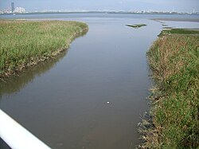
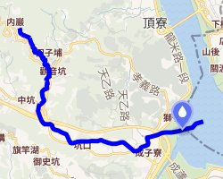
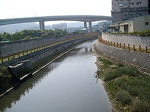

# 觀音坑溪

- id：page_015
- 類型：article
- 原始網址：https://zh.wikipedia.org/wiki/%E8%A7%80%E9%9F%B3%E5%9D%91%E6%BA%AA
- 網站名稱：維基百科（中文）
- 擷取策略：wikipedia:mw-parser-output
- 爬取狀態：**success**（HTTP 200）
- 發佈／更新日期：未標示
- 爬取時間：2026-11-05T18:44:23+08:00
- 分類：自然景觀
- 關鍵字：觀音坑溪、五股區、淡水河、同名錯置、新北市
- 備註：
  - 此頁未偵測到 video／audio 標籤或嵌入播放器，無合法可處理影片。

## 內文（清理後）

| 觀音坑溪 |
| 過觀音坑溪橋入淡水河，對岸右邊是社子，左邊是關渡 |
| 流域 |
| 水系 | 淡水河 |
| 源頭 |
| • 位置 | 觀音山南側（凌雲禪寺附近） |
| • 海拔 | 372公尺（1,220英尺） |
| 河口 | 獅子頭 |
| 流域面積 | 9.2平方公里（3.6平方英里） |
| 位置 | 新北市五股區 |
| 本貌 |
| 長度 | 6.2公里（3.9英里） |

*圖說：觀音坑溪橋上看上游，遠方為台64線高架。*
觀音坑溪 (或以中下游地名另稱北勢坑溪)，位於台灣北部，是淡水河的一條支流，河長6.2公里，流域面積9.2平方公里，分佈於新北市五股區。其源頭位於觀音山南側的凌雲禪寺附近，標高372公尺台北盆地後，轉向東注入淡水河。
觀音坑溪原本注入淡水河的另一支流塭子川獅子頭隘口，即變成現況之各自注入淡水河。
導演齊柏林在所執導的《看見台灣》紀綠片中，拍攝到觀音坑溪遭上游染整廠排放的廢水汙染，河面呈暗紅色。

## 橋梁
觀音坑溪橋:八里左岸自行車道跨過觀音坑溪。

## 相關條目
- 淡水河
- 塭子川

## 參考資料

## 影片／音訊

此頁無影片或音訊元素，亦無嵌入播放器，故無合法可處理之影片。

## 內文圖片對應

- 檔案：output/images/page_015_image_01.jpg
- 原始網址：https://thumb.wikimedia.org/wikipedia/commons/thumb/2/23/%E8%A7%80%E9%9F%B3%E5%9D%91%E6%BA%AA%E5%85%A5%E6%B7%A1%E6%B0%B4%E6%B2%B3.JPG/250px-%E8%A7%80%E9%9F%B3%E5%9D%91%E6%BA%AA%E5%85%A5%E6%B7%A1%E6%B0%B4%E6%B2%B3.JPG?utm_source=zh.wikipedia.org&utm_campaign=parser&utm_content=thumbnail
- 說明：（原頁無圖說）
- 授權：來源網站內容，授權狀態未標示

- 檔案：output/images/page_015_image_02.jpg
- 原始網址：https://maps.wikimedia.org/img/osm-intl,a,a,a,250x200.png?lang=zh&domain=zh.wikipedia.org&title=%E8%A7%80%E9%9F%B3%E5%9D%91%E6%BA%AA&revid=85606836&groups=_9abb92745e4389c7ede7c5cd28b0feb2571db67f&parser=legacy
- 說明：地圖
- 授權：來源網站內容，授權狀態未標示

- 檔案：output/images/page_015_image_03.jpg
- 原始網址：https://thumb.wikimedia.org/wikipedia/commons/thumb/8/8c/%E8%A7%80%E9%9F%B3%E5%9D%91%E6%BA%AA.JPG/250px-%E8%A7%80%E9%9F%B3%E5%9D%91%E6%BA%AA.JPG?utm_source=zh.wikipedia.org&utm_campaign=parser&utm_content=thumbnail
- 說明：觀音坑溪橋上看上游，遠方為台64線高架。
- 授權：來源網站內容，授權狀態未標示

## 頁面超連結（前 40 筆）

- [首頁](https://zh.wikipedia.org/wiki/Wikipedia:%E9%A6%96%E9%A1%B5)
- [分類索引](https://zh.wikipedia.org/wiki/Wikipedia:%E5%88%86%E7%B1%BB%E7%B4%A2%E5%BC%95)
- [特色內容](https://zh.wikipedia.org/wiki/Portal:%E7%89%B9%E8%89%B2%E5%85%A7%E5%AE%B9)
- [新聞動態](https://zh.wikipedia.org/wiki/Portal:%E6%96%B0%E8%81%9E%E5%8B%95%E6%85%8B)
- [聯絡我們](https://zh.wikipedia.org/wiki/Wikipedia:%E8%81%94%E7%BB%9C%E6%88%91%E4%BB%AC)
- [關於維基百科](https://zh.wikipedia.org/wiki/Wikipedia:%E5%85%B3%E4%BA%8E)
- [說明](https://zh.wikipedia.org/wiki/Help:%E9%A6%96%E9%A1%B5)
- [維基社群](https://zh.wikipedia.org/wiki/Wikipedia:%E7%A4%BE%E7%BE%A4%E9%A6%96%E9%A1%B5)
- [編輯入門](https://zh.wikipedia.org/wiki/Help:%E5%85%A5%E9%97%A8)
- [互助客棧](https://zh.wikipedia.org/wiki/Wikipedia:%E4%BA%92%E5%8A%A9%E5%AE%A2%E6%A0%88)
- [IRC即時聊天](https://zh.wikipedia.org/wiki/Wikipedia:IRC%E8%81%8A%E5%A4%A9%E9%A2%91%E9%81%93)
- [資助維基百科](https://donate.wikimedia.org/?wmf_source=donate&wmf_medium=sidebar&wmf_campaign=zh.wikipedia.org&uselang=zh)（外部）
- [Cebuano](https://ceb.wikipedia.org/wiki/Guanyinkeng_Xi_(suba_sa_Republika_sa_Tsina,_Taipei))（外部）
- [條目](https://zh.wikipedia.org/wiki/%E8%A7%80%E9%9F%B3%E5%9D%91%E6%BA%AA)
- [討論](https://zh.wikipedia.org/wiki/Talk:%E8%A7%80%E9%9F%B3%E5%9D%91%E6%BA%AA)
- [不转换](https://zh.wikipedia.org/zh/%E8%A7%80%E9%9F%B3%E5%9D%91%E6%BA%AA)
- [简体](https://zh.wikipedia.org/zh-hans/%E8%A7%80%E9%9F%B3%E5%9D%91%E6%BA%AA)
- [繁體](https://zh.wikipedia.org/zh-hant/%E8%A7%80%E9%9F%B3%E5%9D%91%E6%BA%AA)
- [大陆简体](https://zh.wikipedia.org/zh-cn/%E8%A7%80%E9%9F%B3%E5%9D%91%E6%BA%AA)
- [香港繁體](https://zh.wikipedia.org/zh-hk/%E8%A7%80%E9%9F%B3%E5%9D%91%E6%BA%AA)
- [澳門繁體](https://zh.wikipedia.org/zh-mo/%E8%A7%80%E9%9F%B3%E5%9D%91%E6%BA%AA)
- [大马简体](https://zh.wikipedia.org/zh-my/%E8%A7%80%E9%9F%B3%E5%9D%91%E6%BA%AA)
- [新加坡简体](https://zh.wikipedia.org/zh-sg/%E8%A7%80%E9%9F%B3%E5%9D%91%E6%BA%AA)
- [臺灣正體](https://zh.wikipedia.org/zh-tw/%E8%A7%80%E9%9F%B3%E5%9D%91%E6%BA%AA)
- [編輯](https://zh.wikipedia.org/w/index.php?title=%E8%A7%80%E9%9F%B3%E5%9D%91%E6%BA%AA&action=edit)
- [檢視歷史](https://zh.wikipedia.org/w/index.php?title=%E8%A7%80%E9%9F%B3%E5%9D%91%E6%BA%AA&action=history)
- [上傳檔案](https://zh.wikipedia.org/wiki/Project:上传)
- [固定連結](https://zh.wikipedia.org/w/index.php?title=%E8%A7%80%E9%9F%B3%E5%9D%91%E6%BA%AA&oldid=85606836)
- [頁面資訊](https://zh.wikipedia.org/w/index.php?title=%E8%A7%80%E9%9F%B3%E5%9D%91%E6%BA%AA&action=info)
- [維基共享資源](https://commons.wikimedia.org/wiki/Category:Guanyinkeng_River)（外部）
- [https://zh.wikipedia.org/wiki/File:%E8%A7%80%E9%9F%B3%E5%9D%91%E6%BA%AA%E5%85%A5%E6%B7%A1%E6%B0%B4%E6%B2%B3.JPG](https://zh.wikipedia.org/wiki/File:%E8%A7%80%E9%9F%B3%E5%9D%91%E6%BA%AA%E5%85%A5%E6%B7%A1%E6%B0%B4%E6%B2%B3.JPG)
- [水系](https://zh.wikipedia.org/wiki/%E6%B5%81%E5%9F%9F)
- [淡水河](https://zh.wikipedia.org/wiki/%E6%B7%A1%E6%B0%B4%E6%B2%B3)
- [觀音山](https://zh.wikipedia.org/wiki/%E8%A7%80%E9%9F%B3%E5%B1%B1_(%E6%96%B0%E5%8C%97%E5%B8%82))
- [新北市](https://zh.wikipedia.org/wiki/%E6%96%B0%E5%8C%97%E5%B8%82)
- [五股區](https://zh.wikipedia.org/wiki/%E4%BA%94%E8%82%A1%E5%8D%80)
- [https://zh.wikipedia.org/wiki/File:%E8%A7%80%E9%9F%B3%E5%9D%91%E6%BA%AA.JPG](https://zh.wikipedia.org/wiki/File:%E8%A7%80%E9%9F%B3%E5%9D%91%E6%BA%AA.JPG)
- [台64線](https://zh.wikipedia.org/wiki/%E5%8F%B064%E7%B7%9A)
- [台灣](https://zh.wikipedia.org/wiki/%E5%8F%B0%E7%81%A3)
- [台北盆地](https://zh.wikipedia.org/wiki/%E5%8F%B0%E5%8C%97%E7%9B%86%E5%9C%B0)
