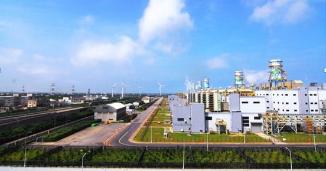

# 大潭火力發電廠

- id：page_020_ext_02
- 類型：article_ext
- 原始網址：https://ea01.moeaea.gov.tw/e0408/energy-smartcity/page/stronghold/show.aspx?kind=2&num=83&page=1
- 網站名稱：經濟部能源署
- 擷取策略：generic:max-text-density
- 爬取狀態：**success**（HTTP 200）
- 發佈／更新日期：未標示
- 爬取時間：2026-11-05T18:45:18+08:00
- 分類：地方產業
- 關鍵字：大潭發電廠、台電、天然氣、觀音區、電力、大潭火力發電廠
- 備註：
  - 此頁未偵測到 video／audio 標籤或嵌入播放器，無合法可處理影片。
  - 圖片略過：https://ea01.moeaea.gov.tw/e0408/Templates/TEZ_112012_1/images/all/footer_bg1.jpg（尺寸過小（113x39））
  - 延伸來源說明：經濟部能源署｜大潭火力發電廠

## 內文（清理後）

## 主題行程規劃
- 回首頁
- 主題行程規劃
- 北臺灣節能場域點推薦
- 阿光的節電行腳旅程
- 北臺灣節能場域點推薦
- 中臺灣節能場域點推薦
- 南臺灣節能場域點推薦
- 東臺灣節能場域點推薦
- 離島節能場域點推薦

## 大潭火力發電廠

### 行程路線
連台積電都靠它，臺灣經濟奇蹟幕後功臣-大潭電廠
竹科是孕育臺灣經濟命脈的搖籃，而大潭發電廠則扮演母親的角色，3000多個歲月，供輸科技廠所需電力，厚植資訊國力。發電機轟隆隆1年365天，24小時日夜轉不停，外部黃色管線平均每小時送進600噸天然氣，透過渦輪機混合燃燒，轉換成熱能，帶動發電機發電。10年來，大潭火力發電廠伴隨科技廠，創造台灣經濟奇蹟。
除了核能發電，臺灣供電還可以有哪些選擇？事實上，位在桃園大潭的天然氣火力發電廠，1年發電量大約288億度電，供電量就佔了北台灣的三分之一，新竹以北有8成的工業用電，包含台積電等國際科技大廠的供電也全靠它，大潭火力發電廠將可取代核能，成為供電重要管道。
全球最大的燃氣渦輪發電廠
大潭電廠佔地116公頃，廠區內6部大型發電機組，每小時發電量高達438萬度，新竹以北全靠它，提供北台灣1/3電量，是台灣北部地區最大單一電廠，次於台中發電廠居台灣第二位，也是全球最大的燃氣渦輪發電廠，政府計畫民國110年大潭電廠擴廠，增加4部發電機組，屆時大潭電廠可以增加到300萬千瓦的電，成為全台發電量最大的電廠。天然氣發電成本高但穩定供電，加上熱能轉換率破5成，一旦核四封存或停建，大潭發電廠很可能成為取代核能發電的新選擇。
資料來源：維基百科
- 回列表頁

## 影片／音訊

此頁無影片或音訊元素，亦無嵌入播放器，故無合法可處理之影片。

## 內文圖片對應

- 檔案：output/images/page_020_ext_02_image_01.jpg
- 原始網址：https://ea01.moeaea.gov.tw/e0408/upload/web/map/%e5%a4%a7%e6%bd%ad%e7%81%ab%e5%8a%9b%e7%99%bc%e9%9b%bb%e5%bb%a0.jpg
- 說明：大潭火力發電廠
- 授權：來源網站內容，授權狀態未標示

## 頁面超連結（前 40 筆）

- [自己的電自己省logo](https://ea01.moeaea.gov.tw/e0408/energy-smartcity/index.aspx)
- [https://ea01.moeaea.gov.tw/e0408/energy-smartcity/page/search/index.aspx](https://ea01.moeaea.gov.tw/e0408/energy-smartcity/page/search/index.aspx)
- [網站導覽](https://ea01.moeaea.gov.tw/e0408/energy-smartcity/page/about/index.aspx?kind=1)
- [用電資訊](https://ea01.moeaea.gov.tw/e0408/energy-smartcity/page/electricity/index.aspx?kind=1)
- [縣市住商(含農業)用電資訊](https://ea01.moeaea.gov.tw/e0408/energy-smartcity/page/electricity/index.aspx?kind=2)
- [鄉鎮市區家庭用電資訊](https://ea01.moeaea.gov.tw/e0408/energy-smartcity/page/electricity/index.aspx?kind=3)
- [冷氣時趨勢圖](https://ea01.moeaea.gov.tw/e0408/energy-smartcity/page/electricity/index.aspx?kind=4)
- [節電效益估算器](https://ea01.moeaea.gov.tw/e0408/energy-smartcity/page/electricity/estimate.aspx)
- [縣市節電計畫](https://ea01.moeaea.gov.tw/e0408/energy-smartcity/page/download/index.aspx)
- [縣市亮點案例](https://ea01.moeaea.gov.tw/e0408/energy-smartcity/page/about/index.aspx?kind=53)
- [最新消息](https://ea01.moeaea.gov.tw/e0408/energy-smartcity/page/news/index.aspx?root=8)
- [節電活動](https://ea01.moeaea.gov.tw/e0408/energy-smartcity/page/video/index.aspx)
- [節電好夥伴](https://ea01.moeaea.gov.tw/e0408/energy-smartcity/page/link/index.aspx?kind=21)
- [圖文懶人包](https://ea01.moeaea.gov.tw/e0408/energy-smartcity/page/link/infographics.aspx?kind=22)
- [節能尋寶圖](https://ea01.moeaea.gov.tw/e0408/energy-smartcity/page/stronghold/map.aspx)
- [節能旅遊地圖](https://ea01.moeaea.gov.tw/e0408/energy-smartcity/page/stronghold/map_1.aspx)
- [主題行程規劃](https://ea01.moeaea.gov.tw/e0408/energy-smartcity/page/stronghold/index.aspx)
- [節能地圖下載](https://ea01.moeaea.gov.tw/e0408/energy-smartcity/page/stronghold/download.aspx)
- [友好夥伴連結](https://ea01.moeaea.gov.tw/e0408/energy-smartcity/page/link/index.aspx?kind=27)
- [Facebook](https://www.facebook.com/EnergyParkNO.1/)（外部）
- [節約能源園區](https://ea01.moeaea.gov.tw/e0408/energy-smartcity/index.aspx?lang=US)
- [回首頁](https://www.energypark.org.tw/energy-smartcity/)（外部）
- [阿光的節電行腳旅程](https://ea01.moeaea.gov.tw/e0408/energy-smartcity/page/stronghold/index.aspx?kind=1)
- [北臺灣節能場域點推薦](https://ea01.moeaea.gov.tw/e0408/energy-smartcity/page/stronghold/index.aspx?kind=2)
- [中臺灣節能場域點推薦](https://ea01.moeaea.gov.tw/e0408/energy-smartcity/page/stronghold/index.aspx?kind=3)
- [南臺灣節能場域點推薦](https://ea01.moeaea.gov.tw/e0408/energy-smartcity/page/stronghold/index.aspx?kind=4)
- [東臺灣節能場域點推薦](https://ea01.moeaea.gov.tw/e0408/energy-smartcity/page/stronghold/index.aspx?kind=5)
- [離島節能場域點推薦](https://ea01.moeaea.gov.tw/e0408/energy-smartcity/page/stronghold/index.aspx?kind=6)
- [回列表頁](https://ea01.moeaea.gov.tw/e0408/energy-smartcity/page/stronghold/index.aspx?kind=2&page=1)
- [網頁設計(另開視窗)](https://www.eztrust.com.tw)（外部）
- [https://www.energypark.org.tw/](https://www.energypark.org.tw/)（外部）
- [https://accessibility.moda.gov.tw/Applications/Detail?category=20260930010703](https://accessibility.moda.gov.tw/Applications/Detail?category=20260930010703)（外部）
