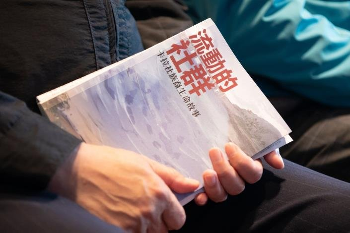
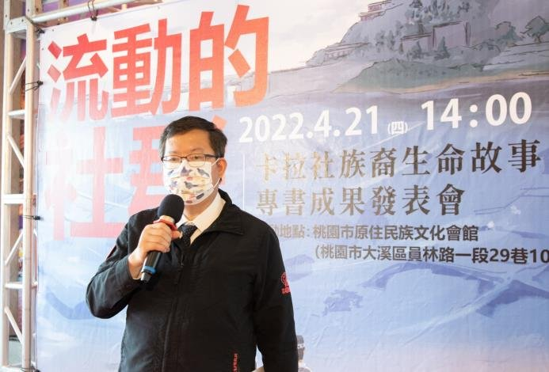
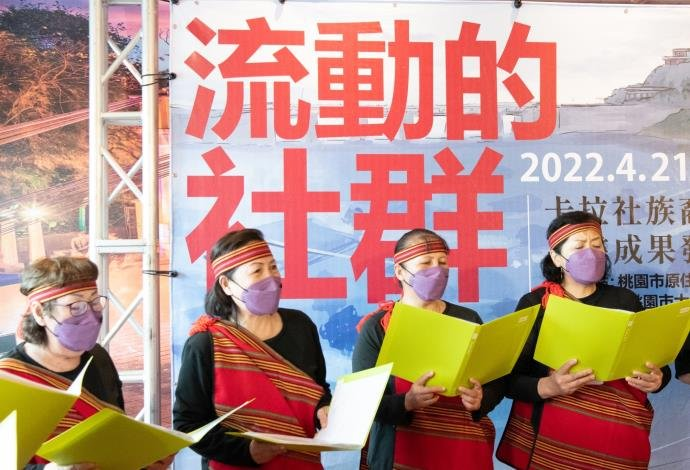

# 《流動的社群：卡拉社族裔生命故事》專書成果發表，留下卡拉社遷移歷史、凝聚散居族人的情感

- id：page_031_ext_01
- 類型：article_ext
- 原始網址：https://news.tycg.gov.tw/News_Content.aspx?n=5016&s=316772
- 網站名稱：桃園市政府新聞處
- 擷取策略：tycg:CCMS_Content/area-editor
- 爬取狀態：**success**（HTTP 200）
- 發佈／更新日期：未標示
- 爬取時間：2026-11-05T18:45:36+08:00
- 分類：歷史文化
- 關鍵字：原住民族文獻、泰雅族、石門水庫、卡拉社、口述歷史、卡拉社專書報導
- 備註：
  - 此頁未偵測到 video／audio 標籤或嵌入播放器，無合法可處理影片。
  - 延伸來源說明：桃園市政府新聞處｜卡拉社專書報導

## 內文（清理後）

### 《流動的社群：卡拉社族裔生命故事》專書成果發表，留下卡拉社遷移歷史、凝聚散居族人的情感
- 發布單位：新聞聯繫科
- 資料提供單位：新聞處
《流動的社群：卡拉社族裔生命故事》專書成果發表，留下卡拉社遷移歷史、凝聚散居族人的情感桃園市長鄭文燦今（21）日下午前往大溪區，出席「流動的社群－卡拉社族裔生命故事」專書成果發表會，鄭市長表示，卡拉社部落族人因半世紀前政府推動石門水庫建設，被迫歷經3次遷徙，從石秀坪到大溪中庄新村，再到觀音大潭新村，最終散居各地。鄭市長認為，針對石門水庫興建過程未獲妥善安置的淹沒區居民，應恢復其應有權益，才符合轉型正義，而歷史正義恢復需要時間，希望至少透過文字及影像紀錄，將散居的族人凝聚起來。鄭市長指出，政府於民國43年開始規劃興建石門水庫，水庫淹沒區範圍遼闊，除了阿姆坪，涵蓋霞雲坪、溪口台、合流、下奎輝、石秀坪、二坪、新柑坪、下高遶等部落居地，當時石秀坪泰雅族人在沒有心理準備的情況下，被迫遷移到大溪中庄新村，但民國52年葛樂禮颱風來襲，摧毀剛建立的屋基，族人們再度遷至觀音大潭新村，當時即遭遇觀音海沙地不利農作的難題，後續又有高銀化工鎘污染事件，引發卡拉社族人不滿、圍廠抗議，最後受重金屬污染的土地由當時縣政府徵收進行土壤復育，卡拉社族人自此散居各地。鄭市長提到，政府積極推動轉型正義，應該也包含當時興建石門水庫過程中，未獲妥善安置的淹沒區的居民，希望恢復他們應有的權益。由於歷史正義恢復需要時間，希望至少將歷史紀錄留下，並藉此將散居的卡拉社族人凝聚起來。鄭市長說，桃園自升格後全力推動「桃原新政」，其中也與桃園市原住民原卡拉社部落遷移大潭新村協會合作，自105年起，每年補助協會約150萬元經費，其中100萬元用於辦理文史資料建置及舉辦各項聯誼及文化活動，50萬元業務費預算則辦理紀念活動及觀摩參訪，截至今（111）年，已編列逾900萬元。鄭市長談到，市府也透過拍攝「失根的部落－卡拉社部落的泰雅族人遷徙史」紀錄片及出版《流動的社群：卡拉社族裔生命故事》專書，持續蒐集卡拉社部落文史資料。其中《流動的社群：卡拉社族裔生命故事》專書編輯團隊花費約1年時間，透過文獻回顧、田野調查以及耆老口述生命經驗，為卡拉社遷移史留下紀錄。鄭市長說，也希望族人雖然離開了祖籍地，但仍擁有凝聚力，市府未來將持續給予卡拉社族人後代更好的照顧。卡拉社族人代表林誠榮細數當年族人被迫遷徙的辛酸回憶，認為當局在推動石門水庫建設時，犧牲了卡拉社族人的居住權益，他也藉此機會呼籲政府協助卡拉社部落找回失散的族人，讓當時石秀坪46戶族人能再次團聚。市議員暨桃園市原住民原卡拉社部落遷移大潭新村協會理事長王仙蓮表示，在各界及原民局的支持下，透過影片及專書紀錄帶領下一代更加瞭解卡拉社族裔的生命故事以及卡拉社的根源。她說，卡拉社族人就如同吉普賽人一樣，顛沛流離、四散各處，部落耆老也逐漸凋零，她衷心期盼未來卡拉社的血脈、歷史及文化可以傳承下去。今日包括市議員暨桃園市原住民原卡拉社部落遷移大潭新村協會理事長王仙蓮、市議員林志強、李柏坊、陳治文、楊進福、市府原民局副局長陳正雄、大溪區長陳聖義、桃園市桃園區原住民族區總族群領袖林永財等均一同出席活動。

## 影片／音訊

此頁無影片或音訊元素，亦無嵌入播放器，故無合法可處理之影片。

## 內文圖片對應

- 檔案：output/images/page_031_ext_01_image_01.jpg
- 原始網址：https://ws.tycg.gov.tw/001/Upload/1/RelPic/7885/316772/0@710x470.jpg
- 說明：原民局出版《流動的社群：卡拉社族裔生命故事》專書
- 授權：桃園市政府網站（政府網站資料開放宣告）

- 檔案：output/images/page_031_ext_01_image_02.jpg
- 原始網址：https://ws.tycg.gov.tw/001/Upload/1/RelPic/7885/316772/1@710x470.jpg
- 說明：《流動的社群：卡拉社族裔生命故事》記錄卡拉部落遷移軌跡
- 授權：桃園市政府網站（政府網站資料開放宣告）

- 檔案：output/images/page_031_ext_01_image_03.jpg
- 原始網址：https://ws.tycg.gov.tw/001/Upload/1/RelPic/7885/316772/3@710x470.jpg
- 說明：市長期盼透過文字及影像留下歷史紀錄，並凝聚卡拉部落族人的情感
- 授權：桃園市政府網站（政府網站資料開放宣告）

- 檔案：output/images/page_031_ext_01_image_04.jpg
- 原始網址：https://ws.tycg.gov.tw/001/Upload/1/RelPic/7885/316772/4@710x470.jpg
- 說明：卡拉社族人演出
- 授權：桃園市政府網站（政府網站資料開放宣告）

## 頁面超連結（前 40 筆）

- [桃園事](https://news.tycg.gov.tw/Advanced_Search.aspx?q=桃園事)
- [肺炎](https://news.tycg.gov.tw/Advanced_Search.aspx?q=肺炎)
- [訊息澄清區](https://news.tycg.gov.tw/Advanced_Search.aspx?q=訊息澄清區)
- [進階搜尋](https://www.google.com.tw/advanced_search?hl=zh-Hant-tw&as_sitesearch=https://news.tycg.gov.tw)（外部）
- [Facebook](https://www.facebook.com/share.php)（外部）
- [Plurk](https://www.plurk.com/)（外部）
- [Twitter](https://twitter.com/intent/tweet)（外部）
- [Line](https://line.naver.jp/R/msg/text/)（外部）
- [關於我們](https://news.tycg.gov.tw/cl.aspx?n=5001)
- [組織架構](https://news.tycg.gov.tw/cp.aspx?n=5778)
- [主管介紹](https://news.tycg.gov.tw/News_Toggle.aspx?n=8078&sms=12285)
- [機關通訊錄](https://news.tycg.gov.tw/cl.aspx?n=5003)
- [機關聯絡資訊](https://news.tycg.gov.tw/News_Toggle.aspx?n=7800&sms=12150)
- [交通資訊](https://news.tycg.gov.tw/cp.aspx?n=5005)
- [業務資訊](https://news.tycg.gov.tw/cl.aspx?n=5006)
- [施政目標](https://news.tycg.gov.tw/cp.aspx?n=5007)
- [施政成果](https://reiso.tycg.gov.tw/)（外部）
- [法規資訊](https://news.tycg.gov.tw/News.aspx?n=5009&sms=10485)
- [常見問答](https://news.tycg.gov.tw/News_Toggle.aspx?n=5010&sms=10632)
- [有線電視](https://news.tycg.gov.tw/cl.aspx?n=5011)
- [訊息公告](https://news.tycg.gov.tw/cl.aspx?n=5015)
- [市政新聞](https://news.tycg.gov.tw/News.aspx?n=5016&sms=7885)
- [市長行程](https://www.tycg.gov.tw/NewsPage.aspx?n=9&sms=9881)（外部）
- [市政影音](https://youtube.com/channel/UCN7tj-myr69FhTkHKz2naFg?si=lOsT_evaJYQXyRA7)（外部）
- [徵才結果](https://news.tycg.gov.tw/News.aspx?n=5020&sms=10487)
- [徵才資訊](https://news.tycg.gov.tw/News.aspx?n=5021&sms=10488)
- [RSS訂閱](https://news.tycg.gov.tw/cp.aspx?n=5022)
- [便民服務](https://news.tycg.gov.tw/cl.aspx?n=5023)
- [檔案下載](https://news.tycg.gov.tw/News.aspx?n=5024&sms=10489)
- [檔案應用專區](https://news.tycg.gov.tw/cl.aspx?n=24137)
- [重大計畫進度查詢](https://reiso.tycg.gov.tw/governance-progress/11)（外部）
- [相關連結](https://news.tycg.gov.tw/cl.aspx?n=26876)
- [政府資訊公開](https://news.tycg.gov.tw/cl.aspx?n=5026)
- [政府資訊公開專區](https://news.tycg.gov.tw/cp.aspx?n=5027)
- [統計專區](https://news.tycg.gov.tw/cp.aspx?n=5028)
- [性別主流化專區](https://news.tycg.gov.tw/cp.aspx?n=5029)
- [公職人員利益衝突迴避身分揭露專區](https://news.tycg.gov.tw/cp.aspx?n=5032)
- [回首頁](https://news.tycg.gov.tw/Default.aspx)
- [網站導覽](https://news.tycg.gov.tw/SiteMap.aspx)
- [市政信箱](https://taotalk.tycg.gov.tw/interface/Petition?channel=G_DEPC_380180000E)（外部）
